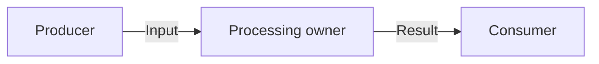

# [NN — Deliverable]

<!-- Copy beside the series README as NN-deliverable.md. Replace placeholders and remove instructions. -->

- Status: draft
- Depends on: [Relative links to prerequisite plan files, or None]
- Shared context: [Overview](README.md)

## Deliverable

[Describe the observable result of this plan and its scope.]

## User stories and requirements

| Story | Requirement | Behavior delivered by this plan |
| --- | --- | --- |
| [US-01](README.md#user-stories) | [R-01](README.md#requirements) | [Concrete part of the requirement implemented here] |

<!-- Link shared definitions. Add new series requirements to the overview before using them here. -->

## Not required and explicitly avoided

[Link applicable X-IDs from the overview and state any boundaries specific to this deliverable.]
[Distinguish unnecessary capabilities from prohibited implementation approaches. Do not treat either category as future work.]

## Context and constraints

[Name the affected source paths and the current behavior.]
[Link applicable AGENTS.md rules, existing guards, and required skills.]
[Specify interfaces this plan consumes or produces.]
[Record material assumptions without requiring prior chat history.]

## Data flow

<!-- Replace this illustrative flow with the actual proposed flow. Use stable component names shared with the Swift sketch. -->



[Identify existing and proposed components, data crossing boundaries, and state ownership.]
[Include persistence, asynchronous work, failures, and cancellation where they affect the requirements.]
[State omitted details and assumptions. If no data flow changes, explain why this section does not apply.]

## Architecture sketch

<!-- Replace this illustrative Swift pseudocode with proposed types, responsibilities, and composition. It is not production code. -->

```swift
// Proposed shape only. Request and Response are domain values defined by the plan.
protocol ProposedService {
    func process(_ request: Request) throws -> Response
}

struct ProposedFeature {
    let service: any ProposedService // Injected by the composition root.
}
```

[Show who creates and owns each component and which interfaces connect them.]
[Distinguish existing APIs from proposed APIs. State relevant isolation, lifetime, and error contracts.]
[Keep the sketch high-level. Mark omitted details and link source for existing types.]
[For work without Swift architecture, explain why this section does not apply.]

## Steps

1. [Concrete change with affected files, requirement IDs, and expected behavior.]
2. [Next change, including documentation or integration needed for this deliverable.]

## Acceptance and verification

| Requirement or exclusion | Acceptance criterion | Command or manual procedure, with working directory | Expected result |
| --- | --- | --- | --- |
| R-01 | [Observable behavior] | [Exact command or procedure] | [Evidence of success] |
| X-02 | [Excluded approach remains absent] | [Focused source review or relevant check] | [Evidence the boundary holds] |

## Recovery

[Describe how to detect partial completion and safely continue or recover. Write Not applicable for steps without partial-state risk.]

## Decisions and revisions

| Date | Decision or revision and reason | Source |
| --- | --- | --- |
| [YYYY-MM-DD] | [Initial decision or later revision] | [Request or GitHub comment URL] |

## Progress

- [ ] [Meaningful implementation step]
- [ ] Verify acceptance criteria.
- [ ] Review and publish the completed work.

## Execution record

[Not started. Append concise dated results, commands, revisions, deviations, and remaining validation limits.]
[If a revision invalidates evidence, label it stale and state which verification must repeat.]

## Resume point

[Next action, partial work, and any blocker. At completion, record Complete and the implementation PR or requested local-only handoff.]

## Outcome

[Not started. At completion, describe the result and link any deferred backlog items.]
