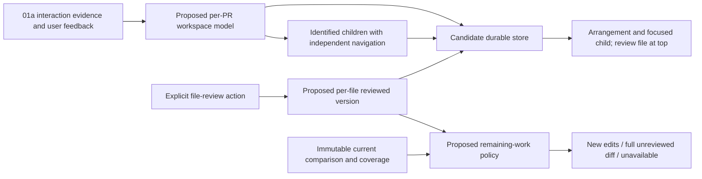

# 01 — Review-state foundation

- Status: outline
- Depends on: [01a — Workspace prototype](01a-workspace-prototype.md).
- Shared context: [Overview](README.md).

## Intended outcome

A `MobiusCore` library preserves independent logical PR workspaces, their child-view identities/navigation, per-file reviewed versions, and drafts across relaunch. Returning restores a workspace's arrangement and last-focused child. Resuming a review child starts at the top of its selected file. Remaining-work policy follows Q-15: new edits since each reviewed file's last-reviewed version, and the full PR diff for an unreviewed file, with full PR diffs available for either.

This is production groundwork after prototype learning. It does not itself deliver a native app, live GitHub integration, or iCloud sync. The earlier ready assessment and detailed implementation sequence are superseded by Q-13–Q-18; the prototype now comes first.

## User stories and requirements

| Story | Requirement | Intended contribution |
| --- | --- | --- |
| US-01, US-02 | R-02, R-03 | One workspace per PR; identified child views with independent navigation; workspace review progress/drafts and local arrangement/focus restoration. |
| US-03 | R-04 | Immutable per-file review evidence and pure remaining-work evaluation. |
| US-06 | R-07 | Stable identities and versioned data that later sync can address. |
| US-07 | R-08, R-09 | Honest failures, isolation by account/repository/PR, and preservation of accepted data. |
| Supporting | R-11 | Module documentation, manifests, tests, and dependency guards. |

[Requirements and exclusions](README.md#requirements) remain authoritative. Precise in-file restoration, reviewed-range tracking, and a manually captured PR-wide checkpoint are not required by the selected workflow. Remote sync, renderer behavior, and publication remain later work.

## Known boundaries and candidate design

Read the root and Plans contracts and the running-tests skill during refinement. Proposed paths remain `Mobius/MobiusCore/{Sources,Tests,README.md,AGENTS.md}`, plus the product-group docs. Core initially uses Foundation and must not import UIKit, SwiftUI, Where modules, or a UI facade. Register its library in `Package.swift`, its hosted tests through `Project.swift`, and relevant Bumper boundaries and mutation tests when implemented.

Each workspace belongs to one typed account/repository/PR target, independent of its outer tab/window presentation. It owns identified child views for review, reference files, and research. View kind or document route is not a unique child identity: two children can inspect the same file with independent navigation. Their review receipts belong to the PR workspace. Two PRs with the same file path still have independent progress. A stack connection does not combine their stores, baselines, drafts, or feedback actions.

A review child's resume value identifies its selected file; it does not persist a reviewed line range or require exact scroll restoration. Workspace restoration retains child arrangement and last-focused identity, so returning need not focus a review. Keep device presentation separate from semantic workspace contents; refine persistence and sync boundaries before fixing the schema. Per-file review evidence records the immutable comparison/version accepted by the explicit file-review action. A new push may make that file need review again, but must retain the earlier evidence needed to calculate its new edits. Unreviewed files have no reviewed baseline and show the full PR diff.

The previous candidate was a serial store actor with version-checked mutations and atomic metadata replacement, separate from evictable source blobs/indexes. Retain it as an option to evaluate after the prototype; do not implement its schema just because it was previously specified. Production identity, errors, migrations, concurrency, and recovery need executable refinement.



```swift
// Proposed concepts only. Final fields and APIs follow prototype evaluation.
struct ReviewTarget: Hashable, Codable, Sendable {
    let accountID: Account.ID
    let repositoryID: Repository.ID
    let pullRequestNumber: PullRequest.Number
}

struct ReviewResumeFile: Codable, Sendable {
    let file: ReviewFile.ID
}

struct FileReviewReceipt: Codable, Sendable {
    let target: ReviewTarget
    let file: ReviewFile.ID
    let reviewedComparison: FileComparisonIdentity
    let reviewedRevision: ReviewRevision
}
// Workspace owns one ReviewTarget, identified children, drafts, and receipts.
// Each review child retains its own ReviewResumeFile.
// Presentation references workspace/child IDs; native scene IDs are separate.
// File identity across renames and comparison context requires refinement.
```

All named domain types are proposed. Receipt/content identity must distinguish both sides, paths, modes, and comparison kind where they affect what was reviewed. A new head alone cannot prove content changed or that it remains reviewed. The progress policy must preserve unavailable evidence as unavailable. Technical handling of rebases, changed bases, renames, missing history, and files leaving the PR diff belongs in the joint refinement of 01 and 03.

## Questions and learning needed

- [01a](01a-workspace-prototype.md) must supply observed workspace/child navigation, restoration, and remaining-work behavior plus the user's feedback before the production model is fixed. Its first artifact exposed a flattened workspace model; Q-19–Q-21 require another iteration. Integrate further feedback before fixing identities or schema.
- Choose the persistence representation, mutation/version contract, migration behavior, and failure recovery from the evaluated model. The earlier atomic-file proposal remains an option.
- [Q-09](README.md#q-09) owns distributed merge/account policy. Preserve stable identities and revision evidence; local mutation versions must not be presented as distributed causal clocks.
- Keep original errors and accepted user work on failure. Missing storage may initialize an empty store; corrupt or unsupported storage must not be silently replaced with one.

## Refinement trigger and intended verification

- Trigger: 01a's artifact and evaluation are complete, and resulting product decisions are integrated.
- Evidence needed: Accepted workflow, concrete workspace/child/route/receipt identities, local arrangement/focus restoration, per-child review-file resumption, and required state transitions demonstrated by the mockup.
- Next action: Expand this file into an executable plan with owned interfaces, implementation steps, schema/recovery details, and a test matrix. Recheck the target graph and relevant repository contracts before readiness.

The eventual checks must demonstrate two independent PR workspaces reopening with their children, references, drafts, arrangements, and last-focused child; independent navigation in multiple children of the same kind; file-top review resumption; per-file new-edit/full-diff selection shared within the PR; preserved prior review evidence after a push; no cross-PR progress leakage; explicit baseline advancement; honest incomplete history; and failed/stale saves preserving accepted state. Changing outer presentation must preserve logical identities. Include real persistence round trips and controlled competing mutations. Use the matching Core tests, architecture checks, and formatting after targets exist; a zero-test pass is not acceptance.

## Decisions and revisions

| Date | Decision | Source |
| --- | --- | --- |
| 2026-11-14 | Initially proposed foundation-first delivery with atomic metadata persistence and PR-wide explicit checkpoints. | Initial plan at `d1ee30cc82d110dfac94fecb58fce9762020cb58`; no implementation ran. |
| 2026-11-14 | Replace the checkpoint model with per-file reviewed versions; resume from the file top; keep one workspace per PR. | Q-13–Q-15. |
| 2026-11-14 | Return this deliverable to outline and refine it after a lightweight, three-layout prototype. | Q-16–Q-18. |
| 2026-11-14 | Distinguish workspace, child-view, route, and presentation identities; restore arrangement and last focus, with a selected file per review child. | First-artifact feedback and [Q-19–Q-21](README.md#q-19). |

## Execution record

Not started. No module, schema, Xcode project generation, or implementation test was produced by planning.

## Resume point

Await 01a evidence, integrate it, then refine this outline and repeat review before execution.

## Outcome

Pending prototype learning and executable refinement. Completion will establish durable local review state, not the first release.
