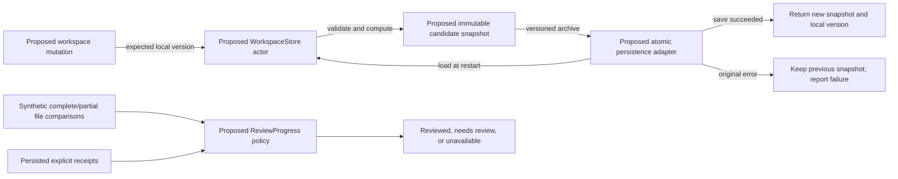

# 01 — Review-state foundation

- Status: ready
- Depends on: None.
- Shared context: [Overview](README.md).

## Deliverable

A `MobiusCore` library that can preserve and reopen several review workspaces without a UI or live provider. Explicit file-review receipts are valid only for the exact comparison they describe. Reading positions and drafts survive a new store instance. This is groundwork; it does not provide the first-release GitHub or iCloud experience.

## User stories and requirements

| Story | Requirement | Behavior delivered here |
| --- | --- | --- |
| US-01, US-02 | R-02, R-03 | Typed workspace documents, independent reading locations, explicit receipts, drafts, and local restoration. |
| US-03 | R-04 | Pure progress evaluation against immutable file-comparison identities and an explicit checkpoint. |
| US-06 | R-07 | Stable entity/account identities and versioned records that future sync can address; no sync yet. |
| US-07 | R-08, R-09 | Honest save/load errors, stale-mutation rejection, account partitioning, and separate evictable content references. |
| Supporting | R-11 | Module documentation, package/test registration, and dependency guards. |

Definitions live in [Requirements](README.md#requirements). X-01 applies to this planning turn; implementation below is only for a subsequent execution request. X-03, X-05, and X-07 constrain that implementation. Network access, token storage, UI rendering, and CloudKit transport are not delivered here.

## Context and constraints

Read the [root contract](../../AGENTS.md), [Plans contract](../AGENTS.md), and [running-tests skill](../../.agents/skills/running-tests/SKILL.md) before execution. `Package.swift`, `Project.swift`, `BumperBowling.swift`, and `.bumper/RULES.md` are the integration owners. Existing `WhereArchitectureTests` exercise dependency diagnostics; they do not yet cover Mobius.

Create `Mobius/README.md` and `Mobius/AGENTS.md` for the product group, plus `Mobius/MobiusCore/{Sources,Tests,README.md,AGENTS.md}`. Core initially uses Foundation only. It must not import SwiftUI, UIKit, Where modules, or a UI facade. Do not create empty later modules or provider abstractions with no current consumer.

Rules and guards to add together:

| Invariant | Owner | Proposed guard |
| --- | --- | --- |
| Provider identity is distinct from names/URLs; generated IDs exist only for newly created local entities. | `ReviewIdentity.swift` and module contract. | `ReviewIdentityTests`; persisted identity round trips and no fallback generation. |
| Review receipts bind both file sides, paths, modes, and comparison kind; visiting is not reviewing. | `FileReviewReceipt.swift`, `ReviewProgress.swift`. | Matching tests with changed base/head, rename, deletion, and incomplete inputs. |
| Acknowledged mutations are persisted before they become the store's published snapshot. | `WorkspaceStore.swift`, `AtomicWorkspacePersistence.swift`. | Failure injection and reopen tests using the real persistence implementation. |
| Window edits cannot overwrite a newer state silently. | Store version check. | Competing mutations from the same expected version; one must receive a stale-version error. |
| Core has no app/UI dependency. | New module AGENTS and Bumper configuration. | Mutation test rejecting UIKit and WhereCore, plus an allowed Foundation neighbor. |

[Q-09](README.md#q-09) will determine remote merges. This step implements local serialization and revision preservation, not distributed conflict resolution. Its record schema remains provisional until sync refinement.

## Data flow



All named domain components are proposed. The filesystem and Foundation serialization are existing platform facilities. No remote mutation or live code download occurs. Cache contents are outside the authoritative metadata archive.

## Architecture sketch

```swift
// Proposed pseudocode. Concrete Codable DTO fields and error cases are defined
// during step 2 and documented as a versioned wire contract.
struct ReviewTarget: Hashable, Codable, Sendable {
    let accountID: Account.ID
    let repositoryID: Repository.ID
    let pullRequestNumber: PullRequest.Number
}

enum WorkspaceDocument: Codable, Sendable {
    case review(ReviewDocument)
    case source(SourceDocument)
    case search(SearchDocument)
}

struct FileComparisonIdentity: Hashable, Codable, Sendable {
    let kind: ComparisonKind
    let before: FileRevision // Includes absent/blob/submodule, path, mode, object ID.
    let after: FileRevision
}

struct FileReviewReceipt: Codable, Sendable {
    let target: ReviewTarget
    let comparison: FileComparisonIdentity
    let reviewedAtRevision: ReviewRevision
}

protocol WorkspacePersisting: Sendable {
    func load() throws -> WorkspaceArchive?
    func save(_ archive: WorkspaceArchive) throws
}

actor WorkspaceStore {
    private let persistence: any WorkspacePersisting
    private var snapshot: WorkspaceSnapshot

    func apply(_ mutation: WorkspaceMutation,
               expectedVersion: WorkspaceVersion) throws -> WorkspaceSnapshot {
        // Reject a stale version; construct a candidate without mutating snapshot.
        // Synchronously persist the candidate on this actor, with no await gap.
        // Only then replace snapshot and return the accepted version.
    }
}
```

Every `ID`, Git object identity, path, PR number, and version is a dedicated domain type. Account identity includes the provider host and provider user identity; display login is not the key. Local workspace/document/draft IDs are created once. An absent persisted identity is an error, not a new UUID.

Keep `ReadingLocation`, `ReviewCheckpoint`, `FileReviewReceipt`, and `ReviewDraft` as separate concepts. A location holds a document/content identity and a code anchor; its validity is checked on reopen. A receipt is only issued for complete supported comparison data. Absence of a blob for an addition/deletion is a typed file state, not a failed fetch. Unknown or missing objects remain unavailable.

A changed PR head with identical before/after file content, paths, modes, and comparison kind may retain that file's receipt. A changed base side, rename, or mode change requires another review under the initial conservative policy. Do not infer cross-file or cross-path equivalence from a matching blob alone. A checkpoint also retains the PR base/head and comparison context so later code can detect unavailable or rewritten history.

Receipt lookup must also match the account/repository/PR target. A since-checkpoint receipt does not automatically become a current-PR receipt. A UI action may explicitly mark the named current file comparison after the user inspects its delta; the action must identify that exact target instead of inferring intent from the visible tab.

`WorkspacePersisting.load()` returns nil only for a genuinely absent archive. Decoding, permission, unsupported-version, and I/O failures throw the original error or an error that retains it. Domain values cross actor boundaries as immutable Sendable snapshots. UI observation is a later adapter.

## Steps

1. **Register Core and its guards.** Add the package library and a `MobiusCoreTests` hosted bundle through the existing `unitTests` helper, with the first identity value and its matching test so both targets are nonempty. Include the bundle in `Stuff-iOS-Tests`; use `StuffTestHost`. Extend Bumper's component catalog/included paths with MobiusCore's foundation boundary and tests rejecting UI/Where imports. Update the catalog, root architecture description, module docs, and run `./sync-agents`.
2. **Define and test the durable model.** Add focused files for identity, workspace documents, reading locations, checkpoints, receipts, progress, drafts, and the archive DTO. Keep 1:1 test filenames and shared builders in `MobiusCoreTestSupport.swift`. Document stable serialized keys/cases and an explicit schema version. Drafts retain user text and original revision anchors; no publication state machine is implemented yet. A local mutation version must not be presented as a cross-device causal clock.
3. **Implement local persistence and serialization.** Add `AtomicWorkspacePersistence.swift` and the serial `WorkspaceStore.swift`. Write an archive atomically before publishing the new snapshot. Scope file locations by account identity; keep source blobs/indexes outside the metadata archive. Missing files initialize an empty store; corrupt or unknown-version files remain intact and surface an error. Inject the persistence protocol into the store; fakes conform to that protocol.
4. **Prove transitions.** Implement the scenario matrix below. Include independent workspaces, stale callers, failed saves, reopening, and explicit progress changes. Opening/selecting a document does not create a receipt. Marking a file unreviewed changes only that review's local state. Preserve the original checkpoint when a newer PR snapshot is supplied.
5. **Review and publish groundwork.** Run the listed checks, inspect the complete diff through code-review, and use github-workflow for commit/push/PR. Record actual counts and revisions here. Reconcile an implementation issue created from STU-329 before beginning execution; do not close the planning issue as evidence of a shipped app. Update the horizon using the actual model before refining 02/03.

Each meaningful implementation step is a coherent commit after its applicable checks. Do not commit a failing intermediate target graph.

## Acceptance and verification

Commands run from the repository root after the new targets exist. Test names below are proposed coverage, not claims of existing tests.

| Requirement | Acceptance criterion | Procedure | Expected result |
| --- | --- | --- | --- |
| R-02/R-03 | Two PR documents plus a source and search document retain independent identity, ordering, location, and draft text after reopening. | `./test MobiusCoreTests`; `WorkspaceTests`, `WorkspaceStoreTests`. | Same persisted values from a new store; no generated replacement IDs. |
| R-03/X-03 | Opening, scrolling, and refreshing do not mark a file reviewed or submit feedback. | `ReviewProgressTests` with the same document under each operation. | Receipt set changes only for the explicit review intent. |
| R-04/R-09 | Within the same account/repository/PR, identical compared file content retains progress; changed sides, path, mode, or comparison kind requires review. Identical content in another PR/account cannot reuse a receipt. | Parameterized `FileReviewReceiptTests` / `ReviewProgressTests`. | No timestamp/head-only shortcut or cross-target progress leak. |
| R-04/R-08 | Partial manifests, missing baselines, unsupported file kinds, and unavailable content cannot report complete review. | Synthetic fixtures with explicit coverage states. | Typed unavailable/needs-review result; existing checkpoint preserved. |
| R-08 | A failed replacement keeps the prior accepted state; a stale window mutation is rejected. | Store tests with protocol-conforming failure injection and concurrent calls. | Original error retained, no partial in-memory commit or lost newer state. |
| R-03/R-09 | Real archive save/reopen works; corrupt/unknown-version input is preserved; account A cannot load account B's file. | `AtomicWorkspacePersistenceTests` in temporary directories. | Exact round trip, visible failures, isolated stores. |
| R-11 | New bundle is selected, Core dependencies are enforced, and formatting passes. | `./ide --no-open`, `./test MobiusCoreTests`, `./swiftformat --lint`. | Nonempty suite; default architecture checks and mutations pass. |

Inspect all source/test selection and the generated target graph. A zero-test pass is not acceptance. These checks establish local behavior only; no image, GitHub, Catalyst, or CloudKit result is claimed by this deliverable.

## Recovery

A mutation that fails before replacement leaves the prior archive authoritative and the candidate unpublished. Retry only after reporting the failure and reconciling the caller's expected version. On startup, preserve a corrupt or unsupported archive and report it; never replace it with an empty workspace. A temporary incomplete write is not an accepted archive. Implement cleanup only for temporary files owned by this store.

If the process ends after replacement but before the caller receives acknowledgment, reopen the durable version before retrying. Do not replay the old mutation against a guessed version. Include a restart test seeded with that committed-but-unacknowledged snapshot.

If manifest generation or tests stop partway, inspect the existing edits and rerun `./ide --no-open` after completing the graph. Do not delete caches, simulators, or unrelated work to recover. No live account data is involved in the synthetic tests.

## Decisions and revisions

| Date | Decision | Source |
| --- | --- | --- |
| 2026-11-14 | Make durable review identity/progress the first deliverable; use a small atomic metadata store with a replaceable persistence interface. | [Shared decisions](README.md#shared-decisions). |
| 2026-11-14 | Keep network, remote conflict policy, and scene layout outside this executable horizon. | Q-08–Q-11 do not affect local fixture acceptance. |

## Progress

- [ ] Register module, tests, docs, and boundary guards.
- [ ] Implement typed values and explicit progress semantics.
- [ ] Implement accepted-state persistence and recovery.
- [ ] Verify the scenario matrix and applicable checks.
- [ ] Review, commit, push, and publish the implementation.

## Execution record

Not started. Plan creation did not generate an Xcode project, implement the module, or run its future tests.

## Resume point

After an execution request, verify the plan review and source baseline, create/link the implementation issue, then begin step 1. No product decision blocks this synthetic foundation. If later sync design changes its wire contract, revise the affected plans before proceeding.

## Outcome

Not implemented. Acceptance here will establish local review-state groundwork, not completion of the first release.
