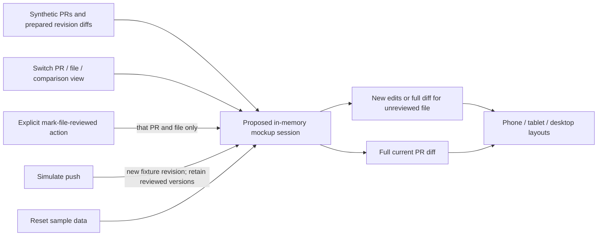

# 01a — Workspace and remaining-work prototype

- Status: ready
- Depends on: None.
- Ordering: Inserted before [01](01-review-state-foundation.md); the [overview](README.md#execution-order) owns execution order.
- Shared context: [Overview](README.md).

## Deliverable and investigation

A lightweight interactive mockup for evaluating independent PR workspaces, file-top resumption, and remaining work across phone, tablet, and desktop layouts. The user selected a prototype before durable state work (Q-16), all three layouts together (Q-17), and a lightweight mockup for quick iteration (Q-18).

Investigate whether the navigation and comparison labels make it clear which PR, file, version, and unfinished work the reviewer is seeing. The agreed behavior comes from Q-13–Q-15; layout and navigation details are hypotheses to evaluate, not final native UI decisions.

Bound the first pass to one self-contained browser artifact, two synthetic PR workspaces, two fixture revisions, three viewport layouts, and one feedback round. Record further iterations explicitly rather than expanding the prototype into a production implementation.

## User stories and requirements

| Story | Requirement | Evidence from this prototype |
| --- | --- | --- |
| US-01, US-04 | R-02, R-05 | Separate PR contexts; reference files and a fixture search remain with their PR. |
| US-02 | R-03 | Returning to a PR restores its last review file at the top. |
| US-03 | R-04 | Reviewed files show new edits; unreviewed files show the full PR diff; either can open its full PR diff. |
| US-06 | R-01, R-10 | The same interaction is inspectable at phone, tablet, and desktop viewport sizes. This is not native platform acceptance. |

The prototype supplies interaction evidence for these requirements; it does not complete their production acceptance. R-06/R-07 and the rest of the release requirements remain in later plans.

## Scope and artifacts

Proposed artifact: `Plans/2026-11-14-mobius/Prototype/index.html`, with embedded styles, scripts, and synthetic fixtures. Use semantic browser controls and no external dependencies or network data. Store the interaction evidence and feedback in this plan's execution record. Read the repository and Plans contracts before implementation.

Keep session state in memory so fixture behavior is reproducible through an explicit Reset action. Workspace switching within the mockup preserves each PR's documents, last file, draft fixture, and review state. Reload durability, CloudKit, authentication, native menus/windows, a real Git engine, real search indexing, and live GitHub feedback are outside this artifact. Those exclusions do not alter first-release scope.

The artifact must identify itself as a mockup using sample data. Do not copy its state schema into production automatically; 01 must derive its model from evaluated behavior and repository contracts.

## Scenario and state flow

Use synthetic PR 42 and PR 43. Each has a distinct workspace even if they share a file path. An optional stack-connection label links the PRs without combining their state.

Within PR 42, version 1 includes `Parser.swift`, `Store.swift`, and `Stable.swift`. Mark Parser and Stable reviewed; leave Store unreviewed. The simulated push to version 2 changes Parser and Store, while Stable stays unchanged.

- Remaining work shows Parser's new edits since its last reviewed version and Store's full current PR diff. Stable has no new work and remains reachable through the full PR view.
- Opening the full PR diff for Parser shows its complete current PR change. Changing views does not advance a reviewed version.
- Marking Parser reviewed at version 2 advances only Parser's baseline. Keep the visible file understandable while updating the remaining-work list; the precise transition is part of the evaluation.
- Open a fixture reference file and search in PR 42, switch to PR 43, then return. Restore PR 42's context and open its last review file at the top. A reference document is not a new review workspace.

All components are proposed mockup state. Swift pseudocode does not apply to this browser artifact; the native ownership sketch remains provisional in the overview. Predefined fixture diffs simulate comparisons and do not verify a Git diff algorithm.

## Steps

1. **Build the scenario fixture.** Define two PR identities, independent document collections and last-file selections, per-file reviewed versions, and prepared full/incremental diffs for the two versions. Keep shared-path fixtures isolated by PR. Document the fixture states alongside the artifact.
2. **Create the interactive shell.** Add workspace switching, a review-file list, remaining-work/full-PR views, a full-diff action for the selected file, fixture reference/search navigation, explicit file-review actions, Simulate push, and Reset. Prototype suitable navigation for narrow, medium, and wide viewports using the same state. Treat layout and labels as candidates for feedback.
3. **Exercise the return visit.** Run the scenario above at recorded phone, tablet, and desktop viewport sizes. Confirm a resumed review file starts at the top and that another PR's state is unaffected. Check both mouse/pointer and keyboard operation; inspect narrow-layout touch-target usability. Record what was actually exercised rather than claiming native device validation.
4. **Collect evidence and feedback.** Deliver the artifact with the scenario and representative captures of the three layouts. Ask the user to try workspace switching and the post-push remaining-work view. Record confusing transitions, requested changes, and whether the workflow should proceed, change, or receive another prototype iteration.
5. **Review and hand off.** Integrate supported feedback into the overview and affected outlines, retaining unresolved decisions. Review the changed artifact and plan through code-review, run relevant checks, then commit/push and publish through github-workflow. Do not refine the durable model until the required prototype feedback is recorded.

For local browser inspection, a loopback-only static server can serve the artifact, for example `python3 -m http.server 8765 --bind 127.0.0.1 --directory Plans/2026-11-14-mobius/Prototype`. Use an available port and stop the owned server after inspection. If browser automation is unavailable, record the missing runtime evidence; source inspection alone does not establish interactive acceptance.

## Acceptance and verification

| Criterion | Check | Expected evidence |
| --- | --- | --- |
| Workspaces stay independent. | Switch PR 42 → PR 43 → PR 42 after opening context and changing review state. | Each retains its own documents, last file, and reviewed versions; a stack link has no shared-state effect. |
| Resume starts at the file top. | Scroll within a review file, leave the PR, and return. | The same review file opens from the top. No reviewed-range state is inferred. |
| Remaining work follows the chosen model. | Mark Parser/Stable reviewed at version 1, leave Store unreviewed, then simulate version 2. | Parser shows new edits; Store shows its full PR diff; Stable has no remaining changes. |
| Full context is accessible. | Open the full PR diff for both Parser and Store; switch views and PR workspaces. | Complete current PR diffs remain available and baselines change only through the explicit file-review action. |
| All three layouts can be evaluated. | Execute the scenario at recorded narrow, medium, and wide browser sizes. | Captures plus interaction notes identify each viewport and any usability failures. |
| The experiment produces a decision. | Review the artifact with the user. | Recorded feedback supports proceeding, revising, or another bounded iteration. A supported negative result is valid; pending feedback leaves the experiment incomplete. |

Inspect the browser console for runtime errors and verify all artifact resources load locally. Use `git diff --check` and review local plan links after updates. No app test suite or snapshot baseline is implied by this browser mockup; use proportionate browser interaction checks. Do not claim iPhone/iPad/Catalyst runtime, VoiceOver, persistence, provider, or sync validation from viewport captures.

## Recovery and retention

Reset restores the known fixture; reload also starts a fresh session. Keep the prototype isolated from real accounts and data. Preserve the artifact and concise evaluation record as design evidence. Remove abandoned variants before publication; retain any alternative only when its recorded feedback explains why it is useful. Native implementation must not import the prototype runtime.

## Progress and execution record

- [ ] Create fixture and interactive artifact.
- [ ] Exercise all three layouts and capture evidence.
- [ ] Collect and integrate user feedback.
- [ ] Review and publish the artifact and evaluation record.

Not started. No prototype artifact or runtime result exists yet.

## Resume point

After an execution request, read current plan feedback and the latest question resolutions, then begin the bounded artifact. Plan creation and the selection of this deliverable did not authorize its execution.

## Outcome

Pending prototype evidence and feedback. [01](01-review-state-foundation.md) remains an outline until those findings are integrated.
