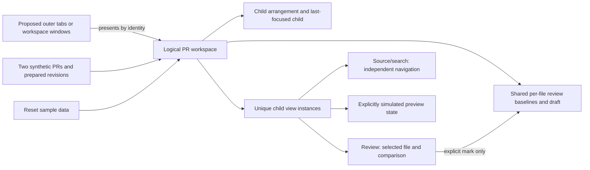

# 01a — Workspace and remaining-work prototype

- Status: executing
- Implementation issue: [STU-330](https://linear.app/kve/issue/STU-330/prototype-mobius-review-workspaces).
- Depends on: None.
- Ordering: Inserted before [01](01-review-state-foundation.md); the [overview](README.md#execution-order) owns execution order.
- Shared context: [Overview](README.md).

## Deliverable and investigation

A lightweight interactive mockup for evaluating logical PR workspaces, their independent presentation as tabs or windows, multiple child views, review resumption, and remaining work across phone, tablet, and desktop layouts. The user selected a prototype before durable state work (Q-16), all three layouts together (Q-17), and a lightweight mockup for quick iteration (Q-18).

Investigate whether the navigation and comparison labels make it clear which PR, file, version, and unfinished work the reviewer is seeing. The agreed behavior comes from Q-13–Q-15; layout and navigation details are hypotheses to evaluate, not final native UI decisions.

The first pass was bounded to one self-contained browser artifact, two synthetic PR workspaces, two fixture revisions, three viewport layouts, and one feedback round. That evaluation identified a material correction: a workspace had been flattened into a document tab group. Iteration 2 retained the same fixture and browser scope and added the ownership/presentation experiment below. Its evaluation requested substantially less stacked chrome. Iteration 3 preserves the corrected ownership model and capabilities while testing compact workspace/view controls, ending with another user evaluation. None of these passes expands into native implementation or a complete window manager.

## User stories and requirements

| Story | Requirement | Evidence from this prototype |
| --- | --- | --- |
| US-01, US-04 | R-02, R-05 | Logical PR workspaces own independently navigable child views; outer tab/window presentation does not copy or merge their contents. |
| US-02 | R-03 | Restore the workspace arrangement and last-focused child. Resuming a review child starts its own selected file at the top. |
| US-03 | R-04 | Reviewed files show new edits; unreviewed files show the full PR diff; either can open its full PR diff. |
| US-06 | R-01, R-10 | The same interaction is inspectable at phone, tablet, and desktop viewport sizes. This is not native platform acceptance. |

The prototype supplies interaction evidence for these requirements; it does not complete their production acceptance. R-06/R-07 and the rest of the release requirements remain in later plans.

## Scope and artifacts

Proposed artifact: `Plans/2026-11-14-mobius/Prototype/index.html`, with embedded styles, scripts, and synthetic fixtures. Use semantic browser controls and no external dependencies or network data. Store the interaction evidence and feedback in this plan's execution record. Read the repository and Plans contracts before implementation.

Keep session state in memory so fixture behavior is reproducible through an explicit Reset action. Workspace switching preserves each PR's child views, their independent navigation and arrangement, the last-focused child, draft fixture, and shared review progress. Reload durability, CloudKit, authentication, native menus/windows, a real Git engine, real search indexing, and live GitHub feedback are outside this artifact. Those exclusions do not alter first-release scope.

The artifact must identify itself as a mockup using sample data. Do not copy its state schema into production automatically; 01 must derive its model from evaluated behavior and repository contracts.

## Iteration 2 decisions and bounded method

User feedback and Q-19–Q-21 were supplied through the parent planning conversation on 2026-11-14:

- Q-19: “fork” was a typo for “view.” No editing, cloning, or fork capability is requested. Child views may display existing code, research, reviews, previews, and simulations.
- Q-20: “All of the above if needed” delegates bounded layout exploration. Floating, tiling, docking, and tabs may be used where useful; this is not a requirement to implement every mode on every native platform.
- Q-21: Return restores the workspace arrangement and last-focused child. A non-review child keeps focus. Resuming a review child starts that child's selected file at the top; there is no singleton workspace-wide selected review file.

Proposed prototype structure, not a production schema:

| Owner | Session-only responsibility |
| --- | --- |
| Mockup shell | Outer workspace tab/window presentation and active workspace identity. |
| Logical PR workspace | Fixture revision, per-file reviewed versions, draft, child collection, arrangement, and last-focused child. |
| Child view instance | Unique instance identity, kind, selected file/comparison or search query or simulated-preview state, and placement. Multiple children can have the same kind or file. |

Use tiled children as an exploratory wide-screen default, a bounded freeform move/resize arrangement, and a focus-one-child presentation with a child selector for compact screens. Outer workspace windows remain simulated browser shells. Treat defaults and labels as evaluation hypotheses, not native platform commitments. Showing the same workspace through a different outer presentation must not create another logical workspace or reset its children.

A New View action can create Review, Source, Search, or Preview children. Review selection and comparison mode belong to each review child; marking reviewed updates the workspace's shared PR/file baseline and all affected child displays. A preview contains explicitly simulated, interactive sample content sufficient to evaluate placement and continuity. It neither executes code nor establishes native preview/simulator feasibility. Native execution remains a later experiment.

Bound iteration 2 to those four child kinds, the existing two PRs/two revisions, useful arrangement controls, the same three viewport categories, and one further user evaluation. No editing/forking, backend, new account integration, actual OS windows, native execution, or production durability is added.

## Iteration 3 compact-chrome method

The user evaluated iteration 2 and approved the compact-chrome proposal (“SGTM”), explicitly requesting another background rebuild on 2026-11-14. This revises presentation, not the Q-19–Q-21 ownership or review rules. Retain iteration-2 artifact revision `e1c1059cf28` and its separate evidence; record new evidence under `Prototype/evidence/iteration-03/`.

The investigation is whether more of the default viewport can show the actual review, source, research, or preview while all existing capabilities stay understandable and reachable:

- Keep concise workspace identity (short name/PR number), the active child/file title, truthful current comparison, and immediate review actions visible. Combine workspace heading and tools into a compact row. On compact screens, the child selector can supply the active view title instead of repeating a title bar.
- Replace stacked comparison/file/context bands with a compact view toolbar. A full PR diff must still say **Full PR diff**, including an unreviewed file in Remaining; a reviewed file's new edits must identify its last-reviewed version. Keep file navigation and full/remaining selection reachable without advancing baselines.
- Remove permanent teaching copy and repeated kind/ordinal labels when the title and icon suffice. Preserve accessible names that distinguish same-kind child instances. Full PR metadata, progress detail, outer presentation, and arrangement choices may move into accessible details/menus with predictable focus and dismissal.
- Move Canvas, Reset, and Simulate push into a collapsible prototype-controls panel. Keep a small sample-data indicator and an honest simulated-preview indicator; no real execution is implied.
- Keep readable typography and usable pointer/touch/keyboard targets. The experiment reduces the number of bands and repeated content rather than shrinking labels and controls. Defaults remain exploratory native-layout hypotheses.

Bound the pass to the existing two PRs/two revisions/four child kinds and state model. Retain multiple views, independent navigation, shared review progress, drafts, add/close/recovery, outer tabs/windows, arrangements, search, simulated preview state, and file-top review resumption. No native, backend, persistence, account, editing/forking, or real execution work is added.

Before/after evidence uses identical viewports and fixture states, including a review at the initial full comparison and a post-push incremental comparison. Record the content viewport's top position and usable height at phone, tablet, and desktop sizes, plus representative visually inspected captures. Exercise newly disclosed controls by keyboard and pointer, Escape/focus return, and navigation from the compact selector. Repeat the complete previous regression scenario against the final source, since moving controls can affect focus and reachability despite retaining the state model.

## Scenario and state flow

Use synthetic PR 42 and PR 43. Each has a distinct workspace even if they share a file path. An optional stack-connection label links the PRs without combining their state.

Within PR 42, version 1 includes `Parser.swift`, `Store.swift`, and `Stable.swift`. Mark Parser and Stable reviewed; leave Store unreviewed. The simulated push to version 2 changes Parser and Store, while Stable stays unchanged.

- Remaining work shows Parser's new edits since its last reviewed version and Store's full current PR diff. Stable has no new work and remains reachable through the full PR view.
- Opening the full PR diff for Parser shows its complete current PR change. Changing views does not advance a reviewed version.
- Marking Parser reviewed at version 2 advances only Parser's baseline. Keep the visible file understandable while updating the remaining-work list; the precise transition is part of the evaluation.
- Open multiple child views in PR 42, including two review views with different selected files, independent search views, and a simulated preview. Changing a child selection/query does not navigate a sibling.
- Change outer workspace presentation between tabs and windows. The child identities, contents, arrangement, progress, and focus remain owned by the same workspace.
- Switch from a focused research/preview child in PR 42 to PR 43, then return. Restore PR 42's arrangement and focused child. Separately resume a review child and verify its selected file opens at the top.
- Change the bounded arrangement, focus a child, and inspect compact/wide layouts. A child view is not a new workspace. Review progress remains shared within one PR and isolated from the other PR.

All components are proposed mockup state. Swift pseudocode does not apply to this browser artifact; the native ownership sketch remains provisional in the overview. Predefined fixture diffs simulate comparisons and do not verify a Git diff algorithm.

## Steps

1. **Preserve evaluated ownership and history.** Retain the first-pass artifact/evidence at `2e3653877` and iteration-2 artifact/evidence at `e1c1059cf28`, with their evaluations. Keep PR/file review baselines workspace-owned and unique child instances independently navigable. Retain the prepared fixture revisions.
2. **Compact the presentation.** Apply the iteration-3 method above: combine workspace heading/tools, use concise child titles, compact the view toolbar, and disclose metadata/arrangement/prototype controls. Preserve all iteration-2 ownership, navigation, review, draft, preview, and arrangement capabilities. Layout details remain candidates for feedback.
3. **Exercise the return visit.** Run the scenario above at recorded phone, tablet, and desktop viewport sizes. Confirm child navigation is independent, shared review progress updates sibling review views, outer presentation preserves ownership, workspace return preserves arrangement/focus, a resumed review child starts its selected file at the top, and another PR's state is unaffected. Check both mouse/pointer and keyboard operation; inspect narrow-layout touch-target usability. Record what was actually exercised rather than claiming native device validation.
4. **Collect evidence and feedback.** Deliver the artifact with the scenario, matched content-space measurements, and representative captures of the three layouts. Ask the user to evaluate the compact chrome and control discoverability alongside multiple same-kind child views, workspace return, simulated preview, and post-push remaining work. Record confusing transitions, requested changes, and whether to proceed, change, or run another bounded iteration.
5. **Review and hand off.** Integrate supported feedback into the overview and affected outlines, retaining unresolved decisions. Review the changed artifact and plan through code-review, run relevant checks, then commit/push and publish through github-workflow. Do not refine the durable model until the required prototype feedback is recorded.

For local browser inspection, a loopback-only static server can serve the artifact, for example `python3 -m http.server 8765 --bind 127.0.0.1 --directory Plans/2026-11-14-mobius/Prototype`. Use an available port and stop the owned server after inspection. If browser automation is unavailable, record the missing runtime evidence; source inspection alone does not establish interactive acceptance.

## Acceptance and verification

| Criterion | Check | Expected evidence |
| --- | --- | --- |
| Logical ownership survives presentation. | Change outer tabs/windows with multiple children open in both PRs. | Same workspace and child identities, content, focus, arrangement, drafts, and progress. |
| Child navigation is independent. | Open two review or search children; change only one file/comparison/query. | Sibling state is unchanged. Marking reviewed is shared only among review children of that PR. |
| Workspaces stay independent. | Switch PR 42 → PR 43 → PR 42 after changing child and review state. | Each retains its children, arrangement, last focus, draft, and review baselines. |
| Return and review resumption are distinct. | Leave a focused research/preview child, return, then resume a previously scrolled review child. | Preserve non-review focus and arrangement on return; the review child opens its own selected file at the top when resumed. |
| Remaining work follows the chosen model. | Mark Parser/Stable reviewed at version 1, leave Store unreviewed, then simulate version 2. | Parser shows new edits; Store shows its full PR diff; Stable has no remaining changes. |
| Full context is accessible. | Open the full PR diff for both Parser and Store; switch views and PR workspaces. | Complete current PR diffs remain available and baselines change only through the explicit file-review action. |
| Simulated preview can be evaluated. | Change sample preview controls, switch children/PRs/presentation, and return. | State remains with its child and owner; simulated status is explicit and no code is executed. |
| All three layouts can be evaluated. | Execute the scenario at recorded narrow, medium, and wide browser sizes. | Captures plus interaction notes identify each viewport and any usability failures. |
| Compact chrome improves content space. | Compare the same fixture and viewport before/after at all three sizes. | More usable content height without smaller text/targets; workspace, child/file, actual comparison, and immediate review action stay understandable. |
| Disclosed controls stay reachable. | Use metadata/arrangement, outer presentation, prototype controls, and compact child navigation by pointer and keyboard. | Every previous capability remains reachable; Escape/dismissal restores focus and leaves state unchanged unless an explicit action changes it. |
| The experiment produces a decision. | Review the artifact with the user. | Recorded feedback supports proceeding, revising, or another bounded iteration. A supported negative result is valid; pending feedback leaves the experiment incomplete. |

Inspect the browser console for runtime errors and verify all artifact resources load locally. Use `git diff --check` and review local plan links after updates. No app test suite or snapshot baseline is implied by this browser mockup; use proportionate browser interaction checks. Do not claim iPhone/iPad/Catalyst runtime, VoiceOver, persistence, provider, or sync validation from viewport captures.

## Recovery and retention

Reset restores the known fixture; reload also starts a fresh session. Keep the prototype isolated from real accounts and data. Preserve the artifact and concise evaluation record as design evidence. Remove abandoned variants before publication; retain any alternative only when its recorded feedback explains why it is useful. Native implementation must not import the prototype runtime.

## Progress and execution record

### First pass

- [x] Create fixture and interactive artifact.
- [x] Exercise all three layouts and capture evidence.
- [x] Collect first-pass feedback; material correction requires iteration 2.
- [x] Review and publish the artifact and evaluation record.

Execution started on 2026-11-14 after the user requested the prototype in a background agent. Work is isolated in the `mobius-prototype` worktree on `codex/mobius-prototype`, initially based on `4e70677e7` and advanced to the `047706c26` planning checkpoint. PR #497 had no conversation, review, or inline comments when read at start. The implementation is tracked separately in STU-330; STU-329 remains the planning issue.

### First-pass artifact and interaction evidence

The first-pass artifact is preserved at [revision `2e3653877`](https://github.com/kyleve/Stuff/blob/2e3653877bf141964805d417eac0b94c03a24c6a/Plans/2026-11-14-mobius/Prototype/index.html), alongside the retained [first-pass verification record](Prototype/evidence/verification.json) and captures below. This describes first-pass behavior, not iteration 2 acceptance. All data is synthetic and session-only. Two PRs retain independent files, comparison modes, open source/search tabs, queries, drafts, and reviewed versions. Returning to a PR opens its last review file at the top. A marked file remains selected with a caught-up message; this transition is a hypothesis for feedback.

Browser scenarios passed at the following viewports in Chromium 156.0.8078.4 through repository-pinned Playwright 1.64.1. Captures use light appearance and 1× device scale.

| Viewport | Capture | Observed behavior |
| --- | --- | --- |
| 1440 × 1000 | [Desktop](Prototype/evidence/desktop.png) | Workspace rail, file list, retained source/search tabs, full PR context. |
| 834 × 1112 | [Tablet](Prototype/evidence/tablet.png) | Workspace picker, persistent file list, Parser's new edits since v1. |
| 390 × 844 | [Phone](Prototype/evidence/phone.png) | Workspace/file drawers, scrollable tabs, Store's full current PR diff; code scroll stays inside the document. |

At every size, the scenario marked Parser and Stable at v1, left Store unreviewed, advanced PR 42 to v2, and verified Parser's incremental comparison, Store's full comparison, Stable's absence from remaining work, and access to full context. Comparison selection and refresh preserved baselines. Marking Parser at v2 changed only its baseline. Switching PRs retained independent drafts and context; returning restored the same review file at scroll offset zero. PR 43's own reviewed-Store → push comparison was also checked. Reset restored v1 and empty progress.

Pointer interaction, phone touch taps, keyboard search, keyboard marking, and phone drawer comparison → Escape focus restoration passed. No page/console errors, failed resource loads, external requests, or document-level horizontal overflow occurred. `@axe-core/playwright` 4.14.0 WCAG 2/2.1 A/AA scans of the checked baseline, post-push, and saved-draft states reported no violations. Direct `file://` loading and marking a file also passed, so the artifact does not require a running server.

These are browser interaction and automated accessibility observations. They do not establish native device, VoiceOver, real Git diff, persistence, provider, or sync acceptance. The repository's default web lint globs do not cover this HTML artifact. Inline JavaScript syntax and `git diff --check` were checked directly; local walkthrough links resolve. `./test`, native snapshots, and SwiftFormat were not run because no native source, build input, or Swift file changed.

### Independent review

A fresh subagent reviewed the complete artifact against parent `047706c26`, then rechecked supported corrections. The fixes preserve first-row characters/indentation in prepared diffs; apply PR-specific substitutions to both full and incremental comparisons; restore focus to a surviving control or the current document after rendering and modal dismissal; improve small-text contrast; and keep accessible names consistent with visible workspace, push, and saved-draft labels. No actionable findings remained after recheck. The verification record identifies the final artifact content; retained screenshots are design evidence, not SnapshotKit references.

### Feedback and publication

The user evaluated the first pass and found it flattened a logical workspace into a document tab group. That is a material correction, not acceptance of the first-pass workspace model. Q-19–Q-21 above resolve the revised method and authorize another bounded prototype pass. The native state foundation remains an outline.

Published [PR #500](https://github.com/kyleve/Stuff/pull/500), ready for review, above planning [PR #497](https://github.com/kyleve/Stuff/pull/497) in [stack #501](https://github.com/kyleve/Stuff/stack/501). The branch merges parent `68477fe625`, which includes main `96f5bf0f1`; integration preserves the verified HTML content. The stack reports no rebase needed. STU-330 remains In Review and this experiment remains executing for user feedback. No product acceptance is claimed.

The owned loopback server is stopped after inspection; the artifact opens directly from disk. Local CUA browser use is disabled in Work settings, so the published PR could not be visually inspected through that UI. Published description/image-link checks use GitHub API and direct image responses; the local captures themselves were visually inspected.

## Iteration 2 readiness and execution

- Status transition: `executing` → `draft` on 2026-11-14 after the material first-pass correction; the previous readiness review does not establish readiness for the revised UI.
- Source inspected: `2e3653877`; working tree was clean. Current PR #500 feedback contains only the previously posted screen-evidence comment; the new product feedback comes from the user conversation.
- Q-19–Q-21 are resolved above. Parent owns integration into shared requirements/overview and production outlines; this file owns the browser method and evidence.
- Readiness review, 2026-11-14: inspected the complete revised method against source `2e3653877`, Q-13–Q-21, the root/Plans contracts, and current PR feedback. The existing singleton `lastFile`, `query`, and kind-deduplicated tabs cannot represent the requested child instances. The revised owner table, state flow, steps, and acceptance checks consistently put selection/query/preview state on child instances and review progress on the PR workspace. Q-19 excludes editing/forking; Q-20 delegates bounded layout exploration; Q-21 separates workspace focus restoration from per-review-child file-top resumption. All material choices needed for this browser pass have answers or explicit delegation. Defaults remain exploratory; native/platform/execution exclusions are preserved. No readiness findings remain. Mermaid was source-reviewed, not renderer-validated.
- Readiness disposition: `draft` → `ready` after that review, then `ready` → `executing` under the user's explicit instruction to proceed with iteration 2. Implementation and second-round acceptance evidence were pending at that readiness checkpoint.

- [x] Review the revised bounded method and record readiness.
- [x] Build independent workspace presentation and multiple child views.
- [x] Exercise both ownership layers and original review behavior across three sizes.
- [x] Record fresh independent review and second-iteration captures.
- [x] Publish the coordinated stack update.
- [x] Collect and integrate second-round user feedback: excessive stacked chrome prompted the approved iteration-3 method above.

### Iteration 2 implementation and evidence

The [revised artifact](Prototype/index.html) separates outer workspace presentation from owned child views. Review, Source, Research, and explicitly simulated Preview instances have unique IDs and independent navigation. Review baselines and the draft remain shared within one PR. Workspace return restores arrangement and last-focused identity; each resumed review starts its own selected file at the top. Tiled, bounded floating, and focused arrangements are exploratory defaults, with compact view selection retaining the wider arrangement.

The first-pass [runnable archive](Prototype/iteration-01.html) exactly matches `2e3653877` and its existing evidence remains intact. New captures and [exact-source verification](Prototype/evidence/iteration-02/verification.json) are separate:

| Viewport | Evidence |
| --- | --- |
| 1440 × 1000 | [Tiled child views](Prototype/evidence/iteration-02/desktop-tiles.png), [outer workspace windows](Prototype/evidence/iteration-02/desktop-windows.png). |
| 834 × 1112 | [Floating child views](Prototype/evidence/iteration-02/tablet-float.png). |
| 390 × 844 | [Restored preview focus](Prototype/evidence/iteration-02/phone-preview.png). |

Complete three-size scenarios passed through Playwright 1.64.1 / Chromium 156.0.8078.4. They created multiple Review, Source, Research, and Preview instances; verified independent files/queries/sample states and shared PR progress; changed outer presentation without replacing identities; restored arrangement and non-review focus; resumed each review file at its top; and repeated the original per-file remaining/full-diff scenario. Closure checks preserve focus when a background child or an inactive workspace's child closes; closing the last child provides keyboard recovery through New view. Reset restores the initial fixture.

Pointer and phone touch taps, keyboard search, and wide-layout pointer/keyboard movement and resizing passed. Checked initial, post-push/saved-draft, and reopened-empty-workspace states had zero axe WCAG 2/2.1 A/AA violations. No page/console errors, failed loads, external requests, or document-level horizontal overflow were observed. Direct file loading and mark-reviewed behavior passed. Final inline JavaScript syntax, local links, and diff whitespace were checked. Native tests and SwiftFormat remain outside this browser-only change; default repository web lint globs do not cover the HTML.

Fresh independent review found and rechecked floating z-order, background/inactive-workspace closure, empty-workspace focus recovery, keyboard scrolling in the preview, and Enter submission. The search change handler was rerendering a text input's form before implicit submission; restricting it to its owned select controls fixes that trigger. Modal dismissal now completes synchronously, preventing queued close callbacks from rerendering or stealing focus after another interaction begins. A final compact-selector correction keeps the focused child visible, including after PR/presentation changes. No actionable review findings remain. These checks do not establish native, VoiceOver, actual execution, persistence, provider, or sync behavior.

Parent coordination rebased the unchanged first-pass artifact/readiness record onto parent `fcee86b3b0` at child `46d284bbafa` before implementation. The revised artifact and evidence were committed at [`e1c1059cf28`](https://github.com/kyleve/Stuff/commit/e1c1059cf28a2954a0513d2514e7d0b7be9c34dd) and published through `gh stack push` to existing [PR #500](https://github.com/kyleve/Stuff/pull/500). Its description and [existing screen-evidence comment](https://github.com/kyleve/Stuff/pull/500#discussion_r4576427594) now describe iteration 2. GitHub-rendered HTML contains the expected images and captions; all four commit-pinned image responses match the local PNG bytes. Published-PR visual inspection remains unavailable because local CUA browser use is disabled. The owned loopback server is stopped; direct file loading remains usable. STU-330 stays In Review with current evidence. The next decision is the user's evaluation of this corrected workspace model, not readiness to implement native code.

## Iteration 3 readiness and execution

- Status transition: `executing` → `draft` for the material presentation revision.
- Source and feedback inspected: clean child `66c7da62331873548f0231c9da666a555bf306fb`, artifact `e1c1059cf28`; current PR #500 feedback contains the existing screen-evidence comment. The new direction is the user's explicit approval and rebuild request in the parent conversation.
- Accepted decisions are recorded in the compact-chrome method above. Parent owns the overview and production-plan implications. No unanswered product question blocks this bounded presentation pass.
- Readiness review, 2026-11-14: inspected the revised method against `66c7da623`, the original remaining-work scenario, Q-19–Q-21, the current overview/production-outline boundaries, root/Plans instructions, and current PR feedback. The change is presentation-only: the existing workspace/child identity and explicit baseline owners remain valid. The method keeps truthful comparison labels, preserves every existing capability through named reachable controls, requires keyboard/dismissal regression checks, and measures content-space improvement at matched fixture states. Earlier evidence is retained as historical, with runtime/visual verification repeated for the changed source. The user explicitly approved compact chrome and background implementation; no missing product decision blocks this bounded pass. No readiness findings remain. The unchanged ownership diagram is source-reviewed, not renderer-validated.
- Readiness disposition: `draft` → `ready` after review, then `ready` → `executing` under the user's explicit rebuild request. Implementation evidence and third-round feedback remain pending.

- [x] Review the compact-chrome method and record readiness.
- [x] Rebuild compact controls while retaining all existing capabilities.
- [x] Repeat the three-size regression scenario and exercise disclosed controls.
- [x] Record fresh independent review, content-space comparison, and iteration-3 captures.
- [ ] Publish the coordinated stack update and current issue evidence.
- [ ] Collect and integrate third-round user feedback.

### Iteration 3 implementation and evidence

The revised [artifact](Prototype/index.html) consolidates workspace identity/actions, removes repeated teaching/status bands, and uses concise child/file titles. Workspace options disclose full metadata, review progress, child navigation, arrangement, and outer presentation. On compact screens the active child selector supplies the title; review controls retain the actual comparison and explicit mark action. File navigation is disclosed. Canvas, Reset, and both simulated pushes live in a collapsible sample-controls panel. The independent workspace/child model, PR baselines, drafts, and all previous capabilities remain intact.

[Iteration 2's runnable archive](Prototype/iteration-02.html) exactly matches `e1c1059cf28`; both earlier evidence sets remain unchanged. [Iteration-3 verification](Prototype/evidence/iteration-03/verification.json) identifies final HTML SHA256 `f2adc670df7668d0c99d79f3ac0d9abeea3df701f56a53e1373de331c2eb274f`, exact measurements, captures, and observed checks.

| Viewport | Review pane height, before → after | First code-row top, before → after | Matched evidence |
| --- | --- | --- | --- |
| 1440 × 1000 | 413 → 765 | 525 → 203 | [Before](Prototype/evidence/iteration-03/desktop-before.png), [after](Prototype/evidence/iteration-03/desktop-after.png). |
| 834 × 1112 | 535 → 877 | 515 → 203 | [Before](Prototype/evidence/iteration-03/tablet-before.png), [after](Prototype/evidence/iteration-03/tablet-after.png). |
| 390 × 844 | 216 → 648 | 568 → 195 | [Before](Prototype/evidence/iteration-03/phone-before.png), [after](Prototype/evidence/iteration-03/phone-after.png). |

Values are CSS pixels rounded to the nearest pixel. Initial Parser full comparisons use identical viewport/fixture/appearance; post-push incremental comparisons were separately measured with the same pane geometry. Scroll-pane top and first-code-row top are distinct measurements in the verification JSON. Code text increases from 10px to 12px, and initial phone buttons measure at least 44 × 44px. Additional captures show [new edits on phone](Prototype/evidence/iteration-03/phone-incremental.png), [outer windows](Prototype/evidence/iteration-03/desktop-windows.png), [tablet float](Prototype/evidence/iteration-03/tablet-float.png), [phone preview](Prototype/evidence/iteration-03/phone-preview.png), and [workspace options](Prototype/evidence/iteration-03/phone-options.png).

The complete final-source scenario passed at all three sizes through Playwright 1.64.1 / Chromium 156.0.8078.4. It covers same-kind child identity/navigation, PR isolation/shared baselines, drafts, source-to-review, preview state, outer presentation, arrangement/focus return, review file-top resumption, original remaining/full comparisons, background/inactive-workspace closure, empty-workspace recovery, and Reset. Relocated menus and sample controls were exercised by pointer/touch and keyboard, with Escape/focus return and Canvas changes. Five axe WCAG 2/2.1 A/AA scans per size reported zero violations. No page/console/load errors, external requests, or document overflow occurred. Standalone file loading/marking, inline JavaScript syntax, archive identity, local links, and whitespace checks pass. Checks use ad hoc scripts, not retained CI guards; native suites and default HTML-excluding lint do not establish coverage here.

Fresh independent review confirmed three fixes: final-view dialog dismissal restores visible New view focus; title accessible names retain visible filenames/titles; and queued native close events are ignored while a newly reopened dialog is open. The last failure reproduced when Escape after removing all children was immediately followed by Enter to reopen. Five immediate close → reopen → Research → Enter trials pass after correction. The long tablet scenario also found floating children could cover prototype controls after repeated focus; explicit stacking contexts contain them. The reviewer independently verified controls after 40 view raises, all three sizes and disclosed states, comparison labels, inactive-PR closure, archive identity, and rendered output. No actionable findings remain on the recorded source hash.

The parent readiness update was coordinated onto parent `4b5873d95` at child `3327973404` before UI edits. Commit the verified artifact/evidence at a clean point, let the coordinator record the delivery checkpoint and cascade the stack, then publish current PR/issue/screenshot evidence. Native behavior, VoiceOver, actual execution, provider/durability/sync, and third-round product acceptance remain unverified.

## Resume point

Coordinate the final clean artifact/evidence commit with the parent, then publish PR #500, its existing screenshot comment, and STU-330 evidence. Return the demo/checks/revision to the coordinator for the requested user notification. Preserve earlier evidence and collect third-round feedback before refining or implementing the native foundation. Coordinate all parent/child history mutations.

## Outcome

First-pass evidence is retained; its evaluation prompted the workspace-model correction. Iteration 2 is built, verified, and published; its evaluation now prompts compact chrome. Iteration 3 is built and browser-verified; publication and third-round user evaluation remain pending, so the plan stays `executing`. The experiment remains incomplete until its required feedback is recorded. No native or product acceptance is claimed. [01](01-review-state-foundation.md) remains an outline until the required evidence and user decision are integrated.
