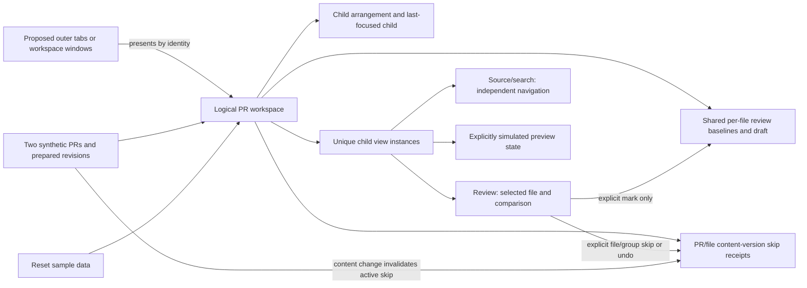

# 01a — Workspace and remaining-work prototype

- Status: executing
- Implementation issue: [STU-330](https://linear.app/kve/issue/STU-330/prototype-mobius-review-workspaces).
- Depends on: None.
- Ordering: Inserted before [01](01-review-state-foundation.md); the [overview](README.md#execution-order) owns execution order.
- Shared context: [Overview](README.md).

## Deliverable and investigation

A lightweight interactive mockup for evaluating logical PR workspaces, their independent presentation as tabs or windows, multiple child views, review resumption, and remaining work across phone, tablet, and desktop layouts. The user selected a prototype before durable state work (Q-16), all three layouts together (Q-17), and a lightweight mockup for quick iteration (Q-18).

Investigate whether the navigation and comparison labels make it clear which PR, file, version, and unfinished work the reviewer is seeing. The agreed behavior comes from Q-13–Q-15; layout and navigation details are hypotheses to evaluate, not final native UI decisions.

The first pass was bounded to one self-contained browser artifact, two synthetic PR workspaces, two fixture revisions, three viewport layouts, and one feedback round. That evaluation identified a material correction: a workspace had been flattened into a document tab group. Iteration 2 retained the same fixture and browser scope and added the ownership/presentation experiment below. Its evaluation requested substantially less stacked chrome. Iteration 3 preserved the corrected ownership model while testing compact controls. Its evaluation requested file-kind grouping, suitable comparison presentations, and explicit PR-scoped skipping. Iteration 4 retains the compact shell and existing scenarios while investigating those decisions with additional synthetic fixtures. None of these passes expands into native implementation or a complete window manager.

## User stories and requirements

| Story | Requirement | Evidence from this prototype |
| --- | --- | --- |
| US-01, US-04 | R-02, R-05 | Logical PR workspaces own independently navigable child views; outer tab/window presentation does not copy or merge their contents. |
| US-02 | R-03 | Restore the workspace arrangement and last-focused child. Resuming a review child starts its own selected file at the top. |
| US-03 | R-04 | Reviewed files show new edits; unreviewed files show the full PR diff; either can open its full PR diff. |
| US-09, US-10 | R-13, R-14 | Group kinds and evaluate content-specific comparisons with raw fallbacks; separate PR-local skip receipts from review history and resurface changed/new work. |
| US-06 | R-01, R-10 | The same interaction is inspectable at phone, tablet, and desktop viewport sizes. This is not native platform acceptance. |

The prototype supplies interaction evidence for these requirements; it does not complete their production acceptance. R-06/R-07 and the rest of the release requirements remain in later plans.

## Scope and artifacts

Proposed artifact: `Plans/2026-11-14-mobius/Prototype/index.html`, with embedded styles, scripts, and synthetic fixtures. Use semantic browser controls and no external dependencies or network data. Store the interaction evidence and feedback in this plan's execution record. Read the repository and Plans contracts before implementation.

Keep session state in memory so fixture behavior is reproducible through an explicit Reset action. Workspace switching preserves each PR's child views, their independent navigation and arrangement, the last-focused child, draft fixture, and shared review progress. Reload durability, CloudKit, authentication, native menus/windows, a real Git engine, real search indexing, and live GitHub feedback are outside this artifact. Those exclusions do not alter first-release scope.

The artifact must identify itself as a mockup using sample data. Do not copy its state schema into production automatically; 01 must derive its model from evaluated behavior and repository contracts.

## Iteration 2 decisions and bounded method

User feedback and Q-19–Q-21 were supplied through the parent planning conversation on 2026-11-14:

- Q-19: “fork” was a typo for “view.” No editing, cloning, or fork capability is requested. Child views may display existing code, research, reviews, previews, and simulations.
- Q-20: “All of the above if needed” delegates bounded layout exploration. Floating, tiling, docking, and tabs may be used where useful; this is not a requirement to implement every mode on every native platform.
- Q-21: Return restores the workspace arrangement and last-focused child. A non-review child keeps focus. Resuming a review child starts that child's selected file at the top; there is no singleton workspace-wide selected review file.

Proposed prototype structure, not a production schema:

| Owner | Session-only responsibility |
| --- | --- |
| Mockup shell | Outer workspace tab/window presentation and active workspace identity. |
| Logical PR workspace | Fixture revision, per-file reviewed versions, draft, per-file skip receipts, child collection, arrangement, and last-focused child. |
| Child view instance | Unique instance identity, kind, selected file/comparison or search query or simulated-preview state, and placement. Multiple children can have the same kind or file. |

Use tiled children as an exploratory wide-screen default, a bounded freeform move/resize arrangement, and a focus-one-child presentation with a child selector for compact screens. Outer workspace windows remain simulated browser shells. Treat defaults and labels as evaluation hypotheses, not native platform commitments. Showing the same workspace through a different outer presentation must not create another logical workspace or reset its children.

A New View action can create Review, Source, Search, or Preview children. Review selection and comparison mode belong to each review child; marking reviewed updates the workspace's shared PR/file baseline and all affected child displays. A preview contains explicitly simulated, interactive sample content sufficient to evaluate placement and continuity. It neither executes code nor establishes native preview/simulator feasibility. Native execution remains a later experiment.

Bound iteration 2 to those four child kinds, the existing two PRs/two revisions, useful arrangement controls, the same three viewport categories, and one further user evaluation. No editing/forking, backend, new account integration, actual OS windows, native execution, or production durability is added.

## Iteration 3 compact-chrome method

The user evaluated iteration 2 and approved the compact-chrome proposal (“SGTM”), explicitly requesting another background rebuild on 2026-11-14. This revises presentation, not the Q-19–Q-21 ownership or review rules. Retain iteration-2 artifact revision `e1c1059cf28` and its separate evidence; record new evidence under `Prototype/evidence/iteration-03/`.

The investigation is whether more of the default viewport can show the actual review, source, research, or preview while all existing capabilities stay understandable and reachable:

- Keep concise workspace identity (short name/PR number), the active child/file title, truthful current comparison, and immediate review actions visible. Combine workspace heading and tools into a compact row. On compact screens, the child selector can supply the active view title instead of repeating a title bar.
- Replace stacked comparison/file/context bands with a compact view toolbar. A full PR diff must still say **Full PR diff**, including an unreviewed file in Remaining; a reviewed file's new edits must identify its last-reviewed version. Keep file navigation and full/remaining selection reachable without advancing baselines.
- Remove permanent teaching copy and repeated kind/ordinal labels when the title and icon suffice. Preserve accessible names that distinguish same-kind child instances. Full PR metadata, progress detail, outer presentation, and arrangement choices may move into accessible details/menus with predictable focus and dismissal.
- Move Canvas, Reset, and Simulate push into a collapsible prototype-controls panel. Keep a small sample-data indicator and an honest simulated-preview indicator; no real execution is implied.
- Keep readable typography and usable pointer/touch/keyboard targets. The experiment reduces the number of bands and repeated content rather than shrinking labels and controls. Defaults remain exploratory native-layout hypotheses.

Bound the pass to the existing two PRs/two revisions/four child kinds and state model. Retain multiple views, independent navigation, shared review progress, drafts, add/close/recovery, outer tabs/windows, arrangements, search, simulated preview state, and file-top review resumption. No native, backend, persistence, account, editing/forking, or real execution work is added.

Before/after evidence uses identical viewports and fixture states, including a review at the initial full comparison and a post-push incremental comparison. Record the content viewport's top position and usable height at phone, tablet, and desktop sizes, plus representative visually inspected captures. Exercise newly disclosed controls by keyboard and pointer, Escape/focus return, and navigation from the compact selector. Repeat the complete previous regression scenario against the final source, since moving controls can affect focus and reachability despite retaining the state model.

## Iteration 4 file kinds and explicit skip method

The user requested differentiated diffs/listing for localization, Git LFS files, Markdown, and code. Q-22–Q-24, resolved through the parent conversation on 2026-11-14, establish grouping with quieter kinds collapsed, explicit **Skip for this PR** separate from reviewed state, and resurfacing when a skipped file changes. This pass preserves the compact information hierarchy accepted for iteration 3. Shared requirements R-13 (kind grouping/presentations/fallbacks) and R-14 (PR-local skip/undo/resurfacing) are owned by the parent overview; this file owns the bounded browser method.

Use the existing two PRs and two prepared revisions. Extend each PR from three code files to the following seven files at v1 and eight at v2; source navigation/search also retain the supporting `Reference.swift` fixture.

| Group | Fixture | Prepared comparison and v2 behavior |
| --- | --- | --- |
| Code | `Parser.swift`, `Store.swift`, `Stable.swift` | Preserve original line diffs and remaining-work scenario. Parser/Store change at v2; Stable stays unchanged. |
| Documents | `README.md` | Rendered Markdown before/after with source-diff access. A v2 link-target-only edit must remain identifiable even if rendered prose looks the same. |
| Localization | `Localizable.xcstrings` | Changed key/locale/value rows with raw source-diff access. v2 changes a translation and adds a locale; receipts stay file-level. |
| Snapshots/assets | `SearchResults.svg` | Embedded synthetic before/after images, metadata, and SVG source. Mark with an LFS attribute/badge; v2 changes the image. |
| Snapshots/assets | `Design.psd` | Explicitly unavailable binary preview; prepared metadata and LFS pointer fallback. Its v1 PR change is unchanged at v2. Never display a fabricated clean comparison. |
| Snapshots/assets | `EmptyResults.svg` | New file at v2, with explicit absent-before state, synthetic image, metadata, and source. This was not a member of any v1 group-skip snapshot. |

These are candidate presentations, not native renderers or format parsers. All before/current/rendered/source/pointer data is deterministic and bundled. LFS is an attribute across content types, never a separate content group. No Git/LFS downloads, real parsing, network integration, additional account data, executable previews, or per-key review receipts are added.

The existing file chooser becomes a grouped list. Code starts open; Documents, Localization, and Snapshots/assets start collapsed. Collapsed headers retain visible remaining/reviewed/skipped counts and explicit group actions. Per-child expansion and rendered/source selection are navigation state. They never advance a review baseline or skip a file. File-review actions retain their underlying PR/file/revision owner; the existing private draft remains PR-scoped. No per-key or fabricated submission anchors are added.

Skip receipts are separate from review receipts. Individual skip applies only to a currently remaining file. A skip records only that PR/file's current prepared content version; **Skip remaining files** snapshots only currently remaining files present in the group when invoked. It does not configure a category exclusion or affect another PR. Current-file and group undo remove skip receipts without modifying actual review history. A content change invalidates the active skip and returns the file to Remaining; an unchanged skip persists. A new file has no skip receipt. Resurfaced reviewed files still compare from their last actually reviewed version; resurfaced unreviewed files show the full PR diff.

Count/action policy was reconciled with the parent on 2026-11-14: remaining, currently reviewed, and actively skipped are distinct mutually exclusive dispositions. Already-current reviewed files are not eligible for individual/group skip. A now-changed remaining file may have an older reviewed receipt, which skipping preserves. Undo restores remaining unless actual review independently made it current. Explicit Mark reviewed can clear an active skip only when the actual comparison/content is available and the user deliberately invokes it. Missing binary bytes cannot be marked reviewed through a fabricated preview. Group undo applies to currently active skips in that group; neither group action creates a future category rule.

Keep the selected file understandable when marking/skipping updates the chooser. A skipped selected file remains reachable with its status and Undo; full context/source remain accessible. When nothing remains but skips exist, say no remaining work and report skipped files separately, never all reviewed. Preview fallback names missing/unsupported content and exposes the raw source, pointer, or metadata that actually exists. Rendered Markdown must not conceal source-level details such as changed link targets or formatting.

Bound effort to these groups/fixtures, existing four child kinds, the original interaction matrix, and one further evaluation. Retain [iteration 3's published artifact](https://github.com/kyleve/Stuff/blob/58c13ac56f87688548887172fef6f39e818bc819/Plans/2026-11-14-mobius/Prototype/index.html) as a byte-identical runnable archive and leave prior evidence untouched. Store separate captures, exact-source checks, and evaluation in `Prototype/evidence/iteration-04/`.

## Scenario and state flow

Use synthetic PR 42 and PR 43. Each has a distinct workspace even if they share a file path. An optional stack-connection label links the PRs without combining their state.

Within PR 42, version 1 includes `Parser.swift`, `Store.swift`, and `Stable.swift`. Mark Parser and Stable reviewed; leave Store unreviewed. The simulated push to version 2 changes Parser and Store, while Stable stays unchanged.

- Remaining work shows Parser's new edits since its last reviewed version and Store's full current PR diff. Stable has no new work and remains reachable through the full PR view.
- Opening the full PR diff for Parser shows its complete current PR change. Changing views does not advance a reviewed version.
- Marking Parser reviewed at version 2 advances only Parser's baseline. Keep the visible file understandable while updating the remaining-work list; the precise transition is part of the evaluation.
- Open multiple child views in PR 42, including two review views with different selected files, independent search views, and a simulated preview. Changing a child selection/query does not navigate a sibling.
- Change outer workspace presentation between tabs and windows. The child identities, contents, arrangement, progress, and focus remain owned by the same workspace.
- Switch from a focused research/preview child in PR 42 to PR 43, then return. Restore PR 42's arrangement and focused child. Separately resume a review child and verify its selected file opens at the top.
- Change the bounded arrangement, focus a child, and inspect compact/wide layouts. A child view is not a new workspace. Review progress remains shared within one PR and isolated from the other PR.

All components are proposed mockup state. Swift pseudocode does not apply to this browser artifact; the native ownership sketch remains provisional in the overview. Predefined fixture diffs simulate comparisons and do not verify a Git diff algorithm.

## Steps

1. **Preserve evaluated ownership and history.** Retain the earlier artifact/evidence at `2e3653877`, `e1c1059cf28`, and `58c13ac56`, with their evaluations. Keep PR/file review baselines workspace-owned and unique child instances independently navigable. Retain the prepared fixture revisions.
2. **Add grouped content and independent skip receipts.** Apply the iteration-4 method above while retaining compact workspace/view controls. Add the bounded kind fixtures, grouped chooser, explicit file/group skip/undo, content-version invalidation, truthful per-kind previews, and raw fallbacks. Preserve all earlier workspace, review, draft, navigation, and arrangement capabilities.
3. **Exercise the return visit.** Run the scenario above at recorded phone, tablet, and desktop viewport sizes. Confirm child navigation is independent, shared review progress updates sibling review views, outer presentation preserves ownership, workspace return preserves arrangement/focus, a resumed review child starts its selected file at the top, and another PR's state is unaffected. Check both mouse/pointer and keyboard operation; inspect narrow-layout touch-target usability. Record what was actually exercised rather than claiming native device validation.
4. **Collect evidence and feedback.** Deliver matched grouped-list/type-comparison captures at all three sizes, plus skip/undo/new-push evidence and compact-shell continuity. Ask the user to evaluate group discoverability, skip meaning/resurfacing, comparison usefulness/raw access, and retained workspace return behavior. Record confusing transitions, requested changes, and whether to proceed, change, or run another bounded iteration.
5. **Review and hand off.** Integrate supported feedback into the overview and affected outlines, retaining unresolved decisions. Review the changed artifact and plan through code-review, run relevant checks, then commit/push and publish through github-workflow. Do not refine the durable model until the required prototype feedback is recorded.

For local browser inspection, a loopback-only static server can serve the artifact, for example `python3 -m http.server 8765 --bind 127.0.0.1 --directory Plans/2026-11-14-mobius/Prototype`. Use an available port and stop the owned server after inspection. If browser automation is unavailable, record the missing runtime evidence; source inspection alone does not establish interactive acceptance.

## Acceptance and verification

| Criterion | Check | Expected evidence |
| --- | --- | --- |
| Logical ownership survives presentation. | Change outer tabs/windows with multiple children open in both PRs. | Same workspace and child identities, content, focus, arrangement, drafts, and progress. |
| Child navigation is independent. | Open two review or search children; change only one file/comparison/query. | Sibling state is unchanged. Marking reviewed is shared only among review children of that PR. |
| Workspaces stay independent. | Switch PR 42 → PR 43 → PR 42 after changing child and review state. | Each retains its children, arrangement, last focus, draft, and review baselines. |
| Return and review resumption are distinct. | Leave a focused research/preview child, return, then resume a previously scrolled review child. | Preserve non-review focus and arrangement on return; the review child opens its own selected file at the top when resumed. |
| Remaining work follows the chosen model. | Mark Parser/Stable reviewed at version 1, leave Store unreviewed, then simulate version 2. | Parser shows new edits; Store shows its full PR diff; Stable has no remaining changes. |
| Full context is accessible. | Open the full PR diff for both Parser and Store; switch views and PR workspaces. | Complete current PR diffs remain available and baselines change only through the explicit file-review action. |
| Simulated preview can be evaluated. | Change sample preview controls, switch children/PRs/presentation, and return. | State remains with its child and owner; simulated status is explicit and no code is executed. |
| All three layouts can be evaluated. | Execute the scenario at recorded narrow, medium, and wide browser sizes. | Captures plus interaction notes identify each viewport and any usability failures. |
| Compact chrome improves content space. | Compare the same fixture and viewport before/after at all three sizes. | More usable content height without smaller text/targets; workspace, child/file, actual comparison, and immediate review action stay understandable. |
| Disclosed controls stay reachable. | Use metadata/arrangement, outer presentation, prototype controls, and compact child navigation by pointer and keyboard. | Every previous capability remains reachable; Escape/dismissal restores focus and leaves state unchanged unless an explicit action changes it. |
| Groups stay discoverable. | Inspect Code and collapsed quiet groups at all three sizes; expand/collapse independently in two children. | Kind/count/skip status is visible, child navigation is independent, and no receipts change from disclosure. |
| Skip is separate from reviewed. | Skip/undo a current file and group, including a now-changed file with a prior reviewed receipt; check that currently reviewed files are ineligible. | Only PR/file skip receipts change; actual review baselines remain unchanged, counts stay distinct, and undo restores the underlying disposition. |
| New work resurfaces. | Skip assets at v1, push v2 with one changed, one unchanged, and one new asset; repeat with reviewed Parser and unreviewed Store. | Changed/new files return to Remaining; unchanged Design skip persists. Parser compares from actual review; Store remains a full PR diff. |
| Type previews preserve comparison truth. | Compare rendered/source Markdown and localization plus image/metadata before/after under full and incremental modes. | Both representations use the same PR/file/baseline/current revision; link-only changes stay identifiable; receipts remain file-level. |
| Missing previews remain honest. | Open Design and new EmptyResults. | Unavailable binary bytes and absent-before content are explicit; only available pointer/source/metadata is shown, never a fabricated clean diff. |
| The experiment produces a decision. | Review the artifact with the user. | Recorded feedback supports proceeding, revising, or another bounded iteration. A supported negative result is valid; pending feedback leaves the experiment incomplete. |

Inspect the browser console for runtime errors and verify all artifact resources load locally. Use `git diff --check` and review local plan links after updates. No app test suite or snapshot baseline is implied by this browser mockup; use proportionate browser interaction checks. Do not claim iPhone/iPad/Catalyst runtime, VoiceOver, persistence, provider, or sync validation from viewport captures.

## Recovery and retention

Reset restores the known fixture; reload also starts a fresh session. Keep the prototype isolated from real accounts and data. Preserve the artifact and concise evaluation record as design evidence. Remove abandoned variants before publication; retain any alternative only when its recorded feedback explains why it is useful. Native implementation must not import the prototype runtime.

## Progress and execution record

### First pass

- [x] Create fixture and interactive artifact.
- [x] Exercise all three layouts and capture evidence.
- [x] Collect first-pass feedback; material correction requires iteration 2.
- [x] Review and publish the artifact and evaluation record.

Execution started on 2026-11-14 after the user requested the prototype in a background agent. Work is isolated in the `mobius-prototype` worktree on `codex/mobius-prototype`, initially based on `4e70677e7` and advanced to the `047706c26` planning checkpoint. PR #497 had no conversation, review, or inline comments when read at start. The implementation is tracked separately in STU-330; STU-329 remains the planning issue.

### First-pass artifact and interaction evidence

The first-pass artifact is preserved at [revision `2e3653877`](https://github.com/kyleve/Stuff/blob/2e3653877bf141964805d417eac0b94c03a24c6a/Plans/2026-11-14-mobius/Prototype/index.html), alongside the retained [first-pass verification record](Prototype/evidence/verification.json) and captures below. This describes first-pass behavior, not iteration 2 acceptance. All data is synthetic and session-only. Two PRs retain independent files, comparison modes, open source/search tabs, queries, drafts, and reviewed versions. Returning to a PR opens its last review file at the top. A marked file remains selected with a caught-up message; this transition is a hypothesis for feedback.

Browser scenarios passed at the following viewports in Chromium 156.0.8078.4 through repository-pinned Playwright 1.64.1. Captures use light appearance and 1× device scale.

| Viewport | Capture | Observed behavior |
| --- | --- | --- |
| 1440 × 1000 | [Desktop](Prototype/evidence/desktop.png) | Workspace rail, file list, retained source/search tabs, full PR context. |
| 834 × 1112 | [Tablet](Prototype/evidence/tablet.png) | Workspace picker, persistent file list, Parser's new edits since v1. |
| 390 × 844 | [Phone](Prototype/evidence/phone.png) | Workspace/file drawers, scrollable tabs, Store's full current PR diff; code scroll stays inside the document. |

At every size, the scenario marked Parser and Stable at v1, left Store unreviewed, advanced PR 42 to v2, and verified Parser's incremental comparison, Store's full comparison, Stable's absence from remaining work, and access to full context. Comparison selection and refresh preserved baselines. Marking Parser at v2 changed only its baseline. Switching PRs retained independent drafts and context; returning restored the same review file at scroll offset zero. PR 43's own reviewed-Store → push comparison was also checked. Reset restored v1 and empty progress.

Pointer interaction, phone touch taps, keyboard search, keyboard marking, and phone drawer comparison → Escape focus restoration passed. No page/console errors, failed resource loads, external requests, or document-level horizontal overflow occurred. `@axe-core/playwright` 4.14.0 WCAG 2/2.1 A/AA scans of the checked baseline, post-push, and saved-draft states reported no violations. Direct `file://` loading and marking a file also passed, so the artifact does not require a running server.

These are browser interaction and automated accessibility observations. They do not establish native device, VoiceOver, real Git diff, persistence, provider, or sync acceptance. The repository's default web lint globs do not cover this HTML artifact. Inline JavaScript syntax and `git diff --check` were checked directly; local walkthrough links resolve. `./test`, native snapshots, and SwiftFormat were not run because no native source, build input, or Swift file changed.

### Independent review

A fresh subagent reviewed the complete artifact against parent `047706c26`, then rechecked supported corrections. The fixes preserve first-row characters/indentation in prepared diffs; apply PR-specific substitutions to both full and incremental comparisons; restore focus to a surviving control or the current document after rendering and modal dismissal; improve small-text contrast; and keep accessible names consistent with visible workspace, push, and saved-draft labels. No actionable findings remained after recheck. The verification record identifies the final artifact content; retained screenshots are design evidence, not SnapshotKit references.

### Feedback and publication

The user evaluated the first pass and found it flattened a logical workspace into a document tab group. That is a material correction, not acceptance of the first-pass workspace model. Q-19–Q-21 above resolve the revised method and authorize another bounded prototype pass. The native state foundation remains an outline.

Published [PR #500](https://github.com/kyleve/Stuff/pull/500), ready for review, above planning [PR #497](https://github.com/kyleve/Stuff/pull/497) in [stack #501](https://github.com/kyleve/Stuff/stack/501). The branch merges parent `68477fe625`, which includes main `96f5bf0f1`; integration preserves the verified HTML content. The stack reports no rebase needed. STU-330 remains In Review and this experiment remains executing for user feedback. No product acceptance is claimed.

The owned loopback server is stopped after inspection; the artifact opens directly from disk. Local CUA browser use is disabled in Work settings, so the published PR could not be visually inspected through that UI. Published description/image-link checks use GitHub API and direct image responses; the local captures themselves were visually inspected.

## Iteration 2 readiness and execution

- Status transition: `executing` → `draft` on 2026-11-14 after the material first-pass correction; the previous readiness review does not establish readiness for the revised UI.
- Source inspected: `2e3653877`; working tree was clean. Current PR #500 feedback contains only the previously posted screen-evidence comment; the new product feedback comes from the user conversation.
- Q-19–Q-21 are resolved above. Parent owns integration into shared requirements/overview and production outlines; this file owns the browser method and evidence.
- Readiness review, 2026-11-14: inspected the complete revised method against source `2e3653877`, Q-13–Q-21, the root/Plans contracts, and current PR feedback. The existing singleton `lastFile`, `query`, and kind-deduplicated tabs cannot represent the requested child instances. The revised owner table, state flow, steps, and acceptance checks consistently put selection/query/preview state on child instances and review progress on the PR workspace. Q-19 excludes editing/forking; Q-20 delegates bounded layout exploration; Q-21 separates workspace focus restoration from per-review-child file-top resumption. All material choices needed for this browser pass have answers or explicit delegation. Defaults remain exploratory; native/platform/execution exclusions are preserved. No readiness findings remain. Mermaid was source-reviewed, not renderer-validated.
- Readiness disposition: `draft` → `ready` after that review, then `ready` → `executing` under the user's explicit instruction to proceed with iteration 2. Implementation and second-round acceptance evidence were pending at that readiness checkpoint.

- [x] Review the revised bounded method and record readiness.
- [x] Build independent workspace presentation and multiple child views.
- [x] Exercise both ownership layers and original review behavior across three sizes.
- [x] Record fresh independent review and second-iteration captures.
- [x] Publish the coordinated stack update.
- [x] Collect and integrate second-round user feedback: excessive stacked chrome prompted the approved iteration-3 method above.

### Iteration 2 implementation and evidence

The [revised artifact](Prototype/index.html) separates outer workspace presentation from owned child views. Review, Source, Research, and explicitly simulated Preview instances have unique IDs and independent navigation. Review baselines and the draft remain shared within one PR. Workspace return restores arrangement and last-focused identity; each resumed review starts its own selected file at the top. Tiled, bounded floating, and focused arrangements are exploratory defaults, with compact view selection retaining the wider arrangement.

The first-pass [runnable archive](Prototype/iteration-01.html) exactly matches `2e3653877` and its existing evidence remains intact. New captures and [exact-source verification](Prototype/evidence/iteration-02/verification.json) are separate:

| Viewport | Evidence |
| --- | --- |
| 1440 × 1000 | [Tiled child views](Prototype/evidence/iteration-02/desktop-tiles.png), [outer workspace windows](Prototype/evidence/iteration-02/desktop-windows.png). |
| 834 × 1112 | [Floating child views](Prototype/evidence/iteration-02/tablet-float.png). |
| 390 × 844 | [Restored preview focus](Prototype/evidence/iteration-02/phone-preview.png). |

Complete three-size scenarios passed through Playwright 1.64.1 / Chromium 156.0.8078.4. They created multiple Review, Source, Research, and Preview instances; verified independent files/queries/sample states and shared PR progress; changed outer presentation without replacing identities; restored arrangement and non-review focus; resumed each review file at its top; and repeated the original per-file remaining/full-diff scenario. Closure checks preserve focus when a background child or an inactive workspace's child closes; closing the last child provides keyboard recovery through New view. Reset restores the initial fixture.

Pointer and phone touch taps, keyboard search, and wide-layout pointer/keyboard movement and resizing passed. Checked initial, post-push/saved-draft, and reopened-empty-workspace states had zero axe WCAG 2/2.1 A/AA violations. No page/console errors, failed loads, external requests, or document-level horizontal overflow were observed. Direct file loading and mark-reviewed behavior passed. Final inline JavaScript syntax, local links, and diff whitespace were checked. Native tests and SwiftFormat remain outside this browser-only change; default repository web lint globs do not cover the HTML.

Fresh independent review found and rechecked floating z-order, background/inactive-workspace closure, empty-workspace focus recovery, keyboard scrolling in the preview, and Enter submission. The search change handler was rerendering a text input's form before implicit submission; restricting it to its owned select controls fixes that trigger. Modal dismissal now completes synchronously, preventing queued close callbacks from rerendering or stealing focus after another interaction begins. A final compact-selector correction keeps the focused child visible, including after PR/presentation changes. No actionable review findings remain. These checks do not establish native, VoiceOver, actual execution, persistence, provider, or sync behavior.

Parent coordination rebased the unchanged first-pass artifact/readiness record onto parent `fcee86b3b0` at child `46d284bbafa` before implementation. The revised artifact and evidence were committed at [`e1c1059cf28`](https://github.com/kyleve/Stuff/commit/e1c1059cf28a2954a0513d2514e7d0b7be9c34dd) and published through `gh stack push` to existing [PR #500](https://github.com/kyleve/Stuff/pull/500). Its description and [existing screen-evidence comment](https://github.com/kyleve/Stuff/pull/500#discussion_r4576427594) now describe iteration 2. GitHub-rendered HTML contains the expected images and captions; all four commit-pinned image responses match the local PNG bytes. Published-PR visual inspection remains unavailable because local CUA browser use is disabled. The owned loopback server is stopped; direct file loading remains usable. STU-330 stays In Review with current evidence. The next decision is the user's evaluation of this corrected workspace model, not readiness to implement native code.

## Iteration 3 readiness and execution

- Status transition: `executing` → `draft` for the material presentation revision.
- Source and feedback inspected: clean child `66c7da62331873548f0231c9da666a555bf306fb`, artifact `e1c1059cf28`; current PR #500 feedback contains the existing screen-evidence comment. The new direction is the user's explicit approval and rebuild request in the parent conversation.
- Accepted decisions are recorded in the compact-chrome method above. Parent owns the overview and production-plan implications. No unanswered product question blocks this bounded presentation pass.
- Readiness review, 2026-11-14: inspected the revised method against `66c7da623`, the original remaining-work scenario, Q-19–Q-21, the current overview/production-outline boundaries, root/Plans instructions, and current PR feedback. The change is presentation-only: the existing workspace/child identity and explicit baseline owners remain valid. The method keeps truthful comparison labels, preserves every existing capability through named reachable controls, requires keyboard/dismissal regression checks, and measures content-space improvement at matched fixture states. Earlier evidence is retained as historical, with runtime/visual verification repeated for the changed source. The user explicitly approved compact chrome and background implementation; no missing product decision blocks this bounded pass. No readiness findings remain. The unchanged ownership diagram is source-reviewed, not renderer-validated.
- Readiness disposition: `draft` → `ready` after review, then `ready` → `executing` under the user's explicit rebuild request. Implementation evidence and third-round feedback remain pending.

- [x] Review the compact-chrome method and record readiness.
- [x] Rebuild compact controls while retaining all existing capabilities.
- [x] Repeat the three-size regression scenario and exercise disclosed controls.
- [x] Record fresh independent review, content-space comparison, and iteration-3 captures.
- [x] Publish the coordinated stack update and current issue evidence.
- [x] Collect and integrate third-round user feedback: Q-22–Q-24 request grouped kinds, suitable previews, and explicit skip/resurfacing.

### Iteration 3 implementation and evidence

The revised [artifact](Prototype/index.html) consolidates workspace identity/actions, removes repeated teaching/status bands, and uses concise child/file titles. Workspace options disclose full metadata, review progress, child navigation, arrangement, and outer presentation. On compact screens the active child selector supplies the title; review controls retain the actual comparison and explicit mark action. File navigation is disclosed. Canvas, Reset, and both simulated pushes live in a collapsible sample-controls panel. The independent workspace/child model, PR baselines, drafts, and all previous capabilities remain intact.

[Iteration 2's runnable archive](Prototype/iteration-02.html) exactly matches `e1c1059cf28`; both earlier evidence sets remain unchanged. [Iteration-3 verification](Prototype/evidence/iteration-03/verification.json) identifies final HTML SHA256 `f2adc670df7668d0c99d79f3ac0d9abeea3df701f56a53e1373de331c2eb274f`, exact measurements, captures, and observed checks.

| Viewport | Review pane height, before → after | First code-row top, before → after | Matched evidence |
| --- | --- | --- | --- |
| 1440 × 1000 | 413 → 765 | 525 → 203 | [Before](Prototype/evidence/iteration-03/desktop-before.png), [after](Prototype/evidence/iteration-03/desktop-after.png). |
| 834 × 1112 | 535 → 877 | 515 → 203 | [Before](Prototype/evidence/iteration-03/tablet-before.png), [after](Prototype/evidence/iteration-03/tablet-after.png). |
| 390 × 844 | 216 → 648 | 568 → 195 | [Before](Prototype/evidence/iteration-03/phone-before.png), [after](Prototype/evidence/iteration-03/phone-after.png). |

Values are CSS pixels rounded to the nearest pixel. Initial Parser full comparisons use identical viewport/fixture/appearance; post-push incremental comparisons were separately measured with the same pane geometry. Scroll-pane top and first-code-row top are distinct measurements in the verification JSON. Code text increases from 10px to 12px, and initial phone buttons measure at least 44 × 44px. Additional captures show [new edits on phone](Prototype/evidence/iteration-03/phone-incremental.png), [outer windows](Prototype/evidence/iteration-03/desktop-windows.png), [tablet float](Prototype/evidence/iteration-03/tablet-float.png), [phone preview](Prototype/evidence/iteration-03/phone-preview.png), and [workspace options](Prototype/evidence/iteration-03/phone-options.png).

The complete final-source scenario passed at all three sizes through Playwright 1.64.1 / Chromium 156.0.8078.4. It covers same-kind child identity/navigation, PR isolation/shared baselines, drafts, source-to-review, preview state, outer presentation, arrangement/focus return, review file-top resumption, original remaining/full comparisons, background/inactive-workspace closure, empty-workspace recovery, and Reset. Relocated menus and sample controls were exercised by pointer/touch and keyboard, with Escape/focus return and Canvas changes. Five axe WCAG 2/2.1 A/AA scans per size reported zero violations. No page/console/load errors, external requests, or document overflow occurred. Standalone file loading/marking, inline JavaScript syntax, archive identity, local links, and whitespace checks pass. Checks use ad hoc scripts, not retained CI guards; native suites and default HTML-excluding lint do not establish coverage here.

Fresh independent review confirmed three fixes: final-view dialog dismissal restores visible New view focus; title accessible names retain visible filenames/titles; and queued native close events are ignored while a newly reopened dialog is open. The last failure reproduced when Escape after removing all children was immediately followed by Enter to reopen. Five immediate close → reopen → Research → Enter trials pass after correction. The long tablet scenario also found floating children could cover prototype controls after repeated focus; explicit stacking contexts contain them. The reviewer independently verified controls after 40 view raises, all three sizes and disclosed states, comparison labels, inactive-PR closure, archive identity, and rendered output. No actionable findings remain on the recorded source hash.

The parent readiness update was coordinated onto parent `4b5873d95` at child `3327973404` before UI edits. The verified artifact/evidence was committed at `ab37aeb347`, then rebased unchanged after the coordinator recorded the delivery checkpoint in parent `2c0926596`. Stable artifact/evidence revision [`58c13ac56f87688548887172fef6f39e818bc819`](https://github.com/kyleve/Stuff/commit/58c13ac56f87688548887172fef6f39e818bc819) is published through `gh stack push`. The artifact and this execution record were verified byte-identical through that rebase. [PR #500](https://github.com/kyleve/Stuff/pull/500), its [existing screenshot comment](https://github.com/kyleve/Stuff/pull/500#discussion_r4576427594), and STU-330 now describe iteration 3. GitHub-rendered HTML has the expected three inline images with descriptive alt text; all eleven pinned PNG responses exactly match the local captures. Published-PR visual browser inspection remains unavailable; local captures were visually inspected. The owned loopback server is stopped and direct file loading passed. Native behavior, VoiceOver, actual execution, provider/durability/sync, and third-round product acceptance remain unverified.

## Iteration 4 readiness and execution

- Status transition: `executing` → `draft` for grouped comparisons and separate skip receipts.
- Source inspected: clean child `a45970c322b21d3646031f4ca93d9641625814af`; artifact `58c13ac56f87688548887172fef6f39e818bc819`. PR #500 contains the existing screen-evidence comment; the new product decisions come from the parent conversation.
- Q-22–Q-24, R-13/R-14, and the bounded fixtures/method are integrated above. The parent resolved group skip as **Skip remaining files**, excluding currently reviewed/skipped files, and constrained actual review to available content. No material product question remains for this pass; native implementation remains excluded.
- Readiness review, 2026-11-14: inspected the full revised method against `a45970c322`, the root/Plans contracts, current PR feedback, Q-13–Q-24 and R-13/R-14 supplied by the coordinator. The existing singleton three-file catalog and reviewed-only disposition need separate presence/content-revision and skip state; the method assigns those to the PR workspace while keeping expansion/format navigation child-owned. Prepared before/current/raw presentations share one underlying comparison selection, and unavailable binary bytes cannot imply review completion. New/changed/unchanged fixtures falsify future-category skipping and accidental baseline advancement. Original workspace/draft/focus/compact-chrome checks remain required. The parent owns consistent overview/native-outline integration before the coordinated rebase. All material method choices are answered or bounded prototype hypotheses; no readiness findings remain. The updated ownership diagram is source-reviewed, not renderer-validated.
- Readiness disposition: `draft` → `ready` after review, then `ready` → `executing` under the explicit iteration-4 implementation request. Runtime evidence and fourth evaluation remain pending.

- [x] Reconcile the bounded skip policy and review readiness.
- [x] Implement grouped fixtures, comparisons, and explicit skip/undo.
- [x] Repeat three-size regressions and skip/group/new-push truth scenarios.
- [x] Record fresh independent review and iteration-4 captures/evidence.
- [x] Publish coordinated PR, existing screenshot comment, and issue updates.
- [ ] Collect and integrate fourth-round user evaluation.

### Iteration 4 implementation and evidence

The [artifact](Prototype/index.html) now groups Code, Documents, Localization, and Snapshots/assets, with quiet groups initially collapsed and visible counts/disclosures/actions. LFS is a badge. Each PR has seven changed files at v1 and eight at v2, plus supporting source. The chooser's Remaining / All filter, expansion, selected file, and rendered/source preference belong to each review child. Shared actual review and separate skip receipts belong to the PR workspace. Individual skip and **Skip N remaining** snapshot eligible current files only; group undo removes active skips. Viewing/disclosure never advances either receipt.

Rendered Markdown exposes exact changed link targets and a source comparison. Localization presents changed key/locale/value rows with raw access. Assets present bundled before/after SVGs, dimensions, bytes, and LFS metadata where applicable. New EmptyResults explicitly has no before file. Design exposes only prepared pointer/metadata, announces unavailable binary content in both Review and Source, and cannot be marked reviewed. These remain candidate fixture presentations, not parsers or native renderers.

The [iteration-3 archive](Prototype/iteration-03.html) exactly matches published `58c13ac56`; all previous evidence is retained unchanged. [Iteration-4 verification](Prototype/evidence/iteration-04/verification.json) pins HTML SHA-256 `fe137ea8e41335bbb0c25a203f6b27aac689bcdb2ce725420a63ab5b50dc8b00`. Matching v1 full-comparison captures use light appearance and 1× scale:

| Viewport | Grouped list | Documents | Localization | Snapshots/assets |
| --- | --- | --- | --- | --- |
| 1440 × 1000 | [Groups](Prototype/evidence/iteration-04/desktop-groups.png) | [Markdown](Prototype/evidence/iteration-04/desktop-documents.png) | [Values](Prototype/evidence/iteration-04/desktop-localization.png) | [Images](Prototype/evidence/iteration-04/desktop-assets.png) |
| 834 × 1112 | [Groups](Prototype/evidence/iteration-04/tablet-groups.png) | [Markdown](Prototype/evidence/iteration-04/tablet-documents.png) | [Values](Prototype/evidence/iteration-04/tablet-localization.png) | [Images](Prototype/evidence/iteration-04/tablet-assets.png) |
| 390 × 844 | [Groups](Prototype/evidence/iteration-04/phone-groups.png) | [Markdown](Prototype/evidence/iteration-04/phone-documents.png) | [Values](Prototype/evidence/iteration-04/phone-localization.png) | [Images](Prototype/evidence/iteration-04/phone-assets.png) |

Additional captures show [skip then push](Prototype/evidence/iteration-04/desktop-skip-push.png), unavailable binary metadata on [phone](Prototype/evidence/iteration-04/phone-unavailable.png) and [tablet](Prototype/evidence/iteration-04/tablet-unavailable.png), and the [link-only source edit](Prototype/evidence/iteration-04/phone-document-source.png). Every capture was visually inspected. The initial Code pane retains iteration 3's exact top/height: desktop 203/765px, tablet 203/877px, phone 195/648px. The verification records code-table top separately from first-row top (the collapsed border extends one pixel above the table origin), avoiding mixed geometry comparisons.

Complete original workspace regressions and new feature scenarios passed at all three sizes on the final hash through Playwright 1.64.1 / Chromium 156.0.8078.4. Existing checks cover same-kind IDs and independent files/queries/previews, shared review progress, PR isolation/drafts, outer tabs/windows, arrangement/focus restoration, file-top review resumption, remaining/full comparisons, add/close/inactive/empty recovery, keyboard movement/resize, sample controls, and Reset. New checks cover independent grouping/format/filter, group exclusion of already-current reviews and future files, individual/group undo, changed/new resurfacing, unchanged skip persistence, baseline retention, available explicit review clearing a skip, and distinct zero-remaining counts. Markdown link-only, localization incremental/full, image identity, raw basis agreement, and unavailable/absent-before cases passed. Thirteen selected axe WCAG 2/2.1 A/AA states per size have zero violations; no page/console/load errors, external requests, or document overflow occurred. Direct file loading/marking, inline JavaScript syntax, 84 local links/anchors, Markdown fences, all three archive byte identities, 16 capture hashes, and diff whitespace also pass.

Evidence distinguishes the fixture limits: the UI proves v1 skip → v2 changed/new return and unchanged skip persistence, plus actual review v1 → skip changed v2 retaining basis v1. A separate seeded policy-only check supplies a later content identity and asserts remaining disposition and actual basis v1. It does not render a third revision or claim that three-step live transition exists in this two-revision artifact.

Fresh independent review covered the complete artifact/catalog and current contracts, relevant prior interaction fixes, prepared diff reconstruction, SVG bytes/hashes, raw/localization consistency, sibling ownership, group policy, focus recovery, and archive identity. It found: (1) the individual Skip accessible-name override omitted the visible action phrase; removing the override retains the visible label/helper; (2) unavailable metadata called object bytes “Pointer size”; the truthful **Object bytes** label and existing pointer-provenance note fix it. The first longer replacement made the narrow tablet object-ID column only 22px wide; the concise label restores 99px and reduces the ID from 363px to 66px tall. Rechecks passed at all three sizes. Pointer-only Source content now has an explicit unavailable-binary notice/footer; group Skip shows its remaining count with matching accessible whitespace. No actionable findings remain on the final hash.

Unfiltered axe also reports inherited best-practice heading/landmark notices outside the selected WCAG tags. This is not a complete accessibility or VoiceOver audit. Checks are ad hoc browser evidence, not retained CI guards. Default web lint globs exclude this HTML; native tests/snapshots and SwiftFormat were not run because this slice changes no native source/build inputs. Real Git/LFS, format parsing, provider behavior, durability/sync, code execution, native platforms, and fourth-round user acceptance remain unverified.

Readiness was coordinated onto parent `b386db979` at child `6e250ab22` before artifact edits. The tested artifact/evidence was committed at `97ba3f963`, then rebased unchanged after the coordinator recorded the delivery checkpoint in parent `ce886cdab`. Stable artifact/evidence revision [`e987835f6a1dd18463eceaf8274673c8445036d5`](https://github.com/kyleve/Stuff/commit/e987835f6a1dd18463eceaf8274673c8445036d5) is published through `gh stack push`. The entire 01a/Prototype tree was verified byte-identical through the cascade; the coordinator independently checked the final HTML/capture hashes and representative final visuals.

[PR #500](https://github.com/kyleve/Stuff/pull/500), its [existing screenshot comment](https://github.com/kyleve/Stuff/pull/500#discussion_r4576427594), and STU-330 now describe iteration 4 and preserve prior history. GitHub-rendered HTML has the expected three PR images and one comment image with descriptive alt text; the published HTML artifact and all sixteen commit-pinned PNG responses exactly match local evidence. Published-PR browser inspection remains unavailable; captures were visually inspected locally. The owned loopback server is stopped, and direct file loading passed. STU-330 remains In Review and this plan remains executing; fourth-round evaluation is explicitly pending. The worker returns the completed artifact/publication/checks/limits to the coordinator, who owns the user's completion notice and next evaluation.

## Iteration 4 layout-options correction

The fourth evaluation reported that selected Float / Tabs did not match the visible layout and that inner Float and outer Windows appeared redundant. This is a focused correction to iteration 4, not another feature expansion. Q-25, answered in the parent conversation on 2026-11-14, requires **honoring explicit Float at narrow widths too**. The optional first diagnostic question does not block this resolved behavior. Workspace presentation and child arrangement remain separate scopes under Q-19–Q-21; selected options must describe what is rendered.

Source `1058ba3ac` / HTML SHA-256 `fe137ea8…` reproduces the contradiction in an isolated fixture browser. Thirty-six combinations covered three arrangements × two presentations × phone/tablet/desktop/wide and both sides of the existing width boundary. At 1440px, Float + Tabs renders three absolutely positioned PR42 children in a 1394px host. Windows narrows each host to 679px and CSS silently changes it to one relative-positioned child while Float stays selected. At 834px the same transition is 788px/three children → 430px/one; at 390px both presentations force one. Host width 680px forces one, 682px floats three. Windows always retains the same two-button tab-looking PR strip. These observations establish the fixture defect, not the exact contents of the user's unavailable live browser. Earlier state/identity tests did not assert these computed visibility/geometry combinations.

### Bounded method and readiness

- Preserve published artifact/evidence `e987835f6` byte-for-byte as an iteration-4 archive; keep existing evidence unchanged and add focused correction evidence separately.
- Make scope visible in the options: **PR workspaces** controls outer Tabs / Windows; **Views in Search #42** (or the named owner) controls Tile / Float / One view. Keep independent stored owners, PR progress, drafts, child IDs/files/queries, and focus unchanged.
- Give Windows distinct workspace-window navigation and visible PR identities rather than retaining a tab-looking strip. It remains a browser simulation, not native OS windows. Tabs presents one PR workspace; Windows presents separate labeled PR containers with reachable navigation.
- Remove the silent width-based arrangement override. Explicit Float renders movable/resizable children at every host width, including hosts narrowed by Windows. Explicit Tile remains a real non-overlapping tile layout; a vertical stack with canvas scrolling is the bounded narrow implementation. Explicit One view shows only the selected child. The initial narrow default may be One view, but resizing or changing outer presentation must not silently change a selected arrangement.
- Keep narrow Float usable through bounded visible frame projection, readable minimum size within available canvas bounds, and reachable move/resize/view-selection controls. Resizing the host changes projected geometry, not the saved arrangement or authored placement. Only explicit movement/resizing changes stored placement. No complete window manager, new persistence, or external execution is added.
- Use one coherent arrangement policy for DOM state, selected controls, frame eligibility, and responsive geometry. Keep compact content chrome; remove misleading choices through correct behavior, not additional permanent teaching bands.
- Repeat the concrete combinations and width boundary with computed display/position/rectangles, non-overlap for tiles, reachability of all children, and menu selection agreement. Exercise narrow pointer/keyboard move/resize, host resizing and outer switches with unchanged saved frames/identities/focus, empty/same-kind child recovery, and the relevant modal/focus paths. Preserve review file-top behavior and existing review/skip/draft data. Capture representative matched before/after states and obtain fresh independent review. Unrelated type fixtures need not repeat unless a changed shared path invalidates them.

Readiness review, 2026-11-14: `executing` → `draft` for this correction, then `draft` → `ready` after integrating Q-25 and reviewing the method against the observed 36-case matrix, Q-19–Q-21 ownership, compact-chrome constraints, and root/Plans instructions. Explicit modes now have falsifiable rendered criteria; narrow frame projection preserves placement without promising native windowing. The coordinator supplied the user answer and owns overview/native-outline integration. No material product question blocks this focused correction. Implementation resumes `executing` under the user's bug report and explicit Q-25 answer after the coordinated parent cascade.

- [x] Reproduce selected/rendered mismatch and review the bounded correction method.
- [x] Correct scoped controls and effective arrangement behavior.
- [x] Verify computed combinations, narrow interactions, continuity, and representative renders; obtain fresh independent review.
- [x] Publish coordinated PR/comment/issue updates and a completion handoff.
- [ ] Collect the user's evaluation of the corrected presentation.

### Layout correction implementation and evidence

The reviewed method was coordinated onto parent `56a9a3307` at child `8404126bf` before UI edits. Source SHA-256 `93018f2fb35d28edb72daab1089a28dd849727658259bd177aa248f68a2e5f5b` now keeps explicit Float/Tile/One view effective at every host width. Narrow Tile stacks real children; only the initial narrow default chooses One view. Windows uses a distinct PR selector and labeled containers. Options visibly scope PR workspaces separately from views in the named PR. Child container sizing keeps controls/content usable inside narrow floats.

Saved normalized frames remain unchanged during host resizing. Display projection fits them within the canvas with a bounded 300×210px minimum (limited by available space); pointer and keyboard operations start from the projected frame, and only explicit motion authors placement. The frame observer adjusts geometry without rebuilding navigation/focus state. The previous silent CSS override and width-gated motion handler are removed.

[Focused verification](Prototype/evidence/iteration-04-layout/verification.json) retains the before/after measurements, source hashes, actual interaction checks, and fresh independent review. Thirty-six author combinations and forty-two reviewer combinations check selected modes against computed display, positioning, fitted bounds, and non-overlapping tiles, including host width 680/682px and viewport 320px. At 1440px Windows still creates 679px hosts, but PR42 now displays all three floating children. Narrow pointer movement of 4px/6px produces exactly 4px/6px with no size jump; keyboard movement, pointer/keyboard resize, actual handle hits, and reachability of obscured/lower views pass at phone/tablet/desktop. Phone move/resize targets measure 44×44px. Resize and presentation round trips preserve authored placement, child IDs/navigation, PR review/skip/draft/query state, and focus. Review-top return, preview return, independent PR frames, and empty recovery pass. The reviewer also exercised narrow touch movement and independently reproduced the old nonfunctional resize trigger. No actionable findings remain.

Fifteen author and twelve independent selected WCAG scans pass; no page/console/load errors, external requests, or document overflow were observed in the focused scenarios. Direct file loading and narrow Float work. Inline JavaScript syntax, 105 local links/anchors, Markdown fences, all four archive identities, ten capture hashes, and diff whitespace pass. These are isolated Chromium fixtures, not inspection of the unavailable user tab or native/VoiceOver acceptance. The complete prepared catalog and review/skip/comparison function range are byte-identical to the prior artifact; unrelated type-fixture tests were not rerun wholesale. Earlier verification is historical and does not substitute for the new geometry checks.

Ten [matched/representative captures](Prototype/evidence/iteration-04-layout/) cover [phone before](Prototype/evidence/iteration-04-layout/phone-float-before.png)/[after](Prototype/evidence/iteration-04-layout/phone-float-after.png), [tablet before](Prototype/evidence/iteration-04-layout/tablet-windows-before.png)/[after](Prototype/evidence/iteration-04-layout/tablet-windows-after.png), [desktop before](Prototype/evidence/iteration-04-layout/desktop-windows-before.png)/[after](Prototype/evidence/iteration-04-layout/desktop-windows-after.png), scoped options, narrow tiles, and narrow floating content. They use the same synthetic v1 fixture, viewport, light appearance, and 1× scale, and were visually inspected. The [iteration-4 archive](Prototype/iteration-04.html) exactly matches published `e987835f6`; previous evidence is untouched. The tested correction/evidence was committed at `af9aa242e`, then rebased byte-identically after the coordinator's delivery checkpoint in parent `8021dc5cc`. Stable artifact/evidence revision [`4fa02dfb4b42f98d219747683c6aaf94132e6c97`](https://github.com/kyleve/Stuff/commit/4fa02dfb4b42f98d219747683c6aaf94132e6c97) is published through `gh stack push`. The coordinator independently verified the final HTML/capture hashes, representative visuals, and fresh review disposition.

PR #500, its existing screen-evidence comment, and STU-330 now describe the correction and retain prior history. GitHub-rendered HTML contains the expected three PR images and one comment image; the published artifact and all ten commit-pinned PNG responses match local evidence. Published-PR browser inspection remains unavailable. The isolated loopback server is stopped; direct file loading passed. STU-330 remains In Review and 01a executing pending evaluation of the corrected presentation. The worker returns the final artifact, receipt, checks, and limits to the coordinator for the requested user completion notice.

## Resume point

The title-bar follow-up is built and verified; return its clean tested commit for coordinator review, then publish the existing PR/evidence/issue and final receipt. Evaluate the corrected filename drag/click behavior with the user after delivery. Keep acceptance open and native refinement gated.

## Outcome

Four iterations and the layout-options correction are published with retained evidence. The next user evaluation found the title-bar gesture missing outside the icon. That focused correction is built and verified with fresh review; coordinator review/publication and user reevaluation remain. The plan stays executing through delivery and evaluation. [01](01-review-state-foundation.md) remains an outline until the required evidence and user decision are integrated.

## Iteration 4 title-bar drag correction

The next user evaluation reports that dragging a view title such as `Parser.swift` does not move it. At published receipt `7f89c2b5c` (HTML SHA-256 `93018f2f…`), isolated mouse gestures at 390 × 844, 834 × 1112, and 1440 × 1000 confirm an 18px/24px title-text drag produces 0px/0px movement; the adjacent icon moves the view by exactly 18px/24px. The prior movement probe exercised only the icon's `[data-drag]` hook, so it did not cover this expected title-bar affordance. Existing layout/type evidence remains historical and unchanged.

### Title-bar method and readiness

Bound this follow-up to the current floating-child pointer gesture. The eligible title bar includes the icon, filename/title, and surrounding header space; independent close, focus-layout, and source-review controls keep their own actions. Use a small named movement threshold to distinguish an intentional drag from stationary/slightly jittered filename clicks. A normal filename click still opens its chooser. A completed drag must not open the chooser or activate a control. Keep the existing keyboard icon/resize behavior, fitted-frame start, PR/child ownership, focus, and narrow-width policy.

Track the initiating pointer, start capture only as needed without breaking native clicks, and clean up on release, cancellation, lost capture, and rerender. Verify the exact title-text path, header and icon, threshold boundaries, mouse/touch drag, stationary click/tap, excluded controls, cancellation and a subsequent gesture. Check narrow and wide geometry, resizing, keyboard movement, focus/placement continuity, and unchanged sibling/PR state. Keep evidence scoped to these paths; unrelated prepared diff/skip fixtures need not run again. Add focused results/captures under `Prototype/evidence/iteration-04-drag/`, preserve all prior evidence, and use a fresh independent review before a clean tested commit and coordinator review. Publish directly through the existing stack after that review; parent stays `8021dc5cc`.

Readiness review (2026-11-14): status briefly returned to draft for the method revision, then ready after checking the user trigger, existing gesture/click ordering, ownership and recovery paths, fixture limits, review/publication sequence, and explicit authorization. No product question or execution blocker remains; status returns to executing for this focused correction. The coordinator delegated this branch's overview checkpoint update only; shared requirements and native outlines stay unchanged. User reevaluation remains required after delivery.

- [x] Reproduce title text versus icon and review the bounded method.
- [x] Implement and verify drag/click separation and cleanup at representative widths.
- [x] Finish fresh independent review; no actionable findings.
- [ ] Obtain coordinator review of the clean tested commit.
- [ ] Publish the existing PR/evidence/issue and return completion to the coordinator.
- [ ] Obtain user reevaluation; the experiment remains executing.

Resume point: send the clean tested commit for coordinator review before publication. The earlier layout-correction publication remains valid historical evidence.

### Title-bar implementation and evidence

HTML SHA-256 `3f86c704db285b85cd504a148236aa464016fb37dd92e005256f27cadc98007d` makes the eligible header, icon, and filename/title share the existing floating-frame gesture. A 5 CSS pixel distance threshold distinguishes movement from click/tap jitter. Capture stays on the original button so a stationary click remains native; a completed drag suppresses its resulting pointer click. Independent action controls and keyboard actions retain their paths. Matching pointer ownership, release/cancel/lost-capture cleanup, rerender teardown, and window blur prevent a stale gesture. Cancellation keeps the last applied placement and stops further movement; it does not synthesize an action.

[Focused verification](Prototype/evidence/iteration-04-drag/verification.json) pins the final source, before reproduction, measurements, and reviews. Twelve author scenarios per size pass at 390 × 844, 834 × 1112, and 1440 × 1000. The exact `Parser.swift` mouse and touch gestures move +18/+24px with no chooser or size jump; stationary clicks/taps and 4px jitter open the chooser; 5px begins a drag. Header/icon movement, next click/Enter, excluded close/focus/source-review actions, foreign-pointer isolation, lost capture/touch cancellation/rerender, pointer/keyboard resizing, saved placement/focus, and sibling/PR continuity pass. Three selected WCAG scans report no violations and no browser/resource errors or external requests occurred.

Fresh independent review found no actionable issues after 15 scenarios at each size plus five alternate-path checks, including drag-out-and-back suppression, preview title, narrow outer Windows ownership, and Tile preserving saved frames. The coordinator independently verified the exact filename drag (+32/+24), suppression, subsequent click, and Enter in Chromium 156.0.8078.4 and WebKit 27.2 via direct file loading. These targeted WebKit checks do not establish a full Safari/device matrix.

Six visually inspected captures apply the same +36/+80px title-text gesture to matching PR42 v1 fixtures, light appearance, 1× scale: [phone before](Prototype/evidence/iteration-04-drag/phone-before.png)/[after](Prototype/evidence/iteration-04-drag/phone-after.png), [tablet before](Prototype/evidence/iteration-04-drag/tablet-before.png)/[after](Prototype/evidence/iteration-04-drag/tablet-after.png), [desktop before](Prototype/evidence/iteration-04-drag/desktop-before.png)/[after](Prototype/evidence/iteration-04-drag/desktop-after.png). Before is exact published source `7f89c2b5c` and stays still; after moves exactly as requested. Prior archives/evidence stay unchanged. The default lint excludes this HTML; native tests/snapshots/SwiftFormat and unrelated type/skip scenarios were not rerun. These are ad hoc synthetic browser checks, not live-user-browser, native/VoiceOver acceptance or retained CI guards. The experiment remains executing pending user reevaluation.
