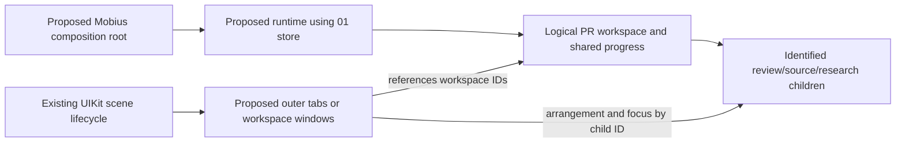

# 02 — Application workspace

- Status: outline
- Depends on: [01 — Review-state foundation](01-review-state-foundation.md).
- Shared context: [Overview](README.md).

## Intended outcome

Mobius launches on iPhone, iPad, and Mac Catalyst with a persistent logical workspace per PR, presentable as a tab or an outer window. Each workspace contains several child windows for review, source, and research, with independent navigation even when two show the same kind of content. Returning restores its arrangement and last-focused child. Resuming a review child opens its selected file from the top. iPad/Mac support native multiple windows; iPhone provides usable workspace/child switching within its available scene capabilities.

Success is a native runtime demonstration with two independent PR workspaces, multiple children, retained arrangement/focus across workspace and outer-presentation changes, Mac menu/keyboard actions, and file-top review resumption. It follows the evaluated browser mockup in [01a](01a-workspace-prototype.md). This is fixture-backed groundwork, not live GitHub or sync delivery. Preview/simulation placement may use fixtures; actual host/live capabilities remain in 07.

## User stories and requirements

| Story | Requirement | Intended contribution |
| --- | --- | --- |
| US-01, US-02 | R-02, R-03 | Logical PR workspaces, outer tabs/windows, independent child navigation, arrangement/focus restoration, and file-top review resumption. |
| US-06 | R-01 | iPhone/iPad app and Mac Catalyst windows, menus, and shortcuts. |
| US-01, US-06 | R-10 | Accessible adaptive layout and keyboard/focus behavior. |
| Supporting | R-11 | Host/UI targets, docs, unit/image coverage, and Catalyst validation. |

See [definitions and exclusions](README.md#requirements). X-03 and X-07 apply. Do not build a single disposable PR-detail flow and defer the workspace model; concurrency of reviews is this deliverable's purpose. Do not add live provider or CloudKit behavior here.

## Known design and assumptions

Proposed paths: `Mobius/MobiusUI/{Sources,Tests,SnapshotTests,README.md,AGENTS.md}` and `Mobius/Mobius/{Sources,Tests,Resources,README.md,AGENTS.md}`. Add the host and UI products through the root manifests. Give Mobius explicit iPhone/iPad/Catalyst destinations; do not expand Where's destination constant.

Create the Core runtime once in the process composition root. Scene presentation refers to logical workspace IDs; a scene can host workspace tabs, while a separate native window can present a workspace. Workspace models refer to child IDs and shared PR progress. Do not equate a workspace or child window with a UIKit scene. Restore scene-to-workspace references; missing or explicitly deleted workspace identity produces a recovery/selection state, not a new random identity. Closing a native presentation releases its presentation-owned work; it does not delete the logical workspace or affect another scene's tasks. PRs remain independent when a stack connection is displayed.

Use 01a's evaluated interactions to distinguish switching PR workspaces from selecting, opening, or arranging children inside one PR. Q-20 allows floating, tiling, docking, or tabs where useful; choose native defaults and platform affordances during refinement. Layouts and labels from the mockup remain candidates until validated natively. Mac outer windows use system scene APIs, with app-specific menu and shortcut routing through the focused workspace to its focused child. Separate child closure, closing a native window, and deleting a workspace. Restore arrangement and last-focused child on return; resuming a review child starts its file at the top. Exact review offsets are not required.



```swift
// Proposed composition sketch; API details await 01.
@MainActor
func makeWorkspaceModel(workspaceID: Workspace.ID, runtime: MobiusRuntime) -> WorkspaceModel {
    WorkspaceModel(workspaceID: workspaceID, runtime: runtime)
}
// Scene/tab presentation references workspace models; each owns child models.
// The process owns runtime and persistence. Exact sharing/lifetimes await 01.
```

Use the [building-ui skill](../../.agents/skills/building-ui/SKILL.md), Broadway root/stylesheet conventions, and production-shaped injected fixtures. Add `MobiusUITests` to `Stuff-iOS-Tests` and `MobiusUISnapshotTests` to `StuffSnapshotTests`, with no new snapshot scheme. Follow full-content capture rules for scrolling panes and pair them with bounded shell captures. SnapshotKit's iOS renderer does not establish Catalyst window behavior.

Declare Mobius's attribution inputs and bundled report through CreditKit's existing tooling. Generate the report when adding linked dependencies, and include `./attribution --check` in acceptance. Read the current CreditKit contract during refinement; Where's report is not Mobius's report.

## Questions and learning needed

- [Q-10](README.md#q-10): Select the code-text substrate and layout after measuring long lines, many documents, accessibility sizes, selection, and VoiceOver. Identify real latency/memory budgets and fixture sizes before readiness.
- [Q-11](README.md#q-11): Specify CLI Catalyst compile coverage and a native window/menu smoke test. Existing `./test` cannot be assumed to target Catalyst. Extend repository tooling only where required, with its public-command tests and owning docs.
- Integrate Q-13–Q-15 and Q-19–Q-21: logical workspaces, multiple identified children, outer presentation independent from contents, last-focus/arrangement restoration, and clear remaining-work/full-PR navigation. Existing scroll-restoration machinery does not establish a requirement to restore an exact review offset.
- Refine close/detach/reopen behavior and any simultaneous presentations of one workspace before implementing them. The bounded mockup need not settle every native scene lifecycle rule.

## Refinement trigger

- Trigger: 01a's feedback is integrated and 01 supplies actual state/persistence interfaces.
- Evidence needed: Working Core types, renderer/layout probe results, dependency closure, an explicit Catalyst build/runtime procedure, and an accessible tab/window interaction specification.
- Next action: Read the applicable UI/module/tooling contracts, expand this file into executable steps and acceptance criteria, and review it before implementation. Keep the first runtime demo synthetic and repeatable.

## Decisions and revisions

| Date | Decision | Source |
| --- | --- | --- |
| 2026-11-14 | Share UIKit/Broadway through Catalyst, with Mac-specific windows, menus, and shortcuts. | Q-04. |
| 2026-11-14 | Keep platform scene presentation local while workspace identity persists. | Overview design proposal. |
| 2026-11-14 | Adopt per-PR grouping and file-top resumption after the lightweight mockup is evaluated. | Q-13/Q-14, Q-16–Q-18. |
| 2026-11-14 | Restore logical workspaces with multiple child windows independently of outer tab/window presentation; retain arrangement and last focus. | First-artifact feedback and [Q-19–Q-21](README.md#q-19). |

## Resume point

Await 01 evidence, then resolve Q-10 and the build/runtime portion of Q-11. Implementation has not started.
