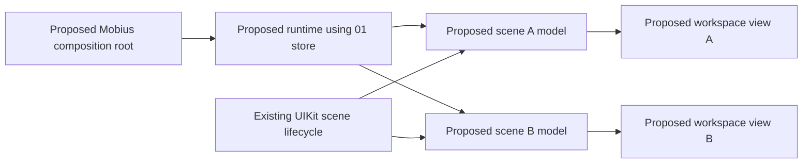

# 02 — Application workspace

- Status: outline
- Depends on: [01 — Review-state foundation](01-review-state-foundation.md).
- Shared context: [Overview](README.md).

## Intended outcome

Mobius launches on iPhone, iPad, and Mac Catalyst with a persistent workspace per PR. A reviewer switches between independent synthetic PR workspaces, each retaining its reference files and searches. Returning to a review opens its last file from the top. iPad/Mac support multiple windows; iPhone provides usable workspace/document switching within its available scene capabilities.

Success is a native runtime demonstration with two independent review workspaces and their reference documents, independent window selections, Mac menu/keyboard actions, and file-top resumption. It follows the evaluated browser mockup in [01a](01a-workspace-prototype.md). This is fixture-backed groundwork, not live GitHub or sync delivery.

## User stories and requirements

| Story | Requirement | Intended contribution |
| --- | --- | --- |
| US-01, US-02 | R-02, R-03 | Independent PR workspaces, document switching, file-top resumption, and scene restoration. |
| US-06 | R-01 | iPhone/iPad app and Mac Catalyst windows, menus, and shortcuts. |
| US-01, US-06 | R-10 | Accessible adaptive layout and keyboard/focus behavior. |
| Supporting | R-11 | Host/UI targets, docs, unit/image coverage, and Catalyst validation. |

See [definitions and exclusions](README.md#requirements). X-03 and X-07 apply. Do not build a single disposable PR-detail flow and defer the workspace model; concurrency of reviews is this deliverable's purpose. Do not add live provider or CloudKit behavior here.

## Known design and assumptions

Proposed paths: `Mobius/MobiusUI/{Sources,Tests,SnapshotTests,README.md,AGENTS.md}` and `Mobius/Mobius/{Sources,Tests,Resources,README.md,AGENTS.md}`. Add the host and UI products through the root manifests. Give Mobius explicit iPhone/iPad/Catalyst destinations; do not expand Where's destination constant.

Create the Core runtime once in the process composition root. Each scene receives a `WorkspaceModel` for one PR with local presentation and the shared store. Restore scene-to-workspace references; missing or explicitly deleted workspace identity produces a recovery/selection state, not a new random identity. Window closure releases that scene's work; it does not delete the workspace or affect another scene's tasks. PRs remain independent when a stack connection is displayed.

Use 01a's evaluated interactions to distinguish switching PR workspaces from switching documents inside one PR. Layouts and labels from the mockup remain candidates until validated natively. Mac windows use system scene APIs, with app-specific menu and shortcut routing to the focused scene. Separate shared document closure from closing a native window. Reopening a review file starts at its top; precise in-file restoration is not required.



```swift
// Proposed composition sketch; API details await 01.
@MainActor
func makeScene(workspaceID: Workspace.ID, runtime: MobiusRuntime) -> WorkspaceModel {
    WorkspaceModel(workspaceID: workspaceID, runtime: runtime)
}
// Each scene owns its model; the process owns runtime and persistence.
```

Use the [building-ui skill](../../.agents/skills/building-ui/SKILL.md), Broadway root/stylesheet conventions, and production-shaped injected fixtures. Add `MobiusUITests` to `Stuff-iOS-Tests` and `MobiusUISnapshotTests` to `StuffSnapshotTests`, with no new snapshot scheme. Follow full-content capture rules for scrolling panes and pair them with bounded shell captures. SnapshotKit's iOS renderer does not establish Catalyst window behavior.

Declare Mobius's attribution inputs and bundled report through CreditKit's existing tooling. Generate the report when adding linked dependencies, and include `./attribution --check` in acceptance. Read the current CreditKit contract during refinement; Where's report is not Mobius's report.

## Questions and learning needed

- [Q-10](README.md#q-10): Select the code-text substrate and layout after measuring long lines, many documents, accessibility sizes, selection, and VoiceOver. Identify real latency/memory budgets and fixture sizes before readiness.
- [Q-11](README.md#q-11): Specify CLI Catalyst compile coverage and a native window/menu smoke test. Existing `./test` cannot be assumed to target Catalyst. Extend repository tooling only where required, with its public-command tests and owning docs.
- Integrate Q-13–Q-15 and prototype feedback: one workspace per PR, file-top resumption, and clear remaining-work/full-PR navigation. Existing scroll-restoration machinery does not establish a requirement to restore an exact review offset.

## Refinement trigger

- Trigger: 01a's feedback is integrated and 01 supplies actual state/persistence interfaces.
- Evidence needed: Working Core types, renderer/layout probe results, dependency closure, an explicit Catalyst build/runtime procedure, and an accessible tab/window interaction specification.
- Next action: Read the applicable UI/module/tooling contracts, expand this file into executable steps and acceptance criteria, and review it before implementation. Keep the first runtime demo synthetic and repeatable.

## Decisions and revisions

| Date | Decision | Source |
| --- | --- | --- |
| 2026-11-14 | Share UIKit/Broadway through Catalyst, with Mac-specific windows, menus, and shortcuts. | Q-04. |
| 2026-11-14 | Keep platform scene presentation local while workspace identity persists. | Overview design proposal. |
| 2026-11-14 | Adopt per-PR grouping and file-top resumption after the lightweight mockup is evaluated. | Q-13/Q-14, Q-16–Q-18. |

## Resume point

Await 01 evidence, then resolve Q-10 and the build/runtime portion of Q-11. Implementation has not started.
