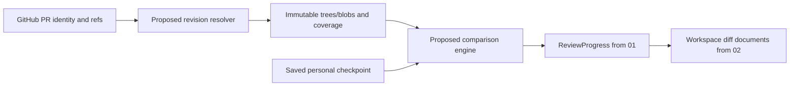

# 03 — GitHub and revision comparison

- Status: outline
- Depends on: [01 — Review-state foundation](01-review-state-foundation.md), [02 — Application workspace](02-application-workspace.md).
- Shared context: [Overview](README.md).

## Intended outcome

The workspace opens actual GitHub PRs and discussions. A reviewer can inspect the current PR diff, set a personal checkpoint, leave, and return after changes to identify what requires another pass. The app shows the revisions and completeness of the comparison it actually loaded.

Demonstrate ordinary pushes, force-push/rebase, base-branch movement, unchanged files, renamed/deleted files, unavailable old history, and paginated/limited responses. Honest unavailable history is an acceptable state; falsely reporting “nothing changed” is not.

## User stories and requirements

| Story | Requirement | Intended contribution |
| --- | --- | --- |
| US-03 | R-04 | Current-PR and since-checkpoint comparisons, using 01's receipts. |
| US-05 | R-06 | Authenticated PR/diff/discussion reading; submission remains in 05. |
| US-07 | R-08, R-09 | Credential/account boundaries, immutable snapshots, coverage, and stale-result control. |
| US-01, US-06 | R-10 | Bounded diff loading/rendering with measured budgets. |

All [exclusions](README.md#not-required-and-explicitly-avoided) apply. Do not introduce Git authoring or treat GitHub's submitted-review/file-viewed state as Mobius's private progress. Support public and private repositories the selected identity can access; authorization failure must remain distinct from an empty PR list.

## Known design and assumptions

Keep product-specific GitHub adapters in `Mobius/MobiusCore/Sources/GitHub/`, revision logic in `Mobius/MobiusCore/Sources/Review/`, and credential storage behind a device-local interface. The root injects transport, credential, cache, and persistence collaborators. UI owns the native authentication presentation adapter. No new general GitHub framework is justified by this plan alone.

The proposed `ReviewRevision` captures base tip, head tip, and the resolved comparison base. Current PR comparison uses the appropriate merge-base-to-head content. The since-checkpoint surface compares saved and current head trees directly, with a separate indication when the PR's base/comparison context changed. Do not present a three-dot comparison as an exact old-tree-to-new-tree delta after a rebase. Changes to the PR comparison itself must re-evaluate both sides of file receipts, even when head content is unchanged.



```swift
// Proposed seam; not existing API or production code.
protocol ReviewRepository: Sendable {
    func snapshot(for target: ReviewTarget) async throws -> ReviewSnapshot
    func file(at revision: FileRevision) async throws -> FileContent
}
// ReviewSnapshot retains immutable revision identity and explicit coverage.
// Failures are thrown; unavailable content is never represented by empty text.
```

GitHub PR-file/compare responses have documented limits; see [research](README.md#research-and-evidence). Treat them as useful metadata, not guaranteed complete manifests. Resolve immutable trees and blobs, traverse truncated trees by subtree, and retain coverage for every material omission. A refresh must not splice pages from different moving revisions. Bound retries if the PR changes while resolving it.

Re-evaluate exact file comparison identities rather than resetting all progress on every new head. Keep refresh separate from setting the personal checkpoint. Retain cached baseline evidence when available. Since full caches do not sync, a new device may have to fetch old objects; deleted/unreachable objects must produce a visible baseline gap, not fabricated equivalence.

Fixtures must include binary/non-text and oversized files, missing patches, CRLF/Unicode/long lines, submodules, rename/mode changes, missing pages, permission loss, cancellation, rate limiting, and superseded refreshes. Define supported rendering and indexing limits before readiness. Show unsupported content honestly without marking its review complete.

## Questions and learning needed

- [Q-08](README.md#q-08) blocks readiness: compare GitHub App and OAuth App access/onboarding; verify PKCE/callback/token-refresh behavior and concrete client-credential handling. Decide whether native public-client behavior is acceptable or an authentication broker is required. Do not assume the developer's `gh` credentials can ship in Mobius.
- Clarify the first supported GitHub host/organization policies during authentication refinement. Repository-account identity must support safe sign-out and switching regardless of initial account-picker scope.
- [Q-10](README.md#q-10): Choose a bounded line-diff/rendering path using fixtures; distinguish an API-derived patch from a locally computed exact-tree comparison.
- A stale review anchor is retained for 05 to resolve; network refresh must not silently rewrite user draft intent.

## Refinement trigger

- Trigger: Core contracts and the fixture workspace are validated.
- Evidence needed: Supported auth registration/flow, permission matrix, concrete GitHub response fixtures, exact comparison semantics, and measured diff budgets. Any required account/app registration is a recorded execution prerequisite.
- Next action: Research and, when execution is authorized, run a bounded auth/read probe. Integrate its evidence here, resolve Q-08, and write tests/steps/recovery for the selected adapter. No API write is needed for this deliverable.

## Decisions and revisions

| Date | Decision | Source |
| --- | --- | --- |
| 2026-11-14 | Use immutable revisions and explicit coverage; timestamps and a single head SHA are insufficient review evidence. | Q-03, R-04, official API research. |
| 2026-11-14 | Keep private personal checkpoints independent of GitHub's review publication. | Overview product model. |

## Resume point

Refine after 01/02. Resolve Q-08 and diff-specific Q-10 before readiness. No live authentication or revision experiment has run.
