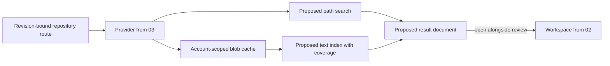

# 04 — Repository exploration

- Status: outline
- Depends on: [02 — Application workspace](02-application-workspace.md), [03 — GitHub and revision comparison](03-github-and-revision-comparison.md).
- Shared context: [Overview](README.md).

## Intended outcome

Browse the repository and search file paths and text while the current review stays open. Results belong to that PR's workspace and open at a stated revision. Switching PRs preserves each workspace's context; resuming the review returns to its last file at the top with progress preserved.

Demonstrate a search from PR A, opening a file outside its diff, switching to PR B, and returning to A unchanged. Repeat at different revisions where the same path has different content. Partial indexing must not look like a complete “no results” response.

## User stories and requirements

| Story | Requirement | Intended contribution |
| --- | --- | --- |
| US-01, US-04 | R-02, R-05 | Repository tree, path search, text search, and persistent source/search documents. |
| US-02 | R-03 | Restore semantic queries and the last review file within its PR workspace. |
| US-07 | R-08, R-09 | Revision/coverage labels, account-isolated caches, and cancellation. |
| US-04, US-06 | R-10 | Accessible results and bounded indexing/rendering workloads. |

X-02, X-05, and X-07 apply. Editing code, terminal access, language-server navigation, and arbitrary execution are not required by this deliverable.

## Known design and assumptions

Use the immutable tree/blob provider from 03 and typed document routes from 01. Put navigation/search policy in focused Core types and the observable interaction in UI. Scope indexes by account, repository, and immutable tree; never silently answer a PR-head search with default-branch results.

Proposed search design: fast path/name matching over the enumerated tree, plus local text indexing of supported fetched blobs. Fetch missing content on a bounded, cancellable schedule, with explicit progress and coverage. Define file-size, storage, network, and indexing limits during Q-10 refinement. Keep useful partial results while distinguishing indexing, complete, incomplete, and failed states. Source/index cache eviction must not delete draft text, receipts, or workspace document identities.



```swift
// Proposed values, not compiled API.
struct RepositorySearch: Sendable {
    let revision: RepositoryRevision
    let query: SearchQuery
    let scope: SearchScope
}
// A result carries its exact revision and coverage; opening uses that revision.
```

GitHub's default-branch code-search endpoint is not the implementation of PR-revision search; see [research](README.md#research-and-evidence). No complete offline clone is promised. Previously cached documents remain useful when offline; missing content remains visibly unavailable.

## Questions and learning needed

[Q-10](README.md#q-10) covers measured indexing limits, large results, keyboard navigation, VoiceOver, and long-file handling. 03 must establish source access for forked PR heads and missing objects. Do not quietly change query scope when access differs.

## Refinement trigger

- Trigger: 03 supplies a tested revision-bound tree/blob API and 02 supplies document navigation.
- Evidence needed: Representative repository trees, indexing measurements, explicit coverage/cancellation policy, and restored-query behavior.
- Next action: Define query/index/result contracts, choose a measured storage/index implementation, then write executable acceptance for same-path/different-revision and interrupted-index scenarios.

## Decisions and revisions

| Date | Decision | Source |
| --- | --- | --- |
| 2026-11-14 | Repository exploration is part of the review workspace, with path and text search at an explicit revision. | Q-03, R-05. |
| 2026-11-14 | Keep exploration documents with their PR when switching to another PR workspace. | Q-13. |

## Resume point

Refine after 02/03 and resolve indexing-specific Q-10. Implementation has not started.
