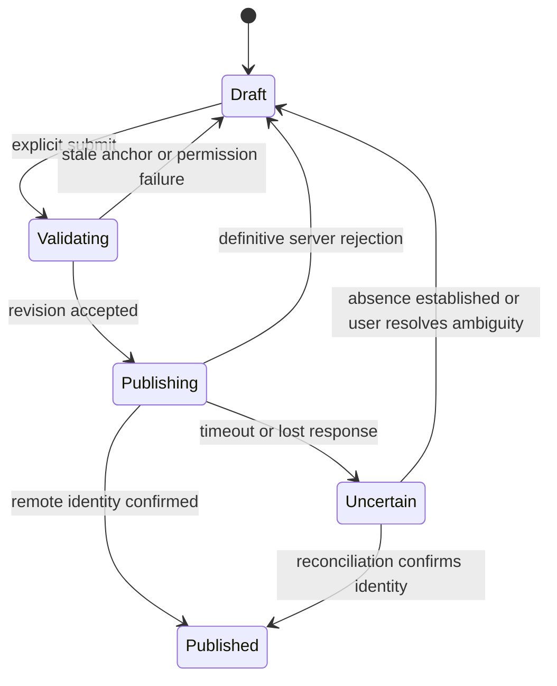

# 05 — Review feedback

- Status: outline
- Depends on: [01 — Review-state foundation](01-review-state-foundation.md), [03 — GitHub and revision comparison](03-github-and-revision-comparison.md), [04 — Repository exploration](04-repository-exploration.md).
- Shared context: [Overview](README.md).

## Intended outcome

Write comments while exploring code, retain them when switching tasks, and explicitly submit a comment, approval, or request for changes. Feedback is attached to the intended PR and revision. Interrupted or ambiguous publication preserves the user's text and provides a clear recovery path.

Demonstrate a multi-file draft, task switching, relaunch, a PR update while drafting, successful submission, and a lost response after the server may have accepted the write. Personal reviewed-file markers remain independent of GitHub submission.

## User stories and requirements

| Story | Requirement | Intended contribution |
| --- | --- | --- |
| US-02, US-05 | R-03, R-06 | Durable local drafts, discussion reading/replies, and explicit review events. |
| US-03, US-07 | R-04, R-08 | Validate revision/line anchors; reconcile uncertain results without blind retries. |
| US-07 | R-09 | Apply the selected account and permission scope; preserve private user text. |

X-02, X-03, and X-05 apply. No automatic review publication on navigation, backgrounding, sync, or a “mark reviewed” action. Code-edit suggestions, merge, dismissal, thread resolution, and broader PR administration are not required for this deliverable.

## Known design and assumptions

Core owns `ReviewDraft`, anchor mapping, and a proposed `ReviewPublisher`. UI owns composition, confirmation, and recovery presentation. Scope publication by account, PR, and draft revision; one local owner serializes mutations for that draft. Record the original immutable file comparison and anchor when text is authored.

Several children may present the same PR's draft or different code revisions. Child navigation remains independent, while draft identity and publication ownership stay with the workspace. Closing or changing presentation must not implicitly publish or delete authored work. Refine same-draft editing and command routing across children before readiness, using [Q-19–Q-21](README.md#q-19) and Q-09's ownership rules.

Read the current PR state before submission. If the head or comparison context changed, show the change and retain the draft until its target is revalidated. A comment authored while viewing a file's new edits since its reviewed version must map to a valid location in the PR review diff, or remain an unsubmitted draft with a useful explanation. Never attach a comment to the same line number in unrelated content. Submit an explicit commit ID where the API supports it; a preflight read does not make a later API write atomic with branch updates.



This is a proposed domain state machine, not a guarantee of exactly-once remote effects. A definitive rejected request preserves an editable draft and original error. Cancellation after dispatch may require reconciliation; it cannot be treated as proof that nothing was posted.

```swift
// Proposed pseudocode; exact associated values await provider evidence.
enum SubmissionState {
    case draft(ReviewDraft)
    case validating(SubmissionIntent)
    case publishing(SubmissionIntent)
    case uncertain(SubmissionIntent, Error)
    case published(PublicationReceipt)
}
// SubmissionIntent retains the draft revision, account, PR, and reviewed head.
// Persist wire-safe intent/receipt data separately from the original runtime Error.
```

GitHub review/comment schemas are linked in [research](README.md#research-and-evidence). Separate general PR conversation comments from inline review comments. Keep remote IDs after confirmed creation. Reconcile pending reviews and comments on reconnect, including reviews begun outside Mobius. Do not assume a generic idempotency key exists or blindly repeat a timed-out POST. Ambiguous matching must remain visible rather than selecting a guessed remote comment.

## Questions and learning needed

- Provider evidence from 03 must establish actual permission failures, pending-review constraints, line/range validation, and supported reply/review operations.
- [Q-09](README.md#q-09): Define cross-device publication ownership before sync. Syncing a draft or an uncertain intent must not automatically send it. Manual concurrent submission of the same shared draft needs a concrete conflict policy; local serialization does not solve that race.
- Draft conflict handling must preserve both authored texts. Publication receipts must identify which draft revision was sent so later edits are not falsely marked published.
- Q-13/Q-15 keep feedback and per-file progress inside the owning PR workspace. A stack connection does not batch publication or advance another PR's progress.

## Refinement trigger

- Trigger: 03 has real provider/account/revision contracts and 04 proves exploration preserves review state.
- Evidence needed: Synthetic API fixtures for accepted, rejected, and response-lost writes; a supported remote reconciliation strategy; draft/submission persistence design; planned two-device conflict cases.
- Next action: Expand the state machine into executable steps and failure/race tests. Live write verification during execution must use an explicitly selected test PR and account; planning itself posts no product review comments.

## Decisions and revisions

| Date | Decision | Source |
| --- | --- | --- |
| 2026-11-14 | Submission is explicit; personal progress and GitHub review events remain separate. | Q-02/Q-03, R-03/R-06. |
| 2026-11-14 | Preserve uncertain publication rather than claiming success or automatically duplicating a write. | R-08 and the external-effect boundary. |

## Resume point

Refine after 03/04. Resolve the remote reconciliation and cross-device ownership contracts before readiness. Implementation has not started.
