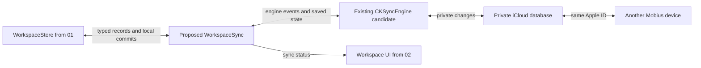

# 06 — iCloud resume and first-release acceptance

- Status: outline
- Depends on: [01](01-review-state-foundation.md), [02](02-application-workspace.md), [03](03-github-and-revision-comparison.md), [04](04-repository-exploration.md), [05](05-review-feedback.md).
- Shared context: [Overview](README.md).

## Intended outcome

Start reviews on one device and continue them on another using private iCloud under the same Apple ID. Independent logical PR workspaces, identified children and their navigation, per-file reviewed versions, explicit current skips, and drafts converge without losing user work or taking over another device's window focus. Returning locally restores the workspace's arrangement and last-focused child; resuming a review child starts at the top of its selected file. Each device authenticates its own GitHub account before retrieving protected source.

This deliverable is required for the first release. Demonstrate an iPhone-to-iPad-to-Mac handoff, concurrent edits, offline work, reconnect, account transitions, and a complete GitHub review flow. A local-only app or simulator-only sync demonstration does not satisfy it.

## User stories and requirements

| Story | Requirement | Intended contribution |
| --- | --- | --- |
| US-02, US-06 | R-03, R-07 | Private cross-device continuity of semantic workspace state and drafts. |
| US-10 | R-14 | Sync PR/file skip and undo independently of reviewed versions; preserve changed/new-file eligibility. |
| US-07 | R-08, R-09 | Conflict preservation, account isolation, visible sync state, and non-replayed publication intents. |
| US-01, US-04, US-06 | R-01, R-10 | Final device/window/input/accessibility acceptance. |
| Supporting | R-11 | Platform CI/runtime coverage, signing/distribution decision, and release evidence. |

X-05 and X-06 apply. No custom workspace-sync backend, different-Apple-ID continuity, or full repository/credential sync. Reopening on another device may require GitHub sign-in and fetching uncached source. That limitation must be visible rather than hidden behind a successful workspace-metadata sync badge.

## Known design and assumptions

The candidate transport is `CKSyncEngine` over a dedicated private CloudKit database/container. The app owns local atomic persistence, pending record changes, serialized engine state, conflict policy, and account transitions. Keep the Core store's accepted-state interface; measure whether record projection requires a different internal persistence implementation.

Use stable per-entity records instead of a single last-writer-wins workspace blob. Design tombstones and deterministic merge rules for child membership, per-child semantic navigation including selected review files, per-file review evidence, and draft revisions. Two views of one file have distinct child IDs. Separate those identities from native scenes, outer presentation mode, and device arrangement. Preserve competing draft texts. Explicitly distinguish opening a new child from an old offline device replaying a deleted child. Wall-clock order alone must not discard user-authored content.

Include [PR-local skip evidence](README.md#changes-by-kind-and-explicit-skipping) and explicit undo in the merge design, separately from reviewed baselines. A group action carries its current remaining files/comparisons, never a future category exclusion. On each device, changed/new files return while unchanged skips remain; stale skip delivery must not suppress newer content. Refine concurrent skip/undo/review and missing comparison history under Q-09 using two-replica cases. No cross-PR exclusion preference is implied. Group collapse and rich/source view preferences are presentation; decide their device/sync ownership during refinement instead of treating them as review evidence.



```swift
// Proposed boundary, not a final CloudKit schema.
protocol WorkspaceSynchronizing: Sendable {
    func synchronize() async throws
}
// The implementation projects persisted entities through stable record IDs.
// It does not publish GitHub feedback or copy authentication credentials.
```

Proposed policy keeps native window bounds, child arrangement, last-focused child, and local scene IDs device-local. Returning to an existing local workspace restores that arrangement/focus under Q-21; a first open on another device needs an adaptive arrangement. Refine initial focus, order, and concurrent child-navigation behavior under Q-09 before fixing the sync schema. Preserve each review child's selected-file identity and resume it at the top; exact review scroll offsets are not part of the continuity contract. Remote work becomes available without unexpectedly opening windows or closing a focused local child during an edit.

Account changes must stop the prior sync scope and isolate its files/records before any new scope starts. iCloud sign-out must not silently upload one account's drafts into another account. GitHub sign-out/revocation must prevent protected fetches and display, with an explicit policy for retained private drafts and caches. Preserve recoverable user work while resolving access; never infer fresh access from stale credentials.

## Questions and learning needed

- [Q-09](README.md#q-09) blocks readiness: exact schema, tombstone retention, draft conflicts, metadata migration/recovery, account changes, and cross-device publication ownership. Use controlled two-replica tests and actual CKSyncEngine events; do not infer a transactional guarantee between CloudKit and GitHub.
- [Q-11](README.md#q-11) blocks release delivery: confirm the supported Catalyst CI/test route, signed app identities, iCloud entitlements/container, and distribution audience. The existing iOS installer system does not establish Mac distribution support.
- Resolve remaining performance/accessibility findings from Q-10 against real workloads. Avoid adding product telemetry of private code or comments to gather these measurements.

## Refinement trigger

- Trigger: The standalone review loop works and its persistent entities/publication receipts are stable enough to design sync.
- Evidence needed: Record/merge specification, synthetic concurrent-edit cases, selected signing/container configuration, a real-device/Mac test environment, and explicit platform build/runtime commands.
- Next action: Expand this file before adding CloudKit behavior. Run bounded merge/account experiments, revise earlier schemas where necessary, then implement and validate. Missing device/container access blocks real sync acceptance; it is not a passing inconclusive product result.

## First-release demonstration

The executable refinement must preserve this sequence:

1. Open two independent PR workspaces and several source/research/review children on iPhone; mark a file reviewed in one PR, leave another unreviewed, explicitly skip current files in a quieter group, and save feedback text. Confirm collapsed groups alone remain unreviewed.
2. Make those workspaces and children available on iPad using its receiving-device presentation policy. Resume a review child at its selected file's top; open another child and follow a search result without losing either PR's context. Switch away and back to prove local arrangement and last focus are retained. Present a workspace as a tab or outer window without changing its contents.
3. Change the test PR; on Mac, verify new edits against each reviewed file's baseline, the full PR diff for an unreviewed file, and full-diff access for either. Changed/new files return after the skip while unchanged skips persist; separate counts must not claim everything was reviewed. Verify typed and source views use the same comparison. Check menu/keyboard navigation and that the second PR's progress is unaffected.
4. Make competing offline draft edits on two devices; reconnect and recover both texts. Exercise skip/undo/review races without losing true reviewed baselines or suppressing new content, child close/reopen, independent navigation in same-kind children, and account switching without remote focus changes.
5. Submit feedback once through an explicit user action; interrupt the response and prove recovery does not blindly replay the write from either device.
6. Verify the same workflow with accessibility text sizes and VoiceOver, and inspect the platform-specific CI/runtime evidence.

This is a planned acceptance flow, not a measured result. Refine exact assertions and data before execution.

## Decisions and revisions

| Date | Decision | Source |
| --- | --- | --- |
| 2026-11-14 | Private iCloud continuity is in the first release and uses the same Apple ID. | Q-05/Q-07. |
| 2026-11-14 | Sync semantic workspace metadata/drafts, retaining native presentation and source caches locally. | Overview design proposal. |
| 2026-11-14 | Sync independent PR workspaces, last-file identity, and per-file reviewed versions; resume at the file top. | Q-13–Q-15. |
| 2026-11-14 | Restore local arrangement/last focus; sync semantic child identity/navigation separately from device presentation. Refine receiving-device defaults and concurrent navigation under Q-09. | [Q-19–Q-21](README.md#q-19), with sync mapping still provisional. |
| 2026-11-14 | Carry explicit current skips across devices separately from reviewed evidence; stale skips cannot exclude newer changes. | [Q-23](README.md#q-23)/[Q-24](README.md#q-24); conflict/schema policy remains with Q-09. |

## Resume point

After 01–05, resolve Q-09/Q-11 and refine this file. Do not call the first release complete before its cross-device and all-platform acceptance passes.
