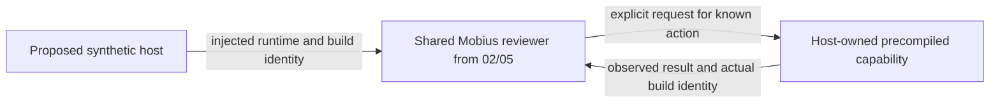

# 07 — Embedded review and live-context experiment

- Status: outline
- Depends on: [02 — Application workspace](02-application-workspace.md), [05 — Review feedback](05-review-feedback.md), [06 — iCloud resume and release](06-icloud-resume-and-release.md).
- Shared context: [Overview](README.md).

## Intended outcome

Establish whether an owning app can embed the same Mobius reviewer and expose a useful bounded live-context action. Produce evidence and a recommendation for a later product decision. A supported negative result can complete the experiment; it does not deliver embedded review as a shipping feature.

## User stories and requirements

| Story | Requirement | Intended contribution |
| --- | --- | --- |
| US-08 | R-12 | Demonstrate or reject host injection, truthful build/revision context, and one useful live action. |
| US-07 | R-08, R-09 | Preserve account/store ownership and show revision mismatch or unavailable identity honestly. |

X-04 applies: no downloaded PR execution, arbitrary native hot loading, or general build service. A running binary contains the code it was built with. Do not label its behavior as the selected PR revision without matching evidence.

## Known design and assumptions

Use a synthetic test host with injected Mobius runtime and a precompiled demonstration action, such as opening a known sample screen with chosen fixture data. Reuse the production review presentation rather than copying it into a separate embedded UI. The host owns the action and supplies build identity; the reviewer compares that identity with the selected PR snapshot.

Bound the refined experiment to one host, one precompiled action, and matching/mismatching/unknown build identity cases. Proposed effort bound: two engineering days after prerequisites are ready; refine this bound before execution. Preserve a report and minimal repeatable harness if it proves useful. Remove unused prototype targets and keep experimental controls out of shipping host behavior.



```swift
// Proposed pseudocode; not a shipping embedding API.
struct EmbeddedReviewContext {
    let runtime: MobiusRuntime
    let buildIdentity: HostBuildIdentity // Known revision or explicitly unavailable.
    let capabilities: [HostReviewCapability] // Typed, precompiled host actions.
}
// The host injects existing resources. Embedding does not open another store.
```

Explore whether a built-in action provides enough context to be valuable. If useful execution requires a separately built app or another execution environment, record that as a finding with its scope and operational cost; do not silently implement a runner during this experiment.

## Questions and learning needed

[Q-12](README.md#q-12): Which host/context action is useful, what proves revision correspondence, and what UI/lifecycle APIs are needed? Inspect runtime ownership, dismissal, in-flight task cancellation, access boundaries, and host resource use. A screenshot of the embedded view alone is insufficient evidence of safe lifecycle reuse.

## Refinement trigger

- Trigger: Standalone workspace and feedback interfaces are proven through 06.
- Evidence needed: Reusable public presentation seam, process/account lifetime contract, selected synthetic host, exact build-identity inputs, and a bounded method.
- Next action: Expand with the experiment template's method, effort bound, evidence criteria, cleanup/retention, and explicit acceptance for positive, negative, and permitted inconclusive outcomes. Keep affected product questions unresolved if evidence is inconclusive.

## Decisions and revisions

| Date | Decision | Source |
| --- | --- | --- |
| 2026-11-14 | Investigate embedding/live context later within this series; do not promise it in the first release. | Q-06. |
| 2026-11-14 | Use host-supplied compiled capabilities and truthful revision identity as the initial experiment boundary. | R-12 and X-04. |

## Resume point

After 06, resolve the experiment prerequisites and refine Q-12. No host integration or live execution experiment has started.
