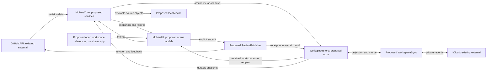

# Mobius: a persistent code-review workspace

## Planning checkpoint

- Updated: 2026-11-14; initial repository baseline `b629d56ac44a3f2a5ea59c3d6ae9cd5401f37674`; merged main through `96f5bf0f1685de259d7ff080842b8092f9a950d2` in `68477fe625784a1a1e68c0115d7e42cc63166692`.
- Operation: Add explicit closing and reopening of PR workspaces to the prototype and record the lifecycle in the production outlines.
- Requested scope and source: On 2026-11-14, the user reports that PR 42 and PR 43 cannot be dismissed and requests closing/reopening workspaces. This extends the existing retained-workspace and restoration decisions; it does not request native implementation.
- Stage: Close/reopen is implemented and verified at three sizes in Tabs/Windows, with fresh independent review clear. [01a](01a-workspace-prototype.md#closereopen-implementation-and-evidence) owns exact-source evidence and the pending clean-commit review/publication.
- Completed: The title-bar follow-up is also published at `f21e01fec` with receipt `ac4ac4478`; its focused browser checks, independent review, and scoped Chromium/WebKit check pass. Q-22–Q-25 and affected production outlines are integrated and reviewed. The fourth prototype iteration and its focused layout correction are built. The correction checks actual selected/rendered geometry, narrow movement/resize, and preserved workspace state; fresh independent review has no actionable findings. The coordinator verified the final HTML/capture hashes and inspected representative phone/tablet/desktop captures. Earlier artifacts/evidence remain intact. [01a's execution record](https://github.com/kyleve/Stuff/blob/codex/mobius-prototype/Plans/2026-11-14-mobius/01a-workspace-prototype.md#layout-correction-implementation-and-evidence) owns detailed evidence and publication. [PR #497](https://github.com/kyleve/Stuff/pull/497)/[STU-329](https://linear.app/kve/issue/STU-329/plan-mobius-code-review-app) track the plan; [PR #500](https://github.com/kyleve/Stuff/pull/500)/[STU-330](https://linear.app/kve/issue/STU-330/prototype-mobius-review-workspaces) track the experiment.
- Pending: Coordinator review of the clean tested artifact and stable PR/evidence/issue publication. The implementation branch owns current 01a execution evidence and its checkpoint. User evaluation, PR review, and merge remain. Q-09 retains cross-device open/closed presentation policy.
- Execution authorization and ownership: The user's request authorizes this bounded prototype change. `/root/mobius_prototype` owns `Prototype/**` and 01a on `codex/mobius-prototype`; the coordinator owns shared requirements/native outlines on `codex/mobius-plan` and the completion notice. Cascade at a clean method checkpoint before UI edits. The implementation branch then owns the current execution checkpoint and publication receipt. Native implementation remains outside scope.
- Next action: Return the clean tested artifact for coordinator review, then publish and deliver the completion notice. User evaluation covers active/inactive/last-workspace closure and retained-state reopening. Parent stays `ecb3c017d`; native plans remain outlines.

## Outcome and scope

Mobius keeps code review open as ongoing work. Each PR has its own logical workspace, which can be presented as a tab or a window. Inside it, reviewers can keep several windows open for review, source, research, and preview context. Returning restores that workspace's arrangement and last-focused window. Resuming a review window starts at the top of its selected file. A remaining-work view shows new edits in previously reviewed files and the full PR diff for unreviewed files; the full PR diff stays available for either. Each reviewed file has its own last-reviewed version. Nobody needs a temporary “got to here” GitHub comment.

A reviewer can close a PR workspace and reopen it later with the same children, arrangement, navigation, drafts, and review/skip evidence. Closing removes it from the presented tabs/windows while retaining its logical workspace. Closing the last one leaves a workspace-selection state with an accessible reopen action.

Changes are grouped by kind, with quieter groups collapsed and presentations suited to the underlying content. A reviewer can explicitly skip current changes for this PR without marking them reviewed. Skipped changes stay discoverable and undoable; new changes return to remaining work while unchanged skips persist. Skipping never advances the last actually reviewed version.

PRs remain separate even when GitHub connects them in a stack. If a stack connection is shown, it is an informational link; it does not combine progress, drafts, comparison baselines, or submission actions. Stack discovery is not an additional first-release integration requirement.

The first release targets **iPhone, iPad, and Mac Catalyst**, including Mac windows, menus, and shortcuts. It supports GitHub PR diffs, comments, approvals, and requests for changes. Private iCloud sync carries workspaces and personal progress between devices using the same Apple ID. These are first-release requirements even though implementation is divided into deliverables.

Embedding the reviewer inside an owning app, with a possible live execution surface, is a **later feasibility experiment** in this series. Preview and simulation windows in the browser prototype use synthetic content to explore their place in a workspace; they do not establish a first-release execution capability.

## User stories

| ID | Story |
| --- | --- |
| US-01 | Open, close, and reopen independent PR workspaces as tabs or windows, each containing several review and research windows, so investigating one question does not discard another task. |
| US-02 | Restore my workspace arrangement and last-focused window, with drafts and progress preserved; resume a review file from its top. |
| US-03 | Distinguish unchanged reviewed work from new PR changes, so I can concentrate on what needs another pass. |
| US-04 | Browse and search repository context without leaving the review workspace. |
| US-05 | Comment, approve, or request changes against the code I inspected. |
| US-06 | Resume the same work on iPhone, iPad, and Mac. |
| US-07 | Trust progress and recover from failures without incomplete downloads or interrupted submissions appearing complete. |
| US-08 | Learn whether embedding Mobius beside the running app can improve review with live context. |
| US-09 | Scan changes by kind and inspect them in a useful form, so localization, documents, and assets do not overwhelm code review. |
| US-10 | Set aside changes for this PR without claiming to have reviewed them, and see new changes when I return. |

## Requirements

R-01–R-07 and R-12–R-14 derive from the user's product choices. R-08–R-11 support repository contracts and correctness; R-10 also incorporates the accepted presentation-density direction. Design details are proposals unless identified as user decisions.

| ID | Required behavior or constraint | Story | Implementing plan |
| --- | --- | --- | --- |
| R-01 | Run on iPhone, iPad, and Mac Catalyst, with Mac windows, menus, and keyboard commands. | US-06 | [02](02-application-workspace.md), [06](06-icloud-resume-and-release.md) |
| R-02 | Keep one independent logical workspace per PR, presentable as a tab or window. Each owns multiple child windows for review, source, and research, with room to investigate preview/live context. Support multiple views of the same kind with independent navigation. Switching PRs or outer presentation preserves their contents. Allow closing and reopening retained workspaces, including closing the last one into an explicit selection state. Stack connections, if shown, are informational. | US-01, US-04 | [01a](01a-workspace-prototype.md) explores interaction and simulated previews; [01](01-review-state-foundation.md), [02](02-application-workspace.md), [04](04-repository-exploration.md) deliver the workspace; [07](07-embedded-review-experiment.md) investigates live context |
| R-03 | Persist child-window identity/navigation, per-file reviewed versions, current skip evidence, and drafts across relaunch. Returning, including after explicitly closing and reopening a workspace, restores its children, arrangement, navigation, and last-focused child without losing drafts or review/skip evidence. Resuming a review child starts at its selected file's top; precise in-file position and reviewed-range tracking are not required. Review progress belongs to the PR workspace; skipped, reviewed, and submitted GitHub feedback remain separate facts. | US-02, US-10 | [01a](01a-workspace-prototype.md) explores interaction; [01](01-review-state-foundation.md), [02](02-application-workspace.md), [05](05-review-feedback.md) deliver it |
| R-04 | Within one PR, remaining work combines new edits since each reviewed file's last-reviewed version with the full PR diff for unreviewed files, excluding current explicit skips under R-14 while keeping them discoverable. Let every file open its full PR diff. An explicit file-review action advances that file's baseline; navigation, grouping, skipping, and refresh do not. | US-03, US-10 | [01a](01a-workspace-prototype.md) explores interaction; [01](01-review-state-foundation.md), [03](03-github-and-revision-comparison.md) deliver it |
| R-05 | Browse files and search paths and text at an identified repository revision within Mobius. Open results in child windows without replacing the review and show search coverage. Independent views may inspect the same file or separate queries. | US-04 | [04](04-repository-exploration.md) |
| R-06 | Read review discussion; compose and explicitly submit comments, approvals, and requests for changes with revision validation and recoverable drafts. | US-05 | [03](03-github-and-revision-comparison.md), [05](05-review-feedback.md) |
| R-07 | Resume workspace contents, child-view navigation, progress, and draft work through private iCloud sync on the same Apple ID. Keep device window placement local and expose sync state; refine cross-device presentation policy under Q-09. | US-02, US-06 | [01](01-review-state-foundation.md) supplies identities; [06](06-icloud-resume-and-release.md) delivers sync |
| R-08 | Preserve original failures, last usable data, and incomplete coverage. Older requests cannot overwrite active state. Missing history cannot imply “reviewed” or “no changes.” | US-07 | [01](01-review-state-foundation.md), [03](03-github-and-revision-comparison.md), [04](04-repository-exploration.md), [05](05-review-feedback.md), [06](06-icloud-resume-and-release.md) |
| R-09 | Scope data by account and repository identity. Keep credentials in device-local Keychain; do not sync them or full repository caches. Protect private code and draft text from diagnostic export. | US-07 | [01](01-review-state-foundation.md), [03](03-github-and-revision-comparison.md), [06](06-icloud-resume-and-release.md) |
| R-10 | Prioritize code and preview content with compact workspace/view controls and details on demand, while keeping identity, comparison meaning, immediate actions, and relevant warnings clear. Presentation controls identify their PR-workspace or child-view scope and match the visible arrangement; explicit Float remains effective at narrow widths under Q-25. Preserve readable text and accessible touch/keyboard/VoiceOver interaction, accessibility text sizes, long lines, and large diffs. Define measured rendering/indexing budgets before the corresponding plan becomes ready. | US-01, US-04, US-06 | [01a](01a-workspace-prototype.md) explores density and presentation; [02](02-application-workspace.md), [03](03-github-and-revision-comparison.md), [04](04-repository-exploration.md) deliver it |
| R-11 | Integrate module docs, manifests, tests, architecture boundaries, attribution, and CI. Release acceptance requires evidence on all three destinations and real cross-device sync. | Supporting constraint | [01](01-review-state-foundation.md), [02](02-application-workspace.md), [06](06-icloud-resume-and-release.md) |
| R-12 | Evaluate a host-injected embedded reviewer and bounded live-context action; report feasibility and limitations without promising arbitrary PR execution. | US-08 | [07](07-embedded-review-experiment.md) |
| R-13 | Group changes by content kind with quieter groups collapsed, and use content-appropriate diff presentations with source/metadata access. Keep counts and changed files discoverable. Rendering limitations must remain explicit; grouping or a rich preview cannot imply review. The initial viewer set is a prototype hypothesis, not an exhaustive native format promise. | US-09 | [01a](01a-workspace-prototype.md) explores grouped mixed fixtures; [02](02-application-workspace.md), [03](03-github-and-revision-comparison.md) deliver the native experience |
| R-14 | Allow explicit skip and undo for current changes within one PR, separately from reviewed. Skipping a group captures its currently remaining files; it does not reclassify reviewed files or exclude that kind from future updates. Changed/new files return to remaining work, unchanged skips persist, and reviewed baselines never advance on skip. Keep skipped counts distinct; zero remaining work must not be labeled all reviewed when skips exist. | US-10 | [01a](01a-workspace-prototype.md) explores interaction; [01](01-review-state-foundation.md), [02](02-application-workspace.md), [03](03-github-and-revision-comparison.md) deliver local behavior; [06](06-icloud-resume-and-release.md) carries personal skip evidence between devices |

## Not required and explicitly avoided

| ID | Category | Exclusion | Reason |
| --- | --- | --- | --- |
| X-01 | Explicitly avoided | Native product implementation during the current prototype operation. | The execution request covers the lightweight 01a mockup. |
| X-02 | Not required | Other Git hosting providers, a general code editor, Git push/merge tools, and automatic AI reviews. | The selected workflow is GitHub review. |
| X-03 | Explicitly avoided | Marking files reviewed merely because they were opened; using scroll offsets as review receipts; posting personal progress as GitHub comments. | These recreate the continuity problem. |
| X-04 | Explicitly avoided | Executing downloaded PR code, arbitrary native hot loading, or promising a general build service. | Q-06 selected a later investigation. |
| X-05 | Explicitly avoided | Treating truncated data, missing history, ambiguous lineage, failed saves, or uncertain submissions as success. | Progress must remain trustworthy. |
| X-06 | Not required | A Mobius service for workspace sync or sync across different Apple IDs. | Q-07 selected private iCloud. Authentication hosting remains an alternative in Q-08. |
| X-07 | Explicitly avoided | Importing Where's product models or repurposing InstallerKit's catalog client as a GitHub client. | Mobius owns its domain; shared modules retain their contracts. |
| X-08 | Not required | Remembered type exclusions across PRs, automatic review based on classification, or per-key/per-pixel review receipts. | Q-23 selected PR-local skipping; file-level reviewed evidence remains the model. |

## Context and discovery

- Planning issue: [STU-329](https://linear.app/kve/issue/STU-329/plan-mobius-code-review-app). Completion means plan delivery, not a shipped app. Create linked implementation issues for selected deliverables before execution; preserve this series as the execution record.
- No Mobius matches were found in Markdown or Swift at the baseline. Linear search included all pages, assignees, states, and `includeArchived: true`: 326 issues returned, with no matching app proposal.
- [Package.swift](../../Package.swift) owns libraries; [Project.swift](../../Project.swift) owns app/test targets. RegionViewer demonstrates target-specific Catalyst support without changing the shared iOS destinations.
- [Broadway](../../Shared/Broadway/AGENTS.md) and [SnapshotKit](../../Shared/SnapshotKit/AGENTS.md) use UIKit. Catalyst fits that direction, but Mobius's dependency closure has not been built.
- [InstallerKit's UpdateClient](../../Shared/InstallerKit/Sources/UpdateClient.swift) reads credential-free catalogs. It is not an existing GitHub client.
- [JournalKit](../../Shared/JournalKit/AGENTS.md) drops old segments under a byte budget. It is not selected as the authoritative workspace/draft store.
- Current `./test --help` selects iOS bundles or the host macro bundle. There is no Catalyst test destination. Host macro tests cannot establish Mobius's Mac behavior.

## Research and evidence

Consulted 2026-11-14. External sources establish documented capabilities, not live integration results.

| Question | Evidence | Implication |
| --- | --- | --- |
| Can a PR file response prove complete coverage? | GitHub documents a 3,000-file ceiling for [PR files](https://docs.github.com/en/rest/pulls/pulls#list-pull-requests-files). | Detect incomplete enumeration and expose coverage. |
| Is the compare endpoint sufficient? | [Compare commits](https://docs.github.com/en/rest/commits/commits#compare-two-commits) returns at most 300 changed files, on the first page. | It cannot be the sole authoritative file enumeration. Tree/blob comparison is the proposed fallback. |
| Can GitHub code search follow a PR revision? | [Code search](https://docs.github.com/en/rest/search/search#search-code) considers the default branch and has size/result limits. | Use a revision-bound tree and local text index for PR context. |
| Can trees be enumerated completely? | [Git trees](https://docs.github.com/en/rest/git/trees#get-a-tree) reports truncation and directs clients to fetch subtrees non-recursively. | Track traversal coverage; a missing subtree is not empty. |
| How does feedback bind to code? | [Reviews](https://docs.github.com/en/rest/pulls/reviews#create-a-review-for-a-pull-request) carry a commit ID and event; [review comments](https://docs.github.com/en/rest/pulls/comments#create-a-review-comment-for-a-pull-request) use path, side, and line/range. | Preserve immutable local anchors and validate them against the PR before submission. |
| What native authentication is supported? | GitHub's [user-token flow](https://docs.github.com/en/apps/creating-github-apps/authenticating-with-a-github-app/generating-a-user-access-token-for-a-github-app) documents PKCE and client credentials; [public-client guidance](https://docs.github.com/en/apps/oauth-apps/building-oauth-apps/best-practices-for-creating-an-oauth-app) addresses native clients. | Do not assume a secretless exchange or default to pasted personal tokens. Resolve Q-08. |
| Can UIKit support the workspace on Mac? | Apple's [Catalyst guidance](https://developer.apple.com/videos/play/wwdc2021/10053/) covers scene-backed windows and menus; [multiple-window guidance](https://developer.apple.com/documentation/uikit/supporting-multiple-windows-on-ipad) separates scenes from shared data. | Share services; keep scene presentation independent. Phone tabs must not require multiple windows. |
| Does CloudKit define merge behavior? | Apple's [CKSyncEngine guidance](https://developer.apple.com/videos/play/wwdc2023/10188/) assigns state persistence and conflict handling to the app. Its [sample](https://github.com/apple/sample-cloudkit-sync-engine) documents container, signing, and real-device/Mac prerequisites. | Define merge/account policies and obtain real two-device evidence. |
| Is Git LFS a content kind? | GitHub documents LFS [pointers to separately stored content](https://docs.github.com/en/repositories/working-with-files/managing-large-files/about-git-large-file-storage). This repo's [.gitattributes](../../.gitattributes) assigns LFS to snapshot PNGs. | Classify the underlying asset for presentation and retain LFS as storage/availability metadata. Missing asset bytes do not imply an unchanged image. |
| Can rich views replace all source evidence? | GitHub's [non-code diff guidance](https://docs.github.com/en/repositories/working-with-files/using-files/working-with-non-code-files) describes image comparisons, prose source/rendered views, and less visible attribute changes. | Candidate rich views need source/metadata access and honest coverage. The docs demonstrate precedents, not an implementation Mobius can assume exists. |
| What localization structure exists here? | At `2c0926596`, [WhereUI's catalog](../../Where/WhereUI/Sources/Resources/Localizable.xcstrings) has source-language/string/version fields, 1,033 entries, and eight variation-bearing entries. | Explore key/locale/value changes rather than serialized JSON lines; plural/variation and metadata coverage still need native refinement. |

## Design overview

### Discovery scenario

PR 42 and PR 43 each have their own workspace. Within PR 42, open a review, two source or research windows, and a simulated preview. Each child retains its own navigation and state. Arrange the children, focus a research window, and switch to PR 43. Returning to PR 42 restores its arrangement and the research window's focus. Selecting the review again opens its selected file at the top. Present PR 42 as a workspace tab or an outer window without recreating its children. A stack link between the PRs does not merge their work. Close PR 42, continue with PR 43, and reopen PR 42 from the retained-workspace picker with its prior state. Closing PR 43 while PR 42 is active does not switch focus. Closing the last presented workspace leaves an intentional empty state; reopening restores the same logical workspace rather than creating a duplicate.

Within PR 42, mark `Parser.swift` reviewed at version 1 and leave `Store.swift` unreviewed. A simulated push supplies version 2. Remaining work shows the version-1-to-version-2 edits for `Parser.swift` and the full current PR diff for `Store.swift`. Either can open its full PR diff. Marking `Parser.swift` reviewed again advances only its baseline. These are files within one PR, not three separate reviews.

The first deliverable is a lightweight interactive mockup with phone, tablet, and desktop layouts. The first artifact limited child views by kind and forced review focus on return. The user rejected that flattening; the second iteration explores the corrected hierarchy, multiple view instances, and useful tiled, floating, or compact arrangements. The user allows arrangement modes as needed; exact controls and native platform defaults remain hypotheses. See [01a](01a-workspace-prototype.md). A mockup result will not establish native platform, persistence, provider, sync, or execution feasibility.

### Presentation density

The user evaluated iteration 2 and accepted the following direction on 2026-11-14. Its stacked headings delayed code and preview content until roughly halfway down the inspected captures. Iteration 3 should reclaim that space through fewer rows and less repetition while preserving readable text, touch targets, and the workspace hierarchy.

| Information | Presentation |
| --- | --- |
| Short workspace name and PR number | Compact workspace bar with access to switching and adding views. |
| Active child/file title | Compact view control; on phone the child selector can also supply the title. Avoid repeating kind/ordinal labels where title and icon suffice. |
| Current comparison and immediate review actions | Keep full PR diff versus new edits since a reviewed version understandable. Keep the explicit review action accessible. |
| Full PR title, author, branches, description, exact revision details | Accessible details/disclosure. Preserve enough repository identity to distinguish ambiguous names. |
| Arrangement and less frequent actions | Menus or disclosures; retain the existing capabilities and keyboard/focus behavior. |
| Prototype Canvas, Reset, and Simulate Push | Collapsible prototype controls with a small persistent sample/simulated indicator. |
| Teaching copy and repeated ownership/status text | Remove from permanent chrome; keep useful guidance in help or the walkthrough. |
| Missing history, stale content, and other consequential conditions | Show when relevant; compact chrome must not conceal a failure or change comparison meaning. |

The target is a compact workspace bar and view toolbar with useful content immediately below. This is an information-priority decision, not a fixed pixel-height limit for native or accessibility layouts. Record comparable before/after content-space evidence across the three viewport sizes, and recheck reachability and focus for controls moved into disclosures. [02](02-application-workspace.md) carries this into native refinement; the prototype's exact controls remain subject to evaluation.

Fourth-round feedback exposes a separate presentation-control problem: outer workspace windows and floating child views must clearly identify their scope, and selected modes must agree with the actual visible arrangement. The old narrow-width fallback hides all but the focused child while retaining a saved wide-layout choice; showing that saved choice as the current layout is misleading. [Q-25](#q-25) selects honoring explicit Float at narrow widths too. Moving to outer workspace windows must not silently replace Float when each PR becomes narrower. Keep narrow floating views movable and their controls reachable; exact prototype frame/scroll affordances remain implementation choices. Verify actual child/window geometry and visibility when changing either control; checking stored IDs and selected values alone missed this case.

### Closing and reopening workspaces

The user requested dismissible PR workspaces after evaluating the title-bar correction on 2026-11-14. R-02/R-03 now explicitly separate retained workspace content from the set currently presented. Close removes an outer tab/window; reopen restores the same workspace and its child identities, arrangement, last focus, routes, drafts, and review/skip evidence. File-top review resumption still applies. Closing a child remains a separate operation. The last-workspace empty state must offer a reachable reopen path.

For the bounded browser experiment, use a close action on each PR tab/window and an always-available workspace picker that can switch to an open workspace or reopen a closed one. Selecting an already-open workspace does not duplicate it. Closing the active workspace selects a remaining neighbor; closing an inactive workspace keeps the active PR and its context. These controls and neighbor choice are prototype implementation choices for evaluation. Retain only the existing two sample workspaces in memory; Reset restores the initial sample session. Closing/reopening needs no new persistence or provider call.

[01](01-review-state-foundation.md) keeps retained identities and content separate from presentation membership; [02](02-application-workspace.md) owns accessible close/reopen and empty-state behavior. Whether open/closed presentation follows a user across devices remains within [Q-09](#q-09) and [06](06-icloud-resume-and-release.md); the local mockup does not decide that policy. The existing baseline, child, and draft semantics already determine what must survive, so this request introduces no blocking product question for the browser flow.

### Changes by kind and explicit skipping

Q-22 selects grouped changes with quieter groups collapsed. Q-23 adds explicit skip for this PR, separate from reviewed. Q-24 requires new changes to return to remaining work. Collapsing is presentation only; skipping records a deliberate choice about the current comparison without creating a review receipt.

The next bounded mockup will investigate these candidate presentations, using prepared synthetic comparisons rather than claiming real parsers or provider integration:

| Group | Candidate list summary | Candidate detail |
| --- | --- | --- |
| Code | Files and change counts | Existing line diff. |
| Documents | Files or changed sections | Rendered Markdown/prose changes with source access, including changed link targets. |
| Localization | Changed keys/locales, distinguished from file count | Key/value/locale changes and source access; a catalog remains one reviewable file. |
| Snapshots/assets | Changed assets and thumbnails | Before/after images and dimensions/metadata; an LFS badge where applicable. Unavailable content stays explicit. |

These are initial experiment defaults. Do not treat the filename extension alone as the whole classification policy, or promise an exhaustive native format catalog. Unknown/unsupported content needs an honest fallback. Exact supported formats and rendering/source coverage remain part of 03 and Q-10 refinement. The compact chrome from iteration 3 remains in force.

An individual skip captures a currently remaining file's comparison. As a bounded interaction choice, the prototype's group action is “Skip remaining files”: it captures only that group's currently remaining files, leaving reviewed files and future members alone. Skipped files remain reachable through the group's summary/full-change view and can be unskipped. On a later push, only changed files or newly introduced files return; unchanged skipped files retain their disposition. A returning reviewed file still compares from its last actually reviewed version, including earlier skipped edits. A returning never-reviewed file shows its full PR diff. Both follow Q-15 because a skip is not a new baseline. Counts distinguish remaining, reviewed, and skipped; a fully skipped PR is not a fully reviewed PR.

Each child retains independent selection/view mode; classification and skip/progress evidence refer to the owning PR/file. Opening a rich or source view, expanding a group, or applying a new push never marks content reviewed or submits GitHub feedback. Native refinement must preserve revision-bound source anchors for comments and mark unavailable or partial projections honestly.

### Product concepts

- **Workspace:** the logical owner of one PR's child windows, progress, and drafts. Its identity does not depend on being presented as a workspace tab or outer window, or on currently being open. Closing its presentation retains its contents for reopening. Another PR has a separate workspace, including when the PRs belong to a stack.
- **Child window/view:** an identified instance inside a workspace, with its own navigation and state. Several can show the same kind of content or the same file. Review progress remains shared within the owning PR. A child window is not inherently a native OS scene.
- **Document route:** the content a child shows, with account/repository identity and an explicit revision policy. View identity is separate from route identity; pinned source content must not silently follow moving branches.
- **Presentation:** outer workspace tabs/windows plus each workspace's child arrangement and last-focused child. Returning restores that local arrangement and focus. Tiling, floating, docking, and tabs are available directions to evaluate, not a settled native window-manager specification. Synced work becomes available without stealing focus or automatically spawning windows.
- **Resume file:** each review child's selected file. Resuming that review starts at its top; an exact scroll position is not durable review progress. Returning to a workspace need not focus a review child.
- **Review receipt:** explicit evidence for a file comparison, including both sides, paths, modes, and content identities. A new head alone neither invalidates every receipt nor proves any one remains current.
- **Per-file baseline:** the version last marked reviewed for that file. Remaining work compares against it; a file with no baseline shows its full PR diff. A separate manually captured PR-wide checkpoint is not required by the selected workflow.
- **Skip evidence:** a PR-local choice to set aside the current file comparison, distinct from its last-reviewed baseline. A group action applies to currently remaining files. New changes invalidate the affected skip, not unrelated skips; undo restores remaining-work eligibility without advancing review progress.
- **Change presentation:** a content-kind-specific list and diff projection over the same file/revision identity. LFS/storage availability and a snapshot's role are separate from its image format. Native classification and renderer interfaces remain provisional.
- **Draft:** user text with its original revision/anchor. Draft, publishing, uncertain outcome, and confirmed publication remain distinct states.

### Proposed ownership

Start with `MobiusCore`, `MobiusUI`, and a thin `Mobius` app host. These are proposed names, not existing APIs.

Core owns typed workspace/child identities, revision/progress policy, local storage, provider protocols, GitHub transport, and sync policy in focused source directories. UI owns observable presentation, Broadway styling, code-rendering adapters, and navigation. Outer scene identity, logical workspace identity, and child-view identity are distinct. Presentation membership can be empty while the store retains workspaces for reopening. The process composition root creates one runtime and injects it into each scene. Views do not open stores or create shared services.

The earlier candidate store is a serial actor with an atomically replaced, versioned metadata file, separate from evictable source blobs and indexes. Its concrete model and technology remain provisional until the mockup is evaluated. Stable identities, honest errors, and preservation of accepted user work remain constraints for later refinement.



Credentials come from device-local Keychain and are omitted. Sync carries metadata (including separate reviewed and skipped evidence) and draft text, not full source caches. Identity/generation checks precede mutation after asynchronous work. A local save and a GitHub write are not one atomic transaction.

```swift
// Proposed ownership only; not compiled code or existing APIs.
@MainActor
final class MobiusRuntime {
    let workspaceStore: WorkspaceStore
    let repository: any ReviewRepository
    let reviewPublisher: ReviewPublisher
    let workspaceSync: WorkspaceSync
    // One process/account scope, injected into all scenes.
}

@MainActor
final class WorkspaceModel {
    let workspaceID: Workspace.ID
    let runtime: MobiusRuntime
    var presentation: WorkspacePresentation // Local arrangement and focused child.
    // Child navigation is keyed by WorkspaceChild.ID, not document kind.
    // Outer scenes/tabs refer to this workspace identity.
    // Closing presentation removes that reference, not the retained workspace.
}

actor WorkspaceStore {
    func apply(_ mutation: WorkspaceMutation,
               expectedVersion: WorkspaceVersion) throws -> WorkspaceSnapshot
    // External callers await actor isolation. There is no await gap inside
    // a local save; publish only after persistence succeeds.
}
```

[01](01-review-state-foundation.md) will define production value/persistence contracts after the mockup. This ownership sketch is a candidate native design; the mockup does not implement these services. Network, sync, and renderer interfaces remain provisional until their outlines are refined. Authentication UI and native scene adapters are omitted.

## Execution order

| Order | Plan | Deliverable |
| --- | --- | --- |
| 1 | [01a — Workspace prototype](01a-workspace-prototype.md) | Lightweight interactive mockup of logical PR workspaces, their child windows, and remaining work across phone, tablet, and desktop layouts. |
| 2 | [01 — Review-state foundation](01-review-state-foundation.md) | Durable workspace/progress state informed by prototype evidence. |
| 3 | [02 — Application workspace](02-application-workspace.md) | Native app with workspace tabs/windows, multiple child views, arrangement/focus restoration, file-top review resumption, and accessible navigation. |
| 4 | [03 — GitHub and revision comparison](03-github-and-revision-comparison.md) | Authenticated PR reading and per-file remaining-work comparisons. |
| 5 | [04 — Repository exploration](04-repository-exploration.md) | Revision-bound browsing and path/text search alongside each review. |
| 6 | [05 — Review feedback](05-review-feedback.md) | Comments and reviews with retained drafts and uncertain-outcome recovery. |
| 7 | [06 — iCloud resume and release](06-icloud-resume-and-release.md) | Cross-device continuity and verified first-release acceptance. |
| 8 | [07 — Embedded review experiment](07-embedded-review-experiment.md) | Evidence and a recommendation for embedded review with bounded live context. |

01a is an inserted prerequisite; the earlier reviewed filenames remain stable. This table defines execution order.

## Planning horizon

- Detail now: [01a](01a-workspace-prototype.md), selected in Q-16–Q-18 to explore all three layouts through a lightweight interactive mockup. Iteration 4 adds grouped type-specific changes and explicit skip/undo under Q-22–Q-24 while preserving the workspace model and compact chrome from iterations 2/3.
- Later selected work: 01–07 are outlines. The earlier claim that 01 was ready is superseded; its model must follow prototype learning.
- Next horizon review: Record prototype observations and the user's feedback, integrate changed decisions, then refine 01 and reconsider 02/03. Technical decisions Q-08–Q-12 retain their recorded gates.
- First-release gate: **01–06 together**, preceded by prototype learning. The mockup does not deliver or waive native platform, GitHub feedback, persistence, or sync requirements.

## Shared decisions

| Date | Decision and reason | Source |
| --- | --- | --- |
| 2026-11-14 | Mobius is a persistent workspace for concurrent review and exploration. | Request, Q-03. |
| 2026-11-14 | iPhone/iPad plus Mac Catalyst with Mac windows, menus, and shortcuts. | Q-01, Q-04. |
| 2026-11-14 | GitHub diffs, comments, approvals, and requests for changes in the first release. | Q-02. |
| 2026-11-14 | Private iCloud continuity on the same Apple ID is a first-release requirement. | Q-05, Q-07. |
| 2026-11-14 | Embedding/live context receives a later experiment. | Q-06. |
| 2026-11-14 | One workspace per PR; stack connections are informational. | Q-13 and Q-15 clarification. |
| 2026-11-14 | Resume at the top of the last review file. | Q-14 follow-up. |
| 2026-11-14 | Remaining work uses each reviewed file's last-reviewed version and includes the full PR diff for unreviewed files. Full PR diffs remain available. | Q-15 follow-up; replaces the earlier PR-wide explicit-checkpoint proposal. |
| 2026-11-14 | Start with a lightweight interactive mockup exploring phone, tablet, and desktop together. | Q-16–Q-18; replaces foundation-first sequencing. |
| 2026-11-14 | Separate a logical PR workspace from its outer tab/window presentation and from its child windows. Allow multiple child views; “fork” was a typo for “view.” | First-artifact feedback, Q-19. |
| 2026-11-14 | Explore floating, tiled, docked, or tabbed arrangements where useful; choose a bounded set for the mockup without fixing every native platform's controls. | Q-20: “All of the above if needed.” |
| 2026-11-14 | Return to the workspace's arrangement and last-focused child. File-top review resumption still applies when a review child is resumed. | Q-21; refines Q-14 without forcing review focus. |
| 2026-11-14 | Use compact workspace/view chrome, details on demand, and collapsible prototype controls; retain comparison meaning, warnings, readable text, and accessible actions. | User's iteration-2 feedback and explicit acceptance of the [presentation-density proposal](#presentation-density). |
| 2026-11-14 | Group changes by kind with quieter groups collapsed; investigate content-appropriate views in a bounded mixed-change prototype. | Q-22 and the user's type-aware diff request. |
| 2026-11-14 | Skip current changes explicitly within this PR, separately from reviewed; new changes return while unchanged skips persist. Review baselines do not advance. | Q-23/Q-24; refines remaining-work eligibility while preserving Q-15's comparisons. |
| 2026-11-14 | Prototype interaction choice: label group skipping “Skip remaining files” and snapshot only those current members, preserving reviewed files and future additions. | Coordinator's bounded implementation choice within Q-23/Q-24; evaluate alongside the grouped list. |
| 2026-11-14 | Honor explicitly selected Float at narrow workspace widths; distinguish PR workspace presentation from arrangements of views within a PR, with selected modes matching rendered behavior. | Fourth-round presentation feedback and [Q-25](#q-25). |
| 2026-11-14 | Close and reopen PR workspaces while retaining their work; support an explicit all-closed selection state. Concrete picker/close controls and neighbor selection remain prototype choices. | User request after the title-bar correction; [workspace lifecycle](#closing-and-reopening-workspaces). |
| 2026-11-14 | Proposed: sync semantic workspace data and drafts; keep native geometry/focus and full code caches local. | R-07/R-09. |
| 2026-11-14 | Proposed: atomic metadata storage, not a bounded journal as the only copy of user work. | JournalKit contract. |

## Questions and resolutions

| ID | Status | Question | Affected work | Blocking impact / next action |
| --- | --- | --- | --- | --- |
| [Q-01](#q-01) | closed | First platforms? | R-01, 02, 06 | Resolved; preserve all three. |
| [Q-02](#q-02) | closed | First workflow/provider? | R-06, 03, 05 | Resolved; preserve GitHub review actions. |
| [Q-03](#q-03) | closed | What problem should Mobius solve? | US-01–US-04, R-02–R-05 | Resolved; continuity and exploration remain central. |
| [Q-04](#q-04) | closed | Native macOS or Catalyst? | R-01, 02 | Resolved; validate a Mac-appropriate Catalyst UI. |
| [Q-05](#q-05) | closed | Sync in first release? | R-07, 06 | Resolved; do not defer beyond the release. |
| [Q-06](#q-06) | closed | Embedding/live-review scope? | R-12, 07 | Resolved; later bounded experiment. |
| [Q-07](#q-07) | closed | iCloud or GitHub-backed sync identity? | R-07/R-09, 06 | Resolved; private iCloud, same Apple ID. |
| [Q-08](#q-08) | deferred | GitHub App/OAuth App, token exchange, permissions, and repository access? | 03, 05 | Blocks 03 readiness; validate the supported native flow before refinement. |
| [Q-09](#q-09) | deferred | CloudKit mapping and concurrent edit/delete/account policy? | 05, 06 | Publication ownership blocks 05 readiness; full merge/schema policy blocks 06. 01 must retain stable IDs and revision evidence. |
| [Q-10](#q-10) | deferred | Renderer and measured large-workspace budgets? | 02–04 | Blocks UI/diff readiness; benchmark fixtures during refinement. |
| [Q-11](#q-11) | deferred | Catalyst validation and release distribution/signing? | 02, 06 | Specify compile/runtime validation in 02; resolve distribution in 06. |
| [Q-12](#q-12) | deferred | What can an embedded reviewer prove about a build and PR? | 07 | Blocks a product promise; choose a synthetic host after standalone delivery. |
| [Q-13](#q-13) | closed | How is concurrent review work grouped? | R-02, 01a, 01, 02, 04 | One independent workspace per PR. |
| [Q-14](#q-14) | closed | What should resuming a review restore? | R-03, 01a, 01, 02, 06 | Start a resumed review file at its top; workspace focus follows Q-21. |
| [Q-15](#q-15) | closed | How should new edits and unfinished work appear within one PR? | R-04, 01a, 01, 03, 05, 06 | Per-file last-reviewed versions; full PR diffs for unreviewed files and as an available alternate view. |
| [Q-16](#q-16) | closed | What should the first deliverable validate? | Execution order, 01a, 01, 02 | Interactive prototype with sample PRs before durable state work. |
| [Q-17](#q-17) | closed | Which layouts should the prototype explore? | 01a | Phone, tablet, and desktop together. |
| [Q-18](#q-18) | closed | What form should the prototype take? | 01a | Lightweight interactive mockup for quick iteration. |
| [Q-19](#q-19) | closed | Does “fork” mean another view or an editable code copy? | R-02/R-05, X-02/X-04, 01a, 01, 02, 04, 07 | It was a typo for “view”; workspace/child distinction integrated without code authoring. |
| [Q-20](#q-20) | closed | How should child windows be arranged? | R-02/R-10, 01a, 02 | All proposed modes may be useful; bounded experiment method reviewed. Native defaults await evidence. |
| [Q-21](#q-21) | closed | Restore arrangement and last focus, or always bring review forward? | R-03/R-07, 01a, 01, 02, 04, 06 | Restore arrangement and last-focused child; file-top behavior applies when resuming a review child. |
| [Q-22](#q-22) | closed | How should file kinds change the default change list and presentation? | R-10/R-13, 01a, 02, 03 | Group by kind with quieter groups collapsed; bounded typed views are prototype hypotheses, native coverage remains with Q-10. |
| [Q-23](#q-23) | closed | Does lower attention mean collapsed detail, explicit skipping, or remembered exclusions? | R-03/R-04/R-14, 01a, 01–06 | Explicit current skip/undo is separate from reviewed; group action captures currently remaining files, with no cross-PR rule. |
| [Q-24](#q-24) | closed | Do new changes to a skipped kind return to remaining work? | R-03/R-04/R-14, 01a, 01, 03, 06 | Changed/new files return, unchanged skips persist, and actual reviewed baselines remain intact. Integrated and method-reviewed. |
| [Q-25](#q-25) | closed | Should Float work at narrow widths or become explicitly unavailable? | R-02/R-10, 01a, 02 | Honor Float at narrow widths too; integrated into scoped controls, real selected arrangements, and the reviewed correction method. |

User answers came from this chat on 2026-11-14. Q-13–Q-25 refine the original answers without reopening the selected platforms, provider, or iCloud scope. The current horizon is prototype evaluation; concrete views and controls remain hypotheses to explore through it.

### Q-01

- Answer: iPhone, iPad, and macOS.
- Integration: R-01, US-06, 02, 06; Q-04 selects the Mac implementation.
- History: Opened, answered, integrated, and closed after platform-coverage review.

### Q-02

- Answer: Review GitHub PRs: diffs, comments, approvals, requests for changes.
- Integration: R-06, US-05, 03, 05, and the release gate.
- History: Opened, answered, integrated, and closed after scope review.

### Q-03

- Answer: Linear review flows lose progress; changes since the prior pass are hard to see; iOS makes concurrent reviews difficult; repository exploration interrupts review. The user imagines tabs or desktop-style windows.
- Integration: Outcome, US-01–US-04, R-02–R-05, product concepts, 01–04. Q-06 separately scopes the suggested embedding idea.
- History: Opened, answered, integrated, and closed after checking each problem has an owned deliverable.

### Q-04

- Answer: Mac Catalyst with Mac-specific windows, menus, and shortcuts.
- Integration: R-01, ownership design, 02, 06.
- History: Opened, answered, integrated, and closed against the UIKit module constraints.

### Q-05

- Answer: Resume the same work across all three platforms in the first release.
- Integration: R-07, 06, first-release gate. Local persistence alone is groundwork.
- History: Opened, answered, integrated, and closed after checking release scope.

### Q-06

- Answer: Include a later feasibility experiment for embedding and live execution.
- Integration: R-12, X-04, 07. Negative evidence can complete an experiment without satisfying a product hypothesis.
- History: Opened, answered, integrated, and closed after experiment-scope review.

### Q-07

- Answer: Private iCloud sync using the same Apple ID.
- Integration: R-07/R-09, X-06, design flow, 06.
- History: Opened, answered, integrated, and closed after sync-scope review.

### Q-08

- Answer/source: Unresolved; official token/public-client sources are in Research and evidence.
- Integration: 03 owns registration choice, callback/token refresh, private repositories, organization restrictions, and any necessary authentication service. A confidential credential cannot be assumed secure inside a native binary.
- Deferral: Needed before 03, not the synthetic local foundation. Validate the concrete flow, integrate the result, and repeat review. Do not default to PAT-based onboarding.
- History: Opened and deferred on 2026-11-14.

### Q-09

- Answer/source: iCloud transport is selected; record and merge policies remain unresolved.
- Integration: 05 owns publication intent/receipt identity and must settle cross-device submission ownership before readiness. 06 owns engine-state persistence, account partitioning, close/reorder races, and conflicting draft edits. The new local workspace close/reopen flow also requires deciding whether open/closed presentation membership follows another device before fixing its sync representation. Preserve both texts on concurrent draft conflict.
- Deferral: Design publication ownership before implementing 05 and the full record/merge policy before 06, using 01's stable IDs. Revise earlier schemas if the evidence requires it. CKSyncEngine is a candidate transport, not a conflict policy.
- History: Opened and deferred on 2026-11-14.

### Q-10

- Answer/source: UIKit/Broadway direction is established; renderer and budgets remain unresolved.
- Integration: 02 owns tabs/scenes/keyboard/VoiceOver; 03/04 own diff and indexing workloads.
- Deferral: Benchmark representative fixtures and set explicit latency/memory budgets before readiness. Initial metadata tests do not depend on the renderer.
- History: Opened and deferred on 2026-11-14.

### Q-11

- Answer/source: Unresolved. RegionViewer and current `./test --help` were inspected; no Catalyst test command exists.
- Integration: 02 must specify a CLI Catalyst build and real window smoke test; 06 owns signed distribution and final runtime acceptance.
- Deferral: Read current tooling and installer contracts before extending them. Use existing iOS test/snapshot schemes and add missing Catalyst coverage. No distribution action is authorized by plan creation.
- History: Opened and deferred on 2026-11-14.

### Q-12

- Answer/source: Unresolved; the user selected an experiment.
- Integration: 07 owns host injection, build identity, bounded live actions, and negative/inconclusive outcomes.
- Deferral: Select the host/method after reusable UI/services exist. Opening a PR does not make its code executable in the running binary.
- History: Opened and deferred on 2026-11-14.

### Q-13

- Answer/source: The user selected a workspace per PR. The Q-15 clarification also establishes that separate PRs are separate reviews, with a stack connection largely an informational note.
- Integration: R-02, product concepts, 01a, and the workspace ownership and navigation in 01/02/04/06.
- History: Asked, answered, integrated, and closed after checking that documents and progress do not merge across PRs. This does not require implementing GitHub stack discovery.
- Refinement: First-artifact feedback distinguishes the logical workspace, its outer tab/window presentation, and its child windows; Q-19–Q-21 refine this hierarchy without changing one workspace per PR.

### Q-14

- Answer/source: Initially uncertain between a point in a file and the file reached in order. The follow-up answer was to start from the top of the file.
- Integration: R-03, resume-file concept, 01a/01/02/06. Precise in-file restoration and reviewed-range tracking are not first-release requirements. With multiple review children, each retains its selected file.
- History: Kept open after the tentative answer; closed after the file-top preference was integrated. Reading or returning to a file does not itself mark it reviewed.
- Refinement: Q-21 separates returning to a workspace from resuming a review child. It supersedes the first artifact's forced-review focus; file-top resumption remains the review behavior.

### Q-15

- Answer/source: Initially uncertain and described as personal; suggested a diff since the last review and/or unreviewed files. An ambiguous A/B/C example prompted clarification that PRs must stay independent. A subsequent example explicitly used two files within one PR; the user accepted showing new edits in a reviewed file and the full PR diff in an unreviewed file, using each file's last-marked-reviewed version and keeping full PR diffs accessible.
- Integration: R-04, per-file baseline concept, 01a/01/03/05/06. A manually captured PR-wide checkpoint is no longer the selected model.
- History: Kept open through the tentative answer and scenario clarification; closed after the per-file proposal was accepted and integrated. No configurable collection of alternative baseline modes was requested.

### Q-16

- Answer/source: Interactive prototype with sample PRs as the first deliverable.
- Integration: Inserted 01a before 01; returned 01 to outline and made prototype evidence its refinement prerequisite.
- History: Asked, answered, integrated, and closed after dependency review. This selects the plan's first deliverable; implementation still requires an execution request.

### Q-17

- Answer/source: Explore all three layouts together.
- Integration: 01a covers phone, tablet, and desktop viewports with the same synthetic workflow.
- History: Asked, answered, integrated, and closed. Viewport demonstrations do not establish native iPhone/iPad/Catalyst behavior.

### Q-18

- Answer/source: Lightweight interactive mockup for quick iteration.
- Integration: 01a produces a self-contained browser artifact; native UIKit targets, persistent stores, authentication, and CloudKit remain later work.
- History: Asked, answered, integrated, and closed after checking prototype scope and acceptance. Browser technology is an implementation choice for the mockup, not the production app architecture.

### Q-19

- Answer/source: After evaluating the first artifact, the user clarified that “fork” was a typo for “view.” The accompanying feedback asks for logical workspaces presentable as tabs or windows, with several windows inside each for research, previews, code review, and simulation context.
- Integration: R-02/R-05, product concepts, 01/02/04/07, and the second iteration of 01a. Child identity and navigation are separate from workspace review progress. X-02/X-04 remain in force; no code-copy/editing feature follows from the typo.
- History: Answered 2026-11-14, integrated and closed after the iteration-2 consistency review below. Preserve the first artifact and its evidence at `2e3653877`; its one-view-per-kind behavior does not satisfy this correction.

### Q-20

- Answer/source: “All of the above if needed” in response to floating/tiling, docked splits/tabs, or tiled arrangements.
- Integration: The user delegates useful arrangement choices to the prototype. 01a will try a bounded set across three viewports; 02 retains native defaults and interaction detail for refinement. This does not require a complete desktop window manager in the browser experiment.
- History: Answered 2026-11-14, integrated and closed after reviewing the bounded experiment method and keeping native defaults provisional.

### Q-21

- Answer/source: Restore arrangement and last-focused window when returning to a workspace.
- Integration: R-03, discovery scenario, product concepts, 01/02/04/06, and 01a. A source, research, or preview child can remain focused on return. Q-14 still applies when the reviewer resumes a review child. Device-specific geometry/focus versus synced semantic state remains subject to Q-09's later policy refinement.
- History: Answered 2026-11-14, integrated and closed after the resume-path consistency review below; no remaining product question blocks the revised browser method.

### Q-22

- Request/source: On 2026-11-14, after trying the compact prototype, the user asked to differentiate changes by type, naming localization, Git LFS, Markdown, and code, and to list them differently.
- Current proposal: Specialized presentations and concise summaries could accompany grouping by content kind. Localization could show changed keys/translations, Markdown rendered changes, assets visual previews/metadata, and code line diffs. These examples are proposals, not a selected first-release renderer catalog.
- Asked: For a mixed PR, group by kind with quieter groups collapsed, show code first followed by other changes, or retain one file list with specialized previews?
- Blocking impact: Resolve the default organization and a bounded sample set before making a further 01a iteration executable. Later native classification/rendering belongs to 02/03 and Q-10. No production renderer implementation is authorized by this discovery record.
- Answer/source: The user selected grouping by kind, with quieter groups collapsed, on 2026-11-14.
- Integration: US-09/R-13, [candidate views](#changes-by-kind-and-explicit-skipping), 02/03 and dependent source/feedback paths in 04/05. The bounded 01a method covers four groups and prepared views, without selecting a final native format catalog.
- History: Opened, answered, integrated, and closed 2026-11-14 after the iteration-4 consistency/readiness review below.

### Q-23

- Request/source: The user cares less about some change types, but has not specified how that preference changes review progress.
- Asked: Collapse detail while leaving files unreviewed, allow an explicit skip for this PR distinct from reviewed, or remember personal exclusions across PRs?
- Blocking impact: Integrate skip separately from R-03/R-04 review receipts. Visual prominence must not silently imply review. The new PR-local state affects 01/03 and later sync policy in 06.
- Answer/source: The user selected explicit skip for this PR, separate from reviewed, on 2026-11-14. Remembered exclusions across PRs were not selected.
- Integration: US-10/R-14 and R-03/R-04, skip evidence in 01/03, visible group actions/counts in 02, preserved source/drafts in 04/05, and later sync in 06. Group actions are explicitly scoped to currently remaining files as a prototype interaction choice. Q-24 supplies push behavior.
- History: Opened, answered, integrated, and closed 2026-11-14 after the iteration-4 consistency/readiness review below.

### Q-24

- Asked: After skipping localization in one PR, do another push's localization changes return to remaining work, or does that kind stay skipped for the PR until undo?
- Source: Follow-up to the user's Q-23 answer on 2026-11-14. The existing per-file reviewed baseline must remain separate from this new personal skip choice.
- Blocking impact: Needed before fixing skip identities/state transitions or executing another prototype pass. Unrelated grouping/presentation discovery can continue.
- Answer/source: The user selected bringing new changes back into remaining work on 2026-11-14.
- Integration: R-14, [skip semantics](#changes-by-kind-and-explicit-skipping), 01/03/06 state and verification, and 01a's changed/unchanged/new fixture scenario. Skip never advances a reviewed baseline; production identity/conflict details remain at their existing refinement gates.
- History: Opened, answered, integrated, and closed 2026-11-14 after the iteration-4 consistency/readiness review below.

### Q-25

- Request/source: On 2026-11-14, the user reported selected Float/Tabs options that did not match the visible result and confusion between floating views and workspace windows.
- Evidence: On published artifact `fe137ea8…`, 36 isolated browser combinations confirm that compact container rules override Tile/Float with a focused single view up to 680 CSS pixels, while options select the stored layout. At a 1440px viewport, switching only Tabs → Windows narrows the PR host from 1394px to 679px and changes three absolute-positioned Float children into one relative-positioned child. At 834px, Windows hosts become 430px with the same substitution. Both outer modes retain the same tab-looking strip. These reproduce the defect in fixture browsers; the user's live tab was unavailable to inspection.
- Asked: When a workspace is narrow, honor Float with movable overlapping views, or use one view and clearly disable Float until enough room exists?
- Blocking impact: The choice changes responsive behavior and current-mode reporting in 01a and later native refinement in 02. Keep the two-level workspace/child model from Q-19 and compact-chrome priorities intact. Actual OS windows remain outside the browser experiment.
- Answer/source: The user selected “Honor Float at narrow widths too” on 2026-11-14.
- Integration: R-10, [presentation controls](#presentation-density), 02, and [01a's bounded correction method](https://github.com/kyleve/Stuff/blob/codex/mobius-prototype/Plans/2026-11-14-mobius/01a-workspace-prototype.md#iteration-4-layout-options-correction) retain the two-level model and explicit layout behavior. The prototype's narrow stacked Tile and initial One view default are bounded implementation choices; explicit selected modes remain effective as width changes.
- History: Opened, answered, integrated, and closed 2026-11-14 after the correction-method review below.

## Plan review

- Initial review: 2026-11-14 against `b629d56ac44a3f2a5ea59c3d6ae9cd5401f37674`, covering the original eight files. Its readiness finding for 01 is superseded by Q-13–Q-18 and prototype-first sequencing.
- Initial findings and disposition (historical): Aligned the overview's store signature with 01's then-proposed version-checked save; corrected 02's runtime ownership claim; added receipt-isolation and persistence-recovery scenarios; assigned app attribution to 02. Brought Q-09's submission-ownership decision forward to 05 and added its definitive rejection transition. No implementation tests ran; 01's detailed design is now deferred until prototype evaluation.
- Revision review: Integrated Q-13–Q-18 across the nine-file series, including workspace isolation, file-top resumption, per-file baselines, and prototype-first dependencies. Reviewed 01a for executable experiment detail; 01–07 remain outlines.
- Iteration-2 review: 2026-11-14 against parent `68477fe625` plus this revision and the implementation branch's 01a method at `68926adfd`. Reviewed all affected production outlines and the current experiment method against Q-19–Q-21. Corrected the conflation of workspace, outer presentation, and child identity; moved review-file selection into each child; separated return focus from review resumption; and kept preview execution and cross-device presentation policy at their existing refinement gates. Multiple views share PR review evidence without sharing navigation. No remaining consistency or browser-method readiness finding was identified.
- Iteration-3 review: 2026-11-14 against parent `fcee86b3b`, iteration-2 artifact `e1c1059cf28`, and the revised 01a method on the implementation branch. The accepted information priorities are integrated into R-10, the shared decision, and 02's native refinement. The method preserves comparison truth and all existing capabilities, repeats moved-control/focus checks, and requires matched content-space evidence. Background ownership and completion reporting are explicit. No remaining consistency or browser-method readiness finding was identified; native implementation and third-round acceptance remain pending.
- Iteration-4 review: 2026-11-14 against parent `2c0926596` plus this revision and child method `0ff008a05e668dea373800208d2d7a8fd049a63f`. Traced Q-22–Q-24 through R-13/R-14 and affected 01–06 outlines. Kept kind presentation independent from review/skip evidence; restricted group skip to currently remaining members; retained actual reviewed baselines and independent child navigation; distinguished LFS storage from content kind; and preserved source/metadata coverage and unavailable-state honesty. The method bounds seven v1/eight v2 files per PR, with changed/unchanged/new cases, raw/rich comparison checks, all prior regressions, independent review, and three-size captures. No remaining consistency or method-readiness finding was identified. Native schemas, format support, rendering budgets, and merge policy remain provisional.
- Layout-correction method review: 2026-11-14 against parent `ce886cdab` plus readiness revision `56a9a3307` and child method `56a7a5e4795b58ffef95cb71ef23b71d8129e4fe`. Q-25 is integrated into R-10, the presentation contract, 02, and 01a. Reviewed explicit narrow Float, real stacked Tile, One view, scoped options, distinct outer-window navigation, and visible frame projection without rewriting saved placement on host resize. The method checks computed layout and narrow pointer/keyboard handles, including the old visible resize control that rejected narrow hosts. Earlier identity/state-only assertions missed this cross-mode defect. No method-readiness finding remained; the delivery evidence below records the subsequent implementation and checks.
- Workspace-lifecycle review: 2026-11-14 against parent `8021dc5cc` plus this revision and child method `0768b8c0d2adb8bda2054d57833aa2d2b4580bb0`. Traced explicit close/reopen through R-02/R-03, the discovery scenario, retained versus presented ownership, and outlines 01/02/06. Reviewed active/inactive/last closure, same-identity reopening, empty-child restoration, file-top review return, compact accessible controls, and protection from implicit reopens. The two-PR in-memory experiment remains bounded; Q-09 retains cross-device membership policy. No plan-consistency or method-readiness finding remains.
- Readiness: 01a's implementation branch owns reviewed methods, status transitions, and evidence; its pre-execution copy here is historical. Four iterations and their corrections are retained. The close/reopen method is ready for authorized browser implementation; runtime evidence and user evaluation remain pending. Native plans 01–07 remain outlines.
- Verification: All 182 local Markdown links/anchors resolve across nine planning-branch files; fences are balanced; all 14 requirements have implementing owners; the eight-plan dependency graph is acyclic; `git diff --check` passes. The revised 01a method was inspected on its owning branch. These checks validate the plan, not the proposed app.
- Iteration-3 delivery review: The recorded final HTML hash is `f2adc670df7668d0c99d79f3ac0d9abeea3df701f56a53e1373de331c2eb274f`. Matched review-pane heights increased from 413 to 765 CSS pixels on desktop, 535 to 877 on tablet, and 216 to 648 on phone. Code text increased from 10 to 12 CSS pixels. Browser checks cover the retained review/workspace behavior and newly disclosed controls; independent review rechecked focus, accessible-title, dialog-lifecycle, and stacking corrections. No actionable finding remains. Full evidence stays in 01a rather than being duplicated here.
- Iteration-4 delivery review: Final HTML hash `fe137ea8e41335bbb0c25a203f6b27aac689bcdb2ce725420a63ab5b50dc8b00` has three-size workspace and grouped-change checks, including skip/undo, changed/new resurfacing, unchanged skips, actual-reviewed-baseline preservation, and rich/source comparison truth. Fresh independent review verified corrections to the individual Skip accessible name, LFS object-size labeling, and the corrected label's tablet layout; no actionable finding remains. A later-head baseline assertion uses seeded policy evidence, not a third UI fixture revision. The coordinator inspected representative renders and the final review record; 01a owns complete source/capture evidence and publication receipts.
- Layout-correction delivery review: Clean child checkpoint `af9aa242e81a786bddb27cf6566cdc02ca3f0d08` records HTML hash `93018f2fb35d28edb72daab1089a28dd849727658259bd177aa248f68a2e5f5b`. Thirty-six author and forty-two independent-review combinations check actual geometry and selected modes, including narrow hosts created by outer Windows. Pointer/keyboard move and resize, touch movement, handle reachability, non-overlapping Tile, explicit One view, and workspace/focus/review-state continuity pass. Fifteen author and twelve independent selected WCAG scans report no violations. Fresh review has no actionable findings. The coordinator checked all ten capture hashes, the original iteration-4 archive bytes, and representative rendered screens. Complete measurements and publication receipts stay with 01a.
- Validation limits: Close/reopen runtime verification and user evaluation remain pending; prior layout/title-bar checks do not cover the new lifecycle paths. User evaluation of the corrected layout remains pending. The new runtime evidence covers isolated Chromium fixtures; the user's live browser was unavailable. Prior iteration-4 checks remain historical, and unchanged type-comparison fixtures were not rerun wholesale. Browser accessibility checks cover recorded states; existing heading/landmark best-practice notices are recorded separately. No native device test, VoiceOver, product API write, real code execution, persistence, or sync experiment has run. Swift is pseudocode. Mermaid was inspected as source; no local renderer was found. `./test` and `./swiftformat --lint` were skipped for this planning revision because only Markdown changed; browser checks belong to the prototype branch.

## Review and delivery

- Plan review: [PR #497](https://github.com/kyleve/Stuff/pull/497), ready for review. [STU-329](https://linear.app/kve/issue/STU-329/plan-mobius-code-review-app) remains In Review until merge and acceptance verification.
- Implementation: [PR #500](https://github.com/kyleve/Stuff/pull/500) and [STU-330](https://linear.app/kve/issue/STU-330/prototype-mobius-review-workspaces) own 01a's artifact, current method, and evidence. The fourth iteration adds grouped typed views and explicit skip/undo; its focused correction makes the selected arrangement effective and separates PR-workspace presentation from child-view arrangement. Both have scoped browser evidence and independent review. Its execution record owns the publication receipt and requested completion-reporting handoff. Native plans 01–07 have not started.
- Review focus: Logical PR workspaces independent of outer tabs/windows; multiple child views with independent navigation; arrangement/last-focus restoration; grouped typed comparisons with source access; skip versus reviewed and changed-file resurfacing; per-file remaining work and full-diff access; file-top review resumption; prototype learning before the durable model; sync as a release gate.

## Outcome

The plan now explicitly supports closing and reopening PR workspaces while retaining their contents, including a useful all-closed state. The bounded prototype method is reviewed and implementation is authorized. Earlier grouped-change, layout, and title-bar evidence remains intact; it does not validate the new close/reopen paths. Plans 01–07 remain outlines informed by the updated prototype's evaluation and further production discussion.
