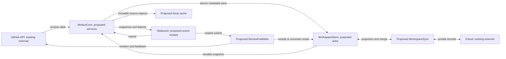

# Mobius: a persistent code-review workspace

## Planning checkpoint

- Updated: 2026-11-14; repository baseline `b629d56ac44a3f2a5ea59c3d6ae9cd5401f37674`.
- Operation: Execute 01a in a background agent while continuing production-plan discussion here. Native implementation is not requested.
- Requested scope and source: The user's 2026-11-14 request, Q-01–Q-07 answers, and Q-13–Q-18 follow-ups on review continuity and prototype priority; see [question history](#questions-and-resolutions).
- Stage: Prototype execution in an isolated worktree; production planning continues separately.
- Completed: Initial research and publication in [PR #497](https://github.com/kyleve/Stuff/pull/497); integrated one workspace per PR, file-top resumption, per-file remaining work, and a lightweight mockup across all three layouts. [STU-329](https://linear.app/kve/issue/STU-329/plan-mobius-code-review-app) tracks plan delivery.
- Pending: Prototype implementation, browser validation, and user feedback; PR review and merge. Q-08–Q-12 remain at their technical refinement gates. The mockup must supply interaction evidence before the durable model becomes executable.
- Execution authorization: The user subsequently requested background execution of 01a on 2026-11-14. The prototype runs on `codex/mobius-prototype` in `/Users/kve/.codex/worktrees/mobius-prototype/Stuff`, based on `4e70677e7`. Its branch owns the artifact and 01a execution evidence; this branch owns the overview and production-plan discussion.
- Next action: The background agent implements and validates [01a](01a-workspace-prototype.md#resume-point), then returns the artifact for user evaluation. Continue production discovery here without assuming the prototype has already validated its hypotheses.

## Outcome and scope

Mobius keeps code review open as ongoing work. Each PR has its own workspace containing its review, reference files, and searches. Reviewers switch between those independent workspaces and resume at the top of the file they left. A remaining-work view shows new edits in previously reviewed files and the full PR diff for unreviewed files; the full PR diff stays available for either. Each reviewed file has its own last-reviewed version. Nobody needs a temporary “got to here” GitHub comment.

PRs remain separate even when GitHub connects them in a stack. If a stack connection is shown, it is an informational link; it does not combine progress, drafts, comparison baselines, or submission actions. Stack discovery is not an additional first-release integration requirement.

The first release targets **iPhone, iPad, and Mac Catalyst**, including Mac windows, menus, and shortcuts. It supports GitHub PR diffs, comments, approvals, and requests for changes. Private iCloud sync carries workspaces and personal progress between devices using the same Apple ID. These are first-release requirements even though implementation is divided into deliverables.

Embedding the reviewer inside an owning app, with a possible live execution surface, is a **later feasibility experiment** in this series. It is not a first-release capability promise.

## User stories

| ID | Story |
| --- | --- |
| US-01 | Keep several reviews and reference documents open, so investigating one question does not discard another task. |
| US-02 | Resume my review file from its top, with drafts and progress preserved, without reconstructing my last session. |
| US-03 | Distinguish unchanged reviewed work from new PR changes, so I can concentrate on what needs another pass. |
| US-04 | Browse and search repository context without leaving the review workspace. |
| US-05 | Comment, approve, or request changes against the code I inspected. |
| US-06 | Resume the same work on iPhone, iPad, and Mac. |
| US-07 | Trust progress and recover from failures without incomplete downloads or interrupted submissions appearing complete. |
| US-08 | Learn whether embedding Mobius beside the running app can improve review with live context. |

## Requirements

R-01–R-07 and R-12 derive from the user's product choices. R-08–R-11 support repository contracts and correctness. Design details are proposals unless identified as user decisions.

| ID | Required behavior or constraint | Story | Implementing plan |
| --- | --- | --- | --- |
| R-01 | Run on iPhone, iPad, and Mac Catalyst, with Mac windows, menus, and keyboard commands. | US-06 | [02](02-application-workspace.md), [06](06-icloud-resume-and-release.md) |
| R-02 | Keep one independent workspace per PR, with its reference files and searches. Switching PRs preserves each workspace. Stack connections, if shown, are informational. | US-01, US-04 | [01a](01a-workspace-prototype.md) explores interaction; [01](01-review-state-foundation.md), [02](02-application-workspace.md), [04](04-repository-exploration.md) deliver it |
| R-03 | Persist workspace documents, the last review file, per-file reviewed versions, and drafts across relaunch. Resume the file from its top; precise in-file position and reviewed-range tracking are not required. Personal progress and submitted GitHub feedback remain separate facts. | US-02 | [01a](01a-workspace-prototype.md) explores interaction; [01](01-review-state-foundation.md), [02](02-application-workspace.md), [05](05-review-feedback.md) deliver it |
| R-04 | Within one PR, remaining work combines new edits since each reviewed file's last-reviewed version with the full PR diff for unreviewed files. Let either file open its full PR diff. An explicit file-review action advances that file's baseline; navigation and refresh do not. | US-03 | [01a](01a-workspace-prototype.md) explores interaction; [01](01-review-state-foundation.md), [03](03-github-and-revision-comparison.md) deliver it |
| R-05 | Browse files and search paths and text at an identified repository revision within Mobius. Open results without replacing the review and show search coverage. | US-04 | [04](04-repository-exploration.md) |
| R-06 | Read review discussion; compose and explicitly submit comments, approvals, and requests for changes with revision validation and recoverable drafts. | US-05 | [03](03-github-and-revision-comparison.md), [05](05-review-feedback.md) |
| R-07 | Resume documents, progress, and draft work through private iCloud sync on the same Apple ID. Keep device window placement local and expose sync state. | US-02, US-06 | [01](01-review-state-foundation.md) supplies identities; [06](06-icloud-resume-and-release.md) delivers sync |
| R-08 | Preserve original failures, last usable data, and incomplete coverage. Older requests cannot overwrite active state. Missing history cannot imply “reviewed” or “no changes.” | US-07 | [01](01-review-state-foundation.md), [03](03-github-and-revision-comparison.md), [04](04-repository-exploration.md), [05](05-review-feedback.md), [06](06-icloud-resume-and-release.md) |
| R-09 | Scope data by account and repository identity. Keep credentials in device-local Keychain; do not sync them or full repository caches. Protect private code and draft text from diagnostic export. | US-07 | [01](01-review-state-foundation.md), [03](03-github-and-revision-comparison.md), [06](06-icloud-resume-and-release.md) |
| R-10 | Support touch, keyboard, VoiceOver, accessibility text sizes, long lines, and large diffs. Define measured rendering/indexing budgets before the corresponding plan becomes ready. | US-01, US-04, US-06 | [02](02-application-workspace.md), [03](03-github-and-revision-comparison.md), [04](04-repository-exploration.md) |
| R-11 | Integrate module docs, manifests, tests, architecture boundaries, attribution, and CI. Release acceptance requires evidence on all three destinations and real cross-device sync. | Supporting constraint | [01](01-review-state-foundation.md), [02](02-application-workspace.md), [06](06-icloud-resume-and-release.md) |
| R-12 | Evaluate a host-injected embedded reviewer and bounded live-context action; report feasibility and limitations without promising arbitrary PR execution. | US-08 | [07](07-embedded-review-experiment.md) |

## Not required and explicitly avoided

| ID | Category | Exclusion | Reason |
| --- | --- | --- | --- |
| X-01 | Explicitly avoided | Native product implementation during the current prototype operation. | The execution request covers the lightweight 01a mockup. |
| X-02 | Not required | Other Git hosting providers, a general code editor, Git push/merge tools, and automatic AI reviews. | The selected workflow is GitHub review. |
| X-03 | Explicitly avoided | Marking files reviewed merely because they were opened; using scroll offsets as review receipts; posting personal progress as GitHub comments. | These recreate the continuity problem. |
| X-04 | Explicitly avoided | Executing downloaded PR code, arbitrary native hot loading, or promising a general build service. | Q-06 selected a later investigation. |
| X-05 | Explicitly avoided | Treating truncated data, missing history, ambiguous lineage, failed saves, or uncertain submissions as success. | Progress must remain trustworthy. |
| X-06 | Not required | A Mobius service for workspace sync or sync across different Apple IDs. | Q-07 selected private iCloud. Authentication hosting remains an alternative in Q-08. |
| X-07 | Explicitly avoided | Importing Where's product models or repurposing InstallerKit's catalog client as a GitHub client. | Mobius owns its domain; shared modules retain their contracts. |

## Context and discovery

- Planning issue: [STU-329](https://linear.app/kve/issue/STU-329/plan-mobius-code-review-app). Completion means plan delivery, not a shipped app. Create linked implementation issues for selected deliverables before execution; preserve this series as the execution record.
- No Mobius matches were found in Markdown or Swift at the baseline. Linear search included all pages, assignees, states, and `includeArchived: true`: 326 issues returned, with no matching app proposal.
- [Package.swift](../../Package.swift) owns libraries; [Project.swift](../../Project.swift) owns app/test targets. RegionViewer demonstrates target-specific Catalyst support without changing the shared iOS destinations.
- [Broadway](../../Shared/Broadway/AGENTS.md) and [SnapshotKit](../../Shared/SnapshotKit/AGENTS.md) use UIKit. Catalyst fits that direction, but Mobius's dependency closure has not been built.
- [InstallerKit's UpdateClient](../../Shared/InstallerKit/Sources/UpdateClient.swift) reads credential-free catalogs. It is not an existing GitHub client.
- [JournalKit](../../Shared/JournalKit/AGENTS.md) drops old segments under a byte budget. It is not selected as the authoritative workspace/draft store.
- Current `./test --help` selects iOS bundles or the host macro bundle. There is no Catalyst test destination. Host macro tests cannot establish Mobius's Mac behavior.

## Research and evidence

Consulted 2026-11-14. External sources establish documented capabilities, not live integration results.

| Question | Evidence | Implication |
| --- | --- | --- |
| Can a PR file response prove complete coverage? | GitHub documents a 3,000-file ceiling for [PR files](https://docs.github.com/en/rest/pulls/pulls#list-pull-requests-files). | Detect incomplete enumeration and expose coverage. |
| Is the compare endpoint sufficient? | [Compare commits](https://docs.github.com/en/rest/commits/commits#compare-two-commits) returns at most 300 changed files, on the first page. | It cannot be the sole authoritative file enumeration. Tree/blob comparison is the proposed fallback. |
| Can GitHub code search follow a PR revision? | [Code search](https://docs.github.com/en/rest/search/search#search-code) considers the default branch and has size/result limits. | Use a revision-bound tree and local text index for PR context. |
| Can trees be enumerated completely? | [Git trees](https://docs.github.com/en/rest/git/trees#get-a-tree) reports truncation and directs clients to fetch subtrees non-recursively. | Track traversal coverage; a missing subtree is not empty. |
| How does feedback bind to code? | [Reviews](https://docs.github.com/en/rest/pulls/reviews#create-a-review-for-a-pull-request) carry a commit ID and event; [review comments](https://docs.github.com/en/rest/pulls/comments#create-a-review-comment-for-a-pull-request) use path, side, and line/range. | Preserve immutable local anchors and validate them against the PR before submission. |
| What native authentication is supported? | GitHub's [user-token flow](https://docs.github.com/en/apps/creating-github-apps/authenticating-with-a-github-app/generating-a-user-access-token-for-a-github-app) documents PKCE and client credentials; [public-client guidance](https://docs.github.com/en/apps/oauth-apps/building-oauth-apps/best-practices-for-creating-an-oauth-app) addresses native clients. | Do not assume a secretless exchange or default to pasted personal tokens. Resolve Q-08. |
| Can UIKit support the workspace on Mac? | Apple's [Catalyst guidance](https://developer.apple.com/videos/play/wwdc2021/10053/) covers scene-backed windows and menus; [multiple-window guidance](https://developer.apple.com/documentation/uikit/supporting-multiple-windows-on-ipad) separates scenes from shared data. | Share services; keep scene presentation independent. Phone tabs must not require multiple windows. |
| Does CloudKit define merge behavior? | Apple's [CKSyncEngine guidance](https://developer.apple.com/videos/play/wwdc2023/10188/) assigns state persistence and conflict handling to the app. Its [sample](https://github.com/apple/sample-cloudkit-sync-engine) documents container, signing, and real-device/Mac prerequisites. | Define merge/account policies and obtain real two-device evidence. |

## Design overview

### Discovery scenario

PR 42 and PR 43 each have their own workspace. Opening a reference file or search from PR 42 retains it there when switching to PR 43. Returning to PR 42 restores its last review file at the top. A stack link between those PRs does not merge their work.

Within PR 42, mark `Parser.swift` reviewed at version 1 and leave `Store.swift` unreviewed. A simulated push supplies version 2. Remaining work shows the version-1-to-version-2 edits for `Parser.swift` and the full current PR diff for `Store.swift`. Either can open its full PR diff. Marking `Parser.swift` reviewed again advances only its baseline. These are files within one PR, not three separate reviews.

The first deliverable is a lightweight interactive mockup with phone, tablet, and desktop layouts. It will explore navigation, labels, and layout using synthetic PRs before native implementation or durable storage. See [01a](01a-workspace-prototype.md). A mockup result will not establish native platform, persistence, provider, or sync feasibility.

### Product concepts

- **Workspace:** one PR's review, source, and search documents. Another PR has a separate workspace, including when the PRs belong to a stack.
- **Document:** a typed route with account/repository identity and an explicit revision policy. Pinned source tabs must not silently follow moving branches.
- **Window presentation:** device-local selection, panes, focus, and scene identity. Synced work becomes available to resume without stealing focus or automatically spawning windows.
- **Resume file:** the last review file within that PR workspace. Reopening starts at its top; an exact scroll position is not durable review progress.
- **Review receipt:** explicit evidence for a file comparison, including both sides, paths, modes, and content identities. A new head alone neither invalidates every receipt nor proves any one remains current.
- **Per-file baseline:** the version last marked reviewed for that file. Remaining work compares against it; a file with no baseline shows its full PR diff. A separate manually captured PR-wide checkpoint is not required by the selected workflow.
- **Draft:** user text with its original revision/anchor. Draft, publishing, uncertain outcome, and confirmed publication remain distinct states.

### Proposed ownership

Start with `MobiusCore`, `MobiusUI`, and a thin `Mobius` app host. These are proposed names, not existing APIs.

Core owns typed values, revision/progress policy, local storage, provider protocols, GitHub transport, and sync policy in focused source directories. UI owns observable presentation, Broadway styling, code-rendering adapters, and navigation. The process composition root creates one runtime and injects it into each scene. Views do not open stores or create shared services.

The earlier candidate store is a serial actor with an atomically replaced, versioned metadata file, separate from evictable source blobs and indexes. Its concrete model and technology remain provisional until the mockup is evaluated. Stable identities, honest errors, and preservation of accepted user work remain constraints for later refinement.



Credentials come from device-local Keychain and are omitted. Sync carries metadata and draft text, not full source caches. Identity/generation checks precede mutation after asynchronous work. A local save and a GitHub write are not one atomic transaction.

```swift
// Proposed ownership only; not compiled code or existing APIs.
@MainActor
final class MobiusRuntime {
    let workspaceStore: WorkspaceStore
    let repository: any ReviewRepository
    let reviewPublisher: ReviewPublisher
    let workspaceSync: WorkspaceSync
    // One process/account scope, injected into all scenes.
}

@MainActor
final class WorkspaceModel {
    let workspaceID: Workspace.ID
    let runtime: MobiusRuntime
    var presentation: WindowPresentation // Device-local.
}

actor WorkspaceStore {
    func apply(_ mutation: WorkspaceMutation,
               expectedVersion: WorkspaceVersion) throws -> WorkspaceSnapshot
    // External callers await actor isolation. There is no await gap inside
    // a local save; publish only after persistence succeeds.
}
```

[01](01-review-state-foundation.md) will define production value/persistence contracts after the mockup. This ownership sketch is a candidate native design; the mockup does not implement these services. Network, sync, and renderer interfaces remain provisional until their outlines are refined. Authentication UI and native scene adapters are omitted.

## Execution order

| Order | Plan | Deliverable |
| --- | --- | --- |
| 1 | [01a — Workspace prototype](01a-workspace-prototype.md) | Lightweight interactive mockup of separate PR workspaces and remaining work across phone, tablet, and desktop layouts. |
| 2 | [01 — Review-state foundation](01-review-state-foundation.md) | Durable workspace/progress state informed by prototype evidence. |
| 3 | [02 — Application workspace](02-application-workspace.md) | Native app with tabs, scenes, file-top resumption, and accessible navigation. |
| 4 | [03 — GitHub and revision comparison](03-github-and-revision-comparison.md) | Authenticated PR reading and per-file remaining-work comparisons. |
| 5 | [04 — Repository exploration](04-repository-exploration.md) | Revision-bound browsing and path/text search alongside each review. |
| 6 | [05 — Review feedback](05-review-feedback.md) | Comments and reviews with retained drafts and uncertain-outcome recovery. |
| 7 | [06 — iCloud resume and release](06-icloud-resume-and-release.md) | Cross-device continuity and verified first-release acceptance. |
| 8 | [07 — Embedded review experiment](07-embedded-review-experiment.md) | Evidence and a recommendation for embedded review with bounded live context. |

01a is an inserted prerequisite; the earlier reviewed filenames remain stable. This table defines execution order.

## Planning horizon

- Detail now: [01a](01a-workspace-prototype.md), selected in Q-16–Q-18 to explore all three layouts through a lightweight interactive mockup.
- Later selected work: 01–07 are outlines. The earlier claim that 01 was ready is superseded; its model must follow prototype learning.
- Next horizon review: Record prototype observations and the user's feedback, integrate changed decisions, then refine 01 and reconsider 02/03. Technical decisions Q-08–Q-12 retain their recorded gates.
- First-release gate: **01–06 together**, preceded by prototype learning. The mockup does not deliver or waive native platform, GitHub feedback, persistence, or sync requirements.

## Shared decisions

| Date | Decision and reason | Source |
| --- | --- | --- |
| 2026-11-14 | Mobius is a persistent workspace for concurrent review and exploration. | Request, Q-03. |
| 2026-11-14 | iPhone/iPad plus Mac Catalyst with Mac windows, menus, and shortcuts. | Q-01, Q-04. |
| 2026-11-14 | GitHub diffs, comments, approvals, and requests for changes in the first release. | Q-02. |
| 2026-11-14 | Private iCloud continuity on the same Apple ID is a first-release requirement. | Q-05, Q-07. |
| 2026-11-14 | Embedding/live context receives a later experiment. | Q-06. |
| 2026-11-14 | One workspace per PR; stack connections are informational. | Q-13 and Q-15 clarification. |
| 2026-11-14 | Resume at the top of the last review file. | Q-14 follow-up. |
| 2026-11-14 | Remaining work uses each reviewed file's last-reviewed version and includes the full PR diff for unreviewed files. Full PR diffs remain available. | Q-15 follow-up; replaces the earlier PR-wide explicit-checkpoint proposal. |
| 2026-11-14 | Start with a lightweight interactive mockup exploring phone, tablet, and desktop together. | Q-16–Q-18; replaces foundation-first sequencing. |
| 2026-11-14 | Proposed: sync semantic workspace data and drafts; keep native geometry/focus and full code caches local. | R-07/R-09. |
| 2026-11-14 | Proposed: atomic metadata storage, not a bounded journal as the only copy of user work. | JournalKit contract. |

## Questions and resolutions

| ID | Status | Question | Affected work | Blocking impact / next action |
| --- | --- | --- | --- | --- |
| [Q-01](#q-01) | closed | First platforms? | R-01, 02, 06 | Resolved; preserve all three. |
| [Q-02](#q-02) | closed | First workflow/provider? | R-06, 03, 05 | Resolved; preserve GitHub review actions. |
| [Q-03](#q-03) | closed | What problem should Mobius solve? | US-01–US-04, R-02–R-05 | Resolved; continuity and exploration remain central. |
| [Q-04](#q-04) | closed | Native macOS or Catalyst? | R-01, 02 | Resolved; validate a Mac-appropriate Catalyst UI. |
| [Q-05](#q-05) | closed | Sync in first release? | R-07, 06 | Resolved; do not defer beyond the release. |
| [Q-06](#q-06) | closed | Embedding/live-review scope? | R-12, 07 | Resolved; later bounded experiment. |
| [Q-07](#q-07) | closed | iCloud or GitHub-backed sync identity? | R-07/R-09, 06 | Resolved; private iCloud, same Apple ID. |
| [Q-08](#q-08) | deferred | GitHub App/OAuth App, token exchange, permissions, and repository access? | 03, 05 | Blocks 03 readiness; validate the supported native flow before refinement. |
| [Q-09](#q-09) | deferred | CloudKit mapping and concurrent edit/delete/account policy? | 05, 06 | Publication ownership blocks 05 readiness; full merge/schema policy blocks 06. 01 must retain stable IDs and revision evidence. |
| [Q-10](#q-10) | deferred | Renderer and measured large-workspace budgets? | 02–04 | Blocks UI/diff readiness; benchmark fixtures during refinement. |
| [Q-11](#q-11) | deferred | Catalyst validation and release distribution/signing? | 02, 06 | Specify compile/runtime validation in 02; resolve distribution in 06. |
| [Q-12](#q-12) | deferred | What can an embedded reviewer prove about a build and PR? | 07 | Blocks a product promise; choose a synthetic host after standalone delivery. |
| [Q-13](#q-13) | closed | How is concurrent review work grouped? | R-02, 01a, 01, 02, 04 | One independent workspace per PR. |
| [Q-14](#q-14) | closed | What should resuming a review restore? | R-03, 01a, 01, 02, 06 | Return to the review file and start at its top. |
| [Q-15](#q-15) | closed | How should new edits and unfinished work appear within one PR? | R-04, 01a, 01, 03, 05, 06 | Per-file last-reviewed versions; full PR diffs for unreviewed files and as an available alternate view. |
| [Q-16](#q-16) | closed | What should the first deliverable validate? | Execution order, 01a, 01, 02 | Interactive prototype with sample PRs before durable state work. |
| [Q-17](#q-17) | closed | Which layouts should the prototype explore? | 01a | Phone, tablet, and desktop together. |
| [Q-18](#q-18) | closed | What form should the prototype take? | 01a | Lightweight interactive mockup for quick iteration. |

User answers came from this chat on 2026-11-14. Q-13–Q-18 refine the original answers without reopening the selected platforms, provider, or iCloud scope. The current horizon is prototype evaluation; detailed navigation and layout are hypotheses to explore through it.

### Q-01

- Answer: iPhone, iPad, and macOS.
- Integration: R-01, US-06, 02, 06; Q-04 selects the Mac implementation.
- History: Opened, answered, integrated, and closed after platform-coverage review.

### Q-02

- Answer: Review GitHub PRs: diffs, comments, approvals, requests for changes.
- Integration: R-06, US-05, 03, 05, and the release gate.
- History: Opened, answered, integrated, and closed after scope review.

### Q-03

- Answer: Linear review flows lose progress; changes since the prior pass are hard to see; iOS makes concurrent reviews difficult; repository exploration interrupts review. The user imagines tabs or desktop-style windows.
- Integration: Outcome, US-01–US-04, R-02–R-05, product concepts, 01–04. Q-06 separately scopes the suggested embedding idea.
- History: Opened, answered, integrated, and closed after checking each problem has an owned deliverable.

### Q-04

- Answer: Mac Catalyst with Mac-specific windows, menus, and shortcuts.
- Integration: R-01, ownership design, 02, 06.
- History: Opened, answered, integrated, and closed against the UIKit module constraints.

### Q-05

- Answer: Resume the same work across all three platforms in the first release.
- Integration: R-07, 06, first-release gate. Local persistence alone is groundwork.
- History: Opened, answered, integrated, and closed after checking release scope.

### Q-06

- Answer: Include a later feasibility experiment for embedding and live execution.
- Integration: R-12, X-04, 07. Negative evidence can complete an experiment without satisfying a product hypothesis.
- History: Opened, answered, integrated, and closed after experiment-scope review.

### Q-07

- Answer: Private iCloud sync using the same Apple ID.
- Integration: R-07/R-09, X-06, design flow, 06.
- History: Opened, answered, integrated, and closed after sync-scope review.

### Q-08

- Answer/source: Unresolved; official token/public-client sources are in Research and evidence.
- Integration: 03 owns registration choice, callback/token refresh, private repositories, organization restrictions, and any necessary authentication service. A confidential credential cannot be assumed secure inside a native binary.
- Deferral: Needed before 03, not the synthetic local foundation. Validate the concrete flow, integrate the result, and repeat review. Do not default to PAT-based onboarding.
- History: Opened and deferred on 2026-11-14.

### Q-09

- Answer/source: iCloud transport is selected; record and merge policies remain unresolved.
- Integration: 05 owns publication intent/receipt identity and must settle cross-device submission ownership before readiness. 06 owns engine-state persistence, account partitioning, close/reorder races, and conflicting draft edits. Preserve both texts on concurrent draft conflict.
- Deferral: Design publication ownership before implementing 05 and the full record/merge policy before 06, using 01's stable IDs. Revise earlier schemas if the evidence requires it. CKSyncEngine is a candidate transport, not a conflict policy.
- History: Opened and deferred on 2026-11-14.

### Q-10

- Answer/source: UIKit/Broadway direction is established; renderer and budgets remain unresolved.
- Integration: 02 owns tabs/scenes/keyboard/VoiceOver; 03/04 own diff and indexing workloads.
- Deferral: Benchmark representative fixtures and set explicit latency/memory budgets before readiness. Initial metadata tests do not depend on the renderer.
- History: Opened and deferred on 2026-11-14.

### Q-11

- Answer/source: Unresolved. RegionViewer and current `./test --help` were inspected; no Catalyst test command exists.
- Integration: 02 must specify a CLI Catalyst build and real window smoke test; 06 owns signed distribution and final runtime acceptance.
- Deferral: Read current tooling and installer contracts before extending them. Use existing iOS test/snapshot schemes and add missing Catalyst coverage. No distribution action is authorized by plan creation.
- History: Opened and deferred on 2026-11-14.

### Q-12

- Answer/source: Unresolved; the user selected an experiment.
- Integration: 07 owns host injection, build identity, bounded live actions, and negative/inconclusive outcomes.
- Deferral: Select the host/method after reusable UI/services exist. Opening a PR does not make its code executable in the running binary.
- History: Opened and deferred on 2026-11-14.

### Q-13

- Answer/source: The user selected a workspace per PR. The Q-15 clarification also establishes that separate PRs are separate reviews, with a stack connection largely an informational note.
- Integration: R-02, product concepts, 01a, and the workspace ownership and navigation in 01/02/04/06.
- History: Asked, answered, integrated, and closed after checking that documents and progress do not merge across PRs. This does not require implementing GitHub stack discovery.

### Q-14

- Answer/source: Initially uncertain between a point in a file and the file reached in order. The follow-up answer was to start from the top of the file.
- Integration: R-03, resume-file concept, 01a/01/02/06. Precise in-file restoration and reviewed-range tracking are not first-release requirements.
- History: Kept open after the tentative answer; closed after the file-top preference was integrated. Reading or returning to a file does not itself mark it reviewed.

### Q-15

- Answer/source: Initially uncertain and described as personal; suggested a diff since the last review and/or unreviewed files. An ambiguous A/B/C example prompted clarification that PRs must stay independent. A subsequent example explicitly used two files within one PR; the user accepted showing new edits in a reviewed file and the full PR diff in an unreviewed file, using each file's last-marked-reviewed version and keeping full PR diffs accessible.
- Integration: R-04, per-file baseline concept, 01a/01/03/05/06. A manually captured PR-wide checkpoint is no longer the selected model.
- History: Kept open through the tentative answer and scenario clarification; closed after the per-file proposal was accepted and integrated. No configurable collection of alternative baseline modes was requested.

### Q-16

- Answer/source: Interactive prototype with sample PRs as the first deliverable.
- Integration: Inserted 01a before 01; returned 01 to outline and made prototype evidence its refinement prerequisite.
- History: Asked, answered, integrated, and closed after dependency review. This selects the plan's first deliverable; implementation still requires an execution request.

### Q-17

- Answer/source: Explore all three layouts together.
- Integration: 01a covers phone, tablet, and desktop viewports with the same synthetic workflow.
- History: Asked, answered, integrated, and closed. Viewport demonstrations do not establish native iPhone/iPad/Catalyst behavior.

### Q-18

- Answer/source: Lightweight interactive mockup for quick iteration.
- Integration: 01a produces a self-contained browser artifact; native UIKit targets, persistent stores, authentication, and CloudKit remain later work.
- History: Asked, answered, integrated, and closed after checking prototype scope and acceptance. Browser technology is an implementation choice for the mockup, not the production app architecture.

## Plan review

- Initial review: 2026-11-14 against `b629d56ac44a3f2a5ea59c3d6ae9cd5401f37674`, covering the original eight files. Its readiness finding for 01 is superseded by Q-13–Q-18 and prototype-first sequencing.
- Initial findings and disposition (historical): Aligned the overview's store signature with 01's then-proposed version-checked save; corrected 02's runtime ownership claim; added receipt-isolation and persistence-recovery scenarios; assigned app attribution to 02. Brought Q-09's submission-ownership decision forward to 05 and added its definitive rejection transition. No implementation tests ran; 01's detailed design is now deferred until prototype evaluation.
- Revision review: Integrated Q-13–Q-18 across the nine-file series, including workspace isolation, file-top resumption, per-file baselines, and prototype-first dependencies. Reviewed 01a for executable experiment detail; 01–07 remain outlines.
- Readiness: 01a is ready for a subsequent execution request. Prototype interaction findings and user feedback are prerequisites to refining 01. A negative prototype result can lead to a revised design; it does not establish production feasibility.
- Verification: All 118 local Markdown links and anchors resolve across nine files; fences are balanced; the eight-plan dependency graph is acyclic; all 12 requirements have implementing owners; `git diff --check` passes. These checks validate the plan, not the proposed app.
- Validation limits: No prototype, device test, product API write, or sync experiment has run. Swift is pseudocode. Mermaid was inspected as source; no local renderer was found. `./test` and `./swiftformat --lint` were skipped because only planning Markdown changed.

## Review and delivery

- Plan review: [PR #497](https://github.com/kyleve/Stuff/pull/497), ready for review. [STU-329](https://linear.app/kve/issue/STU-329/plan-mobius-code-review-app) remains In Review until merge and acceptance verification.
- Implementation: 01a is authorized and running in an isolated background worktree. Native plans 01–07 have not started.
- Review focus: Independent PR workspaces; per-file remaining work and full-diff access; file-top resumption; prototype learning before the durable model; sync as a release gate.

## Outcome

The revised series starts with the lightweight, three-layout mockup in 01a, now authorized for background execution. Plans 01–07 remain outlines informed by later evidence and production discussion.
