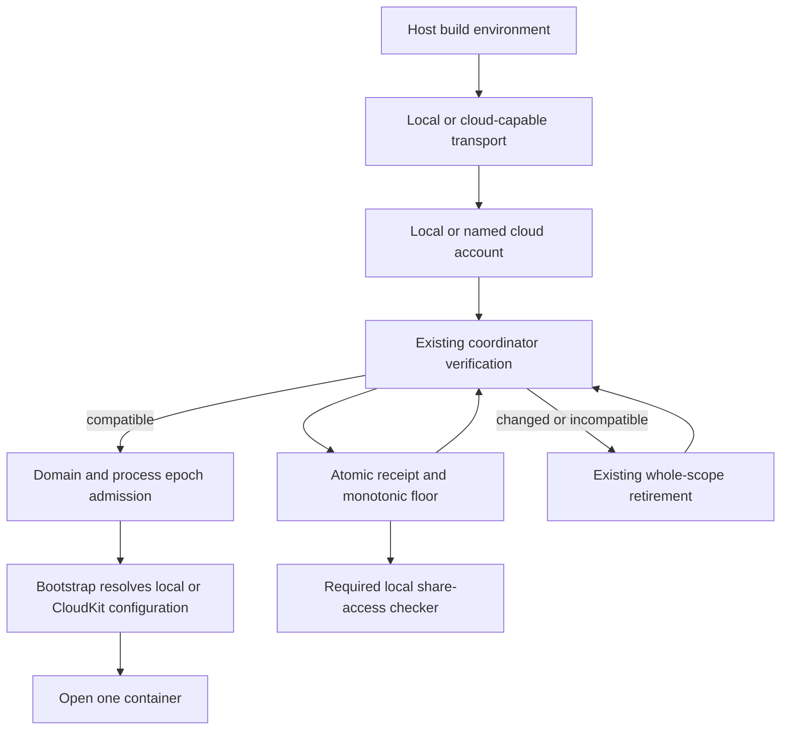

# 01 — Unified compatibility access

- Status: executing
- Depends on: none; follows the completed [ownership series](../2026-11-17-compatibility-review/README.md).
- Shared context: [Overview](README.md)

## Deliverable

R-01–R-05/R-09 and US-01–US-03: all builds verify through required transport/receipt dependencies. A confirmed absent cloud account admits safe local operation. Account/mode transitions revoke old admission and retire the old container before opening its replacement. Share extensions always check locally published access.

## Context and constraints

The overview maps owning rules and guards. Follow Swift, concurrency, testing, launch, app composition, and share contracts. Preserve X-01/X-03/X-05. The account lookup must distinguish `.noAccount` from `.restricted`, `.couldNotDetermine`, and `.temporarilyUnavailable`. The latter three never synthesize a local grant.

The stored receipt remains outside SwiftData, atomic, and excluded from backups. Its highest version survives a change in domain. A local grant is not cloud publication evidence. Existing wire record/zone/field identifiers remain unchanged. The unpublished receipt identity shape may change; malformed receipts remain blocking, not treated as a fresh installation. No legacy data migration is introduced.

## Data flow



Existing components: coordinator, bootstrap, scope retirement, receipt and share model. Proposed values: explicit domain and admission token; proposed implementation: local transport and required access checker. Transport calls can suspend; stale epochs and mismatched opening admissions reject their results. The diagram omits service assembly and log-store cleanup, which retain existing ownership.

## Architecture sketch

```swift
// Proposed domain values. Cloud identity records provenance as separate fields.
struct DataCompatibilityAccountID: Codable, Hashable, Sendable {
    let containerIdentifier: String
    let userRecordName: String
}
enum DataCompatibilityDomain: Codable, Hashable, Sendable {
    case local
    case cloud(DataCompatibilityAccountID)
}
struct DataCompatibilityAdmission: Equatable, Sendable {
    let domain: DataCompatibilityDomain
    let epoch: UInt64 // process-local; never substitutes for receipt evidence
}
protocol DataCompatibilityTransport: Sendable {
    func domain() async throws -> DataCompatibilityDomain
    func read(domain: DataCompatibilityDomain) async throws -> PersistedDataModelVersion?
    // Conditional advance and account-change stream retain the same responsibilities.
}
// The same coordinator verifies local or remote observations and persists receipts.
let admission = try coordinator.requireAccess()
let storage = configuredStorage.admitted(for: admission.domain)
let store = try await open(storage)
try coordinator.requireAccess(admission) // reject account changes during open
```

The local transport reports the build's current version, without server communication. Existing receipts still block an older build. The cloud transport delegates confirmed-no-account operations to that local implementation; it rechecks the account around suspended operations. Cloud publication continues to require real recording eligibility.

The coordinator owns transport, receipts, verification epoch and one in-flight check. Allowed/offline state carries its admission. An observed domain change revokes the existing admission before verifying a replacement. `WhereBootstrap` captures admission with each opening/prepared store; the existing scope compatibility collaborator captures it for a real scope. This prevents returning or revealing a stale scope if a replacement decision arrives while shutdown drains. Demo/test scope collaborators remain inert; the process gate still applies to demo.

A required `DataCompatibilityAccessChecking` API returns a verified receipt or throws. Production app-group access is used for share builds, including Development after the app's local verification. Preview/test access uses a concrete fixture implementation. Filesystem receipt reads can run outside the main actor; coordinator writes and observable decisions stay main-actor owned.

## Steps

1. Add typed domain/admission values, structured cloud identity, `PersistedDataModelVersion`, and local transport/receipt fixtures. Replace the coordinator's nil backend and all default-constructor callers with explicit local composition.
2. Add account-status resolution to the cloud adapter, delegate only confirmed-no-account access locally, centralize schema strings and operation setup/error classification, and retain account checks before/after writes.
3. Bind admitted storage and scope results to their admission token. Use existing retirement on domain changes; reject stale openings even if the domain later returns to the same account.
4. Resolve compiler flags only in `WhereBuildEnvironment`; store the configured policy once in the runtime. Remove the share build's optional-access flag and require a receipt-backed checker everywhere, with an isolated preview implementation.
5. Add deterministic tests for local verification/receipts, no-account access, restricted/unavailable rejection, preserved floors, cloud re-entry requiring recorder publication, and account changes during held opens. Exercise account-status classification below the coordinator's fake transport where practical.
6. Extend CompatibilityPublication for local domain and transitions, preserving cloud-only publication and receipt/floor properties. Update source correspondence in both specs and retain deliberate broken variants/reachability witnesses for added safety properties.
7. Update affected module documentation/contracts and plan evidence. Run selected checks, independent completed-diff review, commit, push, and reply to the nine addressed access/transport/share threads. Later UI/widget threads remain owned by their plans.

## Acceptance and verification

All commands run from the repository root.

| Requirement | Acceptance | Verification |
| --- | --- | --- |
| R-01/R-02 | Local mode verifies and publishes a local receipt; a higher floor blocks; unavailable/restricted never becomes local; cloud re-entry checks remote version and recorder eligibility | `./test --only WhereCoreTests/DataCompatibilityCoordinatorTests --only WhereCoreTests/DataCompatibilityReceiptTests --only WhereCoreTests/DataModelVersionTests` plus the new focused transport/access suites |
| R-02 | Account changes invalidate held openings and old scopes; replacement waits for retirement | `./test --only WhereUITests/WhereCompatibilityModelTests --only WhereUITests/WhereLaunchTests` |
| R-03/R-04 | Host flags are centralized; share checker is required and rejects missing/blocked/mismatched evidence | Build-environment tests, access tests, source review and `./test --architecture-only` |
| R-05 | Stable schema identifiers; conditional saves/account fencing retained | Transport tests and source review |
| R-09 | Extended model cases match declared outcomes and existing guards remain valid | `TLA_JAVA=<pinned Java> ./tla-check CompatibilityPublication CompatibilityLockout`; retain counts and bounds |
| R-09 | Source and documentation agree; formatter/architecture pass | `./swiftformat --lint`, `./sf-symbols --lint`, `./sync-agents --check`, `git diff --check` |

Run `./test --all` once the coherent integration is ready because the change reaches app composition and many fixtures. Regenerate with `./ide --no-open` for newly discovered source files. Physical account/sign-in synchronization remains device validation; fakes do not establish CloudKit delivery timing.

## Recovery

Use Git status and this execution record to identify uncommitted work. Do not discard partial changes or reset real user data. On a failing check, repair the affected source before committing. A receipt I/O/decoding failure stays blocked. Never recover tests by changing a known version floor or opening the user's on-disk store. Reuse test products only after rebuilding changed inputs.

## Decisions and revisions

- 2026-11-17: user approved local operation, required implementations, explicit sync policy, transport cleanup, and execution.
- 2026-11-17: source inspection closes Q-03 with admission-bound bootstrap/scope ownership and existing retirement. This also handles an account change discovered during refresh before its notification arrives.

## Progress

- [x] Implement domain/backend/coordinator and receipt access.
- [x] Integrate storage, host policy, scope ownership, and share access.
- [x] Add Swift and formal coverage; update docs.
- [ ] Verify, independently review, and publish with individual replies.

## Execution record and resume point

Plan published in `a0f844ec9`. Implementation remains uncommitted pending full verification and independent review.

- Focused `./test` selection passed 63 tests: coordinator, receipt/access, account-status adapter, model version, compatibility lifecycle, launch, and build environment. Architecture and host checks passed in the same run.
- `TLA_JAVA="$PWD/.build/tla/mise/data/installs/java/temurin-21.0.8+9.0.LTS/bin/java" ./tla-check CompatibilityPublication CompatibilityLockout` passed all 50 declared outcomes (30 publication, 20 lockout). Added 10 local/transition cases; inspected their three deliberate-failure traces. Artifacts: `CompatibilityPublication.99savO` and `CompatibilityLockout.E9u5N2` under `.build/tla/runs/`.
- `./swiftformat` and `git diff --check` passed. First Swift build exposed non-Sendable helper closures; explicit Sendable actor-isolated operations fixed it. Initial sandboxed TLC run was unable to open its local Java management socket; the authorized run outside that sandbox passed.
- `./test --all --no-generate` exercised 2,986 iOS tests: 2,984 passed, with two demo fixture failures identified by independent review. Both fixtures now perform ordinary local verification before activation and assert activation succeeds. All other unit tests and 28 host macro tests passed; the final rebuilt affected-suite run passed all 55 tests.
- Independent source review against `a0f844ec9` found only those fixture regressions; the reviewer confirmed their source fix and the audit of other activation callers. Formal review found a missing captured admission-generation boundary and a missing matching local-viewer configuration. Both are now modeled and verified: 31 publication outcomes in `CompatibilityPublication.xUKzT9`, 22 lockout outcomes in `CompatibilityLockout.DbwL0F`, with the new traces inspected. The source/model reviewer confirmed no remaining substantive findings.
- Final reuse audit also bound onboarding discovery's active-scope fallback to its original admission; independent review confirmed the guard and regression assertion. The held-open regression now covers both same-account invalidation and ordinary blocked/recovered verification.
- Final SwiftFormat, safe-symbol lint, guidance validation, and diff whitespace checks passed. No dependency or string-catalog changes in this step.
- Final command: `./test --only WhereCoreTests/DataCompatibilityCoordinatorTests --only WhereCoreTests/DataCompatibilityReceiptTests --only WhereCoreTests/DataCompatibilityAccessTests --only WhereCoreTests/CloudKitDataCompatibilityTransportTests --only WhereUITests/WhereCompatibilityModelTests --only WhereUITests/DemoModeTests --only WhereUITests/DemoModeEnvironmentTests --no-generate`: 55 tests passed, including both formerly failing fixtures and the added cold-local-receipt/held-opening cases. Architecture and host helper checks also passed.
- Resume: commit/push 01 and reply to its nine threads plus the deferred model-composition thread; then promote the refined 02 draft.

## Outcome

Pending implementation and publication.
