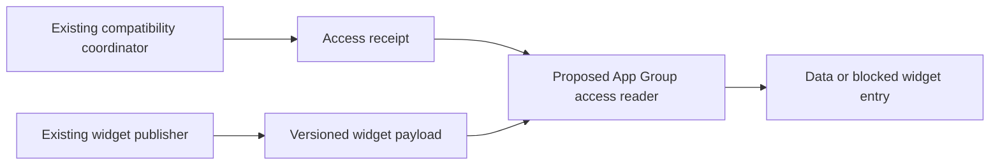

# 02 — Compatibility-aware widget access

- Status: outline
- Depends on: [01](01-unified-access.md).
- Shared context: [Overview](README.md)

## Intended outcome

R-06/R-09 and US-02: widget reads go through shared App Group access, validate receipt and payload provenance, and show an explicit blocked state when history is incompatible. Access withdrawal/recovery requests a timeline reload. Theme publication remains independent of history access.

## Known design

Keep the existing aggregated JSON publisher and lightweight widget extension (X-02). The proposed reader consumes plan 01's required access interface and an envelope identifying the source version/account. It does not open SwiftData. Read/write races must fail closed instead of combining unrelated receipt/payload evidence.



```swift
// Proposed boundary; concrete evidence types come from plan 01.
let result = try appGroupAccess.readWidgetSnapshot()
// Provider maps available / absent / blocked to presentation.
```

## Refinement trigger

- Trigger: plan 01 verifies its access receipt and mode-transition semantics.
- Evidence needed: stable access API, account/version provenance, and notification ownership.
- Next action: define envelope/read consistency and blocked rendering, select regression/snapshot coverage, and review before readiness.

## Resume point

Implementation has not started. Refine after 01; no additional user decision is pending.
