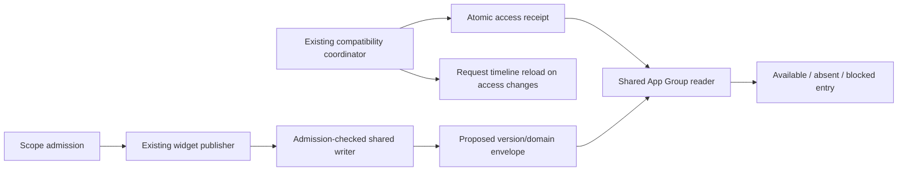

# 02 — Compatibility-aware widget access

- Status: complete
- Depends on: [01](01-unified-access.md), completed and published in `ddcc4a2f3`.
- Shared context: [Overview](README.md)

## Deliverable

R-06/R-09 and US-02: widget reads go through shared App Group access, validate receipt and payload provenance, and show an explicit blocked state when history is incompatible. Access withdrawal/recovery requests a timeline reload. Theme publication remains independent of history access.

Preserve X-01/X-02: no widget SwiftData container or per-history-API checks. Follow the Core/UI/widget contracts and building-ui/running-tests skills. The existing widget JSON is an ephemeral cache; old or malformed payloads show absent/blocked content until the app republishes, with no migration.

## Evidence and design

Plan 01 provides exact-version verified receipts containing a local/cloud domain, and process-local admission tokens invalidated on withdrawal. The existing `WidgetSnapshotStore` reads unqualified JSON. Its production refresher is created before admission and can outlive scope withdrawal while suspended work drains. Simply tagging a late write with the current receipt would mislabel old-scope data.

Capture the admitted domain/version when constructing each real scope's widget publisher. Validate its process admission before atomically writing an envelope. Do not derive provenance from whichever account happens to be current when a late publish finishes. Bootstrap creates the refresher through an injected factory once it knows the admission; demo/test refreshers stay inert.

The shared App Group access API owns receipt-checked snapshot reads and writes. An envelope carries the snapshot plus its admitted data version and domain. A read requires an exact verified receipt, loads the envelope, checks matching provenance, then rechecks the receipt. Missing receipt, withdrawn access, a version/account mismatch, or evidence changing during the read returns a blocked result without snapshot data. A compatible grant with no decodable envelope returns absent content. Existing stale-day behavior remains unchanged.

Both receipt and snapshot writes remain atomic files; this is not a filesystem transaction or immediate revocation of a timeline already held by WidgetKit. Domain/version checks and the second receipt read reject observable mixed evidence. The process admission guards stale publishers. WidgetKit still chooses when to serve a requested reload.



Existing components: coordinator, bootstrap, publisher, receipt, JSON stores, provider. Proposed: payload provenance, shared reader/writer methods, blocked widget view. Theme publication and WidgetKit scheduling are omitted from the diagram; they remain independent.

```swift
let admission = try coordinator.requireAccess()
let refresher = makeWidgetRefresher(admission)
// On the owning actor, require the captured admission before writing the envelope.
try coordinator.requireAccess(admission)
try access.writeWidgetSnapshot(snapshot, provenance: provenance)

// No SwiftData or CloudKit request in the widget process.
let content = try access.readWidgetSnapshot(version: .current)
// available(snapshot), absent, or blocked
```

## Steps

1. Add a version/domain envelope and shared App Group read/write boundary. Preserve low-level stores as implementation details and the separately published theme. Keep missing/corrupt evidence handling explicit and logged.
2. Bind the production widget refresher to its scope admission through bootstrap composition; reject stale writes before serialization. Request timeline reload when compatibility first resolves, withdraws, or recovers, without rebuilding history for a blocked state.
3. Change widget entries/provider to carry available/absent/blocked content. Add one shared WhereUI blocked view adapted to inline, circular, rectangular, and home-screen families. Use existing stylesheet tokens, safe symbols, and localized Open Where guidance. Preserve ordinary widget rendering.
   Route the Today intent's optional snapshot fast path through the same reader; retain its existing live-service fallback after the required intent handoff.
4. Add deterministic receipt/payload mismatch and read-interleaving tests, stale-publisher tests, and reload transition tests. Add focused blocked-widget snapshots; retain ordinary widget coverage.
5. Update module contracts/docs and this evidence. Verify, independently review, commit/push, and reply to thread [4605233370](https://github.com/kyleve/Stuff/pull/495#discussion_r4605233370), including why aggregated JSON remains appropriate. Refine 03 against the final runtime callback.

## Acceptance and checks

| Acceptance | Evidence |
| --- | --- |
| No snapshot data without exact verified matching evidence; old payloads are harmless caches | Core access/store tests for missing, corrupt, blocked, version/domain mismatch, and receipt change around read |
| A retired publisher cannot label old data with a new admission | Held-work or explicit old-token publication regression; inspect written payload |
| Withdrawal/recovery requests reload once per relevant transition | Injected timeline reloader assertions; retain independent theme tests |
| Blocked widgets remain readable in every supported family | Focused image coverage in WhereUISnapshotTests, including dark and large type where supported; visually inspect before recording |
| Existing widget history and presentation behavior remains valid | WidgetSnapshotPublisherTests, WidgetSnapshotStoreTests, WidgetPresentationPublisherTests, WidgetPresentationStoreTests and affected ordinary widget snapshots |
| Composition and formatting remain valid | `./test --architecture-only`, `./swiftformat --lint`, `./sf-symbols --lint`, `./xcstrings --lint`, `git diff --check` |

Use `./ide --no-open` for added source files; use `./test` for simulator suites. Tests cover requests and file decisions, not physical WidgetKit delivery timing. Record exact selected commands/counts after running.

## Recovery

Repair failures before committing. Do not reset the user's App Group data. Tests use temporary directories and injected readers/reloaders; unreadable evidence never restores access. If the API changes during implementation, update this plan before dependent work.

## Refinement and review

2026-11-17: refinement trigger met for API/design: plan 01's 63 focused tests and independent source review established the required receipt/admission boundary. Plan 01 is now published in `ddcc4a2f3`; final 55-test rerun passed and both independent reviews are complete. Refinement adds captured publisher provenance and double receipt checking to avoid late-write and mixed-read races. No product question remains. Reviewed against the final API and the full series on 2026-11-17: the writer retains old-scope provenance; reads fail closed on mismatches; theme and widget scheduling stay independent. Requirements, exclusions, steps, and verification agree. Ready for authorized execution. Diagrams are syntax-inspected, not rendered.

## Progress and resume point

- [x] Finish review/readiness after 01 publication.
- [x] Implement reader/writer, publisher admission, and reload.
- [x] Implement blocked presentation and coverage (visually reviewed).
- [x] Verify, review, publish, and reply.

Implementation started after publishing the reviewed plan in `8a0390d9e`. Reader/writer, admission-bound publication, reload transitions, and blocked rendering are implemented locally. The first build exposed the Today intent's low-level snapshot consumer; it now uses shared access, preserving its existing live-service fallback. This necessary caller adaptation is within R-06, reviewed against WhereIntents' handoff contract. Published in `ee67c64d7`; widget-thread reply and reviewed image comment are posted. Continue with reviewed plan 03.

## Verification

- Selected widget/access/presentation, compatibility/reload, Flyover, build-environment, and intent-reader suites: 47 tests passed with a rebuilt product (`./test` with the nine `--only` suite selections).
- Final read-interleaving refinement: rebuilt `WhereCoreTests/WidgetDataAccessTests`, 4 tests passed, including both present and absent cache cases.
- Initial focused `--record missing` capture created 9 references / 12 captures. The recording-only failures were expected. Visual review found a clipped AX5 title; changed the fallback to retain the full title and added fixture backgrounds for visible light/dark inspection. Recaptured the corrected layout and inspected all nine references in both themes/appearances. AX5 now shows the complete title on two lines.
- Fresh independent source review caught the Today intent consumer at the same time as the first build. It now uses `AppGroupDataAccess`; its existing live-report fallback tests pass. Follow-up source review found no remaining issue. Independent visual review of all nine references found no remaining issue.
- Final `./test --snapshots` selection of WidgetCompatibilityView, TodayWidgetView, YearTotalsWidgetView, TodayInlineAccessoryView, TodayCircularAccessoryView, and YearTotalsRectangularAccessoryView suites with `--record never --no-build --no-generate --review --timings`: 40 references / 43 captures passed. Three theme sheets differed in encoding only (zero changed pixels).
- Architecture (30 rule tests plus enforcement), SwiftFormat, SF Symbols, catalog normalization/lint, guidance checks, and whitespace checks passed. Final UI source lint also passed.

## Outcome

Delivered in `ee67c64d7` on [PR #495](https://github.com/kyleve/Stuff/pull/495). Shared access, publisher provenance, reload transitions, and blocked widget rendering are verified and independently reviewed. The widget feedback thread has a reply and the new screen has image evidence. WidgetKit delivery/native rendering remain device acceptance; STU-334 stays In Review.
