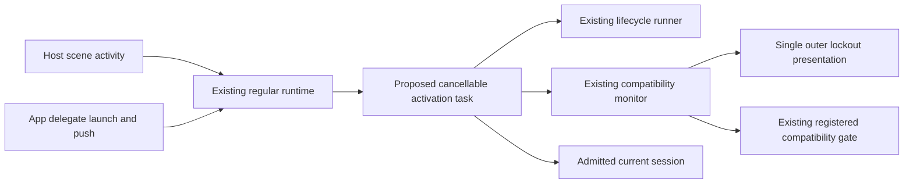

# 03 — Lockout presentation and runtime lifecycle

- Status: complete
- Depends on: [01](01-unified-access.md), complete in `ddcc4a2f3`, and [02](02-widget-access.md), complete in `ee67c64d7`.
- Shared context: [Overview](README.md)

## Deliverable

R-07–R-09 and US-02/03: one visible lockout presentation, runtime-owned foreground compatibility work, and startup cleanup named `shutdown()`.

Preserve X-01–X-05. The existing process model remains; the session/onboarding redesign is separately tracked in STU-335. No changes to compatibility publication policy, formal-model semantics, or native InstallerKit foreground UI ownership are intended. Recheck FirstForegroundReveal source correspondence because its promotion entry point moves to the runtime.

## Evidence and design

Plan 01 establishes admission-bound scopes; plan 02 adds an access-change callback used by the runtime to request widget reloads. `RootView` still renders the lockout in three branches and starts polling, foreground promotion, refresh, and session activation from scene callbacks. `WhereCompatibilityModel.bind` already completes the compatibility gate when access recovers.

Retain the outer lockout branch that masks every launch phase before asynchronous retirement. Keep a registered compatibility gate, using the existing launch splash as its short-lived placeholder while the monitor completes the handle. Remove the repeated gate and ready-state lockout views. Preserve the positive splash minimum and scene visibility input to LifecycleKitUI; no changes to its first-reveal state machine.

The host reads `scenePhase` at the `WhereApp` level and forwards aggregate activity to `WhereApplicationRuntime`. [Apple documents](https://developer.apple.com/documentation/swiftui/scenephase) that an App-level read stays active while any scene is active; RootView retains its scene-specific visibility read. The regular runtime owns one cancellable activation task and ignores duplicate activity values. Each active transition starts the existing monitor's foreground polling, promotes the launcher, then refreshes compatibility and activates the current session only while still active and admitted. Inactive/background input cancels the task and stops polling. Check cancellation before starting and after suspension so a late promotion or verification completion cannot activate an old foreground request. Cancellation does not tear down the process launcher or revoke otherwise valid background recording.

`didFinishLaunching` still synchronously constructs the launch prerequisites and starts the runner for headless wakes. `RootView` becomes a consumer of model/runner state; fixture previews explicitly start their own runner. Inspector receives the same host event seam with no regular-app business work. Keep InstallerKit update checks with visible UI as required by the app contract.



Existing components: runtime, runner, monitor, session, root, gate. Proposed: host scene forwarding and runtime-owned activation task. Widget reload and InstallerKit UI callbacks are omitted; their ownership stays unchanged.

```swift
// Host forwards initial and changed scene activity; RootView retains visibility only.
runtime.sceneActivityChanged(isActive: scenePhase == .active)

// Runtime owns cancellation and the business sequence.
compatibility.setForeground(isActive, model: model)
await launcher.enterForeground()
guard !Task.isCancelled else { return }
await compatibility.refresh(model: model)
guard !Task.isCancelled, !compatibility.isBlocking(model) else { return }
await model.session?.appBecameActive()

await previousStartupState.shutdown()
```

## Steps

1. Rename `WhereStartupState.release()` and its caller to `shutdown()`, preserving the cancellation/drain ordering and installation-location release behavior.
2. Add the runtime scene-activity entry point and forward the host's initial and subsequent active state. Implement cancellation/deduplication in the regular runtime; Inspector remains inert. Expose only the monitor operations needed at the process boundary.
3. Remove foreground business tasks and duplicate lockout views from `RootView`. Keep the outer mask, registered splash placeholder, presentation visibility, and preview-owned runner startup.
4. Add deterministic runtime tests using injected model/runner fixtures, without invoking another real `didFinishLaunching` or re-registering App Intents. Cover inactive/headless behavior, active→inactive before the task starts, activation, duplicate input, blocked access, cancellation during held verification, and polling cancellation. Retain compatibility retirement and LifecycleKitUI first-visible-reveal regression suites.
5. Update ownership docs and current plan evidence. Run focused unit and root/lockout image checks, inspect images, independently review, commit/push, and reply individually to shutdown, presentation, and runtime threads. Update PR description and screenshot evidence for the final revision; reconcile the series and Linear state.

## Acceptance and checks

| Acceptance | Evidence |
| --- | --- |
| Exactly one root lockout presentation immediately masks stale/blocked history | Source call-site inspection; compatibility retirement/recovery tests; RootView and DataCompatibilityView snapshots |
| Inactive scene never promotes a headless runner or starts session activation | Runtime fixture tests; WhereLaunchTests; LifecycleContainerTests headless/first-reveal cases |
| Duplicate events coalesce; interrupted activation cannot resume session business work | Held-work runtime regression with cancellation and explicit completion signals |
| Foreground polling still detects a missed push and stops when inactive | WhereCompatibilityModelTests plus runtime event tests |
| Startup shutdown still drains held opens and retires GPS before outputs | Existing WhereCompatibilityModelTests and WhereModelTests |
| Host/module composition remains valid | `./test --architecture-only` (normal runner also owns this), `./swiftformat --lint`, `./sf-symbols --lint`, `git diff --check` |

Use `./ide --no-open` for new source/test files. Select WhereTests runtime suites, WhereUITests compatibility/model/launch suites, LifecycleKitUITests, RootViewSnapshotTests, and DataCompatibilityViewSnapshotTests through `./test`. Rerun `./tla-check FirstForegroundReveal` for its updated source mapping; its bounded semantics stay unchanged. Record actual counts. Keep physical background delivery and system scene scheduling as device-validation limits.

## Recovery

Repair failures before publishing. Preserve the previously verified access and widget commits. Do not reset user data or change SwiftData/CloudKit schema. If cancellation or gate ownership changes beyond this design, update the plan and its review before dependent edits.

## Refinement and review

2026-11-17: source refinement triggered by plan 01's published admission API and plan 02's implemented callback. The launcher owns its drive task, so canceling a runtime activation wait does not cancel headless recording; explicit cancellation checks must suppress the remainder. Removing RootView's runner task requires explicit preview startup. Keep the registered gate because LifecycleKitUI treats missing gate views as terminal failures. No product question is open. Final readiness review completed against `ee67c64d7`: the access-change callback stays on the monitor and the runtime remains its consumer. Reviewed the whole series for dependency/scope agreement, the active-task cancellation sequence, initial aggregate scene input, gate placeholder, preview startup, and test evidence requirements. No unresolved decision or dependency remains. Ready for the already-authorized execution. Diagram syntax inspected, not rendered; Swift sketch is design, not compilation evidence.

## Progress and resume point

- [x] Refine ownership/cancellation, gate placeholder, and verification design.
- [x] Finish readiness review after 02 publication.
- [x] Implement runtime ownership, shutdown naming, and one lockout.
- [x] Finish verification.
- [x] Independently review, publish, reply, and complete the series.

Execution started after publishing the reviewed plan in `3c75833d6`. Runtime/presentation changes and six activity regressions are implemented and verified. Independent review found that DEBUG cutsheets do not run capture-only readiness hooks; both logged-in fixtures now start their own runners, as does the onboarding preview. The reviewer rechecked that correction and found no remaining actionable issue. Published implementation: `e908eef364c07875c963fd5065aa708465dba182`. The three review replies, updated screen evidence, final PR description, and STU-334 delivery record are published and verified. No implementation step remains in this series.

## Verification

- `./tla-check FirstForegroundReveal` using the pinned Temurin runtime: all 8 expected outcomes matched in `.build/tla/runs/FirstForegroundReveal.kb06UZ`. Both current configurations and all negative/reachability state counts are unchanged. Updated source correspondence; model semantics are unchanged.
- Final rebuilt selection: `./test --only WhereTests/WhereRuntimeActivityTests --only WhereTests/WhereAppTests --only WhereUITests/WhereCompatibilityModelTests --only WhereUITests/WhereModelTests --only WhereUITests/WhereLaunchTests --only LifecycleKitUITests --only WhereUISnapshotTests/RootViewSnapshotTests --only WhereUISnapshotTests/DataCompatibilityViewSnapshotTests --no-generate --record never --review --timings`: **83 unit tests and 20 image references / 36 captures passed**. This includes all six new activity regressions. The 16 theme-sheet byte differences had zero changed pixels; references are unchanged.
- Inspected all four root images plus representative iPad/light and iPhone/AX5 lockout sheets. The ready root, warning badge, rosettes, and complete large text remain intact. Captures do not establish interaction, VoiceOver, motion, or physical scene scheduling.
- `./ide --no-open`, `./swiftformat --lint`, `./sf-symbols --lint`, guidance checks, and `git diff --check` passed. The normal test runner passed all 30 architecture-rule tests, enforcement, and host helper regressions.
- Fresh independent review covered the entire step against `3c75833d6`, host/preview callers, aggregate activity, cancellation and admission checks, retained gate, shutdown ordering, and formal correspondence. The preview correction above was rechecked; no actionable findings remain.
- Physical account transitions, background delivery, and multiple-window scene scheduling remain device acceptance. GitHub image markup and committed image metadata were verified through the API; local browser access is disabled, so live PR layout and Mermaid rendering remain unverified.

## Outcome

Completed in [e908eef36](https://github.com/kyleve/Stuff/commit/e908eef364c07875c963fd5065aa708465dba182) on [PR #495](https://github.com/kyleve/Stuff/pull/495). Published individual replies for [shutdown naming](https://github.com/kyleve/Stuff/pull/495#discussion_r4606530707), [one lockout](https://github.com/kyleve/Stuff/pull/495#discussion_r4606532427), and [runtime ownership](https://github.com/kyleve/Stuff/pull/495#discussion_r4606534388). Updated the existing root and lockout image comments to this tested revision and refreshed the PR's final behavior, evidence, and rollout limits.

All R-07–R-09 deliverables and X-01–X-05 exclusions are preserved. The series is delivered; STU-334 stays In Review while the PR is open. STU-335 remains the separate onboarding/session-model follow-up. Physical-device acceptance and final CI remain review/release checks; no merge, thread resolution, or Production schema deployment was performed.
