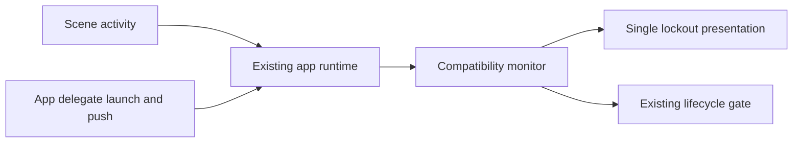

# 03 — Lockout presentation and runtime lifecycle

- Status: outline
- Depends on: [01](01-unified-access.md), [02](02-widget-access.md).
- Shared context: [Overview](README.md)

## Intended outcome

R-07–R-09 and US-02/03: one visible lockout presentation, runtime-owned foreground compatibility work, and startup cleanup named `shutdown()`.

## Known design

Retain the outer lockout decision that masks every launch phase. Keep a registered compatibility gate for orchestration; the existing monitor owns completion when admission succeeds. Move foreground polling/refresh/session activation behind the runtime, with scene lifecycle signals forwarded from the host. Preserve LifecycleKitUI's headless and first-visible-reveal rules. Do not undertake the session-only model redesign (X-04).



```swift
// Proposed host forwarding. Scene visibility still drives presentation.
runtime.sceneActivityChanged(isActive)
// Startup-owned work uses the existing terminal vocabulary.
await previousStartupState.shutdown()
```

## Refinement trigger

- Trigger: 01/02 establish final access-change and runtime responsibilities.
- Evidence needed: final callback ownership and unchanged lifecycle guards.
- Next action: specify runtime event ownership/cancellation, gate placeholder behavior, targeted tests/snapshots, and review before readiness.

## Resume point

Implementation has not started. Refine after 02; no additional user decision is pending.
