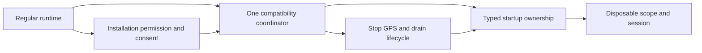

# 01 — Explicit lockout and startup ownership

- Status: complete
- Depends on: None
- Shared context: [overview and requirements](README.md)

## Deliverable and constraints

Implement R-01–R-06 for US-01/US-02, preserving exclusions X-01–X-03. A real installation owns permission/eligibility independently of its disposable data scope. A model owns one injected compatibility monitor and one startup state; resources and work belong to the state that can use them. Shutdown permanently retires background work; location `stop()` remains reversible acquisition control.

Owning rules: `Where/Guidance/launch.md`, `WhereUI/Sources/Launch/AGENTS.md`, and Core's Devices/Location contracts. Existing guards: `WhereCompatibilityModelTests` (including replacement-scope lockout), `WhereLaunchTests`, `DemoModeTests`, `WhereResetTests`, `OnboardingFlowModelTests`, `DataCompatibilityCoordinatorTests`, `DeviceRecordingControllerTests`, and `LocationIngestorTests`. Update stale demo guidance with the approved policy.

## Data flow



Existing runtime, coordinator, scope, and lifecycle runner remain. Installation ownership and explicit startup resource states are the changes. CloudKit storage and receipt details are omitted because their protocol is unchanged.

```swift
// Proposed ownership, not final API spelling.
protocol WhereShutdownable: Sendable { func shutdown() async }
enum StartupState {
    case preparing(Bootstrap)
    case opening(OpeningWork)
    case open(Scope)
    case running(Session)
    case retiring(RetirementWork)
    case locked
}
// Installation permission is independent of disposable scope and demo permission.
```

## Steps

1. Introduce the terminal shutdown contract and explicit owned attribution lifecycle; retain GPS-first ordering and typed immutable geometry reads.
2. Require compatibility injection in both model initializers and fixture composition; introduce installation-owned permission/eligibility and share it with real bootstrap assembly.
3. Consolidate startup ownership, opening and retirement tasks. Remove the demo bypass and select inert demo observation/removal behavior at composition. Preserve failed/stale-open cleanup and repeat-lockout cancellation.
4. Simplify shared-root lockout layout, expand the flagged conditional, and document intentional container selection and silent push registration.
5. Update relevant module docs and PlusCal correspondence, verify each group, obtain fresh independent review, commit/push, update the PR and reply on all 11 human threads.

## Acceptance and verification

Run commands from the repository root. Use `./test --all` for the final cross-bundle constructor/lifecycle integration; use selected suites above during development. Run `./test --architecture-only` for composition and contract changes. Run selected DataCompatibilityView, RootView and OnboardingView snapshot suites after view changes, inspect rendered changes before recording. Run `./swiftformat --lint` and `./sf-symbols --lint`.

Run `./tla-check CompatibilityLockout CompatibilityPublication` with the pinned Java runtime; preserve negative controls and distinguish unchanged protocol evidence from new lifecycle claims. Add deterministic tests for real permission before store open, synthetic demo eligibility, stale opening retirement, and startup-state transitions where existing coverage does not distinguish failure.

R-01–R-05 require passing Swift and formal checks with cancellation ordering preserved. R-06 requires inspected image evidence and replies naming pushed commits. The reviewer must inspect the complete final diff and its callers before publication.

## Recovery

Resume from the current diff and execution record. Never repeat a store open to recover canceled work until its prior task drains. Keep partial changes local until their group is green; do not revert unrelated user changes. Snapshot references are accepted only after inspection.

## Progress

- [x] Shutdown ownership.
- [x] Required injection, installation eligibility, typed startup and demo policy.
- [x] Layout and individual clarifications.
- [x] Swift tests, formal checks, images, independent review.
- [x] Push and all review-thread replies.

## Execution record / resume point

2026-11-17: shutdown ownership complete. Selected WhereCore suites passed 127 tests, followed by 11 SampleCorrectionCoordinator tests after updating its explicit live-observer fixture. Both runs included architecture checks (30 tests) and the backup-upgrader guard. Fresh independent review covered the Core diff and callers; it caught and verified a public protocol witness visibility fix and the second live-observer fixture. `git diff --check` passed. Next: required injection, installation permission, and typed startup ownership.


2026-11-17: startup group verified with `./test --all --no-generate` (2,973 iOS tests, 28 host macro tests, 30 architecture tests, host helpers). Final compatibility suite rebuilt after adding onboarding cancellation/preservation coverage: 13 tests passed. Its name was narrowed after review because observing retirement entry alone does not prove the onboarding join. The held-log regression does verify replacement waits for scope-retaining log work. Final `./test --architecture-only` passed the changed constructor rule and its former-owner negative fixture. `./sf-symbols --lint`, formatting and diff checks passed.

Fresh independent source review caught and verified fixes for ordinary retirement lacking terminal recording shutdown, a missing coalesced-waiter admission check, manual demo rejection completing onboarding, and stale bootstrap waiters clearing/returning a superseded open. It also found the existing unowned log-open lifetime gap; the scope now owns and drains that task. No remaining actionable production findings.

Both PlusCal concerns reran with all 40 expected outcomes matching. Current totals: 3,667,540 generated / 1,432,817 distinct states. Artifacts: `.build/tla/runs/CompatibilityLockout.xtNkQp` and `CompatibilityPublication.qEL0mD`. Independent mapping review confirmed the opening-identity abstraction; README limits explicitly exclude bootstrap retry-waiter interleavings and eligibility mode changes during awaits. Next: publish this group and replies, then layout/clarifications and image verification.

2026-11-17: published shutdown ownership as `9646b7a37` and startup ownership as `b61b7c27b`; replied on the eight associated human threads. The final UI slice uses standard `whereScreenRoot()` padding/width, alignment-only centering, and size-based bounce. Runtime comments document the shared CloudKit container and silent APNs registration; the flagged conditional is multiline. Fresh independent review found no actionable source findings.

Rebuilt selected DataCompatibilityView, RootView, and OnboardingView snapshots with `./test --snapshots --only WhereUISnapshotTests/DataCompatibilityViewSnapshotTests --only WhereUISnapshotTests/RootViewSnapshotTests --only WhereUISnapshotTests/OnboardingViewSnapshotTests --record never --no-generate --review --timings`. Root/onboarding's 15 references passed unchanged. Inspected six intended lockout changes (recording-device and verification in light/dark, plus phone/iPad AX5), then recorded only failures in the lockout suite. Final `./test --snapshots --only WhereUISnapshotTests/DataCompatibilityViewSnapshotTests --record never --no-build --no-generate --skip-architecture --skip-host-tests --review --timings` passed all 16 references / 32 captures. Total selected coverage: 31 references / 47 captures. SwiftFormat and SF Symbols lint passed. Screenshots establish static layout/copy, not live scroll or VoiceOver behavior. Next: push UI, reply on the remaining three threads, refresh published screenshot comments/PR evidence, and put STU-333 In Review.

2026-11-17: delivered UI/clarifications as `f10214601` on [PR #495](https://github.com/kyleve/Stuff/pull/495). Verified all 11 human review threads have one marked reply and no individual human inline comment is unaccounted for. Updated the existing lockout/onboarding/root screenshot comments in place; all four published PNGs match reviewed local bytes, and GitHub's rendered HTML includes the expected images/revision. The PR description includes current behavior, source mapping, retained review findings, exact validation, and limits. [STU-333](https://linear.app/kve/issue/STU-333) is In Review. No threads were resolved and the PR remains open.

Acceptance R-01–R-06 is complete for this implementation plan. CI was running at handoff; local verification is recorded above. Physical two-device CloudKit propagation, offline cold-launch identity, live Siri/share UI, VoiceOver/scroll interactions, and Production schema rollout remain the existing documented acceptance procedure, not claims established by snapshots or bounded models. Browser access was disabled; publication checks used the API and local image review. No implementation work or review reply remains pending in this plan.
