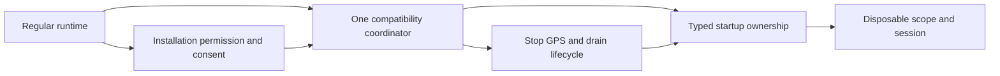

# 01 — Explicit lockout and startup ownership

- Status: executing
- Depends on: None
- Shared context: [overview and requirements](README.md)

## Deliverable and constraints

Implement R-01–R-06 for US-01/US-02, preserving exclusions X-01–X-03. A real installation owns permission/eligibility independently of its disposable data scope. A model owns one injected compatibility monitor and one startup state; resources and work belong to the state that can use them. Shutdown permanently retires background work; location `stop()` remains reversible acquisition control.

Owning rules: `Where/Guidance/launch.md`, `WhereUI/Sources/Launch/AGENTS.md`, and Core's Devices/Location contracts. Existing guards: `WhereCompatibilityModelTests` (including replacement-scope lockout), `WhereLaunchTests`, `DemoModeTests`, `WhereResetTests`, `OnboardingFlowModelTests`, `DataCompatibilityCoordinatorTests`, `DeviceRecordingControllerTests`, and `LocationIngestorTests`. Update stale demo guidance with the approved policy.

## Data flow



Existing runtime, coordinator, scope, and lifecycle runner remain. Installation ownership and explicit startup resource states are the changes. CloudKit storage and receipt details are omitted because their protocol is unchanged.

```swift
// Proposed ownership, not final API spelling.
protocol WhereShutdownable: Sendable { func shutdown() async }
enum StartupState {
    case preparing(Bootstrap)
    case opening(OpeningWork)
    case open(Scope)
    case running(Session)
    case retiring(RetirementWork)
    case locked
}
// Installation permission is independent of disposable scope and demo permission.
```

## Steps

1. Introduce the terminal shutdown contract and explicit owned attribution lifecycle; retain GPS-first ordering and typed immutable geometry reads.
2. Require compatibility injection in both model initializers and fixture composition; introduce installation-owned permission/eligibility and share it with real bootstrap assembly.
3. Consolidate startup ownership, opening and retirement tasks. Remove the demo bypass and select inert demo observation/removal behavior at composition. Preserve failed/stale-open cleanup and repeat-lockout cancellation.
4. Simplify shared-root lockout layout, expand the flagged conditional, and document intentional container selection and silent push registration.
5. Update relevant module docs and PlusCal correspondence, verify each group, obtain fresh independent review, commit/push, update the PR and reply on all 11 human threads.

## Acceptance and verification

Run commands from the repository root. Use `./test --all` for the final cross-bundle constructor/lifecycle integration; use selected suites above during development. Run `./test --architecture-only` for composition and contract changes. Run selected DataCompatibilityView, RootView and OnboardingView snapshot suites after view changes, inspect rendered changes before recording. Run `./swiftformat --lint` and `./sf-symbols --lint`.

Run `./tla-check CompatibilityLockout CompatibilityPublication` with the pinned Java runtime; preserve negative controls and distinguish unchanged protocol evidence from new lifecycle claims. Add deterministic tests for real permission before store open, synthetic demo eligibility, stale opening retirement, and startup-state transitions where existing coverage does not distinguish failure.

R-01–R-05 require passing Swift and formal checks with cancellation ordering preserved. R-06 requires inspected image evidence and replies naming pushed commits. The reviewer must inspect the complete final diff and its callers before publication.

## Recovery

Resume from the current diff and execution record. Never repeat a store open to recover canceled work until its prior task drains. Keep partial changes local until their group is green; do not revert unrelated user changes. Snapshot references are accepted only after inspection.

## Progress

- [x] Shutdown ownership.
- [ ] Required injection, installation eligibility, typed startup and demo policy.
- [ ] Layout and individual clarifications.
- [ ] Swift tests, formal checks, images, independent review.
- [ ] Push and all review-thread replies.

## Execution record / resume point

2026-11-17: shutdown ownership complete. Selected WhereCore suites passed 127 tests, followed by 11 SampleCorrectionCoordinator tests after updating its explicit live-observer fixture. Both runs included architecture checks (30 tests) and the backup-upgrader guard. Fresh independent review covered the Core diff and callers; it caught and verified a public protocol witness visibility fix and the second live-observer fixture. `git diff --check` passed. Next: required injection, installation permission, and typed startup ownership.
