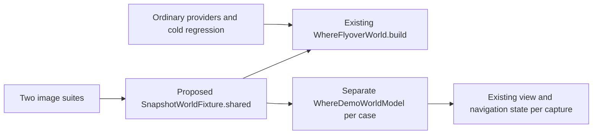

# 01 — Share the visual matrices' demo initialization

- Status: executing
- Depends on: None; follows the measured fixtures in PR #516.
- Shared context: [Overview](README.md).

## Deliverable and requirements

US-01 and R-01–R-04: initialize one standard demo world for 44 compatible visual variants, retaining three narrow-window cold starts, retain independent capture presentation, preserve output and cold coverage, and measure/publish the result. X-01 excludes interactive, mutation, and lifecycle consumers. Do not modify `WhereFlyoverWorld.build()` or snapshot renderer policy.

## Design

Add an explicit async builder to the DEBUG demo model and the two colocated snapshot factories. Ordinary factories default to a fresh build. Only the image suites inject `SnapshotWorldFixture.shared.load`; the narrow-window factory keeps the fresh builder. Each descriptor retains its own demo model, selection, view, and readiness hooks. The shared world includes its session, report, services, and preferences; these captures must not perform user edits.



```swift
// Proposed shape; error and cancellation details omitted here.
@MainActor final class SnapshotWorldFixture {
    static let shared = SnapshotWorldFixture()
    func load() async throws -> WhereFlyoverWorld
}
// Existing model gains explicit injection, defaulting to the existing builder.
WhereDemoWorldModel(buildWorld: SnapshotWorldFixture.shared.load)
```

The test fixture retains a single initialization task. Concurrent callers await the same task. Caller cancellation does not cancel that process-owned work, and canceled callers cannot publish loaded state. A failed initialization clears the task before propagating the error, allowing retry. Unit tests use local fixture owners; they do not consume the image singleton.

## Steps

1. Add builder injection through `WhereDemoWorldModel`, `DuoLayoutSnapshotFixture`, `MainTabs`, and `DeviceLayoutLabView`. Keep defaults fresh.
2. Add the test-only fixture under `Tests/Support`, include it in `Project.swift`, and opt in through private snapshot providers in the two image suites. Keep the cold/preloaded test on the ordinary provider.
3. Add focused cancellation/coalescing/retry tests. Update the module documentation and narrow fixture-isolation exception. Regenerate with `./ide --no-open`.
4. Run matched image profiles, an opposite-order capture probe, existing world/lab lifecycle tests, and the full WhereUI image bundle. Remove temporary probes and retain evidence outside Git.
5. Run the fresh independent review, correct supported findings, publish above #516, update STU-121, and dispatch final CI gates.

## Acceptance and verification

From the repository root:

- `./test --only WhereUITests/SnapshotWorldFixtureTests --only WhereUITests/WhereFlyoverWorldTests --only WhereUITests/DeviceLayoutLabViewTests`: shared initialization, cancellation, retry, fresh-world ownership, and explicit reset pass.
- `./test --only WhereUISnapshotTests/MainTabsSnapshotTests --only WhereUISnapshotTests/DeviceLayoutLabViewSnapshotTests --timings --review --record never`: retain 70 captures, dimensions, identities, references, and tolerances; preparation/runner time decrease.
- Temporary opposite-order probe captures the same 69 matrix images, using the existing reference paths and policies. Compare review diagnostics with the normal order and baseline; remove the probe afterward.
- `./test WhereUISnapshotTests --timings --review --record never`: all 801 images pass. Normal invocations also cover architecture; run Swift formatting and changed guidance checks.
- Review the full slice against the parent revision, including scoped defaults and mutable-world ownership. No source or reference changes outside the approved behavior.

## Recovery

Keep the existing baseline artifacts. On capture drift, inspect the images and shared mutable state before changing implementation. Do not rerecord references or weaken comparison. New files require regeneration; do not reuse stale build products. Preserve the unrelated untracked skill during stack operations.

## Progress and execution

- 2026-11-17: baseline two-suite run passed 70 captures, including one recovered readiness retry. Artifacts: `/private/tmp/stuff-shared-world-baseline-20261117`.
- Initial candidate: eight unit tests passed. All 70 capture identities/dimensions match, but the three narrow-window images fail. Viewed actual/reference images show the native tab bar about 33 pixels lower, with Year content also shifted. The independent reviewer confirmed this blocking finding. The other emitted diagnostics above one color step match the baseline. No references or tolerances changed.
- Both ready-before-hosting and 1.5s settling probes reproduce the identical narrow-window differences. Keep the three narrow cases fresh; share the other 44. Restore the original 0.5s floor and remove both temporary probes. Independent review identified no safe existing readiness hook: narrow uses a detached compact iPad viewport, while regular-width phone captures retain a scene for native bar height. A shared-renderer investigation remains outside this slice in STU-121.
- Final bounded candidate passes all 70 captures, with the same identities, dimensions, pixels, tiles, and comparison settings. Capture time 153.241s → 110.763s (42.478s / 27.7% saved); runner phase 165.430s → 124.253s (41.177s / 24.9%). Both runs have the same single recovered first-lab settling retry. MainTabs preparation 44.635s → 6.519s. These are matched debug-simulator observations, not a CI wall-clock estimate.
- MainTabs captures 124.142s → 89.315s; Device Layout Lab 29.099s → 21.448s. Two pre-existing Locations native-material diagnostics differ by 32 and 27 pixels in their counts; all assertions pass. Do not describe this as pixel-exact equivalence.
- Opposite-order check passes all 69 matrix captures in 105.700s, zero retries. All 61 MainTabs captures run in reverse first, followed by the eight reversed Device Layout Lab captures, against the original reference paths. Identities, dimensions, pixels, and tiles match the baseline matrix. Temporary probes are removed.
- Eight unit tests in three suites pass, including cancellation, retry, world ownership, and Reset Demo. Architecture, Swift formatting, symbol lint, and tracked-guidance checks pass. Full 801-image bundle is running.
- Independent review against parent `2c24c3415` found the warm narrow-window regression and then reviewed the explicit cold fallback without further findings. The world is mutable: mounted Locations reconciliation updates last-seen counts, so the opposite-order evidence supports this fixed noninteractive matrix, not arbitrary user actions.
- Guidance checks pass with the unrelated oversized untracked simple-english skill temporarily excluded and restored byte-for-byte. The full working-directory check reports only that pre-existing 19,768-byte skill limit violation.

## Resume point

Finish the full WhereUI image bundle, attach final review evidence, then publish the slice and dispatch final CI gates.
