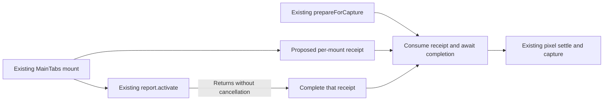

# Await MainTabs' mounted activation

Status: complete
Dependencies: none; execute after plan 01 to keep measurements and commits distinct.
Requirements: [US-01, R-01–R-03, X-01](README.md#outcome-and-constraints).

## Intended result and design

Investigate replacing `settle → activate again → settle` in the 17 welcome/update captures with `await mounted activation → settle`. The other MainTabs families keep their current readiness and floors.

The shell task and foreground handling both call `YearReportModel.activate()`, which starts a new lifecycle revision. Fixture data starts loaded, so observing `.loaded` does not prove completion. Retries reuse the root view value in fresh hosting controllers.

Use a DEBUG-only hook in the existing shell task. A fresh mount registers its own observable completion receipt before awaiting the unchanged `report.activate()`. Publish completion only when that task returns without cancellation. Keep the receipt in optional `@State`, initially nil, so a retry creates a fresh receipt while rehosting retains it. The capture hook consumes one receipt, then observes its completion. Cancellation releases either wait without scheduling delayed cleanup.

This seam applies only to the 17 noninteractive welcome/update fixtures. Each fixes its scene phase and does not write or change years, so foreground reactivation cannot supersede the mounted task. It is not a general scene-idle signal. The production activation implementation, foreground handling, and other snapshot families remain unchanged.



```swift
// Proposed DEBUG-only seam; ordinary activation remains unchanged.
@State var snapshotMount: Mount? = nil
.task {
    if snapshotMount == nil, !Task.isCancelled {
        snapshotMount = readiness?.registerMount()
    }
    await report.activate()
    if !Task.isCancelled { snapshotMount?.didActivate = true }
}
// Existing capture infrastructure bounds and cancels the wait.
prepareForCapture: { await readiness.waitForActivation() }
```

The receipt isolates late completion from a canceled or previous host. The stream buffers a mount that arrives before its hook; observation handles completion before or after the hook. No generic readiness framework or production activation coalescing is needed. Diagram omits the unchanged update/welcome tasks and rendering details.

## Method and acceptance

1. Prototype the receipt and hook in `MainTabs` and its DEBUG snapshot support.
2. Run all 61 MainTabs captures with `--timings --review --record never`, compared with the parent baseline. Check identities, dimensions, tiles, pixel diagnostics, retries, and phase totals.
3. If output supports retention, add deterministic tests for completion before/after waiting, canceled wait cleanup, late previous-mount completion, and the real mounted task with a gated store. Exercise a forced capture retry using the same root view value.
4. Run the affected unit and image suites, formatting and symbol checks, then review the complete diff independently. Record limits and publish the retained change in its own commit after plan 01.
5. If the bounded prototype cannot preserve output or completion ownership, remove it and publish the supported negative result. Do not weaken pixel checks or alter native floors to manufacture a saving.

Plan review, 2026-11-17, `c4843ee05`: the fixed-scene fixture scope prevents the competing foreground activation found during source inspection. Per-mount registration addresses the known reused-root retry regression. The protocol follows the existing Calendar receipt/observation pattern without changing it. Q-02 is resolved for these fixtures, subject to implementation tests; image equivalence and savings remain experimental. Mermaid syntax was inspected but no renderer was run.

## Execution evidence

The first 61-capture probe passed in 74.452s against the 91.329s baseline. The final combined image run passed both reference functions with these results:

| Capture work | Baseline | Candidate | Saving |
| --- | ---: | ---: | ---: |
| Elsewhere, 18 images | 21.891s | 15.691s | 6.200s (28.3%) |
| MainTabs, 61 images | 91.329s | 73.948s | 17.381s (19.0%) |
| Combined, 79 images | 113.220s | 89.639s | 23.581s (20.8%) |
| Changed MainTabs shell cases, 17 images | 30.018s | 13.143s | 16.875s (56.2%) |

Identities, sizing, 390,611,286 pixels, 79 tiles, capture-settle policies, and measurement-readiness policies match. Elsewhere matches every reference exactly. The two existing MainTabs AX5 differences have identical diagnostics; the 345-pixel, maximum-two-level WelcomeLocations drift disappears. Some unchanged adaptive cases vary slightly in pixel-difference counts and regions. MainTabs passes existing assertions, but the full matrix is not byte-identical. No references changed. Final capture work has 484 settle passes versus 752 in the baseline.

These are local debug-simulator measurements with matched `--timings --review --record never` diagnostics. They are not a repeated benchmark or CI wall-clock forecast. The first probe independently supports the direction and scale of the MainTabs improvement.

Validation:

- Five unit functions in two suites pass: three readiness functions with five argument cases, plus both existing MainTabs lifecycle tests. Readiness covers early completion, late completion, cancellation before/after registration, and rejection of the previous mount's completion.
- The forced-retry test passes using one root view value in fresh hosts. The second activation is held at a store-read gate while the report is already loaded; readiness must wait for that activation.
- Both image functions pass all 79 reference captures with no capture retries. Normal architecture and applicable host checks, SwiftFormat, SF Symbol lint, and whitespace checks pass.

Commands and artifacts:

1. `TEST_WORKDIR=/private/tmp/stuff-shell-readiness-final-20261117 ./test --only WhereUITests/MainTabsSnapshotReadinessTests --only WhereUITests/MainTabsTests --only WhereUISnapshotTests/MainTabsSnapshotTests --only WhereUISnapshotTests/ElsewhereViewSnapshotTests --no-generate --timings --review --record never` passed the units, then exposed a missing Testing SPI import in the new snapshot test. The import was corrected.
2. `TEST_WORKDIR=/private/tmp/stuff-shell-readiness-final-images-20261117 ./test --only WhereUISnapshotTests/MainTabsSnapshotTests --only WhereUISnapshotTests/ElsewhereViewSnapshotTests --no-generate --timings --review --record never` passed both reference functions. The new retry fixture then lacked `WhereModel` for its Settings tab and crashed. The fixture now supplies the same environment as existing hosted MainTabs tests.
3. `TEST_WORKDIR=/private/tmp/stuff-shell-readiness-retry-20261117 ./test --only 'WhereUISnapshotTests/MainTabsSnapshotTests/retryWaitsForItsMountedActivationDespitePreloadedData()' --no-generate --timings --review --record never` passed the corrected regression in 1.250s. This fixture-only correction does not alter the preceding reference matrices. The failed combined invocation is not reported as green.

Delivered in [PR #520](https://github.com/kyleve/Stuff/pull/520), ready for review on `main` after #518 merged. Independent review reports no remaining actionable findings and retains the corrected environment-fixture finding. Implementation `debf041d1` became `ff93236f1`; `git diff debf041d1 ff93236f1` is empty after stack synchronization. No prototype instrumentation or implementation work remains. Remote CI is separate from the local acceptance evidence above.
