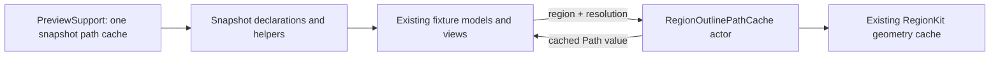

# 01 — Share immutable snapshot paths

- Status: complete
- Depends on: None
- Shared requirements: [Overview](README.md), R-01, R-02, R-04, R-05; exclusions X-01 and X-02.

## Design

`PreviewSupport` creates one DEBUG-only `RegionOutlinePathCache`. Snapshot helpers inject it through the environment. Broadway roots reuse an inherited cache and keep a root-owned fallback when none is supplied. This prevents nested roots from replacing the shared dependency. Explicit snapshot artwork hooks and Duo fixtures receive that same actor. Independent production roots, standalone non-snapshot previews, and fresh-cache unit tests retain their own caches.



The actor stores deterministic geometry only. Artwork publication models retain their existing ownership and cancellation guards. Diagram omits rendering and comparison, which do not change.

```swift
// Proposed composition, not a new production singleton.
extension PreviewSupport {
    static let snapshotArtworkCache = RegionOutlinePathCache()
}
// The Broadway wrapper now honors its inherited cache.
content.whereBroadwayRoot(theme: theme)
    .environment(\.regionOutlinePathCache, PreviewSupport.snapshotArtworkCache)
```

## Steps and acceptance

1. Record the unchanged five-suite baseline with `./test --no-generate --only WhereUISnapshotTests/AppearanceSettingsViewSnapshotTests --only WhereUISnapshotTests/LocationForecastSummarySnapshotTests --only WhereUISnapshotTests/LocationForecastPanelSnapshotTests --only WhereUISnapshotTests/LocationsBackgroundSnapshotTests --only WhereUISnapshotTests/RegionWelcomeCardSnapshotTests --timings --review --record never`.
2. Update snapshot composition and explicit snapshot cache consumers, including Duo fixtures. Keep the five post-settle hooks unchanged for this step.
3. Add hosted coverage for shared-cache injection through single and theme snapshot helpers, and independence of the supplied publication models. Keep existing cache/model/task tests using fresh caches. Update the module README.
4. Run the same focused image matrix, plus the relevant WhereUI cache, artwork, and composition tests. Regenerate with `./ide --no-open` if adding source/test files.
5. Require no retries, unchanged identities/dimensions/tiles, passing references, and reviewed changed diagnostics. Record the observed cache-only delta without overstating it. Run architecture checks for the new composition boundary, formatting, and symbol lint. Commit this verified step.

Tests use `./test`; later snapshot invocations may use `--skip-host-tests` because the baseline owns applicable host checks. Full image integration in plan 02 covers the broad snapshot-helper injection. Restore only task-owned edits if a candidate fails.

## Execution record

The baseline at parent `c5cd82626` passes five tests and 63 captures with no retries. Timed captures total 65.589s: post-settle hooks 26.163s, final settling 31.991s. The baseline also owns applicable host checks. Raw logs are retained in the session's `artwork-snapshot-results` directory.

Shared cache composition is implemented. Hosted tests confirm nested roots reuse an injected or root-owned cache, independent roots keep separate fallbacks, and single/theme snapshot helpers share the actor while independently supplied publication models remain independent. The initial test build needed a missing WhereCore import; the corrected focused run passes 18 tests. Independent review caught a concurrency warning in the local test-builder function: its explicit Sendable annotation would become an error in Swift 6. An explicitly typed MainActor/Sendable closure replaces the local function; the corrected hosted rerun passes all three tests with no concurrency diagnostics. Architecture checks and symbol lint pass. The cache-only profile passes five tests and 63 captures with zero retries and matching identities, dimensions, pixels, and tiles. It takes 66.223s versus 65.589s baseline (+0.634s, about 1%). All 22 diagnostic payloads match exactly. This pair does not establish a speedup from sharing paths; the cache is retained for the approved resource ownership and reuse, with most elapsed time still in settling.

## Resume point

Complete. Cache step `c42e9456d` is published in [PR #515](https://github.com/kyleve/Stuff/pull/515). Independent source review and full image integration pass; see [plan 02](02-preparation-hooks.md) for the broad run and delivery record.

Commands: the baseline command above, then the same five suites with `--skip-host-tests` for cache-only images. Unit coverage uses `./test --no-generate --only WhereUITests/RegionArtworkTaskTests --only WhereUITests/RegionArtworkModelTests --only WhereUITests/RegionOutlinePathCacheTests --only WhereUITests/LocationForecastArtworkLoaderTests --only WhereUITests/LocationsBackgroundArtworkTests` (18 passed). The final annotation rerun uses `./test --no-generate --skip-host-tests --only WhereUITests/RegionArtworkTaskTests` (3 passed). `./swiftformat --lint`, `./sf-symbols --lint`, and `git diff --check` pass.
