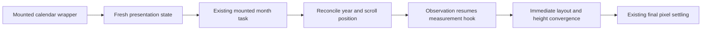

# Observe completion boundaries

Status: complete
Dependencies: none.
Requirements: [US-01, R-01–R-03, X-01](README.md#outcome-and-constraints).

## Question and method

Determine whether a public UIKit update callback can replace settling, and whether existing application readiness hooks can remove measurement settling.

1. Add a temporary passive `UIUpdateLink.afterUpdateComplete` observer around the existing pixel settle loop. Record callback count, first callback time, scene attachment, and elapsed settle time under a separate diagnostic prefix. Preserve every existing decision and timeout.
2. Run Calendar and MainTabs with `--timings --review --record never`. These cover task-driven content, full-content measurement, retained native chrome, and detached synthetic viewports. Keep raw output and summarize callbacks against actual settling.
3. Inspect Calendar's mounted presentation reconciliation and existing measurement hooks in other expensive suites. Prefer an existing completion boundary over a new readiness abstraction. A callback must identify this capture's completed work; a prior configuration's state cannot satisfy it.
4. Select at most one bounded implementation slice if completion is sufficient. Otherwise retain the negative evidence. Update the plan before implementing a selected slice.
5. Remove temporary instrumentation. Review and publish the evidence, and any separately validated implementation.

## Boundaries and acceptance

The probe is observational: no continuous-update requests, new waits, reference changes, or settle-policy changes. Disable its observer on every exit. This experiment accepts a supported negative result. A candidate implementation requires matched diagnostic modes, unchanged capture identities and dimensions, passing reference comparisons, and cancellation-safe readiness. Image differences must be compared with the baseline rather than judged solely by pass/fail tolerance.

Existing flow: host → measurement readiness → measurement settling → size convergence → final hosting/readiness → pixel settling → capture. The temporary observer only watches the two settling stages. No new architecture or diagram is needed.

Probe sketch (not compilation evidence):

```swift
let link = UIUpdateLink(view: view)
link.addAction(to: .afterUpdateComplete) { _, _ in recordUpdate() }
link.isEnabled = true
defer { link.isEnabled = false; reportProbe() }
// Existing settling loop, unchanged.
```

## Review and progress

2026-11-17, source `445375f86`: reviewed against the current renderer, Calendar task, snapshot isolation rules, prior quiescence experiment, and Xcode 27.2 public headers. The callback only completes one UI update; it does not promise that later asynchronous work or native effects are complete. The experiment measures availability and ordering, not a universal correctness proof. No unresolved product decision blocks this bounded investigation. User requested this work directly.

The passive probe is running. Its first 82 settling phases are detached and receive no callbacks. This already excludes `UIUpdateLink` as a universal replacement; retain the complete run for scene-backed comparisons.

## Calendar candidate, reviewed before implementation

Source inspection identifies an existing completion boundary: `CalendarPresentationState.year` becomes non-nil in the mounted month content's reconciliation task. The task performs reconciliation and initial scroll commands synchronously. Swift Observation's `Observations` sequence delivers transactional state after suspension, so the measurement hook can await this state without polling or adding a production callback.

Keep ordinary providers and previews unchanged. Add a capture-specific case factory that uses the same declarations, with one independent readiness holder per configuration. The initial proposal created presentation state in each lazy content builder; independent review showed that retries reuse the built view value. The [corrected design](#reviewed-correction-own-readiness-at-mounting) creates state once per mounted host instead. The hook consumes that mount's state and waits for its year. Awaited month content is then measured with `.immediate`; final pixel settling remains unchanged. The unconverted HistoryColumn, fixed-size cases, and standalone synchronous month fixtures retain their current policies.



```swift
let state = readiness.makePresentation() // Each fresh host mount.
CalendarContentView(presentationState: state, ...) // Existing injection.
// After hosting, the hook observes this exact state:
for await ready in Observations({ state.year != nil }) {
    if ready { return }
}
```

Check cancellation, already-ready state, and replacement by a fresh view with focused unit tests. Run all Calendar captures in matched timing/review mode; compare identities, dimensions, tile counts, and diagnostics against the probe baseline. Retain the candidate only if the final image contents and full-content dimensions remain correct. Revert prototype source changes if they do not meet that criterion. No product behavior or public API changes are proposed.

2026-11-17 candidate review: checked lazy fixture creation, independent configuration state, repeatable retries and theme panels, non-polling cancellation, and unchanged preview identities. The existing hook ceiling bounds a missing reconciliation. The final capture settle does not repair incorrect measured dimensions, so dimension comparison is a required acceptance check. Mermaid renderer not available; syntax reviewed manually. This is a prototype, not yet validated behavior.

The first candidate passed 63 images and three unit tests, but independent review found that the capture retry reuses the original view value. The proposed builder-time state therefore remained ready on a fresh host. No retries occurred in the image run, so it did not exercise this defect. Do not retain that implementation.

### Reviewed correction: own readiness at mounting

A DEBUG-only wrapper starts with nil `@State` content. Its task creates the presentation and concrete content once per mount, after checking cancellation. The state survives measurement-to-capture rehosting; a new retry controller starts empty. A per-configuration readiness holder consumes one mount registration, whether mounting precedes or follows the hook, then observes that presentation's reconciliation. A canceled mount waiter cleans up synchronously on the main actor and cannot terminate the next mount's wait. Models are created once per mount, not on body reevaluation.

The corrected flow starts with `lazy wrapper → fresh host → create/store mounted content → register presentation`; the remaining reconciliation, immediate measurement, and final settling stages are unchanged. This replaces the earlier builder-time assumption. Review confirmed that it preserves production presentation state and requires a forced-retry regression using one built view value with multiple hosting controllers.

## Validation and outcome

The corrected implementation passes four unit tests (five argument cases) and both Calendar snapshot-suite tests. The second snapshot test forces a retry after readiness, reusing one root view value in fresh controllers. It verifies distinct presentation instances, completed month reconciliation, and full-height output. Ordinary image captures have zero unexpected retries.

The passive probe baseline captured Calendar and MainTabs together, with `--timings --review --record never`. Its Calendar portion took 76.269s. Do not use that instrumented run as the final savings claim.

The final control switches only the Calendar image test to its ordinary provider, leaving the new hook unused, and runs only `calendarContent()`. It has no probe instrumentation. The candidate uses the same diagnostic settings. The exact tested provider source was restored afterward and checked byte-for-byte.

| Phase, 63 captures | Control | Candidate | Saved |
| --- | ---: | ---: | ---: |
| Measurement, including readiness | 32.230s | 10.345s | 21.885s (67.9%) |
| Final settling | 21.419s | 21.513s | -0.094s |
| All capture work | 75.626s | 53.601s | 22.025s (29.1%) |

All identities, sizing, 614,041,674 pixels, and 99 tiles match. Both runs retain the same 646 and three one-unit differing pixels; the candidate adds only a zero-pixel theme-sheet diagnostic. No references or tolerances changed. This is one local debug-simulator comparison, not a repeated benchmark or CI wall-clock result. Runner totals are not compared because the candidate also executes the forced-retry test. The shared renderer is unchanged, so coverage remains focused on Calendar rather than rerunning every image bundle.

Commands from the repository root, after `./ide --no-open`:

```sh
# Corrected implementation, including cancellation and forced retry.
./test --only WhereUITests/CalendarSnapshotReadinessTests \
  --only WhereUISnapshotTests/CalendarContentViewSnapshotTests \
  --no-generate --timings --review --record never

# Temporary ordinary-provider control, with the tested source restored afterward.
./test --only 'WhereUISnapshotTests/CalendarContentViewSnapshotTests/calendarContent()' \
  --no-generate --timings --review --record never
```

Normal test invocations also passed architecture, Flyover command, attribution, and applicable host checks. Swift formatting, symbol lint, and `git diff --check` pass. Independent review verified the corrected retry boundary, raw control/candidate captures, and exact source restoration, with no remaining findings.

Raw logs, summaries, probe patch, and callback observations are retained under `/Users/kve/.codex/visualizations/2026/11/17/01a1e71b-13f1-7c80-8aee-e46d45c92d5b/completion-hooks-results/`. The local work directories are `/private/tmp/stuff-completion-hooks-{probe,calendar-final,calendar-control}-20261117`.

Complete. Implementation `cde3fb37c` and evidence are published in [PR #518](https://github.com/kyleve/Stuff/pull/518), above #517 in stack #519. No temporary probe or control substitution remains. Remote CI results remain separate from the local acceptance above; STU-121 stays In Review for this unmerged slice and broader snapshot performance work.
