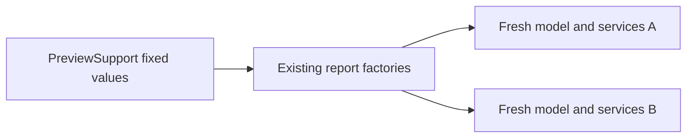

# 01 — Reuse fixed report values

- Status: executing
- Depends on: None
- Requirements: [R-01, R-03–R-05](README.md); exclusions X-01–X-02.

## Design

Create lazy immutable report and location values in `PreviewSupport`; preserve its existing factory signatures. Each caller still constructs its resolver wrapper, observable model, preferences, and services. Keeping the wrapper fresh preserves its current-time-zone calendar.



```swift
// Proposed shape; the factory keeps its current public API.
private static let fixedReport = makeFixedReport()
public static func sampleReport() -> YearReport { fixedReport }
```

## Steps and acceptance

1. Add temporary benchmark probes to an existing test file. Measure three batches of fixed report/detail construction, consuming returned values. Profile five fresh demo worlds for plan 02 in the same invocation. No generation inputs change.
2. Cache only immutable fixed values, preserving the original construction algorithm and public factory signatures. Repeat the same benchmark in separate processes. Record first-use and warm-call costs separately where useful.
3. Run `./test --no-generate --only WhereUITests/YearReportModelTests` and relevant fixture consumers. Add behavior coverage only for a new ownership/date contract; do not test synthesized value semantics.
4. Run representative calendar, forecast, and region-card snapshots with `--timings --review --record never`. Broad WhereUI image integration follows the final retained source in plan 02. Preserve references and readiness settings.
5. Remove temporary probes, update the module README as needed, and commit this verified step separately. Keep raw measurements outside Git and concise results here.

A supported microbenchmark improvement establishes avoided construction work, not an equivalent suite-wide speedup. Restore task-owned changes if output or date behavior differs.

## Execution record

Not started. The first profile also owns applicable host checks; later runs may use `--skip-host-tests`.

## Resume point

Run the baseline probe, then implement and compare the cache.
