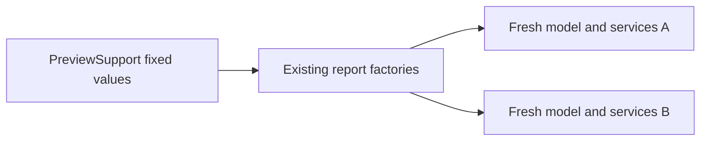

# 01 — Reuse fixed report values

- Status: complete
- Depends on: None
- Requirements: [R-01, R-03–R-05](README.md); exclusions X-01–X-02.

## Design

Create lazy immutable report and location values in `PreviewSupport`; preserve its existing factory signatures. Each caller still constructs its resolver wrapper, observable model, preferences, and services. Keeping the wrapper fresh preserves its current-time-zone calendar.



```swift
// Proposed shape; the factory keeps its current public API.
private static let fixedReport = makeFixedReport()
public static func sampleReport() -> YearReport { fixedReport }
```

## Steps and acceptance

1. Add temporary benchmark probes to an existing test file. Measure three batches of fixed report/detail construction, consuming returned values. Profile five fresh demo worlds for plan 02 in the same invocation. No generation inputs change.
2. Cache only immutable fixed values, preserving the original construction algorithm and public factory signatures. Repeat the same benchmark in separate processes. Record first-use and warm-call costs separately where useful.
3. Run `./test --no-generate --only WhereUITests/YearReportModelTests` and relevant fixture consumers. Add behavior coverage only for a new ownership/date contract; do not test synthesized value semantics.
4. Repeat the prior five-suite, 63-capture artwork matrix with `--timings --review --record never`, using the source-equivalent PR #515 repeat as its baseline. Broad WhereUI image integration in plan 02 covers calendar and other report consumers. Preserve references and readiness settings.
5. Remove temporary probes, update the module README as needed, and commit this verified step separately. Keep raw measurements outside Git and concise results here.

A supported microbenchmark improvement establishes avoided construction work, not an equivalent suite-wide speedup. Restore task-owned changes if output or date behavior differs.

## Execution record

The first temporary probe was rejected by the logging architecture guard; it ran no tests. It was replaced with typed Periscope spans and a test-only collector. A public span-name enum needed explicit Sendable conformance before the successful baseline. The successful source baseline is `bc02a4595` plus temporary probes; no generation inputs changed. The first structured-probe invocation ran the applicable host checks, and later invocations use `--skip-host-tests`.

The probe passes one test, consumes three batches of 500 `sampleReport()` and 500 `sampleYearReportDetails()` results, and builds five fresh demo worlds. Baseline factory totals: report 0.444211s, details 0.428271s. Cached totals: report 0.001479s, details 0.003443s, including first use. Warm batch medians fall from 141.920ms to 0.033ms for report values, and 143.237ms to 0.411ms for details. The original cost is about 0.29ms per call, so this is a small setup improvement, not evidence of a large suite-wide gain.

`PreviewSupport` now retains immutable report and location values. Its public factory signatures, data-construction algorithms, current-calendar wrapper, and model/service creation remain unchanged. All temporary instrumentation has been removed. Final clean-source checks:

- `./test --no-generate --skip-host-tests --only WhereUITests/YearReportModelTests --only WhereUITests/WhereFlyoverWorldTests`: 33 tests pass in two suites.
- `./test --no-generate --skip-host-tests --only WhereUISnapshotTests/AppearanceSettingsViewSnapshotTests --only WhereUISnapshotTests/LocationForecastSummarySnapshotTests --only WhereUISnapshotTests/LocationForecastPanelSnapshotTests --only WhereUISnapshotTests/LocationsBackgroundSnapshotTests --only WhereUISnapshotTests/RegionWelcomeCardSnapshotTests --timings --review --record never`: five tests and 63 captures pass, with no retries. Capture identity, sizing, pixel count, and tile count match the parent repeat. All 19 emitted pixel diagnostics equal the parent; three parent diagnostics with zero differing pixels are absent. References and thresholds are unchanged.
- Capture time is 37.301s versus 37.319s in the earlier parent repeat. The 0.018s difference does not establish a suite speedup; factory setup sits outside capture timing.
- Architecture checks, `./swiftformat --lint`, `./sf-symbols --lint`, and `git diff --check` pass. No generation inputs changed.

Independent review of `bc02a4595` through `5ada50bbc` plus this working diff found no actionable source or measurement issue. It verified value ownership, fresh calendar construction, raw arithmetic, and probe removal. The final review also verified the broad image evidence and source equivalence after stack synchronization; see plan 02. The report change is `50a138520`, published in [PR #516](https://github.com/kyleve/Stuff/pull/516).

## Resume point

Complete. The retained change and evidence are published in PR #516. Remote CI results remain pending; the PR owns their dispatch records.
