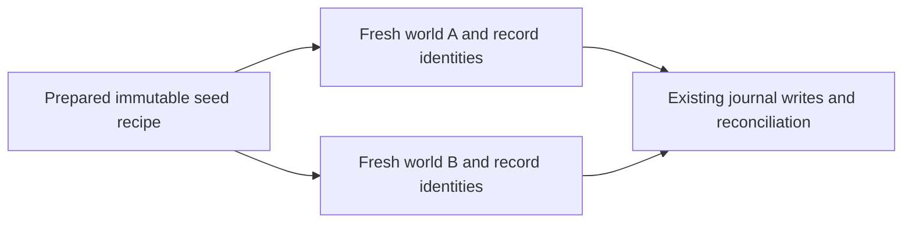

# 02 — Try reusable demo seed inputs

- Status: ready
- Depends on: None; reuse plan 01's instrumentation baseline, then measure after its verified report change.
- Requirements: [R-02–R-05](README.md); exclusions X-01–X-02.

## Experiment

Question Q-03: Does reusing immutable seed inputs materially reduce fresh demo-world construction with a small, explicit API?

Measure five serial worlds and separate store creation, service initialization, script generation, writes/reconciliation, log-store creation, session startup, and report activation. Try at most one prepared-input design. A negative result is acceptable if the measured upper bound is too small for the required API/identity complexity, or the candidate fails isolation/content checks. Do not retain unsupported infrastructure merely to claim both experiments succeeded.

The proposed value contains the scenario's sample coordinates/times and manual-history inputs. The DEBUG fixture composition owns reuse; each world gets new record identities, device stamping, services, and store. Ordinary production/demo calls still construct their own inputs. A retained API must carry the clock/calendar/scenario together so mismatched inputs cannot seed a different world.



```swift
// Candidate shape only; decide the smallest seam from measured work.
let recipe = DemoDataBuilder(now: referenceDate, calendar: calendar).preparedInputs()
// Each use still writes through its own services and assigns fresh identities.
try await recipe.seed(into: freshServices)
```

## Steps and acceptance

1. Inspect the subphase baseline. Record generation's upper bound before selecting the candidate. If the seam cannot remain small and meaningful, record the negative result with evidence.
2. For a retained candidate, cover repeated seeding into separate stores, unchanged reports/issues, destination device stamping, and fresh sample identities. Retain the existing across-year and configured-issue tests.
3. Run `./test --no-generate --only WhereCoreTests/DemoDataBuilderTests --only WhereUITests/WhereFlyoverWorldTests --only WhereUITests/DemoModeTests`, plus the focused probe. Repeat the selected candidate in a fresh process.
4. Remove all temporary instrumentation. Run the affected WhereUI image bundle with `./test --no-generate --skip-host-tests --only WhereUISnapshotTests --timings --record never`. Compare capture inventory to the prior source-equivalent full run. Run architecture checks, Swift formatting, symbol lint, and independent review.
5. Commit verified steps separately. Publish above #515 with `gh stack submit --auto --open`, update the linked issue with evidence, and dispatch both full CI gates on the final tip. Report remote results without waiting for completion.

## Recovery and record

Restore only unsupported candidate/instrumentation edits; keep verified report reuse. Do not share a live world as a fallback. Record measurements, commands, revisions, reviewer findings, and any retained validation limit here.

## Resume point

Await plan 01's shared baseline, then choose the bounded experiment from its subphase costs.
