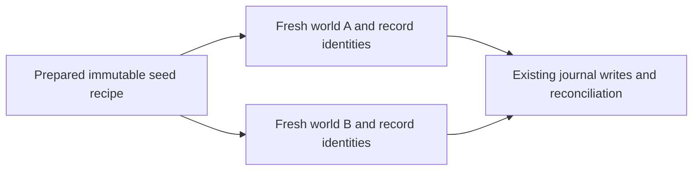

# 02 — Try reusable demo seed inputs

- Status: complete
- Depends on: None; reuse plan 01's instrumentation baseline, then measure after its verified report change.
- Requirements: [R-02–R-05](README.md); exclusions X-01–X-02.

## Experiment

Question Q-03: Does reusing immutable seed inputs materially reduce fresh demo-world construction with a small, explicit API?

Measure five serial worlds and separate store creation, service initialization, script generation, writes/reconciliation, log-store creation, session startup, and report activation. Try at most one prepared-input design. A negative result is acceptable if the measured upper bound is too small for the required API/identity complexity, or the candidate fails isolation/content checks. Do not retain unsupported infrastructure merely to claim both experiments succeeded.

The proposed value contains the scenario's sample coordinates/times and manual-history inputs. The DEBUG fixture composition owns reuse; each world gets new record identities, device stamping, services, and store. Ordinary production/demo calls still construct their own inputs. A retained API must carry the clock/calendar/scenario together so mismatched inputs cannot seed a different world.



```swift
// Candidate shape only; decide the smallest seam from measured work.
let recipe = DemoDataBuilder(now: referenceDate, calendar: calendar).preparedInputs()
// Each use still writes through its own services and assigns fresh identities.
try await recipe.seed(into: freshServices)
```

## Steps and acceptance

1. Inspect the subphase baseline. Record generation's upper bound before selecting the candidate. If the seam cannot remain small and meaningful, record the negative result with evidence.
2. For a retained candidate, cover repeated seeding into separate stores, unchanged reports/issues, destination device stamping, and fresh sample identities. Retain the existing across-year and configured-issue tests.
3. If an API is retained, run `./test --no-generate --only WhereCoreTests/DemoDataBuilderTests --only WhereUITests/WhereFlyoverWorldTests --only WhereUITests/DemoModeTests`, plus the focused probe. Repeat the selected candidate in a fresh process. A negative result with no Core change uses the final report-fixture checks from plan 01.
4. Remove all temporary instrumentation. Run the affected WhereUI image bundle with `./test --no-generate --skip-host-tests --only WhereUISnapshotTests --timings --record never`. Compare capture inventory to the prior source-equivalent full run. Run architecture checks, Swift formatting, symbol lint, and independent review.
5. Commit verified steps separately. Publish above #515 with `gh stack submit --auto --open`, update the linked issue with evidence, and dispatch both full CI gates on the final tip. Report remote results without waiting for completion.

## Recovery and record

Restore only unsupported candidate/instrumentation edits; keep verified report reuse. Do not share a live world as a fallback. Record measurements, commands, revisions, reviewer findings, and any retained validation limit here.

## Execution record

Two separate processes each build five fresh demo worlds through the unchanged production-shaped path. World medians are 0.936s and 0.922s. Script generation totals only 2.275ms and 2.432ms across five worlds; medians are 0.439ms and 0.466ms. Even a perfect zero-cost cache saves roughly 0.02s across 39 worlds, before accounting for fresh identities or cache lookup.

The first process spends 1.289s ingesting GPS, 0.913s writing manual backfills, and 0.602s writing corrections across five worlds. Session startup totals 1.265s and report activation 0.644s. These calls retain ordinary writes and reconciliation. Store creation is mostly 3ms after the first cold creation; it is not the dominant repeated cost.

Decision: supported negative result under Q-03's bounded criterion. Do not introduce a prepared-input API or cache for this negligible budget. No prepared-input candidate was built, and no Core or world-construction change remains. The ten generation measurements include the exact target work and establish a tighter bound than the earlier aggregate scope timer. Broader write/reconciliation optimization remains in STU-121 and is outside this request.

Independent review recomputed both raw logs (66 rows each), checked that the generation span contains `makeScript()` including new sample identities, and found no actionable issue. Generation means extrapolated over 39 worlds are 0.017748s and 0.018970s. These are an upper-bound estimate for the measured scenario, not an implemented speedup or evidence about other scenarios.

The final retained source passes 33 report/world tests and the focused 63-capture image matrix from plan 01. Core/demo behavior is unchanged, so the conditional candidate-specific Core tests are not needed. Broad WhereUI image integration passes with the final retained source:

- `./test --no-generate --skip-host-tests --only WhereUISnapshotTests --timings --record never`: 67 tests in 62 suites, 801 captures, no retries or failures. All identities, sizing, 4,414,294,494 pixels, and 902 tiles match the parent inventory.
- Capture time is 677.761s; the test runner takes 732.243s. The earlier source-equivalent parent sample has 677.170s in captures. This integration run establishes reference acceptance and inventory preservation, not a measured timing improvement or pixel-exact equality.
- Architecture, Swift formatting, symbol lint, and diff checks pass. No references, tolerances, readiness policies, or generation inputs changed. All temporary probes were removed before final validation.

Independent review checked the complete diff and raw logs, with no actionable findings. Rebase from `5808c576f` to `9005c92f0` preserves the complete tree `f6f5b30a643ad4619ee1489c550dbf3d691bbd31`; parent `d3f012395` matches the tested `bc02a4595` source. The negative result is a separate commit, `9005c92f0`, in [PR #516](https://github.com/kyleve/Stuff/pull/516). Final publication records do not change source. The PR owns manual full-gate dispatch links and pending remote results.

## Resume point

Complete. The supported negative result and report optimization are published in PR #516. Review its pending CI results; broader seed write/reconciliation work remains in STU-121.
