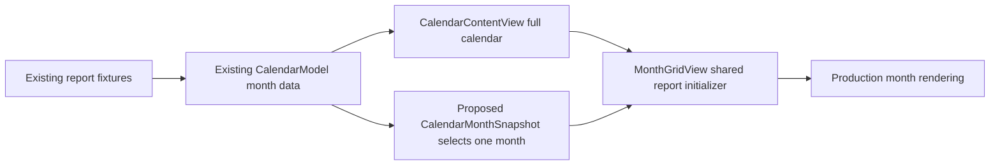

# Focus calendar content on representative months

Status: executing
Dependencies: none; execute after plan 01 for separate commits and evidence.
Requirements: [US-01, R-02–R-04, X-01–X-02](README.md#requirements-and-scope).

Replace repeated year-long detail captures with one production month carrying the state's meaningful content. Retain a small full-height integration set and the distinct year-overview layout. Keep production-shaped fixture data and explicit capture identities.

## Selected coverage

| Subject | Selected month / retained scope |
| --- | --- |
| WithData and region focus | May: California/New York transition and both footer totals |
| Flights | July: both completed-flight spans |
| Itinerary | October: flexible planned dates and home days |
| ItineraryOverlap | November: overlapping California/New York plans; an additional small case preserves the second month's risk |
| Empty and planned states | July: current-day styling and recorded/planned transition |
| MissingDays | January: scattered recordings and visible gaps |
| FutureWithoutPlans | January of the selected future year |
| MultiRegionPlannedStay | July, with the existing fixture's planned-region argument set to California to show recorded New York plus future California |
| FullYear and HistoryColumn | One full phone calendar plus the existing full narrow history pane |
| YearOverview variants | Retain the distinct twelve-month layout, including its large-type column adaptation and planning states |
| YearView | Retain Loaded phone light/dark and RestoredOverview light/dark; cover picker traits in a small production-control matrix. Empty content remains covered by month and adaptive-load cases. |

Most detail states retain their existing names and widths but shrink to one complete month. Full-screen scenario previews and Flyover retain their original calendar subjects through the same case declarations. Add a preview of the focused image subjects so references can also be reviewed in that form.

## Design

Share report-to-month wiring in a `MonthGridView` initializer: calendar, focus, planning visibility, per-day membership, and monthly summaries. `CalendarContentView` uses that initializer unchanged in behavior. A DEBUG-only `CalendarMonthSnapshot` selects a month through the production `CalendarModel`, then renders that same production month at its normal content width and background. It computes its final month synchronously, so measurement is immediate; final pixel settling stays enabled.

`CalendarSnapshotCases.detail` chooses the focused month for the image matrix or the existing full-screen calendar for scenario previews. It preserves frame names/traits and removes the viewport minimum for focused months. Existing mounted-layout readiness remains for full calendars and overviews. There is no production month filter or image crop.



```swift
// Proposed shared wiring; production behavior remains the same.
MonthGridView(month: month, focusedRegion: region, report: report)
// DEBUG image subject uses production calendar data, with no scrolling wrapper.
let month = CalendarModel(report: report).months(from: report.report).month(number)
MonthGridView(month: month, focusedRegion: region, report: report)
    .padding().whereContentRoot().background(systemBackground)
```

The sketch omits error handling and existing constructor arguments. Invalid fixture data must fail explicitly rather than render a placeholder.

## Execution and acceptance

1. Commit plan 01's verified RTL removal and preserve the 75-capture calendar baseline.
2. Implement the shared month wiring, focused subjects, explicit full-height cases, and YearView picker coverage. Preserve ordinary full-screen scenario previews and Flyover.
3. Run the two calendar image suites with recording disabled first. Compare changes against the intended matrix, then record only changed/new subjects in a focused run.
4. Inspect every reframed case in light/dark and representative tablet/AX5/accessibility images. Verify flight badges, missing days, focused dots, flexible/overlapping plans, hidden plans, current-day treatment, and complete frames.
5. Assert all retained/new references with recording disabled. Run CalendarModel, CalendarMonthAccessibility, CalendarContentView, YearView, and WhereFlyoverCatalog tests; run formatting, symbols, architecture and guidance checks. Use an independent completed-diff review before publication.
6. Record actual image/pixel/height totals and timings. Claim smaller review subjects from the changed dimensions; distinguish changed workload from implementation-only speedups. Delete only references no longer emitted.

Review, 2026-11-17, `fdb86b6bd`: this coverage retains month-list composition at two widths plus two full YearView integrations. Overview AX5 remains because its one-column layout is a separate behavior. The shared initializer prevents planning wiring from drifting in component captures. Existing fixture dates support the selected months. Q-02 is resolved within the user's requested scope. Mermaid syntax was inspected; no renderer was run.

## Execution evidence

Implemented the shared production initializer and DEBUG month subjects. The first comparison with `--record never` reported exactly the intended changes: 28 existing month images changed dimensions, two new overlap images, five new picker images, and the new FullYear identity. FullYear then reused the original WithData phone reference byte for byte (SHA-256 `781646e6be160eeb218c96196b5dbf13a8b5ac18a8e0544b18cc0f2f63c86b58`, 1206 × 9792). The recording run changed only the 28 reframed images and seven new component images. Five superseded YearView references were removed.

The calendar/YearView inventory changes from 75 captures, 750,675,471 pixels, and 120 tiles to 78 captures, 297,023,451 pixels, and 85 tiles: 60.4% fewer pixels and 29.2% fewer tiles. Forty-two retained identities keep the same dimensions; 28 shrink, eight are added, and five are removed. Reference files change from 73 to 76 because cutsheet panels have separate timing rows. All 40 retained files are byte-identical to the base. These totals describe the changed coverage workload, not an implementation-only speedup. Failed comparison timings are not used as performance evidence.

Visual review covered every reframed image and all seven new component images. Light/dark, tablet, AX5, contrast, and annotation captures retain complete month frames. Flight badges, recording gaps, focus, flexible/overlapping plans, hidden plans, footer totals, and today's highlight are visible. The mode picker covers its selected state, large-type vertical arrangement, contrast, and accessibility labels. An independent reviewer inspected the same images and verified FullYear's identical bytes. No clipping or blank subjects were found.

Artifacts: `/private/tmp/stuff-calendar-months-compare-20261117`, `/private/tmp/stuff-calendar-months-record-20261117`, and `/private/tmp/stuff-calendar-months-review-20261117`. Both image runs select `WhereUISnapshotTests/CalendarContentViewSnapshotTests` and `WhereUISnapshotTests/YearViewSnapshotTests` with `--no-generate --timings --review`; recording uses `--no-build --record failed` after the initial `--record never` comparison. Both intentionally return exit 65 for changed/new references.

The final run passes 25 unit functions in six suites, then eight image functions in five suites with 162 captures and zero retries. Calendar forced-retry and YearView adaptive-load regressions pass. Architecture, applicable host checks, SwiftFormat, symbol lint, whitespace, and tracked-guidance checks pass. The unrelated untracked simple-english skill was excluded from the tracked-guidance check and restored unchanged. Independent review covers base `b0dfa58cb`, RTL commit `fdb86b6bd`, the calendar source, all reference changes, and raw results; no actionable findings remain.

```sh
TEST_WORKDIR=/private/tmp/stuff-snapshot-reviewability-final-20261117 ./test \
  --only WhereUITests/CalendarModelTests \
  --only WhereUITests/CalendarMonthAccessibilityTests \
  --only WhereUITests/CalendarContentViewTests \
  --only WhereUITests/CalendarSnapshotReadinessTests \
  --only WhereUITests/YearViewTests \
  --only WhereUITests/WhereFlyoverCatalogTests \
  --only WhereUISnapshotTests/MainTabsSnapshotTests \
  --only WhereUISnapshotTests/SettingsViewSnapshotTests \
  --only WhereUISnapshotTests/OnboardingThemeSelectionViewSnapshotTests \
  --only WhereUISnapshotTests/CalendarContentViewSnapshotTests \
  --only WhereUISnapshotTests/YearViewSnapshotTests \
  --no-generate --timings --review --record never
```

With the same timing/review flags, CalendarContentView capture work falls from 52.994s to 37.614s; YearView falls from 19.958s to 17.946s. Together: 72.952s → 55.560s, saving 17.392s (23.8%). The other 84 captures vary by 0.241s. This is one local debug-simulator comparison on Xcode/iOS 27.2, with intentionally smaller coverage subjects; it is not a repeated benchmark or CI wall-time result. Passing references do not establish exact captured pixels. Retained cases keep their baseline diagnostics, with small variation in the unchanged adaptive Locations case. The complete suite and physical-device behavior were not rerun for this focused matrix change.

Resume: commit the verified calendar step and publish above PR #520.
