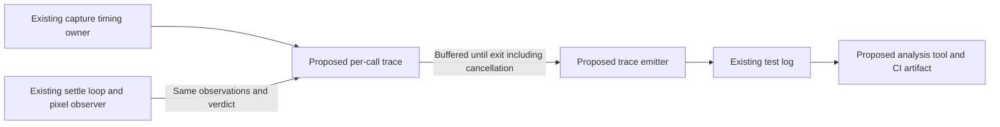

# 01 — Trace settling

- Status: ready
- Depends on: None.
- Shared context: [Overview](README.md).

## Deliverable and requirements

Implement R-01 and the evidence transport portion of R-02. Preserve X-01–X-04.
With `./test --timings`, each settling call produces a versioned JSON record with its capture identity, ordinal, reason, policy, outcome, and ordered pass observations.
Without timing, do not allocate pass buffers or emit trace rows.

## Data flow



The capture timing owner creates identity once. Call ordinals continue across retries using that owner.
The trace is main-actor confined; it starts no tasks and owns no UI state. Existing cleanup and failure propagation remain unchanged.
No trace output can choose or modify a settling result. Immediate paths report a skipped outcome with no pixel passes.

## Architecture sketch

```swift
// Proposed shape; implementation names may become more specific.
let trace = timing.makeSettleTrace(reason: .content, limits: limits)
// Existing sleep/layout/render/observe logic, with observational timestamps.
trace?.append(pass: observation)
trace?.finish(outcome: outcome)
// Existing verdict is returned unchanged.
```

Add `SnapshotSettleTrace` and typed reasons beside the existing recorder in SnapshotKitTesting.
The pixel observer exposes its last event (anchor, changed, matching, missing) and stability result without a second comparison.
Record sleep request/actual elapsed, layout, low-resolution rendering, combined pixel normalization/comparison, and elapsed sample time.
Record pixel-stable and minimum-duration-satisfied conditions independently at the original decision timestamp.
The combined pixel cost can be split with a focused trace later if it is material.
Keep diagnostic rows distinct from `SNAPSHOT_TIMING`, and retain existing aggregate capture semantics.

## Steps

1. Extend capture-owned metadata and mark each renderer call site: measurement, content, native insets, post-action, scroll reset, and accessibility preparation.
2. Instrument the existing loop and immediate path. Buffer records and emit after exit; report outcome and partial work on cancellation/failure.
3. Add meaningful guards for wire identity, disabled diagnostics, event transitions, floor/proof overlap, and retained outcomes. Existing slow-fade, one-pixel, cancellation, starvation, and retry tests remain authoritative.
4. Add `Tools/snapshot_settle_profile.py` to validate logs, retain raw trace JSONL, and summarize operation times, reasons, outcomes, and observations. Reject malformed/nonfinite records; preserve duplicate capture labels through capture identities.
5. Retain successful CI trace artifacts beside suite timings without changing shard assignment or capture parallelism. Document output and invocation in module/tool READMEs.

## Acceptance and verification

From the repository root:

- `./ide --no-open` after adding source/test files.
- `./test SnapshotKitTestingTests --no-generate`: new diagnostic checks and existing renderer/readiness/cancellation/retry/pixel guards pass.
- `python3 -m unittest discover -s Tools/Tests -p 'test_snapshot_settle_profile.py'`: valid, malformed, partial, and duplicate-label accounting checks pass.
- Applicable CI-tool checks cover artifact staging.
- `./test --snapshots --no-generate --timings --record never`: all current image captures pass without recording; preserve identity/geometry and inspect retries.
- `./swiftformat --lint`, `./sf-symbols --lint`, Python formatting/lint for changed tools, `git diff --check`, and tracked guidance checks pass.
- Independent completed-diff review verifies observations do not control behavior, and checks raw evidence before publication.

## Recovery and boundaries

A failed run retains logs and partial trace rows; the analyzer labels outcomes and missing completion evidence rather than silently treating them as successful captures.
Disable timing to obtain an uninstrumented control. Do not change a floor or tolerance to make an instrumented run pass.
Do not overwrite unrelated untracked files or run another simulator during measurements.

## Progress and resume point

Ready after plan review; implement diagnostics, then execute the checks. No source implementation is present yet.
