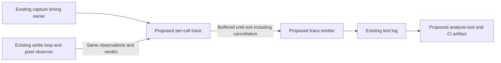

# 01 — Trace settling

- Status: complete
- Depends on: None.
- Shared context: [Overview](README.md).

## Deliverable and requirements

Implement R-01 and the evidence transport portion of R-02. Preserve X-01–X-04.
With `./test --timings`, each settling call produces a versioned JSON record with its capture identity, ordinal, reason, policy, outcome, and ordered pass observations.
Without timing, do not allocate pass buffers or emit trace rows.

## Data flow



The capture timing owner creates identity once. Call ordinals continue across retries using that owner.
The trace is main-actor confined; it starts no tasks and owns no UI state. Existing cleanup and failure propagation remain unchanged.
No trace output can choose or modify a settling result. Immediate paths report a skipped outcome with no pixel passes.

## Architecture sketch

```swift
// Proposed shape; implementation names may become more specific.
let trace = timing.makeSettleTrace(reason: .content, limits: limits)
// Existing sleep/layout/render/observe logic, with observational timestamps.
trace?.append(pass: observation)
trace?.finish(outcome: outcome)
// Existing verdict is returned unchanged.
```

Add `SnapshotSettleTrace` and typed reasons beside the existing recorder in SnapshotKitTesting.
The pixel observer exposes its last event (anchor, changed, matching, missing) and stability result without a second comparison.
Record sleep request/actual elapsed, layout, low-resolution rendering, combined pixel normalization/comparison, and elapsed sample time.
Record pixel-stable and minimum-duration-satisfied conditions independently at the original decision timestamp.
The combined pixel cost can be split with a focused trace later if it is material.
Keep diagnostic rows distinct from `SNAPSHOT_TIMING`, and retain existing aggregate capture semantics. Add capture identity and expected call count to the capture summary; reconcile call ordinals and pass totals. Preserve orphaned or incomplete records explicitly. Take the deciding sample timestamp immediately after rendering, before normalization/comparison; later diagnostic clocks never control the verdict.

## Steps

1. Extend capture-owned metadata and mark each renderer call site: measurement, content, native insets, post-action, scroll reset, and accessibility preparation.
2. Instrument the existing loop and immediate path. Buffer records and emit after exit; report outcome and partial work on cancellation/failure.
3. Add meaningful guards for wire identity, disabled diagnostics, event transitions, floor/proof overlap, and retained outcomes. Existing slow-fade, one-pixel, cancellation, starvation, and retry tests remain authoritative.
4. Add `Tools/snapshot_settle_profile.py` to validate logs, retain raw trace JSONL, and summarize operation times, reasons, outcomes, and observations. Reject malformed/nonfinite records; preserve duplicate capture labels through capture identities. Require terminal Xcode success in every input log as well as call/pass reconciliation before reporting completion.
5. Retain successful CI trace artifacts beside suite timings without changing shard assignment or capture parallelism. Document output and invocation in module/tool READMEs.

## Acceptance and verification

From the repository root:

- `./ide --no-open` after adding source/test files.
- `./test SnapshotKitTestingTests --no-generate`: new diagnostic checks and existing renderer/readiness/cancellation/retry/pixel guards pass.
- `python3 -m unittest discover -s Tools/Tests -p 'test_snapshot_settle_profile.py'`: valid, malformed, partial, and duplicate-label accounting checks pass.
- Applicable CI-tool checks pass. Replay the staging command against a local trace; the actual CI upload remains part of plan 02.
- `./test --snapshots --no-generate --timings --record never`: all current image captures pass without recording; preserve identity/geometry and inspect retries.
- `./swiftformat --lint`, `./sf-symbols --lint`, Python formatting/lint for changed tools, `git diff --check`, and tracked guidance checks pass.
- Independent completed-diff review verifies observations do not control behavior, and checks raw evidence before publication.

## Recovery and boundaries

A failed run retains logs and partial trace rows; the analyzer labels outcomes and missing completion evidence rather than silently treating them as successful captures.
Disable timing to obtain an uninstrumented control. Do not change a floor or tolerance to make an instrumented run pass.
Do not overwrite unrelated untracked files or run another simulator during measurements.

## Progress and resume point

2026-11-17: Plan committed at `230c5048d`; instrumentation implementation has started. Independent review requires trace-call/pass reconciliation and preservation of the original post-render decision timestamp. Both are explicit acceptance conditions.

Implementation now tags all six renderer reasons, records pass operations and pixel events, and reconciles call/pass totals in the analysis tool. Review corrected disabled-path clock/environment evaluation and excluded unsampled quiescence calls from the unchanged-pixel metric. Seven parser tests and 12 existing CI tests pass. The live-log smoke check exposed a capture-boundary truncation that still reconciled; terminal success is now required separately for each input log, with a regression guard. Framework validation completed 162 functions: 158 passed and four had intentional expected failures, with no unexpected failures. Two new Swift Testing assertions needed macro-compatible forms before the framework build could run; neither failure involved production source compilation.

Full validation passes all 935 captures and 78 functions without retries or reference recording. The capture multiset matches the through-521 baseline on suite, identifier, pixels, tiles, sizing, measurement readiness, and capture-settle policy: 4,797,647,739 pixels and 1,014 tiles. All 1,828 calls and 6,066 passes reconcile; 1,265 calls settle and 563 skip. All input logs have terminal success. The exact CI staging command, replayed against the real log and JUnit in a temporary directory, retains all records and identical JUnit bytes. Plan 02 also verifies real CI staging, upload, and download.

Commands and retained evidence:

- `TEST_WORKDIR=/private/tmp/stuff-settle-trace-unit-20261117 ./test SnapshotKitTestingTests --no-generate`; result bundle and log in that directory. Precise test work is 74.116s.
- `TEST_WORKDIR=/private/tmp/stuff-settle-trace-full-20261117 ./test --snapshots --no-generate --timings --review --record never`; 872.092s runner test phase and 843.961s precise test work. This run enables review diagnostics; the through-521 timing baseline does not, so these totals do not estimate tracing overhead.
- `python3 -m unittest Tools.Tests.test_snapshot_settle_profile Tools.Tests.test_ci_workflows Tools.Tests.test_ci_circleci`: 19 tests pass.
- Generation, normal architecture/host checks, Swift formatting, SF Symbol lint, scoped Ruff lint/formatting, and whitespace checks pass.
- Raw logs, xcresult export, capture/trace JSONL, reconciliation, and inventory checks are retained under `snapshot-settle-investigation-results/local-full` in the session artifact directory. Exact staging replay is `/private/tmp/stuff-settle-stage-replay-20261117`.

Completed: instrumentation commit `f60c1c974` is published in [PR #524](https://github.com/kyleve/Stuff/pull/524). Independent source and raw-evidence review has no remaining blockers. It verified every sampled stability/floor flag, all capture/test identities and totals, and retained staging bytes. Existing reference tolerances pass; the 153 review-diagnostic rows do not establish byte-identical captured images. This is groundwork; no settling optimization or saving is claimed. Continue with plan 02.
