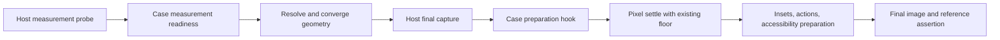

# 03 — Evaluate controlled settling improvements

- Status: complete
- Depends on: [02](02-classify-costs.md), complete at `2fd1cdfaa`.
- Shared context: [Overview](README.md), R-03/R-04 and X-02–X-04.

## Intended outcome

Resolve Q-04 for the selected candidates. Explain work inside rendering and identify safe measurement settles to remove.
A supported negative result can close a candidate. An unavailable system trace can close attribution only with a recorded tool limitation and an alternate process sample; it cannot establish a speedup.

## Evidence and choices

Plan 02 measures render calls at 72.9% locally and 79.8% on CI. The 308 sampled measurement calls cost 95.652s locally and 118.493s on CI. These costs overlap.
The seven local late-changing calls and two CI Root measurement calls rule out universal first-stable completion.
Apple documents that `drawHierarchy` with `afterScreenUpdates: false` can omit recent changes. It also documents that reusing a `UIGraphicsRenderer` reuses drawing contexts:
[view rendering](https://developer.apple.com/documentation/uikit/uiview/drawhierarchy(in:afterscreenupdates:)), [renderer reuse](https://developer.apple.com/documentation/uikit/uigraphicsrenderer).
These descriptions motivate experiments; they do not prove correctness or savings on the pinned runtime.

## Bounded experiments

1. Attribute rendering using one focused static/native run through `./test` and a process-scoped Instruments trace or `sample`. Keep unprofiled controls separate from the instrumented run. Inspect stacks for drawing, transaction commits, synchronization, and context allocation. Do not infer CPU cost from wall-clock intervals alone.
2. Test at most two renderer candidates: reuse the renderer within a settle call, invalidating it when bounds change; and preserving extended color through downsampling before the existing small-image sRGB normalization. The process sample identifies color conversion as a substantial sampled render cost; its position before downsampling is an inference. Keep `afterScreenUpdates: true`; the stale committed-frame alternative is not selected. Never use a control render to update a candidate host before its verdict. Do not change pixel tolerance, quiet duration, minimum floors, or final image rendering.
3. Audit explicit measurement eligibility. Start with `UpdateBuildView`, `UpdateHistoryView`, `FlightReviewPointRow`, and `PrivacyPassportCard`; they have static input candidates and measured repeated probe cost. The source audit also selects SettingsView (static list with prepared models) and OnboardingThemeSelectionView (artwork that preserves card layout and supplied selection). Expand only to source-proven synchronous fixtures or operation-owned completion hooks. Keep Root, PlanningRegionPicker, Flyover, and other unproved async sizing on their current policies. A zero-change trace alone does not qualify a fixture.
4. Move OnboardingThemeSelectionView's existing artwork hook from the post-settle action to capture preparation, subject to the same fresh-host comparisons. The cache load does not need settled UI and the card's content layout does not depend on its result. Repeated native/action stages remain in scope for attribution. Change them only if an operation-owned completion or geometry invariant removes the need; otherwise record why they remain. Do not repeat rejected global-idle/UIUpdateLink experiments.

## Method and implementation boundaries

Use separate serial invocations for old and candidate policies, with fresh host processes and controllers. The control must not flush a candidate host before capture.
For candidates that can shorten readiness, capture the candidate result, the normal result on a fresh host, and a later result on another fresh host (an added 500ms before measurement settling and another 500ms before final capture). Compare dimensions and normalized images, inspect differing content, and retain raw diagnostics.
The added delay is an experimental oracle, never a production sleep. Include every Settings variant because its width observer can change gutters and row wrapping. Run Onboarding alone in a fresh process for a cold-cache comparison; cache completion does not itself prove that mounted cards have published their artwork, so final settling remains. Native noise may prevent byte equality; quantify it against repeated control captures and require current reference assertions plus direct content/geometry evidence. Reject unexplained differences.
Before accepting a candidate, use two repetitions per control/candidate mode on focused families and one separate later-capture oracle. Alternate modes when feasible. A pilot without a useful gain can stop early as a negative result. Full-suite results validate coverage, not a statistically precise speed estimate.
For renderer reuse, preserve every draw and deadline. Compare focused runs before deciding whether the gain warrants keeping the extra state. Require changing-bounds and fresh-sample guards before accepting that candidate.
Temporary experimental switches and captures live in an isolated patch or local artifact directory and are removed before publication. Retain commands, source hashes, logs, result exports, image comparisons, and supported negative findings.

The existing pipeline remains:



The measurement candidate changes only the case declaration:

```swift
// Existing API; eligible fixtures only. Final settling remains unchanged.
SnapshotCase(measurementReadiness: .immediate) {
    FixtureView(model: fullyPreparedModel)
}
// No readiness inference, global cache, or cross-mount completion token.
```

## Acceptance and checks

- Record where render time is spent, distinguishing observed stacks from inference and unprofiled timings.
- Accept a candidate only with source/lifecycle justification, matched results and geometry, unchanged references/tolerances, and repeatable savings that justify its complexity. Otherwise retain the negative result.
- Exercise all seven local late-change identities through MainTabs, PlanningRegionPicker, Root, and Flyover suites. Keep the CI Root cases in the full isolated CI check.
- Run renderer regression tests for noise, cumulative fade, single pixels, changing dimensions, cancellation, timeout/starvation, retries, and hosting cleanup for shared-renderer changes.
- Use `./test --snapshots --record never --review --timings --only Bundle/Suite` for focused cases; use `./test SnapshotKitTestingTests` for framework checks. The exact bundle names must come from `Project.swift`/existing test artifacts.
- After an accepted shared-renderer change, run the full image suite and reconcile all 935 capture identities, geometry, and policies; compare against plan 02 with capture multisets because some IDs repeat.
- Refine plan 04 from supported results, even when only the measurement track qualifies. Do not stop at experiment publication while accepted implementation work remains.

## Results and decisions

All experiments used Xcode 27.2 (27B52), iOS 27.2, and the repository-owned iPhone 17 simulator. The control source is `2fd1cdfaa`; temporary adapters changed only the selected policy and image export. Each invocation records its exact command, environment, source hashes, and exit status.

### Rendering

A 20-second simulator-scoped Time Profiler trace recorded 22.344s of CPU sample weight across threads. Settle-image rendering accounted for 3.793s; 1.740s of that was below `CGColorTransformConvertUsingCMSConverter`. A separate ten-second wall-stack sample recorded 1,164 stacks in settle rendering, with 669 below color conversion, and also showed render-server waits. Conversion before downsampling is an inference from the stacks, not a measurement of buffer dimensions. These samples do not establish suite-wide CPU proportions.

| Run | Captures | Test phase (s) | Capture (s) | Settle (s) | Render (s) | Passes |
| --- | ---: | ---: | ---: | ---: | ---: | ---: |
| Control 1 | 110 | 133.108 | 113.834 | 64.770 | 48.468 | 810 |
| Extended 1 | 110 | 133.101 | 112.027 | 62.991 | 42.319 | 1,019 |
| Reuse | 110 | 134.216 | 112.740 | 64.096 | 48.045 | 799 |
| Control 2 | 110 | 134.979 | 113.315 | 64.463 | 48.295 | 799 |
| Extended 2 | 110 | 138.731 | 117.884 | 62.383 | 42.302 | 975 |

Extended color reduced mean traced rendering by 6.071s (12.55%) and settling by 1.930s (2.99%), but increased mean test time by 1.873s. Faster samples produced more passes before the unchanged floor. Renderer reuse's single result was within control variation. The experiment was narrowed after that pilot: stop before another repetition, production state, or further acceptance guards. This is a supported rejection of the tested prototype, not proof that all renderer reuse is ineffective.

Both extended runs and repeated controls had identical dimensions and no normalized image differences above one channel unit. Both formats passed nine renderer test functions, including six real hierarchy cases for wide color, transparency, cumulative fades, one bottom-edge sample pixel, and fractional neighbors of saturated color. The diagnostic contexts confirmed 8-bit sRGB versus 16-bit extended sRGB. No correctness failure was observed in these bounded checks. Do not ship either prototype: neither showed repeatable end-to-end benefit in the local trials. These renderer candidates were not tested on CI. CI has slower samples, so the local floor-limited result does not establish their CI performance.

### Measurement and preparation

The initial six-family candidate failed all 16 Settings captures: 15 were 156 pixels (52 points) too short, and AX5 was 219 pixels (73 points) too short. Ready data did not establish ready hosted geometry. Reject immediate measurement for the entire Settings provider. The component responsible for the missing height was not directly traced.

The five remaining providers were repeated as a successful matched selection, independent of that failed run:

| Run | Captures | Test phase (s) | Capture (s) | Settle (s) | Passes |
| --- | ---: | ---: | ---: | ---: | ---: |
| Control 1 | 62 | 75.150 | 54.521 | 37.763 | 583 |
| Candidate 1 | 62 | 55.667 | 34.892 | 18.073 | 273 |
| Control 2 | 62 | 75.762 | 54.662 | 37.330 | 569 |
| Candidate 2 | 62 | 56.017 | 36.415 | 18.606 | 269 |
| Delayed oracle | 62 | 146.056 | 121.727 | 38.902 | 551 |

Each pair, the repeated controls, and candidate 2 versus the delayed oracle are pixel-identical after premultiplied sRGB normalization: all 62 images, with unchanged dimensions. Every successful invocation has complete traces and no retries. The oracle's intentional delays are excluded from savings.

Mean capture time falls 18.938s (34.69%), test time 19.614s (25.99%), and settling 19.207s (51.16%). Accept explicit immediate measurement for UpdateBuild, UpdateHistory, FlightReviewPointRow, PrivacyPassportCard, and OnboardingThemeSelection. Accept moving Onboarding artwork loading before the first final settle. This removes 62 sampled measurement calls and ten post-action calls while preserving final settling and all matrices.

A separate first-in-process Onboarding control/candidate passed ten pixel-identical images with capture totals 12.536s and 6.076s. Visual inspection confirmed California artwork in both theme specimens. The path cache was cold at process start; final settling still covers publication into each mounted card model. Artwork preserves layout but does not make every card globally fixed-height.

### Other repeated stages

Source review retained native inset and accessibility preparation. They reconcile geometry or parsing state and have no replacement readiness signal proven by this experiment.

Root's launcher and Device Layout's shared world preparation await owner-held `Task.value`. Cancelling the waiter does not cancel the owner. Moving them into a bounded preparation task group requires owner-aware waiting and targeted cancellation checks. Device Layout's preloaded test must also forward a moved hook. DevicesSettings can change height during session start and requires overlapping/cancelled-start coverage. PlacesYear's artwork-only hook is another source-eligible candidate. A matched CI trial of extended-color intermediates and a separate sampling-cadence experiment remain open. Preserve current-frame rendering and the full quiet-window proof; fewer early draws may also affect how hosted UI progresses. These unselected follow-ups remain in [STU-121](https://linear.app/kve/issue/STU-121), not implicit acceptance of a mechanical hook rename.

## Evidence, cleanup, and review

Raw evidence is retained at `/Users/kve/.codex/visualizations/2026/11/17/01a1e71b-13f1-7c80-8aee-e46d45c92d5b/snapshot-settle-improvements-results/`:

- `attribution/`: Instruments trace, CPU export/summary, wall-stack sample, and focused test artifacts.
- `experiments/`: per-run logs, result bundles, PNGs, commands/source hashes, normalized comparisons, timing tables, scripts, and the final prototype patch.
- `experiments/excluded-runs.json`: two failed temporary-adapter builds and the stale-product guard run. They are excluded from passing counts and timings. Both guard formats were subsequently rebuilt and passed.

The temporary renderer/capture adapters have been restored byte-for-byte to the base. Retain only actual hierarchy regression guards and findings; remove export code, flags, delays, and format prints. The clean-source rebuild passes all nine `SnapshotRenderingSupportTests` functions, including all six hierarchy arguments; `./swiftformat --lint Shared/SnapshotKitTesting/Tests/SnapshotRenderingSupportTests.swift` and `git diff --check` pass. Final guard artifacts are `/private/tmp/stuff-settle-final-guards/` with the console log alongside. Independent final review found no blockers. It recomputed raw traces and image inventories, confirmed all 62 selected PNGs and ten cold Onboarding PNGs are byte-identical between their controls, and verified that content settle floors, quiet proof, maximum budgets, and retries remain unchanged. Groundwork is published at `433450cba` in [PR #525](https://github.com/kyleve/Stuff/pull/525), stacked on #524.

Independent review by `/root/review_settling_candidates` corrected the async sizing sketch, required actual hierarchy-render guards, identified Settings' geometry risk, and required the cold Onboarding check. The original plan review covered requirements, independent-host controls, cancellation, cleanup, and prior late-change counterexamples. Mermaid syntax was inspected; no rendered-diagram check is claimed.

## Resume point

Evidence supports the five-provider implementation in plan 04. Clean-source guard verification, independent review, and publication are complete. Plan 04 has delivered the accepted changes and verified all retained MainTabs, PlanningRegionPicker, Root, and Flyover late-change identities locally and on CI. Later rendering/sampling experiments remain in STU-121.
