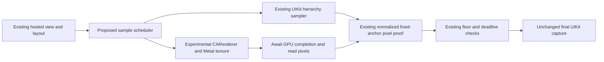

# 05 — Test Metal capture and sample scheduling

- Status: ready
- Depends on: [04](04-validated-improvements.md), complete at `1ef9b92b7`; documentation head `75978860f` is fully green.
- Shared context: [Overview](README.md), R-05, X-02–X-04, Q-06–Q-08.
- Owner: root agent; execution explicitly authorized by the user on 2026-11-17.

## Question and bounded method

Can the existing pixel proof cost less by sampling less often or rendering its low-resolution images into a Metal texture?
Keep final PNG capture, normalization, reference tolerances, matrices, readiness hooks, floors, and the fixed-anchor proof unchanged.
The experiment may complete with a supported negative result. An unavailable GPU or inconclusive noisy timing is a reported limit, never evidence of a gain.

Start with one local Metal capability/fidelity pilot, allowing two corrective iterations for adapter errors. Stop a backend that cannot see current content without changing the hosted hierarchy or using private APIs. Test cadence at one conservative 60ms start-to-start minimum, including at least 16ms suspension between renders. A second interval or floor-aware strategy is permitted only if the first trial identifies a specific avoidable cost. Limit each viable candidate to two paired focused controls plus one later oracle before selecting it for full validation. Preserve failed probes and their source outside Git.

## Proposed experiment boundary



Swift sketch, not compilation evidence:

```swift
await suspendUntilNextSample(minimumSuspension: .milliseconds(16))
layoutHostedView()
let image = try await sampleCurrentContent(using: candidate)
let stable = pixelProof.observe(image, at: sampleCompletion)
return evaluateExistingFloorAndDeadlines(stable)
```

The GPU pilot owns its device, queue, renderer, texture, and completion fence. It must not reparent or mutate the hosted root to fit a texture. Allocate for current bounds, clear output, await completed GPU work before reading, and retain resources through completion even during cancellation. Missing images break the proof. The candidate remains temporary until fidelity and end-to-end timing justify a maintained backend. Final capture still uses UIKit.

## Steps and evidence

1. Save source hashes and clean copies under the session's `snapshot-metal-sampling-results` artifact directory. Keep probes in existing source/test files so temporary generation changes are unnecessary. Use `./test` serially on this checkout's simulator.
2. In `SnapshotRenderingSupportTests.swift`, test actual Metal device creation and CARenderer output for hosted colors, sublayers, scale/origin, transforms, text, translucency, and late mutations. Compare with independent UIKit hosts. Add SwiftUI and native effect probes if basic fidelity works; include WebKit before allowing a general backend. A test must distinguish blank/stale output from a stable view. Record capability, dimensions, channel differences, and timings.
3. In `SnapshotRenderingSupport.swift`, prototype cadence independently. Preserve mandatory suspension, timing attribution, cancellation, starvation/timeout distinction, fixed anchor, two matching observations over 120ms, and native floors. Run framework guards, adding late-change/slow-fade/pulse adversaries as needed. Document that discrete sampling cannot certify all possible transient motion.
4. Run two serial control/candidate pairs over MainTabs, FlightReviewPointRow, PrivacyPassportCard, UpdateBuild, and UpdateHistory using `./test --snapshots --no-generate --record never --review --timings --only Bundle/Suite`. Use `--no-build` only after the exact probe source has built. Record capture/test/settle/render/sleep totals, pass counts, retries, geometry, and PNGs. If Metal fails the prerequisite, run cadence only.
5. Compare candidate verdicts and final images with independent normal and later hosts. Delay the oracle by 500ms without first capturing the candidate through UIKit. Include representative Root, PlanningRegionPicker, Flyover, and native chrome before broad acceptance. Do not infer readiness from a final image captured after an extra flush.
6. Restore nonselected prototype code. Retain scripts, hashes, commands, raw logs, images, negative results, and analysis outside Git. Record concise findings here and review them before refining plan 06. Keep the user-owned untracked skill untouched.

## Acceptance and recovery

Each candidate has a supported disposition and its tested scope. A rejected basic backend does not require a full suite or CI trial. A retained candidate must preserve declared correctness and show repeatable focused end-to-end benefit beyond control variation; faster rendering alone is insufficient. Explicit fallback eligibility must be justified by the content's behavior, not guessed from class names or silent capture failure.

Interrupted trials resume from recorded source hashes and the last complete run; never compare mixed probe revisions. Restore only this experiment's files, not unrelated working-tree changes. No references are recorded. Review source and raw evidence independently under `code-review`; publication follows `github-workflow` above PR #525.

## Progress and resume point

Plan reviewed against `75978860f`. Begin the Metal capability/fidelity pilot and cadence baseline. No experiment has run yet.
