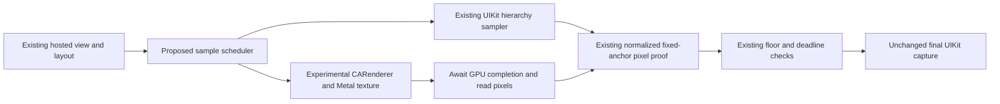

# 05 — Test Metal capture and sample scheduling

- Status: executing
- Depends on: [04](04-validated-improvements.md), complete at `1ef9b92b7`; documentation head `75978860f` is fully green.
- Shared context: [Overview](README.md), R-05, X-02–X-04, Q-06–Q-08.
- Owner: root agent; execution explicitly authorized by the user on 2026-11-17.

## Question and bounded method

Can the existing pixel proof cost less by sampling less often or rendering its low-resolution images into a Metal texture?
Keep final PNG capture, normalization, reference tolerances, matrices, readiness hooks, floors, and the fixed-anchor proof unchanged.
The experiment may complete with a supported negative result. An unavailable GPU or inconclusive noisy timing is a reported limit, never evidence of a gain.

Start with one local Metal capability/fidelity pilot, allowing two corrective iterations for adapter errors. Stop a backend that cannot see current content without changing the hosted hierarchy or using private APIs. Test cadence at one conservative 60ms start-to-start minimum, including at least 16ms suspension between renders. A second interval or floor-aware strategy is permitted only if the first trial identifies a specific avoidable cost. Limit each viable candidate to two paired focused controls plus one later oracle before selecting it for full validation. Preserve failed probes and their source outside Git.

## Proposed experiment boundary



Swift sketch, not compilation evidence:

```swift
await suspendUntilNextSample(minimumSuspension: .milliseconds(16))
layoutHostedView()
let image = try await sampleCurrentContent(using: candidate)
let stable = pixelProof.observe(image, at: sampleCompletion)
return evaluateExistingFloorAndDeadlines(stable)
```

The GPU pilot owns its device, queue, renderer, texture, and completion fence. It must not reparent or mutate the hosted root to fit a texture. Allocate for current bounds, clear output, await completed GPU work before reading, and retain resources through completion even during cancellation. Missing images break the proof. The candidate remains temporary until fidelity and end-to-end timing justify a maintained backend. Final capture still uses UIKit.

## Steps and evidence

1. Save source hashes and clean copies under the session's `snapshot-metal-sampling-results` artifact directory. Keep probes in existing source/test files so temporary generation changes are unnecessary. Use `./test` serially on this checkout's simulator.
2. In `SnapshotRenderingSupportTests.swift`, test actual Metal device creation and CARenderer output for hosted colors, sublayers, scale/origin, transforms, text, translucency, and late mutations. Compare with independent UIKit hosts. Add SwiftUI and native effect probes if basic fidelity works; include WebKit before allowing a general backend. A test must distinguish blank/stale output from a stable view. Record capability, dimensions, channel differences, and timings.
3. In `SnapshotRenderingSupport.swift`, prototype cadence independently. Preserve mandatory suspension, timing attribution, cancellation, starvation/timeout distinction, fixed anchor, two matching observations over 120ms, and native floors. Run framework guards, adding late-change/slow-fade/pulse adversaries as needed. Document that discrete sampling cannot certify all possible transient motion.
4. Run two serial control/candidate pairs over MainTabs, FlightReviewPointRow, PrivacyPassportCard, UpdateBuild, and UpdateHistory using `./test --snapshots --no-generate --record never --review --timings --only Bundle/Suite`. Use `--no-build` only after the exact probe source has built. Record capture/test/settle/render/sleep totals, pass counts, retries, geometry, and PNGs. If Metal fails the prerequisite, run cadence only.
5. Compare candidate verdicts and final images with independent normal and later hosts. Delay the oracle by 500ms without first capturing the candidate through UIKit. Include representative Root, PlanningRegionPicker, Flyover, and native chrome before broad acceptance. Do not infer readiness from a final image captured after an extra flush.
6. Restore nonselected prototype code. Retain scripts, hashes, commands, raw logs, images, negative results, and analysis outside Git. Record concise findings here and review them before refining plan 06. Keep the user-owned untracked skill untouched.

## Acceptance and recovery

Each candidate has a supported disposition and its tested scope. A rejected basic backend does not require a full suite or CI trial. A retained candidate must preserve declared correctness and show repeatable focused end-to-end benefit beyond control variation; faster rendering alone is insufficient. Explicit fallback eligibility must be justified by the content's behavior, not guessed from class names or silent capture failure.

Interrupted trials resume from recorded source hashes and the last complete run; never compare mixed probe revisions. Restore only this experiment's files, not unrelated working-tree changes. No references are recorded. Review source and raw evidence independently under `code-review`; publication follows `github-workflow` above PR #525.

## Progress and resume point

Metal prerequisites are complete; both tested adapters are rejected. Serial UIKit control/candidate trials are running with a 60ms minimum start interval and at least 16ms suspension. The temporary flags, PNG output, and later oracle stay uncommitted. Complete paired timing and correctness review before selecting any cadence change.

## Metal disposition

The local simulator exposes `Apple iOS simulator GPU`. A direct live-layer pilot produces changing colored pixels, but assigning that layer to `CARenderer` detaches it from its UIKit superlayer. Subsequent UIKit capture fails; cleanup crashes in `CALayerGetSuperlayer` / `removeFromSuperview`. This adapter violates hosted ownership even for a plain colored view.

The public `snapshotView(afterScreenUpdates: true)` adapter preserves the live hierarchy. Its first wrapper trial yields empty pixels despite successful command buffers. An explicit transaction flush and sentinel background expose an offscreen root-position error. A final corrective control sets the position to the texture center: the complete sentinel renders, while all source content is still absent. The visible host is 402×874, unhidden, with alpha 1. The snapshot retains the expected 320×480 bounds. The same failure occurs at 1× and 0.25× for quadrants, text, blur, SwiftUI content, and navigation. UIKit comparison images contain the expected content. The 0.25× sample also follows a successful full-size UIKit capture, so a missing first flush does not explain that result.

| Adapter | Actual evidence | Decision |
| --- | --- | --- |
| Live UIView layer | Changing pixels; source layer detached; UIKit rendering fails; cleanup crashes | Reject: violates host ownership |
| Public snapshot view with corrected wrapper | Full sentinel background, no source pixels; live hierarchy unchanged | Reject: cannot observe content |

The successful snapshot-view test function checks command completion and ownership, not image fidelity. Independent normalized pixel analysis and visual inspection establish its failure. WebKit's CPU image remains white because the probe did not await navigation; no WebKit fidelity result is claimed. Maps were not reached after the basic prerequisite failed.

Warm direct-layer render/readback samples are roughly 1ms, with roughly 316ms first use. These exclude setup; snapshot-view timings also exclude adapter construction. None is an accepted end-to-end speedup. No CI GPU trial ran, and actual CI acceleration remains unknown. This result rejects these adapters on iOS 27.2, not every possible Metal approach. There is no validated content class for a maintained Metal opt-in or fallback selector.

Raw sources, PNGs, logs, result bundles, pixel counts, and crash reports are retained under `/private/tmp/stuff-metal-sampling/` and the durable session artifact directory `snapshot-metal-sampling-results/metal/`. `observations.json` records source hashes and limits. The extra positioning control corrects a demonstrated adapter error before rejecting fidelity; it does not expand the selected experiment into another renderer design. All Metal prototype code is removed from the working source.

Independent reviewer `/root/review_metal_sampling` inspected sources, raw logs, crash reports, normalized outputs, and visible CPU/GPU images. It agrees with these bounded conclusions and identified the excluded WebKit and timing claims. Cadence review remains open pending results.
