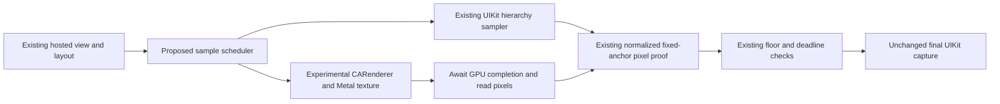

# 05 — Test Metal capture and sample scheduling

- Status: executing
- Depends on: [04](04-validated-improvements.md), complete at `1ef9b92b7`; documentation head `75978860f` is fully green.
- Shared context: [Overview](README.md), R-05, X-02–X-04, Q-06–Q-08.
- Owner: root agent; execution explicitly authorized by the user on 2026-11-17.

## Question and bounded method

Can the existing pixel proof cost less by sampling less often or rendering its low-resolution images into a Metal texture?
Keep final PNG capture, normalization, reference tolerances, matrices, readiness hooks, floors, and the fixed-anchor proof unchanged.
The experiment may complete with a supported negative result. An unavailable GPU or inconclusive noisy timing is a reported limit, never evidence of a gain.

Start with one local Metal capability/fidelity pilot, allowing two corrective iterations for adapter errors. Stop a backend that cannot see current content without changing the hosted hierarchy or using private APIs. Test cadence at one conservative 60ms start-to-start minimum, including at least 16ms suspension between renders. A second interval or floor-aware strategy is permitted only if the first trial identifies a specific avoidable cost. Limit each viable candidate to two paired focused controls plus one later oracle before selecting it for full validation. Preserve failed probes and their source outside Git.

## Proposed experiment boundary



Swift sketch, not compilation evidence:

```swift
await suspendUntilNextSample(minimumSuspension: .milliseconds(16))
layoutHostedView()
let image = try await sampleCurrentContent(using: candidate)
let stable = pixelProof.observe(image, at: sampleCompletion)
return evaluateExistingFloorAndDeadlines(stable)
```

The GPU pilot owns its device, queue, renderer, texture, and completion fence. It must not reparent or mutate the hosted root to fit a texture. Allocate for current bounds, clear output, await completed GPU work before reading, and retain resources through completion even during cancellation. Missing images break the proof. The candidate remains temporary until fidelity and end-to-end timing justify a maintained backend. Final capture still uses UIKit.

## Conditional color-format control

The first 60ms pair saves only 22 of 574 samples and leaves settling time unchanged. Most renders already approach or exceed the proposed interval. The user's preceding sample-rate request arose from the earlier extended-color result: faster renders increased pass counts before unchanged floors. After finishing the current repeat, run two matched pairs of standard/control versus extended-color samples with the 60ms interval. This adds no new capture backend or weakened proof. It tests the interaction identified by plan 03 rather than repeating its uncapped format trial. Keep final capture format unchanged. Build the combined probe once, record source hashes, and use the same products for both modes. The control uses standard color and the current 16ms suspension; the candidate uses extended color and a 60ms minimum start interval with at least 16ms suspension. Attribute any gain to that combination. The earlier extended-only trial predates PR #525 and cannot isolate this interaction on the current provider baseline. Apply the same fidelity, later-oracle, end-to-end acceptance, and cleanup criteria. A negative result needs no full-suite or CI rollout.

This is a bounded refinement of Q-07 within the user's sampling authorization, reviewed against the prior format evidence and current source. No new user decision is needed. Independent reviewer `/root/review_metal_sampling` reviewed this refinement and independently reproduced the first pair from raw traces. It found no plan blocker; implementation acceptance still requires the color/transparency/fade/single-pixel guards, later oracle, and broader validation.

## Steps and evidence

1. Save source hashes and clean copies under the session's `snapshot-metal-sampling-results` artifact directory. Keep probes in existing source/test files so temporary generation changes are unnecessary. Use `./test` serially on this checkout's simulator.
2. In `SnapshotRenderingSupportTests.swift`, test actual Metal device creation and CARenderer output for hosted colors, sublayers, scale/origin, transforms, text, translucency, and late mutations. Compare with independent UIKit hosts. Add SwiftUI and native effect probes if basic fidelity works; include WebKit before allowing a general backend. A test must distinguish blank/stale output from a stable view. Record capability, dimensions, channel differences, and timings.
3. In `SnapshotRenderingSupport.swift`, prototype cadence independently. Preserve mandatory suspension, timing attribution, cancellation, starvation/timeout distinction, fixed anchor, two matching observations over 120ms, and native floors. Run framework guards, adding late-change/slow-fade/pulse adversaries as needed. Document that discrete sampling cannot certify all possible transient motion.
4. Run two serial control/candidate pairs over MainTabs, FlightReviewPointRow, PrivacyPassportCard, UpdateBuild, and UpdateHistory using `./test --snapshots --no-generate --record never --review --timings --only Bundle/Suite`. Use `--no-build` only after the exact probe source has built. Record capture/test/settle/render/sleep totals, pass counts, retries, geometry, and PNGs. If Metal fails the prerequisite, run cadence only.
5. Compare candidate verdicts and final images with independent normal and later hosts. Delay the oracle by 500ms without first capturing the candidate through UIKit. Include representative Root, PlanningRegionPicker, Flyover, and native chrome before broad acceptance. Do not infer readiness from a final image captured after an extra flush.
6. Restore nonselected prototype code. Retain scripts, hashes, commands, raw logs, images, negative results, and analysis outside Git. Record concise findings here and review them before refining plan 06. Keep the user-owned untracked skill untouched.

## Acceptance and recovery

Each candidate has a supported disposition and its tested scope. A rejected basic backend does not require a full suite or CI trial. A retained candidate must preserve declared correctness and show repeatable focused end-to-end benefit beyond control variation; faster rendering alone is insufficient. Explicit fallback eligibility must be justified by the content's behavior, not guessed from class names or silent capture failure.

Interrupted trials resume from recorded source hashes and the last complete run; never compare mixed probe revisions. Restore only this experiment's files, not unrelated working-tree changes. No references are recorded. Review source and raw evidence independently under `code-review`; publication follows `github-workflow` above PR #525.

## Progress and resume point

All bounded trials are complete. Both Metal adapters, the standalone interval, and the combined format/interval candidate are rejected for adoption. The original Swift files are restored byte-for-byte to `75978860f`. Final evidence review and publication remain; plan 06 records the negative-result delivery.

## Metal disposition

The local simulator exposes `Apple iOS simulator GPU`. A direct live-layer pilot produces changing colored pixels, but assigning that layer to `CARenderer` detaches it from its UIKit superlayer. Subsequent UIKit capture fails; cleanup crashes in `CALayerGetSuperlayer` / `removeFromSuperview`. This adapter violates hosted ownership even for a plain colored view.

The public `snapshotView(afterScreenUpdates: true)` adapter preserves the live hierarchy. Its first wrapper trial yields empty pixels despite successful command buffers. An explicit transaction flush and sentinel background expose an offscreen root-position error. A final corrective control sets the position to the texture center: the complete sentinel renders, while all source content is still absent. The visible host is 402×874, unhidden, with alpha 1. The snapshot retains the expected 320×480 bounds. The same failure occurs at 1× and 0.25× for quadrants, text, blur, SwiftUI content, and navigation. UIKit comparison images contain the expected content. The 0.25× sample also follows a successful full-size UIKit capture, so a missing first flush does not explain that result.

| Adapter | Actual evidence | Decision |
| --- | --- | --- |
| Live UIView layer | Changing pixels; source layer detached; UIKit rendering fails; cleanup crashes | Reject: violates host ownership |
| Public snapshot view with corrected wrapper | Full sentinel background, no source pixels; live hierarchy unchanged | Reject: cannot observe content |

The successful snapshot-view test function checks command completion and ownership, not image fidelity. Independent normalized pixel analysis and visual inspection establish its failure. WebKit's CPU image remains white because the probe did not await navigation; no WebKit fidelity result is claimed. Maps were not reached after the basic prerequisite failed.

Warm direct-layer render/readback samples are roughly 1ms, with roughly 316ms first use. These exclude setup; snapshot-view timings also exclude adapter construction. None is an accepted end-to-end speedup. No CI GPU trial ran, and actual CI acceleration remains unknown. This result rejects these adapters on iOS 27.2, not every possible Metal approach. There is no validated content class for a maintained Metal opt-in or fallback selector.

Raw sources, PNGs, logs, result bundles, pixel counts, and crash reports are retained under `/private/tmp/stuff-metal-sampling/` and the durable session artifact directory `snapshot-metal-sampling-results/metal/`. `observations.json` records source hashes and limits. The extra positioning control corrects a demonstrated adapter error before rejecting fidelity; it does not expand the selected experiment into another renderer design. All Metal prototype code is removed from the working source.

Independent reviewer `/root/review_metal_sampling` inspected sources, raw logs, crash reports, normalized outputs, and visible CPU/GPU images. It agrees with these bounded conclusions and identified the excluded WebKit and timing claims. The final cadence and combined-result reviews also agree with the raw evidence, as recorded below.

## Standalone cadence result

Two serial pairs use the same instrumented binary, 110 captures per run, and unchanged references. Both 60ms candidates are slower end to end, so the standalone interval is rejected.

| Run | Test phase | Capture work | Settling | Render | Passes |
| --- | ---: | ---: | ---: | ---: | ---: |
| Control 1 | 120.823s | 99.441s | 50.636s | 38.388s | 574 |
| 60ms 1 | 122.434s | 100.808s | 50.652s | 37.765s | 552 |
| Control 2 | 119.773s | 98.136s | 50.097s | 37.870s | 568 |
| 60ms 2 | 120.400s | 99.098s | 50.425s | 37.433s | 553 |

The mean reduces 18.5 passes and 0.530s of rendering, but adds 0.741s of suspension. Mean settling increases 0.172s, capture work 1.165s, and test phase 1.119s. The interval affects only 89 and 94 sleeps in the candidates; most samples already take longer than the proposed rate.

Every run has the same 110 identities, 558,607,431 pixels, 114 tiles, readiness policies, and final floors, with no retries. The first pair differs by at most one channel unit. Pair 2 and the repeated controls each have the same one-pixel, two-unit difference in `Adaptive-Locations-innerPortrait_duoInnerPortrait_dark`; no geometry changes occur. All reference assertions pass. This is a negative performance result, not a new general readiness proof; no delayed oracle, full-suite rollout, or CI trial is needed for this rejected candidate.

Raw logs, PNGs, traces, summaries, commands, source hashes, and comparisons are retained under the session's `snapshot-metal-sampling-results/cadence/`. The combined format/cadence candidate passes 23 functions in three focused framework suites, including all six real hierarchy color/transparency/fade/single-pixel cases, cancellation, and timeout/starvation guards. Its completed paired end-to-end result follows.

## Combined format and cadence result

The control uses standard samples and the current 16ms suspension. The candidate uses extended-color samples plus the 60ms minimum start interval. Both modes use one rebuilt binary and the current PR #525 provider baseline. These results measure the combination; they do not isolate its interaction from an extended-only arm.

| Run | Test phase | Test bodies | Capture work | Settling | Render | Passes |
| --- | ---: | ---: | ---: | ---: | ---: | ---: |
| Control 1 | 118.306s | 104.449s | 98.133s | 49.892s | 37.715s | 570 |
| Extended + 60ms 1 | 116.622s | 103.673s | 98.449s | 49.299s | 32.220s | 642 |
| Control 2 | 121.369s | 105.843s | 99.540s | 51.417s | 39.083s | 575 |
| Extended + 60ms 2 | 121.008s | 105.757s | 99.349s | 49.312s | 32.150s | 640 |

Mean rendering falls 38.399s → 32.185s (16.18%), while suspension rises 10.603s → 15.044s and pass count rises 572.5 → 641. Mean settling falls 1.349s (2.66%). Capture work is unchanged within noise: 98.837s → 98.899s, 0.063s slower. Test phases average 1.023s faster and test bodies 0.431s faster, smaller than the controls' respective 3.063s and 1.394s spreads. This does not establish repeatable end-to-end improvement beyond control variation. Reject the combined default; faster inner rendering alone does not satisfy acceptance.

Each of these four runs passes 110 captures and six test functions, including the mounted-activation regression beside the five image providers. Identities, 558,607,431 pixels, 114 tiles, policies, and floors match, with no retries. Pair 1 differs by at most one channel unit. Pair 2 and the repeated controls each contain one two-unit pixel; all other differences remain within one unit. No reference is recorded. The 23-function combined guard run includes the real color, translucency, fade, and single-pixel cases. A delayed oracle, full-suite rollout, and isolated-CI candidate trial are gated out by the negative timing result; no broader readiness or CI performance claim is made.

All eight timing runs reconcile through `snapshot_settle_profile.py --require-complete`: 880 capture assertions across repeated 110-capture matrices. Every run contains six test functions; test-body totals sum their reported durations without double-counting the two bundle summaries. Both paired experiments retain identical source hashes within their respective four-run binaries. Their PNG differences are compared directly, independently of reference tolerances.

Raw combined logs, PNGs, traces, summaries, commands, source hashes, result bundles, guard identities, and comparison reports are retained in the session's `snapshot-metal-sampling-results/combination/`. `restored-source.json` proves that all four touched Swift files match the parent. The complete PR contains documentation only. The earlier full local/CI coverage remains evidence for that unchanged source, not a new full-suite run by this experiment.

## Final evidence review

Independent reviewer `/root/review_metal_sampling` and the root each recomputed all eight complete logs, six-function test identities, capture/geometry/policy multisets, timing totals, source hashes, and strict PNG comparisons. Both agree with the rejection criteria and reported limits. The reviewer independently verified that the four restored Swift files match `75978860f` and that retained artifacts match the original runs. Two stale checkpoint sentences were corrected; no behavior or evidence blocker remains. Final publication is the remaining step.
