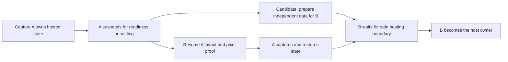

# 07 — Investigate overlapping snapshot work

- Status: outline
- Depends on: [05](05-metal-and-sampling-experiments.md) and [06](06-deliver-sampling-improvements.md), for the accepted sampling baseline and measured costs.
- Shared context: [Overview](README.md), R-07, Q-10, X-02–X-04.
- Request: On 2026-11-17 the user proposed doing useful work for another snapshot while the current snapshot settles, and requested its own planned phase. This selects investigation and planning; it does not establish a safe parallel-capture architecture.

## Intended outcome

Measure whether overlapping work shortens elapsed snapshot execution while preserving exact capture identity, geometry, content readiness, retries, cleanup, and deterministic reporting. A supported negative result is valid. Do not promise savings equal to the recorded sleep duration.

## Starting constraints

The accepted local baseline records 108.067s of settle suspension across the full suite. This interval includes SwiftUI tasks, native commits, fixture progress, and scheduling delay. It is not a measurement of unused CPU time. UIKit layout and rendering remain MainActor work; moving their scheduling does not make them execute in parallel on that actor.

`SnapshotCaptureLock.withHost` currently owns the marked host window, animation state, and safe-area override globals across suspension. Its FIFO makes concurrent callers execute safely in sequence. `ConcurrentCaptureTests` specifically guards different inset overrides and restoration. Other capture paths detach and resize the shared window, retain its scene for native chrome, reparent accessibility subjects, and restore state on every exit. Releasing the lock around `Task.sleep` would violate these ownership rules.

Read the [previous concurrency experiments](../../Shared/SnapshotKitTesting/Guidance/experiments.md) before refinement. Uncontrolled in-process overlap previously caused more than 24 incorrect comparisons; multiple simulators sharing a render server were slower and failed captures. Those results rule out merely enabling parallel tests. They do not measure a new bounded pipeline with explicit ownership.

## Candidate boundaries

1. **Preparation overlap:** prepare one following fixture's independent data while the current capture remains the sole host owner. Preserve lazy construction, per-case model isolation, cancellation, and case-owned readiness hooks. Do not mount the next controller or mutate window, scene, traits, safe areas, or process animation state during preparation. Shared caches and reused worlds need an explicit reentrancy audit.
2. **Completed-image overlap:** compare or process one prior capture's immutable PNG while the next view settles. The existing capture lock is released before reference comparison, but comparison currently runs on the MainActor. Separate work that needs UIKit or test-reporting context from image-data computation before moving it. Preserve panel-level verdicts, reference normalization, ordered issues/attachments, and record-mode semantics. The observed 100.057s comparison phase includes decoding and review diagnostics; its whole duration is not a savings estimate or a proposed background task boundary.
3. **Hosted overlap:** investigate at most two independently owned host slots, with a coordinator serializing each render and every shared-state operation. First prove that both subjects can keep progressing while their window, scene, traits, native chrome, accessibility, and restoration state remain isolated. A second UIWindow alone is not that proof. Keep the existing serial path for unsupported content.

These are alternatives for investigation, not approved public APIs. Preparation and completed-image overlap may be useful even if hosted overlap fails. Keep at most two cases' work in flight initially. Do not alter floors, quiet proof, tolerance, coverage, or fixture content to make an overlap result pass.



This sketch shows the lower-risk preparation candidate. A hosted-overlap design must add explicit ownership and cleanup diagrams before readiness.

```swift
// Proposed bounded preparation; names are sketches, not existing APIs.
async let nextData = prepareIndependentFixture(nextCase)
let current = try await existingSerialCapture(currentCase)
let prepared = try await nextData
try await existingSerialCapture(nextCase, preparedData: prepared)
```

The sketch omits cancellation/error delivery, ordered reporting, completed-image overlap, and how optional preparation is declared. Those are required refinement decisions, not implementation latitude.

## Refinement trigger and required evidence

After plans 05–06 settle the baseline, correlate waits with main-thread CPU and runnable fixture/UI work. Identify preparation that can actually move earlier, rather than counting all sleeps as available capacity. Read the relevant fixture owner contracts and historical concurrency fixes.

Before marking ready, define a bounded prototype, explicit eligible content, two-slot resource budget, cancellation and error paths, deterministic ordering, fairness, and fallback. Decide how timestamps and per-capture traces preserve real wall time under overlap: summed capture durations cannot establish a throughput gain. Supply capture-owned suite/test attribution before interleaving output; the current settling analyzer infers suite labels from serial log order, so unchanged reporting would misattribute concurrent work.

Require independent fresh-host serial/control/later oracles, interleaved trait and inset cases, late updates, cancellation of either slot, failed hooks, retry freshness, scene/animation restoration, accessibility, memory pressure, and no starvation of current-view work. Use `ConcurrentCaptureTests` as a minimum guard, not sufficient proof by itself. Positive local results require complete snapshot coverage and isolated CI comparison, including worker/job wall time and resource peaks. Do not run competing simulator workloads on the local Mac.

## Resume point

Added at the user's request while the sampling experiment is running. The current capture lock and all production concurrency behavior remain unchanged. Refine this outline from the accepted baseline and review its design before executing a prototype. Track the phase through [STU-121](https://linear.app/kve/issue/STU-121).
