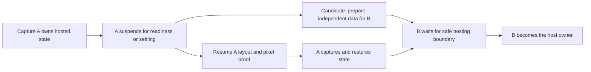
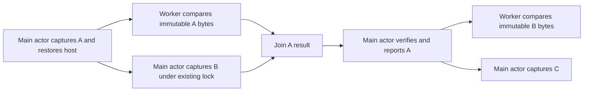
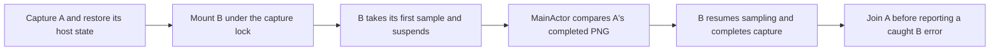

# 07 — Investigate overlapping snapshot work

- Status: complete
- Depends on: [05](05-metal-and-sampling-experiments.md) and [06](06-deliver-sampling-improvements.md), for the accepted sampling baseline and measured costs.
- Shared context: [Overview](README.md), R-07, Q-10, X-02–X-04.
- Request: On 2026-11-17 the user proposed doing useful work for another snapshot while the current snapshot settles, then explicitly requested execution: “Let’s move onto phase 7!” This authorizes the bounded investigation and implementation of a validated result; it does not establish a safe parallel-capture architecture.

## Intended outcome

Measure whether overlapping work shortens elapsed snapshot execution while preserving exact capture identity, geometry, content readiness, retries, cleanup, and deterministic reporting. A supported negative result is valid. Do not promise savings equal to the recorded sleep duration.

## Starting constraints

The accepted local baseline records 108.067s of settle suspension across the full suite. This interval includes SwiftUI tasks, native commits, fixture progress, and scheduling delay. It is not a measurement of unused CPU time. UIKit layout and rendering remain MainActor work; moving their scheduling does not make them execute in parallel on that actor.

`SnapshotCaptureLock.withHost` currently owns the marked host window, animation state, and safe-area override globals across suspension. Its FIFO makes concurrent callers execute safely in sequence. `ConcurrentCaptureTests` specifically guards different inset overrides and restoration. Other capture paths detach and resize the shared window, retain its scene for native chrome, reparent accessibility subjects, and restore state on every exit. Releasing the lock around `Task.sleep` would violate these ownership rules.

Read the [previous concurrency experiments](../../Shared/SnapshotKitTesting/Guidance/experiments.md) before refinement. Uncontrolled in-process overlap previously caused more than 24 incorrect comparisons; multiple simulators sharing a render server were slower and failed captures. Those results rule out merely enabling parallel tests. They do not measure a new bounded pipeline with explicit ownership.

## Candidate boundaries

1. **Preparation overlap:** prepare one following fixture's independent data while the current capture remains the sole host owner. Preserve lazy construction, per-case model isolation, cancellation, and case-owned readiness hooks. Do not mount the next controller or mutate window, scene, traits, safe areas, or process animation state during preparation. Shared caches and reused worlds need an explicit reentrancy audit.
2. **Completed-image overlap:** compare or process one prior capture's immutable PNG while the next view settles. The existing capture lock is released before reference comparison, but comparison currently runs on the MainActor. Separate work that needs UIKit or test-reporting context from image-data computation before moving it. Preserve panel-level verdicts, reference normalization, ordered issues/attachments, and record-mode semantics. The observed 100.057s comparison phase includes decoding and review diagnostics; its whole duration is not a savings estimate or a proposed background task boundary.
3. **Hosted overlap:** investigate at most two independently owned host slots, with a coordinator serializing each render and every shared-state operation. First prove that both subjects can keep progressing while their window, scene, traits, native chrome, accessibility, and restoration state remain isolated. A second UIWindow alone is not that proof. Keep the existing serial path for unsupported content.

These are alternatives for investigation, not approved public APIs. Preparation and completed-image overlap may be useful even if hosted overlap fails. Keep at most two cases' work in flight initially. Do not alter floors, quiet proof, tolerance, coverage, or fixture content to make an overlap result pass.



This sketch shows the lower-risk preparation candidate. A hosted-overlap design must add explicit ownership and cleanup diagrams before readiness.

```swift
// Proposed bounded preparation; names are sketches, not existing APIs.
async let nextData = prepareIndependentFixture(nextCase)
let current = try await existingSerialCapture(currentCase)
let prepared = try await nextData
try await existingSerialCapture(nextCase, preparedData: prepared)
```

The sketch omits cancellation/error delivery, ordered reporting, completed-image overlap, and how optional preparation is declared. Those are required refinement decisions, not implementation latitude.

## Refinement trigger and required evidence

After plans 05–06 settle the baseline, correlate waits with main-thread CPU and runnable fixture/UI work. Identify preparation that can actually move earlier, rather than counting all sleeps as available capacity. Read the relevant fixture owner contracts and historical concurrency fixes.

Before marking ready, define a bounded prototype, explicit eligible content, two-slot resource budget, cancellation and error paths, deterministic ordering, fairness, and fallback. Decide how timestamps and per-capture traces preserve real wall time under overlap: summed capture durations cannot establish a throughput gain. Supply capture-owned suite/test attribution before interleaving output; the current settling analyzer infers suite labels from serial log order, so unchanged reporting would misattribute concurrent work.

Require independent fresh-host serial/control/later oracles, interleaved trait and inset cases, late updates, cancellation of either slot, failed hooks, retry freshness, scene/animation restoration, accessibility, memory pressure, and no starvation of current-view work. Use `ConcurrentCaptureTests` as a minimum guard, not sufficient proof by itself. Positive local results require complete snapshot coverage and isolated CI comparison, including worker/job wall time and resource peaks. Do not run competing simulator workloads on the local Mac.

## Executable refinement — 2026-11-17

The first bounded experiment selects completed-image work within one provider invocation. Current source already returns immutable PNG data after restoring the host. Fixture builders and their mounted tasks remain lazy and serial. Preparation overlap offers no generic independent-data seam; hosted overlap requires redesign of the global-state owners. Audit those alternatives here, but do not combine their architectural changes with this first throughput experiment. A supported negative result completes this bounded experiment; untested alternatives remain explicit follow-ups in STU-121.

### Questions, method, and bounds

1. Decompose the existing comparison phase into review diagnostics and reference verification on the same 110-capture selection used in plan 05. Retain raw, capture-owned events with provider/test identity and monotonic timestamps. This observational run does not establish savings.
2. Prototype one background comparison of immutable image bytes while the main actor captures the next ordinary case. Preserve the FIFO capture lock. Use a structured task group with at most one comparison worker and one current capture. Drain the preceding result before submitting another worker, crossing a cutsheet boundary, or returning from the provider.
3. Only successful comparisons may bypass repeated pixel computation. The background result retains the exact reference bytes it checked; the existing serial `verifySnapshot` still owns file reads, record modes, attachments, and issues. Its strategy reuses success only when both PNG byte sequences still match the checked inputs. A mismatch, missing or malformed reference, changed file, or unsupported subject uses the existing serial comparator. Keep recording modes and cutsheets on the original path initially. Do not transfer UIKit views, controllers, timing objects, or attachments to the worker.
4. The worker constructs images and comparison state locally, uses an explicit scale instead of querying `UIScreen`, and returns Sendable values only. Check cancellation before and after each expensive synchronous operation. A synchronous library comparison may finish before cancellation returns; await it before scope exit. The parent starts no further capture or report after cancellation. Capture errors drain earlier completed work before reporting the later error, and retries retain the existing fresh-controller behavior.
5. Keep only one prior image payload and one current capture alive. Limit worker eligibility to ordinary captures of at most 8 million pixels; larger captures use the serial path. Sample the owned test-host process RSS every 500ms in every timed mode. Reject an unbounded queue, or peak RSS more than 25% or 256MiB above the larger paired control, whichever threshold is reached first. Sampling may miss shorter peaks; retain this limit. No global worker registry, detached task, or concurrency toggle ships from the prototype by default.

The initial pipeline stays inside a single serial test/provider, and its structured scope ends before the next test starts. Existing UUID capture identities still join settle events to timing rows. Unlike cross-test overlap, this does not invalidate the analyzer's current suite attribution. Prototype events also carry their own test identity and absolute monotonic timestamps. If implementation expands to multiple tests, add capture-owned test/suite attribution to the production trace and analyzer first. Measure actual test/process elapsed time; summed capture latency is not throughput under overlap.



```swift
// Proposed bounded structure; reporting and recovery stay on MainActor.
await withTaskGroup(of: PreparedComparison.self) { workers in
    var pending: CapturedAssertion?
    for job in jobs {
        let current = await captureAsResult(job) // sole host owner
        if let pending {
            let prepared = await workers.next()
            finishInOrder(pending, prepared) // verify checked reference bytes again
        }
        guard !Task.isCancelled else { return }
        switch current {
        case let .success(capture):
            pending = capture
            workers.addTask { await prepareComparison(capture.png, capture.reference) }
        case let .failure(error):
            pending = nil
            report(error)
        }
    }
    await finishLastPendingAssertion()
}
```

The implementation must pass only copied Sendable input values to `addTask`, not the actor-owned capture shown for brevity. Unsupported subjects drain first and run serially. Pipeline-owned comparison results and caught capture errors are reported in original case/configuration order. Readiness hooks can directly emit Testing issues before the previous comparison completes; this experiment does not intercept or buffer arbitrary hook issues.

### Main-actor suspension candidate — user refinement

The user clarified that useful work may also run on MainActor while another MainActor task is suspended. Add a second scheduling candidate over the same immutable-image boundary. It keeps the comparison on MainActor and starts it only when the following capture suspends after its first settling sample. This lets the existing quiet interval accrue during useful work, while still requiring the original subsequent pixel matches. A task-local, experiment-only signal identifies that boundary; reaching capture completion also releases the signal so immediate captures and errors cannot deadlock. The comparison retains the original reference/reporting implementation and never changes hosted state. Check old-reference dimensions and the possible difference-canvas area before running it during a wait; oversized or undecodable references fall back to the post-capture join. The single hosted capture and ordered error join remain intact.



```swift
// Proposed coordination; the child remains on MainActor.
async let priorComparison = compareAfterSignal(previousPNG, signal.stream)
let followingCapture = await withSettleSuspensionSignal(signal) {
    captureNextCaseWithExistingLock()
}
signal.finish() // also releases the child when capture skips settling or fails
await priorComparison
handleFollowingCapture(followingCapture)
```

The implementation uses one task-group child rather than an unbounded series of `async let` bindings. Cancellation terminates the signal wait and the group joins the child. A synchronous comparison already in progress has the same non-preemptible behavior as the original comparator.

Compare this candidate with background preparation and the serial control in the same binary. CPU work on MainActor can delay sample delivery, so preserve original floors, proof, timeout behavior, retry counts, and independent later-oracle checks. Do not equate actor suspension with unused time. This experiment directly evaluates cooperative interleaving without creating a second window or moving fixture construction earlier. If accepted, replace any experimental global or task-local control with the smallest explicit scheduling boundary supported by evidence; no broad test parallelism is selected.

### Verification and decision

- Preserve source copies and run manifests in `/private/tmp/stuff-snapshot-overlap`, then retain reviewed evidence in the session artifact directory. Record commands, environment switches, source hashes, simulator/runtime, test identities, image dimensions, retries, worker occupancy, and worker/main-actor execution intervals.
- Use `./test --no-generate --only SnapshotKitTestingTests` for affected framework contracts. Add focused guards for actual overlap, bounded backpressure, cancellation/drain, ordered errors, stale-reference fallback, malformed/missing reference behavior, and successful-versus-failing comparison equivalence. Reuse existing inset/trait, native scene, late-content, hook-error, retry, accessibility, and recording guards. Their serial capture remains unchanged.
- Use the five selected suites from plan 05 with `./test --snapshots --no-generate --record never --review --timings`, preserving the 110 capture identities. After a correctness pilot, run two interleaved serial/candidate pairs in one built binary. Require consistent reductions in actual test elapsed time beyond control variation, unchanged PNG geometry/content, no extra retries, no extra settle failures, and acceptable peak memory. Do not claim that overlapped phase totals are additive savings.
- If timing fails, retain the negative evidence and remove the prototype. If it passes, run an independent delayed fresh-host oracle, the complete 935-capture serial/candidate comparison, and isolated CI validation before accepting a default. No new references, coverage reduction, floor changes, or tolerance changes are allowed. Investigate differences before proceeding.
- Keep serial fallback for unsupported shapes and preserve authoritative record-mode resolution. Before publication, simplify accepted code, run applicable formatting/tool checks, obtain independent review, and publish a separate stack slice above PR #527. A negative result publishes documentation and retained artifact locations only.

### Research and design review

At parent `64e349f14`, `assertSnapshotReference` runs review diagnostics and `verifySnapshot` synchronously on MainActor. Ordinary captures supply PNG Data. Cutsheets first compare per-panel images and compose their canvas; they are excluded from this first pipeline. The pinned SnapshotTesting image comparator can read `UIScreen.main.scale` unless given a scale; its failure path also creates image attachments. Therefore the worker uses an explicit scale, returns only success/fallback and diagnostic values, and keeps authoritative reporting serial.

Apple documents [UIImage creation and use across threads](https://developer.apple.com/documentation/UIKit/UIImage). Swift documents [structured task-group lifetime](https://docs.swift.org/latest/documentation/swift/taskgroup/) and [explicit concurrent execution](https://developer.apple.com/videos/play/wwdc2025/245/). These support immutable image computation, not background UIKit hosting. No hosted UI leaves MainActor.

Root plan review on 2026-11-17 checked source ownership, failure paths, bounded memory, recording semantics, test attribution, and acceptance gates. Dependencies 05–06 are complete. The user authorized execution; no product decision blocks this bounded experiment. The alternatives remain measured/audited separately, and this experiment does not promise hosted overlap. Mermaid syntax is inspected, not renderer-verified. Independent implementation review remains required.

## Local decision and implementation refinement

Six same-binary runs each passed 110 captures, 105 reference assertions, and six test functions with zero retries.
The second block reversed candidate order. Both candidates retained exactly 558,607,431 captured pixels and 114 tiles.

| Run | Serial control | Background comparison | MainActor suspension comparison |
| --- | ---: | ---: | ---: |
| First test phase | 122.853s | 107.182s | 114.559s |
| Second test phase | 121.705s | 108.510s | 115.385s |
| Mean | 122.279s | 107.846s | 114.972s |
| Mean saving | — | 14.433s (11.80%) | 7.307s (5.98%) |

All 83 eligible background comparisons per run matched and ran off MainActor. Each run overlapped more than
14.8s of worker execution with capture. Seventeen ordinary images exceeded the 8-million-pixel limit;
cutsheets also remained serial. Background peak RSS was 1,397.5/1,414.0MiB against controls of
1,432.8/1,394.2MiB. MainActor peaks were 1,409.4/1,434.4MiB. No candidate exceeded the resource gate.
RSS was sampled every 500ms and can miss shorter peaks.

All six logs pass the complete-trace analyzer. Each candidate/control pair preserves capture identities and
geometry, with no normalized channel difference above one unit. The serial delayed oracle adds 500ms
before measurement and final capture in a fresh process. It passes all 110 captures with zero retries.
Three images each contain one pixel with a two-unit channel difference against both background runs;
the same differences occur against both serial controls. No content or geometry regression is attributed
to overlap. Raw image comparisons remain available for independent review.

Select background comparison for the remaining gates. MainActor interleaving demonstrates the user's
suspension idea, but delays sampling and yields less elapsed-time benefit. Remove its task-local signal
and render-loop hook from the adopted source. Preparation and additional hosted slots remain untested follow-ups.

CI normally leaves `record` unset. Broaden the accepted pipeline beyond the experiment's `.never` gate by
forwarding `record ?? environmentRecordMode()` unchanged, including nil. The original verifier still resolves
inherited task-local and suite-trait policies and owns all writes. Exact-byte success reuse cannot bypass
`.all` recording or approve a changed reference. Explicit/environment `.all` avoids unnecessary preflight;
no duplicate policy resolver or upstream private SPI is added. Cutsheets receive the same override.

Freeze capture duration after the successful final retry, before joining earlier comparison work.
Add worker and serial verification time once, excluding queue latency. Label aggregates summed capture work;
use actual test elapsed time for throughput. Guard inherited/default recording, all four record policies,
byte-different perceptual matches, mixed cutsheet boundaries, cancellation without writes, and timing accounting.

### Complete-suite validation

One fresh full-suite pair passes 935 captures and 78 test functions per run, with zero retries.
Both use the same binary, normal unset record override, 4,797,647,739 pixels, and 1,014 tiles.

| Metric | Serial control | Background comparison |
| --- | ---: | ---: |
| Test phase | 851.900s | 810.041s |
| Exact test-body execution | 826.208s | 782.944s |
| Summed capture work | 760.618s | 760.550s |
| Comparison work | 106.589s | 101.742s |
| Settling elapsed | 444.185s | 446.484s |
| Settle passes | 5,814 | 5,813 |
| Sampled test-host peak RSS | 5,307.25MiB | 5,420.30MiB |

The test phase saves **41.859s (4.91%)**; exact test-body execution saves **43.264s (5.24%)**.
`Tools.xcode_results.test_duration` supplies body totals from the retained `.xcresult` trees.
Summed work is effectively unchanged: the benefit comes from overlap, not removing captured content or proof.
Peak RSS rises 113.05MiB (2.13%), below both resource limits. This is one full pair, supported by the repeated focused pairs.

All 935 exported PNGs preserve geometry and capture identity. Thirteen images contain normalized channel differences;
all but one pixel remain within one unit. The single two-unit pixel is in
`Adaptive-Locations-innerPortrait_duoInnerPortrait_dark`. That entire candidate image matches the independent
serial delayed oracle exactly. The control image matches the earlier serial control exactly. Retain this observed
native-render variation; no reference, settling tolerance, floor, or cadence changes are made.

The adopted source passes 173 framework functions, followed by 28 final focused functions after cleanup,
including a real 9-million-pixel matching-reference fallback guard. The final focused run also covers recording
policy, cancellation, cutsheet boundaries, stale-reference rejection, and timing accounting.
`./swiftformat --lint`, `mise exec -- npm run lint`, three report-tool tests, and `git diff --check` pass.
The complete `./test --timings` runs exercise the public report label. Independent code and evidence review
agree on the bounded worker, authoritative verification, exact inputs, counts, timing, and resource calculations.

Experiment flags and the MainActor signal are removed. Renderer, rendering-support, and configured-capture source
match the parent exactly. Prototype and full-cohort source copies remain outside Git for reproduction.

### Isolated CI validation

The fresh parent control at `64e349f14bba3351f115dfc2266dfe3f00b42ff5` and candidate
`689cef15cac7c28451f13a8f74a0999dc7be248d` each pass 935 captures, 78 functions, and 71 suites
with zero snapshot retries. All four nonempty workers pass original-log `--require-complete` staging.
Capture identities, geometry, readiness, test identities, and all 1,818 settling-call policies match.
Both retain 1,193 sampled calls and 625 skipped calls. The fifth intake worker is explicitly empty.

| Metric | Parent control | Background comparison |
| --- | ---: | ---: |
| Worker 0 test phase | 334.815s | 321.875s |
| Worker 1 test phase | 338.998s | 354.057s |
| Worker 2 test phase | 320.641s | 308.733s |
| Worker 3 test phase | 329.205s | 322.701s |
| Summed worker test phases | 1,323.659s | 1,307.366s |
| Longest worker test phase | 338.998s | 354.057s |
| Longest observed worker step span | 462.184s | 484.909s |
| Snapshot job wall time | 464.843s | 484.093s |
| Highest sampled executor memory | 19.486GiB | 19.704GiB |

**This CI pair does not demonstrate an elapsed-time improvement.** Summed test phases fall 16.293s (1.23%),
but the longest test phase rises 15.059s (4.44%) and job wall time rises 19.250s (4.14%).
The candidate's worker 3 also spends 39.836s more in checkout and reference hydration.
These are observations from one isolated pair, not proof that either the implementation or runner variation causes the differences.
Summed capture work and summed worker time do not measure parallel-job throughput.

Actual executor CPU/memory series use 15-second intervals. Their highest memory sample rises
222.75MiB (1.12%); all four workers reach six sampled CPU cores in both runs.
These measure whole executors, not test-host RSS, and can miss shorter peaks.
They do not directly measure render-server contention. The separate local 500ms RSS gate remains the process-memory evidence.
Successful CI retains diagnostic JSONL, JUnit, and available step output; it does not upload PNGs, full logs, or `.xcresult` bundles.
Local strict image comparisons and the delayed oracle own the additional image-fidelity evidence.

All candidate [CircleCI checks](https://app.circleci.com/workflow/1b2ba126-fd61-4605-86f2-75b6d72ca7d3)
and the [GitHub manual gate](https://github.com/kyleve/Stuff/actions/runs/44213751266) pass at `689cef15c`.
The older duplicate GitHub run was cancelled after verifying its identical head and full-gate selection;
its cancelled jobs are not counted as passed checks.
The control is retained as [pipeline 2538](https://app.circleci.com/pipelines/circleci/HfkN3cJ2hk23YfG42g3oS1/E7hn5FALiSX67sknpk9SZu/2538).

Independent raw-evidence review reproduces the local and CI counts, timing, policies, and resource summaries.
Retain the bounded background pipeline for its repeatable local benefit and passing correctness/resource guards.
CI validation is complete, with no CI elapsed-speedup claim. Further CI throughput measurement remains in STU-121.

### CI validation exception

The control's four nonempty snapshot workers pass. Its separate unit job failed
`StoreRemoteChangeSourceTests.historyObserverForwardsExternalAuthorForItsStore()` on the unchanged parent.
The user identified it as a known intermittent failure and explicitly requested that it be ignored.
Exclude this known test from snapshot acceptance; do not change its source or investigate it further here.
Retain the failure in the CI record and assess all other failures normally.

## Evidence and resume point

Local evidence is retained at:
`/Users/kve/.codex/visualizations/2026/11/17/01a1e71b-13f1-7c80-8aee-e46d45c92d5b/snapshot-overlap-results`.
This includes commands and environments, Swift source hashes/copies, `.xcresult` bundles, complete traces,
all PNGs, strict normalized comparisons, test-body extraction, sampled process memory, and CI artifacts.
`prototype/` holds both scheduling candidates; `oracle-source/` holds the independent delayed renderer;
`full-source/` holds the same-binary full cohort; `final-source/` holds the cleaned implementation.
The scratch collection remains `/private/tmp/stuff-snapshot-overlap`.

Plan 07 is complete. Implementation `689cef15c` is published in ready-for-review [PR #528](https://github.com/kyleve/Stuff/pull/528),
after plan commits `c07770cee` and `bbbf78cc6`. Local acceptance, isolated CI validation, and independent review pass
with the explicit CI performance limits above. `/root/watch_settle_ci` completed the delegated CI reconciliation;
`/root/review_snapshot_overlap` independently audited the raw evidence. The final checkpoint changes documentation only;
CI tested runtime revision `689cef15c`, and its compiled source remains unchanged.

`ci-control/` and `ci-candidate/` retain original artifacts, real staging commands, inventories, resource samples,
and recomputed comparisons. The companion `analyze-ci.py`, `analyze-ci-resources.py`, and `compare-ci.py` reproduce the accounting.
No selected execution remains. Preparation overlap, additional hosted slots, CI throughput uncertainty, and other
readiness questions remain in [STU-121](https://linear.app/kve/issue/STU-121). The open implementation PR keeps that issue In Review;
completion does not assert a merge or issue closure.
