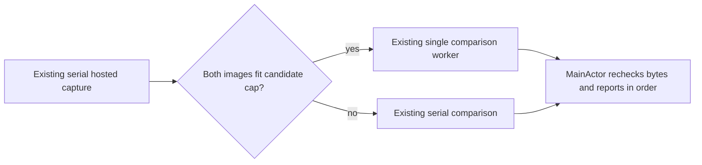

# 08 — Expand bounded reference comparison

- Status: executing
- Depends on: [07](07-overlap-snapshot-work.md).
- Shared context: [Overview](README.md), R-04, R-08, Q-11, X-02–X-04.
- Authorization: The user requested all proposed follow-ups on 2026-11-17.

## Question and intended outcome

Determine whether phase-7 CI timing reflects a repeatable effect, then evaluate a larger bounded image-comparison worker. A supported negative or inconclusive result completes the experiment; it does not justify changing the default.

The local phase-7 run contains 210 captures above 8M pixels and 51.885s of serial comparison work. Of these, 136 captures / 23.752s are at most 12M pixels, 49 / 17.174s are 12–16M, and 25 / 10.959s exceed 16M. These totals include paths outside the provider pipeline, so raising its cap cannot recover all of this work. They are work amounts, not elapsed savings.

## Method and effort bounds

1. Repeat the existing isolated CI comparison in reverse order: candidate `7ccd0383e` (runtime identical to `689cef15c`), then serial control `64e349f14`. Preserve exact source, sharding, environment, identities, geometry, floors, and tolerances. Use the original pair plus this repeat; if worker/test timing remains mixed, permit one final pair in the original order. Maximum: two additional pairs. Do not rebalance shards during measurement.
2. Retain whole-job, per-worker test, wrapper, checkout, reference hydration, and resource measurements separately. Confirm exact capture identities, 78 functions, 935 captures, retry counts, and complete traces. Do not infer contention from coarse CPU samples. Existing exact-revision GitHub gates may supply unchanged helper coverage; no unrelated failure investigation is authorized.
3. For local experiments, preserve a source copy and add temporary process controls for 8M, 12M, and 16M comparison caps. Both captured and reference image dimensions must pass the chosen cap before decode. Keep one worker and one hosted capture; never change the capture lock, issue order, fallback, or record modes.
4. Build once, then use the same binary for interleaved focused runs: 8M / 12M / 16M, followed by 16M / 12M / 8M. Use the prior 110-capture selection with `./test --snapshots --no-generate --record never --review --timings`; preserve images and sample owned-host RSS every 500ms. Validate the temporary image export does not alter capture content or timing attribution.
5. Accept only consistent test/body elapsed savings exceeding control variation, no added retries, unchanged identity/geometry, and no peak RSS increase above the lesser of 25% or 256MiB relative to the larger control. A single focused correctness pilot may reject an unsafe option before both repetitions. If no candidate qualifies, restore the original 8M source and retain negative evidence.
6. A qualifying option needs the existing framework guards, updated resource-bound guard, independent delayed fresh-process oracle, a full 935-capture control/candidate pair, and isolated CI correctness/resource/timing evidence. Keep strict normalized pixel comparisons at one unit per channel; investigate larger differences against control/control and delayed independent output. Existing reference tolerances alone do not establish fidelity.
7. Remove temporary switches/export, keep the smallest supported default, update module evidence, run formatting and applicable checks, obtain independent review, and publish a commit on the follow-up branch. Preserve failures and final-byte revalidation. If CI repeats remain inconclusive, say so explicitly; do not claim a CI improvement.

## Architecture and fallback

The existing pipeline stays intact. Only its eligibility budget changes during this experiment. Oversized captures and references, cutsheets, missing/malformed/changed references, and failed background matches retain the serial authoritative path. Structured cancellation joins the worker before return.



```swift
// Experimental policy only; both dimensions are checked before decoding.
let cap = experimentCap ?? acceptedCap
if capturedPixels <= cap && referencePixels <= cap {
    await existingBoundedPreparation()
} else {
    await existingSerialVerification()
}
```

No new host, queue, fixture preparation, raw-image transfer, or settle scheduling is part of this plan.

## Evidence and recovery

Scratch evidence: `/private/tmp/stuff-snapshot-followups`. Retain final manifests, source hashes, timing summaries, strict image comparisons, and raw logs in the session artifact directory. A failed or interrupted run never counts as a zero-time or complete sample. Restore only owned prototype files from recorded copies, preserving unrelated user work.

Root review on 2026-11-17 at `7ccd0383e` found no blocking decision. The method distinguishes correctness, local elapsed benefit, and CI uncertainty. Its numerical resource gate is inherited from plan 07 rather than expanded to force acceptance. Mermaid is not renderer-verified.

## Progress and resume point

- Source, prior evidence, parent PR feedback, and stack state inspected. PR #528 has no conversation, review, or inline feedback at this checkpoint.
- New tracked stack branch: `perf/snapshot-followup-experiments`.
- Next: dispatch the isolated CI watch, create same-binary local controls, and run the first correctness/timing block.
