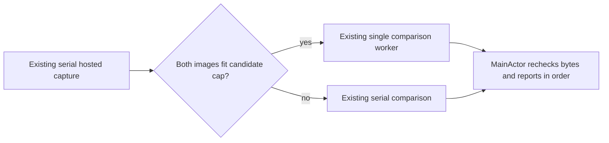

# 08 — Expand bounded reference comparison

- Status: executing
- Depends on: [07](07-overlap-snapshot-work.md).
- Shared context: [Overview](README.md), R-04, R-08, Q-11, X-02–X-04.
- Authorization: The user requested all proposed follow-ups on 2026-11-17.

## Question and intended outcome

Determine whether phase-7 CI timing reflects a repeatable effect, then evaluate a larger bounded image-comparison worker. A supported negative or inconclusive result completes the experiment; it does not justify changing the default.

The local phase-7 run contains 210 captures above 8M pixels and 51.885s of serial comparison work. Of these, 136 captures / 23.752s are at most 12M pixels, 49 / 17.174s are 12–16M, and 25 / 10.959s exceed 16M. These totals include paths outside the provider pipeline, so raising its cap cannot recover all of this work. They are work amounts, not elapsed savings.

## Method and effort bounds

1. Repeat the existing isolated CI comparison in reverse order: candidate `7ccd0383e` (runtime identical to `689cef15c`), then serial control `64e349f14`. Preserve exact source, sharding, environment, identities, geometry, floors, and tolerances. Use the original pair plus this repeat; if worker/test timing remains mixed, permit one final pair in the original order. Maximum: two additional pairs. Do not rebalance shards during measurement.
2. Retain whole-job, per-worker test, wrapper, checkout, reference hydration, and resource measurements separately. Confirm exact capture identities, 78 functions, 935 captures, retry counts, and complete traces. Do not infer contention from coarse CPU samples. Existing exact-revision GitHub gates may supply unchanged helper coverage; no unrelated failure investigation is authorized.
3. For local experiments, preserve a source copy and add temporary process controls for 8M, 12M, and 16M comparison caps. Both captured and reference image dimensions must pass the chosen cap before decode. Keep one worker and one hosted capture; never change the capture lock, issue order, fallback, or record modes.
4. Build once, then use the same binary for interleaved focused runs: 8M / 12M / 16M, followed by 16M / 12M / 8M. Use the prior 110-capture selection with `./test --snapshots --no-generate --record never --review --timings`; preserve images and sample owned-host RSS every 500ms. Validate the temporary image export does not alter capture content or timing attribution.
5. Accept only consistent test/body elapsed savings exceeding control variation, no added retries, unchanged identity/geometry, and no peak RSS increase above the lesser of 25% or 256MiB relative to the larger control. A single focused correctness pilot may reject an unsafe option before both repetitions. If no candidate qualifies, restore the original 8M source and retain negative evidence.
6. A qualifying option needs the existing framework guards, updated resource-bound guard, independent delayed fresh-process oracle, a full 935-capture control/candidate pair, and isolated CI correctness/resource/timing evidence. Keep strict normalized pixel comparisons at one unit per channel; investigate larger differences against control/control and delayed independent output. Existing reference tolerances alone do not establish fidelity.
7. Remove temporary switches/export, keep the smallest supported default, update module evidence, run formatting and applicable checks, obtain independent review, and publish a commit on the follow-up branch. Preserve failures and final-byte revalidation. If CI repeats remain inconclusive, say so explicitly; do not claim a CI improvement.

## Architecture and fallback

The existing pipeline stays intact. Only its eligibility budget changes during this experiment. Oversized captures and references, cutsheets, missing/malformed/changed references, and failed background matches retain the serial authoritative path. Structured cancellation joins the worker before return.



```swift
// Experimental policy only; both dimensions are checked before decoding.
let cap = experimentCap ?? acceptedCap
if capturedPixels <= cap && referencePixels <= cap {
    await existingBoundedPreparation()
} else {
    await existingSerialVerification()
}
```

No new host, queue, fixture preparation, raw-image transfer, or settle scheduling is part of this plan.

## Evidence and recovery

Scratch evidence: `/private/tmp/stuff-snapshot-followups`. Retain final manifests, source hashes, timing summaries, strict image comparisons, and raw logs in the session artifact directory. A failed or interrupted run never counts as a zero-time or complete sample. Restore only owned prototype files from recorded copies, preserving unrelated user work.

Root review on 2026-11-17 at `7ccd0383e` found no blocking decision. The method distinguishes correctness, local elapsed benefit, and CI uncertainty. Its numerical resource gate is inherited from plan 07 rather than expanded to force acceptance. Mermaid is not renderer-verified.

## Progress and resume point

- Source, prior evidence, parent PR feedback, and stack state inspected. PR #528 has no conversation, review, or inline feedback at this checkpoint.
- New tracked stack branch: `perf/snapshot-followup-experiments`.
- Next: dispatch the isolated CI watch, create same-binary local controls, and run the first correctness/timing block.

### First local block

All three runs use the same built source, preserve 110 capture identities / 558,607,431 pixels / 114 tiles, and pass six functions with zero retries. This is preliminary evidence; reversed runs and strict image checks remain pending.

| Cap | Test phase | Test bodies | Sampled host peak |
| --- | ---: | ---: | ---: |
| 8M | 108.111s | 91.797s | 1,416.438MiB |
| 12M | 104.568s | 89.184s | 1,446.000MiB |
| 16M | 106.288s | 91.238s | 1,445.594MiB |

The selection contains 12 ordinary captures between 8M and 12M pixels, four between 12M and 16M, and one above 16M. Their serial control comparisons total 2.936s, 3.212s, and 0.117s respectively. These eligibility counts, not the whole-suite 210-capture count, describe the focused intervention.

Raw controls are `cap8-build-1`, `cap12-1`, and `cap16-1` under the scratch evidence root. The second block runs 16M / 12M / 8M without rebuilding. No default has changed.


Initial independent review at `730152408` plus the two-file cap/export prototype found no introduced correctness defect. It independently reconciled the first five completed runs and confirmed one-worker lifetime, predecode bounds, byte revalidation, and source/geometry identities. The observer sampled nominally every 500ms, with observed same-process gaps up to about 0.72s; peaks remain sampled estimates.

The reviewer noted that temporary PNG export is inside the capture lock/timing. Before adopting a small gain, add one focused same-binary 8M/selected-cap pair with export disabled. This corroboration is additional to the two timing blocks and prevents assuming equal instrumentation is timing-neutral. The prototype exporter must be removed before publication. Full pixel/resource/CI gates remain required for a qualifying candidate.


### Repeated focused decision

The reversed block also passes all 110 captures / six functions with zero retries. Mean test elapsed is 107.324s at 8M, 105.2845s at 12M, and 105.696s at 16M. Mean test-body time is 92.645577s, 89.975039s, and 90.375344s respectively. The 12M cap saves 2.0395s (1.90%) elapsed and 2.670537s (2.88%) in test bodies. Its body savings recur in both blocks (2.612720s and 2.728355s); control body variation is 1.697654s. Maximum sampled host RSS rises 9.921875MiB versus the larger 8M control. Select 12M provisionally as the smaller cap with the lower mean time; do not claim 16M is always slower.

All five strict comparisons preserve identities and geometry. The only pixel above the one-unit threshold is a single two-unit channel variation in `Adaptive-Locations-innerPortrait_duoInnerPortrait_dark.png`. Both 12M whole PNGs are byte-identical to the independently delayed serial oracle from phase 7 and to phase 7's full-suite candidate. Both current controls match the earlier serial controls. The 16M repeats produce one of these same two images. `cap-drift-oracle.json` retains file paths and SHA-256 evidence; this does not replace the fresh delayed/full checks below.

Next: finish the 8M/12M no-export corroboration pair, then run the selected cap's fresh delayed and full-suite checks. No shipping default has changed.


### Export-free corroboration and fresh oracle

The additional no-export pair passes 110 captures / six functions with zero retries. Test-body time falls 92.717447s → 90.763366s (1.954081s); test-phase time falls only 106.174s → 105.839s (0.335s), below observed variation. This supports advancing to full measurement, not claiming a precise export-free end-to-end gain. Independent review recomputes identities, complete traces, source equality, and the omitted exporter environment in both arms.

The fresh serial delayed oracle also passes 110 captures with zero retries and matching geometry. Relative to both 12M runs it has three individual two-unit pixels: the previously identified Adaptive Locations pixel plus one each in Welcome Locations and Welcome Year. Both Welcome differences also occur against both current 8M controls. The new delayed Adaptive Locations PNG matches the current controls, while the earlier independent delayed oracle matches both candidates exactly. These two independent serial delayed outputs establish the same two PNG variants without increased overlap. No larger difference or geometry change is accepted. Four new strict comparison records retain every image delta.

Full 935-capture runs `cap8-full-build` and `cap12-full` are now in progress, in the same source/binary with normal recording-policy resolution. Source is frozen in `cap-oracle-full-source`; experiment delays and serial selection are off in both full runs.

### Full local pair

Both full runs pass 78 functions and 935 captures without retries. Their source hashes, capture identities, 4,797,647,739 pixels, and 1,014 tiles match. Test elapsed falls 808.627s → 791.816s: 16.811s (2.08%). Exact test-body duration falls 780.655129s → 763.375217s: 17.279912s (2.21%). Sampled host RSS rises 5,307.6875MiB → 5,333.453125MiB, an increase of 25.765625MiB, below the existing resource gate.

Settling render work remains essentially unchanged at 322.400s → 322.404s. This supports overlap as the source of elapsed savings; it does not turn work sums into wall time. This is one full pair, supported by the focused repeats above, not a confidence interval or a CI savings claim.

The strict full comparison preserves all dimensions and finds 14 changed images. Twelve stay within one channel unit. Two images each contain one two-unit pixel: the known Adaptive Locations variant and `Index_iPad_tablet-regular-regular.png`. The Adaptive Locations outputs again match the two independent delayed serial variants, with their order reversed in this pair. The site image has eight changed pixels total; its path uses the unchanged one-off HTML assertion, which never consults the provider worker cap. Run a fresh delayed site oracle and 8M site control before closing that investigation. No reference or tolerance changes are permitted.

Raw full comparison: `cap8-full-build-vs-cap12-full-verification.json`; whole-image prior/oracle hashes: `cap-full-drift-oracle.json`. The selected 12M default still awaits this last pixel investigation, the updated oversize framework guard, final-source review, and isolated CI.

### Pixel investigation and clean source

The fresh delayed site oracle and a separate 8M site control each pass 24 captures / one function without retries. The normal control's Index image matches the checked-in reference exactly. The delayed image differs by at most one unit; neither reproduces the candidate's rare two-unit pixel.

The candidate's eight changed pixels lie on the small phone glyph beside the installation instructions. At raster coordinate (179, 2227), RGB changes from (160, 160, 163) to (159, 159, 161), with alpha 255. Geometry and content remain intact on inspection. This is an unreproduced two-unit pixel on an unchanged serial path; renderer/environment variation is inferred. Do not describe this exception as a strict one-unit pass or as oracle reproduction. Independent review accepts this documented investigation under the stated gate; references and tolerances remain unchanged. Raw locations, values, and reference comparisons are in `index-pixel-investigation/`.

Select 12M for final validation. Remove all cap, serial, delay, and PNG-export switches. A real 9M image must now prepare a reusable comparison, while a real 16M image must remain serial. The clean source also inherits the reviewed trace-output repair from [08a](08a-trace-log-framing.md). Focused framework checks and isolated CI remain pending.

The clean source passes 31 focused framework functions at rebased tip `d86e3711` plus the cap diff: `SnapshotImageReferenceTests`, `SnapshotAssertionPipelineTests`, `SnapshotCaptureTimingTests`, and `SnapshotSettleTraceTests`. This covers the real 9M/16M boundary, one-worker overlap, cancellation, recording policies, ordered errors, and timing/wire-format contracts. Generation and whitespace checks pass. Final independent review and CI remain pending.

### Bounded CI repeat conclusion

Four additional pipelines finish at the original frozen revisions. Candidates #2543 and #2546 are clean: each has 935 captures, 78 functions, 1,818 settle calls, identical geometry/policies, and zero retries. Controls #2544 and #2545 both finish 78 functions but fail strict trace transport and recover a DeviceLayoutLab timeout. They remain excluded; no new complete pair exists.

The original paired comparison therefore remains mixed, with no established CI elapsed gain. Candidate maximum test phases are 327.355s and 310.928s, but these are unpaired observations. The last candidate's job wall is 517.366s, including 96.7–109.2s of reference hydration per worker. Fifteen-second whole-executor samples are separate from the local host-RSS gate.

The delegated watcher completed its bounded assignment without further dispatches. Its hash-verified report, raw evidence, and inventories are under `snapshot-followup-results/ci-repeat/` in the session's durable artifact directory. This conclusion does not replace CI validation of the new 12M source.

Final independent review at `d86e3711` plus the clean cap diff finds no blocker for publication. It verifies the real area arguments, 31 passing functions, removal of experiment controls, and all local claims including the explicit HTML pixel inference. Thirteen cap runs, source copies, exported PNGs, exact test JSON, memory samples, and comparisons are retained with SHA-256 hashes under `snapshot-followup-results/cap/`. Publish for the remaining CI gate; plan 08 is not complete yet.


### Final CI decision: retain 8M

The exact clean 12M source, `f509814bb405ef014d9766a29cf03a1caefb8c96`, completes [CircleCI #2554](https://app.circleci.com/pipeline/0efb76ac-3355-4b74-a809-bd8645c67707) and [GitHub CI](https://github.com/kyleve/Stuff/actions/runs/44229297251). All jobs pass, including 2,955 unit functions (two skipped) and the 31 relevant framework guards. Strict trace transport reconciles 935 captures, 78 snapshot functions, and 1,820 settling calls.

Two snapshots recover on attempt 2/3: DeviceLayoutLab `iPhone17-portrait_iPad` times out at 5.082s, and MainTabs `Adaptive-Locations-innerPortrait_duoInnerPortrait_accessibility` at 6.408s. Both fit 12M, but one unpaired run cannot establish causality. The result fails the predeclared no-added-retry gate. Retain 8M and the original real 9M serial-fallback guard; do not extend the experiment with selective retries.

Worker test phases are 300.789 / 335.817 / 368.115 / 364.230s, aggregate work 1,368.951s, and snapshot job wall 476.037s. These unpaired observations include retries and establish no CI savings. The highest 15-second whole-executor memory sample is 20.393GiB; it is separate from local test-host RSS. The hash-verified `snapshot-followup-results/cap-ci/` report preserves raw logs, resources, provenance, and reconciliation.

The bounded experiment therefore closes with promising local evidence but insufficient reliability evidence for adoption. The trace repair remains. PNG processing must be evaluated again at the retained 8M budget; its completed 12M trials are conditional evidence only. Cleanup review, focused checks, and publication of this retained default are the remaining delivery steps.

The restored source passes the same 31 focused framework functions (`cap-retained-tests`, 18.721s test phase). Swift formatting and whitespace checks pass. Independent cleanup review verifies every module Swift file is byte-identical to parent `6d55f21e5`, including the 8M constant and real 9M fallback. The trace writer/collector remain; all prototype controls are absent. All 103 CI evidence hashes and raw capture/call/test counts reconcile. Publish this retained default and continue PNG trials at 8M.
