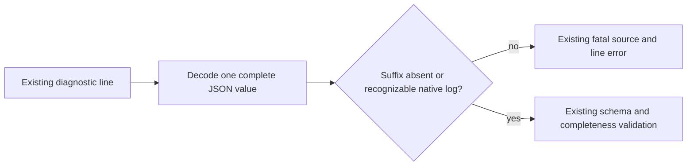

# 08a — Preserve complete traces beside native logs

- Status: executing
- Depends on: [01](01-settle-tracing.md), which owns the collector.
- Shared context: [Overview](README.md), R-01, R-02, R-08.
- Authorization: The requested experiments require reliable trace collection. This repairs a defect found during their execution.

## Result and scope

Submit each diagnostic record and its newline in one write. Read a complete diagnostic JSON record when a concurrent native log follows it before the newline. Keep malformed data, duplicate diagnostics, missing records, and incomplete test runs fatal.

CI pipeline #2544 at control `64e349f14` contains a valid `SNAPSHOT_SETTLE_TRACE` followed immediately by a timestamped `StuffTestHost[pid:thread]` message. All 78 final functions pass, but staging fails with `Extra data`. One DeviceLayoutLab capture also retries after a timeout. Keep this sample outside the complete, retry-free timing cohort even if the repaired collector can analyze its raw logs.

## Design and checks

The existing Python collector reads one JSON value with `JSONDecoder.raw_decode`. Any remainder must begin with the observed native timestamp and process/thread format. Reject arbitrary trailing bytes and any second snapshot diagnostic. Select the earliest marker rather than preferring a later trace over an earlier timing record. Continue existing schema, identity, count, and terminal-success checks.

The final repeat, pipeline #2545, reveals a second transport shape: a native message interrupts a trace inside pass 4, and the rest of the JSON continues on the next line. Do not heuristically repair this record. Change trace and timing emitters to encode the full UTF-8 line, including its newline, and submit it in one `FileHandle.write(contentsOf:)` call. Failure to write is fatal. This removes Swift print's separate buffered writes; it does not guarantee that downstream log transport cannot corrupt a record. Retain strict collector failure and require complete traces from subsequent CI validation.



```swift
// Proposed complete-record submission; downstream validation remains required.
try FileHandle.standardOutput.write(contentsOf: Data((line + "\n").utf8))
```

1. Reproduce the raw CI failure with the published collector.
2. Add the narrow framing helper and command-boundary regression tests. Cover both trace and timing records, unrelated working directories, spaces and Unicode, arbitrary garbage, extra records, and existing truncated/incomplete failures.
3. Run the focused Python suite, relevant lint, and a mutation check that the previous parser rejects the newly supported fixture. Re-analyze the failed artifact separately as diagnostic evidence. Verify mid-record corruption still fails.
4. Update trace/timing emitters to submit complete lines. Run existing framework trace/wire-format guards and retain exact emitted payloads. Do not print synthetic test records into actual capture logs.
5. Obtain independent review. After the active local benchmark and CI repeats finish, commit the fix on the earliest owning stack slice, PR #524, then rebase and publish the stack. Preserve the raw measured source revisions. Require complete timing artifacts from the following candidate CI run.

No capture policy, snapshot reference, tolerance, or CI failure policy changes. If another transport shape appears, fail visibly and retain the raw evidence; do not broaden recovery speculatively.

## Review and progress

2026-11-17, root review at `730152408`: the concrete malformed framing is reproducible from worker 2's retained log. The narrow repair preserves all semantic validation and is independently testable while simulator runs remain untouched. Mermaid is syntax-inspected, not renderer-verified.

The isolated scratch prototype passes nine collector tests, including two new regression functions, and Ruff. Restoring full-line `json.loads` makes the native-suffix fixture fail as expected. Independent review clears the collector and its earliest-marker follow-up. Diagnostic re-analysis recovers all 210 worker-2 captures / 411 calls / 746 passes in #2544, including its recorded timeout; this remains excluded evidence.

Both #2544 and #2545 finish 78 functions but recover the same DeviceLayoutLab timeout on attempt 2/3. Neither belongs in the complete, retry-free timing cohort. The new single-write source prototype remains unbuilt and under independent review.

## Resume point

The repair is committed and pushed as `c6ad51144` on PR #524; all dependent branches rebased cleanly. Ten collector tests, 13 hosted trace/timing functions, the old-parser mutation, generation, scoped Ruff/Swift formatting, and independent completed-diff review pass. The source preserves payload schemas and rejects the second raw mid-record failure. Fresh CI transport validation remains pending with the selected 12M candidate.


## Final transport evidence

CI #2554 at `f509814bb` includes the published repair `c6ad51144`. Strict staging and independent reconciliation succeed for all 935 captures, 78 functions, and 1,820 settling calls, including both timeout attempts. The collector preserves their failure evidence rather than dropping or repairing partial records. All 31 relevant framework guards pass in CI. The complete-line writer remains a mitigation, not a guarantee against downstream corruption; strict transport validation remains required. The larger comparison budget fails its separate reliability gate, which does not invalidate this transport result. Final evidence is hash-verified under `snapshot-followup-results/cap-ci/`.
