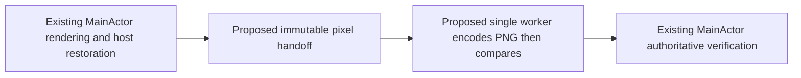

# 09 — Overlap immutable PNG processing

- Status: outline
- Depends on: [08](08-expand-bounded-comparison.md), for the accepted comparison budget and CI evidence.
- Shared context: [Overview](README.md), R-04, R-09, Q-12, X-02–X-04.
- Authorization: The user requested all proposed follow-ups on 2026-11-17.

## Intended outcome and evidence

Determine whether PNG encoding and normalization can leave the serial capture path. The phase-7 full local run spends 28.277s in PNG round trips. This is a target-work measurement, not a savings estimate. A negative or inconclusive measured result is valid.

## Known boundaries

Retain UIKit hosting, hierarchy rendering, safe-area overrides, and restoration on MainActor under the existing lock. Only a completed immutable pixel artifact may leave that boundary. Preserve PNG-normalized reference pixels, scale, metadata, exact reference checks, recording modes, ordered failures, cancellation, one-worker backpressure, and the plan-08 resource gate. Keep cutsheet/public image APIs correct without forcing an unrelated API redesign.

The handoff representation, normalization API, and error result are deliberately undecided. No Swift pseudocode is useful until their ownership and platform contracts are verified.

## Refinement trigger and acceptance

After plan 08 selects or retains its budget, inspect the pinned SDK's image Sendability/threading contracts and actual PNG callers. Define a bounded prototype and meaningful tests for color/alpha/scale, delayed content, cancellation, encoding failure, reporting, and memory lifetime. Compare two interleaved same-binary pairs against the accepted pipeline. A qualifying candidate requires independent delayed captures, full unchanged snapshot coverage, isolated CI, and independent implementation review. Remove rejected prototype code. Never skip normalization or loosen tolerances to make the experiment pass.

## Resume point

Await plan-08 local budget decision; then refine this same file before implementation. CI reconciliation may continue separately if it does not block the local image-ownership design.
