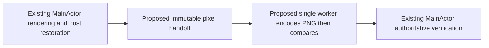

# 09 — Overlap immutable PNG processing

- Status: executing
- Depends on: [07](07-overlap-snapshot-work.md), for the existing one-worker pipeline.
- Integration prerequisite: use the selected or retained plan-[08](08-expand-bounded-comparison.md) budget before the PNG performance trials and adoption. The image-ownership prototype itself uses the already accepted 8M baseline.
- Shared context: [Overview](README.md), R-04, R-09, Q-12, X-02–X-04.
- Authorization: The user requested all proposed follow-ups on 2026-11-17.

## Intended outcome and evidence

Determine whether PNG encoding and normalization can leave the serial capture path. The phase-7 full local run spends 28.277s in PNG round trips. This is a target-work measurement, not a savings estimate. A negative or inconclusive measured result is valid.

## Known boundaries

Retain UIKit hosting, hierarchy rendering, safe-area overrides, and restoration on MainActor under the existing lock. Only a completed immutable pixel artifact may leave that boundary. Preserve PNG-normalized reference pixels, scale, metadata, exact reference checks, recording modes, ordered failures, cancellation, one-worker backpressure, and the plan-08 resource gate. Keep cutsheet/public image APIs correct without forcing an unrelated API redesign.



The executable refinement below selects an immutable `UIImage` handoff, retains the existing PNG APIs, and returns encoded bytes and an ordered success/error result.

## Refinement trigger and acceptance

After plan 08 selects or retains its budget, inspect the pinned SDK's image Sendability/threading contracts and actual PNG callers. Define a bounded prototype and meaningful tests for color/alpha/scale, delayed content, cancellation, encoding failure, reporting, and memory lifetime. Compare two interleaved same-binary pairs against the accepted pipeline. A qualifying candidate requires independent delayed captures, full unchanged snapshot coverage, isolated CI, and independent implementation review. Remove rejected prototype code. Never skip normalization or loosen tolerances to make the experiment pass.

## Resume point

Develop the isolated source prototype from the accepted phase-7 baseline while plan-08 measurements run. Do not modify the active benchmark source or run competing local builds/tests. Apply and test the prototype only after the cap trials finish, using their selected or retained budget.

## Source investigation — 2026-11-17

The Xcode 27.2 UIKit SDK marks `UIImage` `NS_SWIFT_SENDABLE`. Apple's [UIImage documentation](https://developer.apple.com/documentation/uikit/uiimage) describes immutable image objects as safe to create and use across threads. This supports transfer of a finished renderer image, not views, layers, controllers, timing objects, or mutable contexts. Keep the existing `pngData()` plus `UIImage(data:scale:)` normalization rather than changing codecs.

The current `renderSnapshotCaptureLocked` encodes inside the final synchronous autorelease pool. Four internal callers need its normalized result: public image capture, PNG export, cutsheet composition, and configured assertions. The provider pipeline can instead consume a raw-image helper while existing callers retain a normalized wrapper. A configured raw-image helper and normalized facade avoid optional PNG state or partially initialized captures.

Provisional implementation: split raw hierarchy rendering from PNG normalization internally; preserve public APIs and the host lock. Within the existing single worker, encode the immutable image, validate the normalized decode, then prepare reference comparison. Return PNG bytes, separate encoding/comparison durations, and a typed result. MainActor performs authoritative verification and reports errors in capture order. An encoding failure remains a capture error and is never retried as a settling failure. Cancellation joins the worker and prevents later capture/reporting. Oversized captures and explicit recording retain synchronous normalization. Ordinary image scale, cutsheet panel metadata, and original error provenance must survive.

The prototype must measure raw-image lifetime as well as the existing comparison buffers: retaining the unencoded bitmap while the next capture runs adds memory. Keep the prior gate; lower eligibility or reject the candidate if necessary. Do not expand the allowed memory increase.

Required focused guards: same-source eager/background PNG equality for rendered wide-color/alpha/fractional content and multiple scales; encoding failure; worker thread execution; cancellation/drain; bounded overlap; recording policies; ordered earlier encoding errors; and timing that includes worker encoding once while excluding queue delay. Existing capture restoration, retry, cutsheet, and public export guards remain applicable. Two same-binary pairs will compare the accepted plan-08 cap with and without background PNG processing; an accepted candidate needs the delayed, full-suite, CI, and review gates already stated above.

The image-ownership boundary is independent of the numeric comparison cap. The cap is an integration prerequisite for timing/adoption, rather than a prerequisite for writing the isolated prototype.


## Executable procedure

1. Fix the selected plan-08 budget in the experiment manifest. Preserve its passing source as the control. Do not silently combine a different cap with the PNG candidate.
2. Extract an internal raw-render helper and retain the existing normalized facade. Keep all public capture/export return values unchanged. Add an internal raw configured-capture helper for the provider pipeline; existing one-off and panel callers retain their normalized interface. Use named complete values rather than optional PNG state.
3. Keep a temporary same-binary control that performs the existing eager round trip. The candidate hands the finished `UIImage` to one structured worker, which uses the same PNG API and scale-preserving decode before the existing reference preparation. Pass no actor-owned timing or hosted state. Return only immutable bytes, elapsed encoding work, and comparison outcome; errors return through the ordered join.
4. Exclude queue wait from capture work. Freeze raw capture time before waiting for the preceding worker, record encoding and comparison once when their result joins, and retain actual test/body elapsed as the throughput metric. Capture and prepared-image work can overlap; their sum is not wall time.
5. Exercise normalization equality, color/alpha/scale, failed encoding, cancellation, ordered errors, bounded worker count, authoritative recording, and capture restoration through `./test --no-generate --only SnapshotKitTestingTests`. Keep synchronous autorelease pools around rendering and worker encoding/comparison; no pool spans suspension.
6. Run two interleaved 110-capture control/candidate pairs in one binary, reversing the second pair. Export immutable final PNGs identically in both modes, retain exact source hashes and raw timings, and sample test-host RSS at 500ms. Reject regressions in pixels, dimensions, retries, or the unchanged resource gate. Require repeatable test/body elapsed benefit exceeding control variation.
7. A qualifying candidate runs a delayed fresh serial oracle and a full 935-capture pair, followed by isolated CI. Missing references retain authoritative serial verification; encoding failures report the original error. Never manufacture a passing comparison. If no benefit or safety cannot be established, restore the accepted source and retain the measured negative or inconclusive result.
8. Remove experiment switches and image export before final guards, formatting, independent review, commit, and stack publication. Record the tested and published revisions separately, and close Q-12 only after integrating its actual result.

```swift
// Proposed handoff. Real code must keep timing and reporting on MainActor.
let rendered = try await captureConfiguredImageWithExistingLock()
let image = rendered.image // immutable SDK-Sendable UIImage
workers.addTask {
    let png = try normalizeWithExistingPNGAPIs(image)
    let comparison = await prepareExistingReference(png)
    return PreparedImage(png: png, comparison: comparison)
}
// Capture the next case, then join and verify the preceding immutable result.
```

The pseudocode omits the existing single-worker backpressure and ordered error handling, which remain required. Root reviewed this draft against the current four renderer callers and cancellation/reporting tests. The plan-08 budget is still required before timing/adoption; writing the isolated prototype does not select an unmeasured cap.


Independent draft review requires the single-worker permit to span both encoding and comparison; a nested encoder must not release it early. Return only immutable bytes and value results, so raw image/decode intermediates do not escape into completed results. Cover cancellation during encoding separately from comparison. During experiments, export the final PNG at the same completed-result stage in eager and background modes, rather than only on one mode's capture path. These points are integrated requirements before readiness.


### Readiness and execution review

Root review on 2026-11-17 separates the already-complete phase-7 ownership dependency from plan 08's numeric budget decision. The prototype can be authored independently against the accepted 8M constant; its performance runs must use the subsequently selected/retained cap in both arms. This changes execution order only, within the user's authorization for all experiments. No host operations or active benchmark sources may change while those measurements run.

The internal normalized capture facades remain intact. The provider worker may receive either already encoded bytes (experimental eager control) or one finished `UIImage` (candidate). It returns a complete encoded result with separate encoding/comparison timings. The final implementation must remove the experimental choice and keep the smallest representation needed by accepted paths. Cancellation/failure results join in order; `.all`, oversized images, and unsupported paths retain serial processing.

Status advanced through ready to executing after this source/contract review. Scratch source: `/private/tmp/stuff-snapshot-followups/png-prototype-source`. Root owns it; it is not yet applied, built, tested, or selected for adoption. Independent implementation review remains pending.

### Early independent finding

The isolated prototype initially moved configured normalization outside `SnapshotCaptureRetry.capture` without retaining its post-operation cancellation check. Cancellation during synchronous PNG encoding could therefore return a successful one-off capture. The prototype now checks cancellation before and after normalization, and gives cancellation precedence when encoding also fails. A deterministic configured-capture guard cancels inside the injected encoder for both successful and failed encodes. This is a source fix awaiting compilation and runtime evidence; it is not claimed verified yet.

Independent re-review clears this source finding and confirms that both new parameterized cases exercise the actual facade task. Compilation and runtime evidence remain pending; no source has been applied to the active benchmark.
