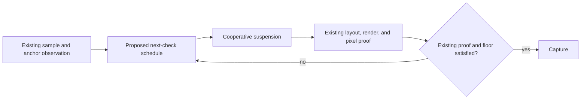

# 10 — Schedule settling samples around decision times

- Status: executing
- Depends on: [07](07-overlap-snapshot-work.md), for the existing settling loop and observer.
- Integration prerequisite: [09](09-overlap-png-processing.md) establishes the accepted pipeline before performance trials. The isolated schedule prototype does not depend on PNG processing or the comparison cap.
- Shared context: [Overview](README.md), R-04, R-10, Q-13, X-02–X-04.
- Authorization: The user requested all proposed follow-ups on 2026-11-17.

## Intended outcome and evidence

Reduce redundant settling renders while retaining trustworthy completion. The phase-7 full local run spends 324.672s rendering settling samples; 1,809 samples have proof satisfied but the minimum duration unmet. These flags are not additive savings and do not prove that unobserved intermediate motion is harmless. The previously tested blanket 60ms interval did not improve elapsed time.

## Known requirements and exclusions

Preserve minimum durations, the fixed normalized anchor, one-unit per-channel tolerance with no area exemption, two matching passes spanning at least 120ms, maximum-duration semantics, cancellation, retry freshness, and the final sampled content. Do not replace pixel proof with a timer or discard changes observed before the floor. Respect MainActor suspension so app tasks can progress.



The conservative candidate below invalidates the quiet proof across an intentionally extended wait. It compares the first resumed sample with the old anchor to retain observed changes, then establishes a new quiet window.

## Refinement trigger and acceptance

After plan 09 fixes the baseline, inspect raw pass traces and the current state machine. Define a bounded schedule with fake-clock/state-machine checks for transient motion, late changes, cumulative fades, missing samples, low cadence, timeouts, starvation, and cancellation. Test real hosted delayed content and native effects against fresh serial and delayed oracles. Use two interleaved focused pairs, then full local/isolated-CI validation for a qualifying candidate. Accept only repeatable elapsed savings, unchanged fidelity, and no extra retries; retain negative evidence and remove rejected schedules.

## Resume point

Author the reviewed floor-wait candidate in scratch while the active benchmark remains frozen. Integrate and run it after plan 09 establishes the performance baseline.


## Trace refinement — 2026-11-17

The full phase-7 trace separates the 1,809 proof-satisfied / floor-unmet samples by minimum duration:

| Minimum | Calls | Calls stable before minimum | Such samples | Render work in those samples |
| --- | ---: | ---: | ---: | ---: |
| 250ms | 1,083 | 700 | 920 | 35.526s |
| 500ms | 39 | 25 | 72 | 4.895s |
| 1s | 40 | 40 | 482 | 22.166s |
| 1.5s | 31 | 31 | 335 | 26.887s |

Only 70 calls have enough remaining minimum time, after first proof, to wait and establish an entirely new 120ms proof plus three estimated sample passes. A conservative reset-after-gap candidate therefore targets mostly raised floors. Ordinary 250ms calls instead offer a possible completion-alignment opportunity: avoid a render that finishes just before the floor and forces another pass. Neither estimate proves that skipping samples is safe or yields elapsed savings.

Potential schedules must bound unobserved gaps, retain the fixed anchor and observed-change flag, sample late changes before accepting, and never extend sleeps past a relevant failure deadline. A predicted render duration can schedule work but cannot establish completion; actual post-render time still owns the verdict. These are requirements for refinement, not a chosen schedule.

## Proposed bounded experiment

Test one conservative schedule first. Only pixel-deciding calls with an already completed quiet proof and a substantially unmet floor qualify. After the current sample, estimate the remaining proof work as 120ms plus three recent pass durations and the ordinary 16ms suspension. If the floor leaves more than this work, suspend until that work should begin, capped at one second and the next applicable failure deadline. Otherwise preserve the 16ms cadence. Quiescence-only mode stays unchanged.

An extended suspension discards the old matching-pass count and anchor timestamp. Keep the old normalized sample until the first resumed observation, so a net change still sets `observedChange`; then start a fresh anchor and require the original two matches over 120ms. A missing resumed sample breaks proof as before. Keep any earlier observed change forever within that settling call. Do not repeatedly extend within the newly started proof. A later extension is possible only after a complete new proof and another sufficiently distant floor.

This deliberately targets the 70 long-floor calls identified above. It does not claim that all 1,809 floor-blocked samples are removable. The alternative of keeping a completed proof through a long gap would offer broader savings, but adds a stale-proof assumption this first candidate avoids.

```swift
// Proposed policy; actual samples and post-render time retain every verdict.
if pixelProofIsComplete, floorHasRoomForFreshProof {
    let delay = min(timeBeforeFreshProof, oneSecond, timeBeforeFailureDeadline)
    if delay > ordinaryDelay {
        pixelStability.requireFreshProofAfterGap()
        try await clock.sleep(for: delay)
    }
}
// Observe against the previous anchor for change detection, then restart proof.
// Never infer stability or meet a deadline from the predicted render cost.
```

The schedule is a pure internal function with explicit elapsed time, minimum, maximum, starvation cap, observed-change state, proof state, and recent pass duration. It must be independently testable without UIKit or a real clock. The actual loop retains cooperative suspension, synchronous sample pools, cancellation handling, and original timeout checks after its fresh observation. Timing records the requested delay accurately.

## Execution and acceptance

1. Once plan 09 establishes its outcome, freeze the accepted pipeline and add a temporary same-binary schedule switch. Implement the pure scheduler and fresh-proof state transition in the existing stability observer. Keep the existing anchor tolerance and all public policies.
2. Cover short/default floors, long floors, no proof, changes, missing/dimension-changing samples, cumulative fades, low cadence, deadline clamping, and past-budget static/starved behavior. A resumed sample can never settle immediately, even when it matches an old proof. A late change after resumption must restart the full quiet window. Preserve cancellation during the longer suspension.
3. Exercise actual hosted delayed updates, including a transient change wholly within a long wait and persistent late content. Both must receive a new complete proof after resumption. Reuse color, single-pixel, timeout, native-effect, restoration, and retry guards through `./test --no-generate --only SnapshotKitTestingTests`.
4. Use two interleaved 110-capture pairs, reverse the second pair, and retain source, PNGs, complete traces, exact test/body elapsed, sample counts, and host RSS. Compare final normalized pixels with the same strict one-unit investigation threshold. Keep all floors, references, and tolerances unchanged.
5. Select the candidate only if elapsed savings repeat beyond control variation, without added retries or resource regression. A qualifying candidate requires a fresh delayed oracle, full 935-capture pair, isolated CI correctness/resource checks, and independent review. Fewer renders alone do not qualify.
6. Remove the experiment switch/export and verify the final source if accepted. Otherwise restore the accepted pipeline and publish the negative or inconclusive result with its limits. Do not broaden the experiment into unchecked stale-proof reuse merely to obtain a gain.

The prototype may conclude negative or inconclusive. Root owns source and local runs; independent review owns correctness and evidence checking. No competing simulator work is permitted. The completed plan-09 baseline remains a prerequisite for integration and performance trials.

## Readiness review

2026-11-17, root review at `730152408`: the accepted settling observer and loop are unchanged by the cap and PNG experiments. Authoring an isolated prototype therefore depends on completed plan 07, while performance integration depends on plan 09. This revision preserves serial measurements and the selected baseline in every timed arm.

The bounded schedule has explicit trigger, proof-reset, observed-change, cancellation, deadline, and rejection rules. It never reduces floors or accepts a pre-gap proof. The original normalized anchor, tolerances, and post-render verdict remain authoritative. The reviewed experiment fits the user's requested scope; no product decision blocks source prototyping. Mermaid is syntax-inspected, not renderer-verified. Status advanced through ready to executing. No tracked runtime source has changed for this phase.

## Source prototype and review

The isolated prototype is in `/private/tmp/stuff-snapshot-followups/sampling-prototype-source`. It changes the existing observer/loop, adds a pure delay policy, and leaves tracked benchmark source untouched. It is not yet compiled or timed.

Independent source review found no incorrect observer or deadline transition, but identified a validation gap: the initial hosted tests could pass without enabling the candidate or resetting proof. The revised tests call an internal explicit-policy overload and observe requested sleeps and actual sample events. A transient changes and returns during a confirmed extended wait. Its first resumed sample must establish a new anchor, followed by two matches spanning 120ms. A persistent update occurs after resumption and must restart proof again. Cancellation waits for an actual extended suspension and permits no later sample. Observations are internal, optional, MainActor-owned, and print no synthetic profile records.

Independent follow-up review confirms that the revised source tests explicitly exercise the candidate and guard proof reset and cancellation. Before acceptance, build these guards and show that removing the loop's proof-reset call makes the hosted regression fail. Runtime and mutation evidence remain pending.
