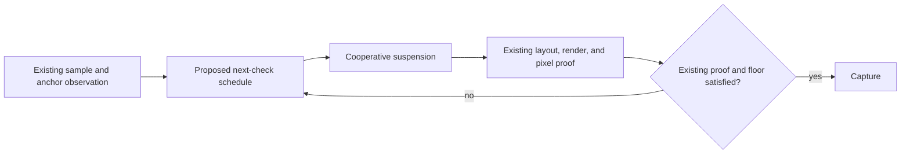

# 10 — Schedule settling samples around decision times

- Status: outline
- Depends on: [09](09-overlap-png-processing.md), for the accepted pipeline baseline.
- Shared context: [Overview](README.md), R-04, R-10, Q-13, X-02–X-04.
- Authorization: The user requested all proposed follow-ups on 2026-11-17.

## Intended outcome and evidence

Reduce redundant settling renders while retaining trustworthy completion. The phase-7 full local run spends 324.672s rendering settling samples; 1,809 samples have proof satisfied but the minimum duration unmet. These flags are not additive savings and do not prove that unobserved intermediate motion is harmless. The previously tested blanket 60ms interval did not improve elapsed time.

## Known requirements and exclusions

Preserve minimum durations, the fixed normalized anchor, one-unit per-channel tolerance with no area exemption, two matching passes spanning at least 120ms, maximum-duration semantics, cancellation, retry freshness, and the final sampled content. Do not replace pixel proof with a timer or discard changes observed before the floor. Respect MainActor suspension so app tasks can progress.

The schedule and whether a skipped interval invalidates the prior proof remain open. Swift pseudocode waits for a falsifiable design; this outline does not permit accepting an old proof without observing late content.

## Refinement trigger and acceptance

After plan 09 fixes the baseline, inspect raw pass traces and the current state machine. Define a bounded schedule with fake-clock/state-machine checks for transient motion, late changes, cumulative fades, missing samples, low cadence, timeouts, starvation, and cancellation. Test real hosted delayed content and native effects against fresh serial and delayed oracles. Use two interleaved focused pairs, then full local/isolated-CI validation for a qualifying candidate. Accept only repeatable elapsed savings, unchanged fidelity, and no extra retries; retain negative evidence and remove rejected schedules.

## Resume point

Refine after plan 09. No arbitrary sleep extension or floor reduction is selected.
