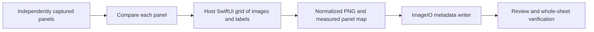

# Measure and reduce comparison sheet overhead

Status: executing. Depends on the [PR 530 baseline](../2026-11-18-snapshot-performance/README.md). Requirements R-01 through R-03 and exclusion X-01 are defined in the [overview](README.md).

All stages already exist. The proposed Swift changes use `settle: .immediate` for the private fixed-content grid and supply `capture.pngData` to the existing ImageIO writer. The shared renderer still mounts and lays out the grid. Its measured panel geometry must validate before verification or recording.

1. Run `./test --no-generate --record never --timings --review --only-file <six owning suites>` on PR 530 and the final candidate on the same simulator. Separate the five sheet-only suites from Calendar's mixed test body. Compare coverage, elapsed time, summed test bodies and real panel counts.
2. Use a temporary hosted probe to time composition, encoding and comparisons. Replay both policies with the same immutable inputs, alternating order. Check the normalized pixels of every complete canvas and its decoded panel map. Compare the current metadata writer and reuse of normalized bytes separately. Keep a proposal only if it saves measured work with identical output. Drop any proposal that fails this criterion. Keep temporary instrumentation out of shipping and test code.
3. Verify with the framework regressions and all six affected image suites. Cover wrapped labels, multiple rows, odd pixel heights, different panel budgets, invalid metadata and recording. Run SwiftFormat and review the final diff before publication. Retain concise results here for future comparisons.
