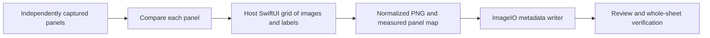

# Measure and reduce comparison sheet overhead

Status: complete. Depends on the [PR 530 baseline](../2026-11-18-snapshot-performance/README.md). Requirements R-01 through R-03 and exclusion X-01 are defined in the [overview](README.md).

All stages already exist. The experiment uses `settle: .immediate` for the private fixed-content grid and supplies `capture.pngData` to ImageIO. It compares the existing metadata writer and ImageIO’s lossless copy. The shared renderer still mounts and lays out the grid. Its measured panel geometry must validate before verification or recording.

1. Run `./test --no-generate --record never --timings --review --only-file <six owning suites>` on PR 530 and the final candidate on the same simulator. Separate the five sheet-only suites from Calendar's mixed test body. Compare coverage, elapsed time, summed test bodies and real panel counts.
2. Use a temporary hosted probe to time composition, encoding and comparisons. Replay both policies with the same immutable inputs, alternating order. Check the normalized pixels of every complete canvas and its decoded panel map. Compare the current metadata writer and reuse of normalized bytes separately. Keep a proposal only if it saves measured work with identical output. Drop any proposal that fails this criterion. Keep temporary instrumentation out of shipping and test code.
3. Verify with the framework regressions and all six affected image suites. Cover wrapped labels, multiple rows, odd pixel heights, different panel budgets, invalid metadata and recording. Run SwiftFormat and review the final diff before publication. Retain concise results here for future comparisons.

## Metadata writer experiment

The pinned ImageIO SDK also offers `CGImageDestinationCopyImageSource` to attach the map while copying compressed image data. A desktop probe of all 57 reference files found that copying the source metadata before changing Description preserved all decoded ImageIO properties. Include this alternative in the iOS replay alongside reuse with the original writer. Check the existing recording and review paths with real panels. A new serialization of the same map can yield a zero-RGB review diagnostic against old files.

## Where the assertion spends its time

A temporary probe around the real assertion path timed each stage once for every sheet, before and after the change, on the iPhone 17 simulator, iOS 27.2. These are summed serial seconds after the last panel capture.

| Stage across all 57 sheets | PR 530 | PR 531 |
| --- | ---: | ---: |
| Compare independent panels against the approved crops | 3.962s | 4.019s |
| Host, lay out, settle and render the grid | 20.524s | 5.206s |
| Encode the sheet and write its metadata | 4.581s | 0.045s |
| Describe differences for `--review` | 7.919s | 7.736s |
| Run the final whole-sheet verification | 5.855s | 4.924s |
| Total | 42.840s | 21.930s |

The five sheet-only test bodies took 78.123s and 58.318s in the two instrumented runs. The same selection took 78.243s and 58.173s with the probes removed. Calendar also runs ordinary captures and owns the other two sheets. The affected selection is `WhereUISnapshotTests` with CalendarContentView, LocationForecastPanel, LocationForecastSummary, PrivacyPassportCard, RegionSummaryCard and RegionWelcomeCard (all suffixed `SnapshotTests`). It executes seven test functions.

## Fixed-input replay

Reused 114 retained panel PNGs at the simulator's display scale, with the labels and identities from each approved map. The same array went through both compositors. Alternating which ran first gave 29 settled-first and 28 immediate-first pairs. The old grid took 20.718s, including 16.085s in its settle. Immediate layout took 4.989s, including 0.164s in that phase. Each grid had the same dimensions, placements and full normalized RGBA, including headings and spacing, across 203,260,860 pixels.

On the settled grids, encoding and metadata writing took 4.280s with PR 530, 2.422s with the original ImageIO writer reading the normalized PNG directly, and 0.041s with the lossless copy. All 57 panel and whole-image verdicts passed for every combination. The review diagnostics had identical RGB counts, maxima and bounds across methods. Twenty-one sheets had zero changed RGB pixels and 36 had accepted differences from the references. Exact encoded bytes can vary with metadata serialization.

The first metadata-only prototype omitted the EXIF ColorSpace tag. Copying the existing source metadata before setting Description preserved it. A second iOS replay of the final writer preserved the source color-space tag and every decoded pixel, panel map and verdict on all 57 sheets. Writing metadata took 4.307s with the old writer and 0.042s with the final copy. Encoded output totaled 90,229,954 and 88,940,279 bytes respectively on these fixed inputs. In two cases one writer reproduced the approved file bytes and the other reported zero RGB differences. Both produced the same image and verdict. The framework regression now checks the captured color-space tag and the decoded whole canvas.

## Normal runner results

Uninstrumented control and candidate ran sequentially on the same worktree simulator with `--no-generate --review --timings --record never` and the six owning suites.

| Measurement | PR 530 | Candidate |
| --- | ---: | ---: |
| Five sheet-only XCTest bodies | 78.243s | 58.173s |
| Time inside their 110 panel captures | 36.848s | 37.093s |
| Time outside those panel captures | 41.395s | 21.080s |
| All seven selected XCTest bodies | 117.438s | 96.756s |
| Runner test phase including process overhead | 130.751s | 107.561s |

The five pure suites saved 20.070s (25.7%). RegionSummaryCard, which owns 28 sheets, fell from 36.134s to 26.762s. Both runs passed 176 captures with zero retries. The ordinary and panel capture traces reported the same 352 settle calls. The grid is profiled separately. The complete selection includes 114 panels and 62 ordinary captures. Capture identities, image dimensions, tile counts, readiness policies and settle outcomes matched the control.

The full `SnapshotKitTestingTests` framework bundle passed 175 tests in 32 suites, including its expected-failure cases. SwiftFormat, agent guidance and diff checks passed. Independent review compared the final code to PR 530, the baseline stage measurements, replay rows and normal runner results. It found no outstanding correctness issue. Both changes are retained. Temporary probes were removed.

## CircleCI

The [PR 530 snapshot job](https://app.circleci.com/workflow/df6d565c-6c0f-450f-a067-ce45ea4fd1f5/job/e2998bf0-229f-4fe0-bb99-367433cb4bab) and the [PR 531 snapshot job](https://app.circleci.com/workflow/3d287a3e-6209-463a-b589-f15dbd3ffcbc/job/00ea1ff5-8169-43b1-8e5f-24074338a7cb) passed on the same shard assignments. JUnit bodies for the five sheet-only suites fell from 98.500s to 74.066s (24.8%). Their panel timings totaled 43.188s and 43.067s. Time outside panel captures fell from 55.312s to 30.999s, a 24.313s reduction.

Both jobs executed 935 capture identities, 78 functions and 71 suites with the same output dimensions and tile counts. All 57 sheets passed. A MainTabs accessibility capture recovered on its second attempt in the candidate. The complete job went from 484.078s to 412.730s. Worker 0 owned zero sheets and ran its test phase 66.702s faster. The slowest worker changed from 0 to 2. The sheet-only suite durations provide the comparison for attributing the change.

All four CircleCI jobs and six [GitHub checks](https://github.com/kyleve/Stuff/actions/runs/44321033088) passed at the implementation revision `c3f2d24c4`. The PR 530 CI sample tested `62984d360`, which has the same runtime as its final plan checkpoint.

## Full local run and delivery

The full `./test --no-generate --snapshots --timings --review --record never` test phase took **734.851s**, compared with **757.995s** on PR 530 (23.144s, 3.05% shorter). The summed XCTest bodies fell from 732.122s to 706.943s. Within those runs, the five sheet-only suites took 78.890s and 58.421s. Both full runs passed the same 78 test functions in 71 suites, 935 capture identities, 1,014 tiles, 4,797,647,739 pixels and 1,818 ordinary or panel settle calls with zero retries.

The two changes are ready for review in [PR 531](https://github.com/kyleve/Stuff/pull/531) at `c3f2d24c4`. All planned verification and publication are complete. The [profiling issue](https://linear.app/kve/issue/STU-123) links to these stage measurements for future work on continuous reports.
