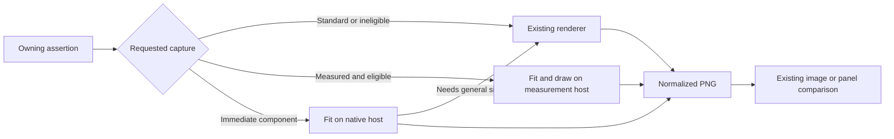

# Adopt and verify single-mount capture

**Complete** in [PR 541](https://github.com/kyleve/Stuff/pull/541). Based on the [prototype trials](https://github.com/kyleve/Stuff/pull/540). Implements [US-01 and R-01 through R-03](README.md#scope-and-evidence).



```swift
await assertSnapshots(of: MyFixture.self, captureMode: .afterMeasurement)
await assertSnapshots(of: MyComponent.self, captureMode: .immediateComponent)
```

1. Add the opt-in assertion modes, preserve the standard default, and test host lifetime, actual route and fallback behavior. Keep retries and cancellation under the existing capture lock.
2. Enroll fixture owners from all three runs. Preserve the known exceptions and references added since the experiment.
3. Run the hosted harness tests and the complete suite with `./test --snapshots --timings --review --record never` on the pinned simulator. Match the executed modes per reference and panel to the prototype. Compare suite time and phase sums with the baseline. Investigate image failures or unexpected selections before publication.
4. Review the resulting diff independently, retain the validation evidence here, and publish the reviewed branch into main.

Acceptance requires a measurable reduction in full-suite runtime, all three cohorts represented, a passing reference comparison for every enrolled fixture, and a documented account of any pre-existing failures. No reference file needs to change.

## Execution

Main at `e19c63f77` passed all 80 snapshot tests on iPhone 17, iOS 27.2. The test phase took 762.848 s. Its 979 timed view and panel captures accounted for 699.0 s, including 347.64 s in final settling. They map to 902 distinct reference files. The suite includes multiple panels per sheet and one repeated comparison against an existing reference.

Independent review identified three cases to preserve: the immediate policy's task yield, full-width scrolling content that can report a stable viewport height, and a safe-area correction after the measured host resizes. The production paths now yield around component sizing and defer scrollers to general capture.

The first production run treated every initial inset correction as a reason to wait. Of the first 38 selected measured captures, 33 spent at least 200 ms in final settling. We stopped this run after 197 images. The revised path settles initial corrections on a live window scene. Detached hosts apply synthetic insets during layout, yield, and recheck them. Both paths settle a subsequent correction. Hosted tests cover each case.

### Result

The full candidate at `259c5f496` passed all 80 tests. The test phase took **646.973 s**, saving **115.875 s (15.2%)** on the same simulator. Final settling fell from 347.64 s to 225.73 s. Both runs had zero capture retries.

| Actual capture mode | References | Native draws | Main | Candidate |
| --- | ---: | ---: | ---: | ---: |
| After measurement | 404 | 410 | 265.24 s | 149.79 s |
| Immediate component | 74 | 74 | 4.31 s | 2.90 s |
| Standard | 424 | 495 | 429.45 s | 429.26 s |
| All | 902 | 979 | 698.99 s | 581.95 s |

Two independent audits matched the timing rows to the owning suite, test, configuration and panel. All 979 matched the intended route and baseline pixel count. The first 92 images contributed 88 selections, the next 200 contributed 147, and the last 585 contributed 243. Each of the 25 newer references used the standard path.

All 20 Banner, 26 widget, and 28 immediate calendar captures reproduced their reference PNG bytes. Of the 404 measured images, 333 matched the decoded reference pixels exactly. Comparing the candidate and control review reports found 40 changed summaries on the measured path. Each reported a maximum difference from its reference of 2/255 or less. Larger reference differences already present in the control had identical review metrics on the measured path. All comparisons passed with the existing thresholds and reference files.

`./test --no-generate --skip-architecture --skip-host-tests SnapshotKitTestingTests --record never` passed all 163 hosted tests. `./test --architecture-only`, SwiftFormat and `./sync-agents --check` passed. The timing comparison is one full local run per revision. CI uses separate workers and shards.
