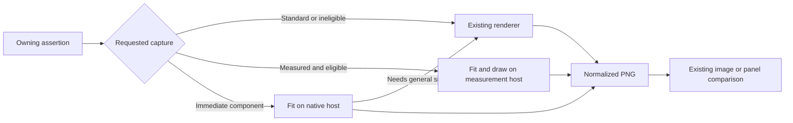

# Adopt and verify single-mount capture

Status: executing. Dependencies: the completed [prototype trials](https://github.com/kyleve/Stuff/pull/540). Implements [US-01 and R-01 through R-03](README.md#scope-and-evidence).



```swift
await assertSnapshots(of: MyFixture.self, captureMode: .afterMeasurement)
await assertSnapshots(of: MyComponent.self, captureMode: .immediateComponent)
```

1. Add the opt-in assertion modes, preserve the standard default, and test host lifetime, actual route and fallback behavior. Keep retries and cancellation under the existing capture lock.
2. Enroll fixture owners from all three runs. Preserve the known exceptions and references added since the experiment.
3. Run the hosted harness tests and the complete suite with `./test --snapshots --timings --review --record never` on the pinned simulator. Match the executed modes per reference and panel to the prototype. Compare suite time and phase sums with the baseline. Investigate image failures or unexpected selections before publication.
4. Review the resulting diff independently, retain the validation evidence here, and publish the reviewed branch into main.

Acceptance requires a measurable reduction in full-suite runtime, all three cohorts represented, a passing reference comparison for every enrolled fixture, and a documented account of any pre-existing failures. No reference file needs to change.

## Execution

Baseline started at `e19c63f77`, using the same simulator and capture flags as the candidate. Resume with the production renderers and fixture enrollment.
